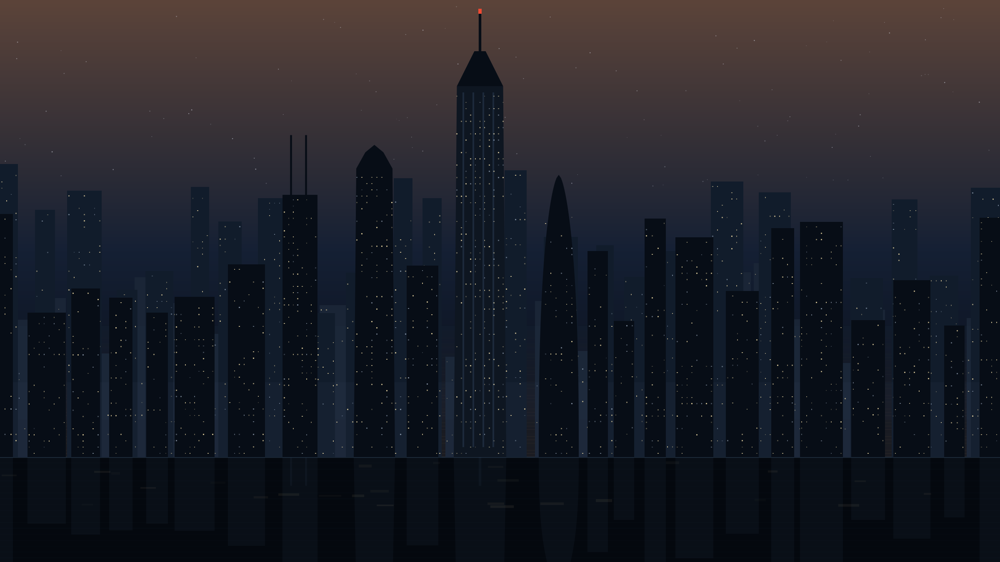

# 深圳的"全妆"，和那个没有名字的 A 市

11 月 18 日到 19 日，亚太经合组织第三十三次领导人非正式会议在深圳举行。这是中国第三次担任 APEC 东道主，前两次是 2001 年的上海、2014 年的北京，中间隔了 12 年。会议周从 11 月 13 日就已经开始。

深圳为这场会"全妆"上阵：灯光、花景、街道，一样一样收拾过去。市民跑去打卡，说这座城市像小说里的 A 市。

A 市是什么？是网文里为了避开真实地名用的代称。它通常被写成一座发达得不需要解释的城市——有最高的楼、最贵的晚宴，但作者不写它的邮编，不写它的台风季，也不写早上八点的地铁。

"像 A 市"这句话，说的其实是那种不带杂质的漂亮：夜里灯一亮，楼群整齐，路面干净。

可深圳真正立得住的地方，恰恰是 A 市没有的那些。平安金融中心 599 米，116 层的观光层在 547.6 米，电梯 55 秒到顶。城中村的握手楼，伸个手能碰到对面阳台。台风过境之后，满地断枝，抢修的队伍排到半夜。

A 市只负责发生故事，不负责运转。深圳两样都得管。

所以"像 A 市"听着是夸，细想有点轻。A 市是个省略号，谁都能往里填；深圳是一页写满的纸，写满了，边上还留着新行。

---

*事实来源：亚太经合组织第三十三次领导人非正式会议于 2026 年 11 月 18 日至 19 日在深圳举行，主题"建设亚太共同体，促进共同繁荣"，系中国继 2001 年上海、2014 年北京之后第三次担任 APEC 东道主，时隔 12 年；2026 年 APEC 领导人会议周为 11 月 13 日至 19 日，据中国外交部发言人 2026-11-13 宣布、新华社 2026-11-14、澎湃新闻 2026-11-16。"全妆"深圳、市民打卡并称"像小说里的 A 市"，据央视网文旅 2026-11-10、合肥晚报 2026-11-14 转述广东台报道，以及广东台《今日关注》相关报道。平安金融中心总高 599 米、地上 118 层、116 层 Free Sky 云际观光层高 547.6 米，据深圳新闻网 2021-02-19；观光层电梯 55 秒从地面到顶，据浙江在线 2026-11-20《深圳的另一面》。"A 市"系网络小说中用于替代真实地名的城市代称、通常指发达的现代都市，据公开问答与网络文学通例。需说明：配图为本文用程序绘制的示意图，不是照片，天际线按福田 CBD 一带四座地标（平安金融中心 599 米、京基 100 约 442 米、中国华润大厦"春笋"约 392.5 米、地王大厦约 384 米）的实际高度比例排布，其余楼群为程式生成的示意形体，不对应具体建筑；"城中村握手楼""台风过境后满地断枝"为对城市日常的描述性表述，未引用具体数据。*

*文中"全妆"指城市为重大会议进行的景观提升与环境布置，是网络与媒体用语，非官方表述；"A 市"不是任何一座真实城市的代号，网文作者使用它，通常是为了让故事不绑定具体地点。*