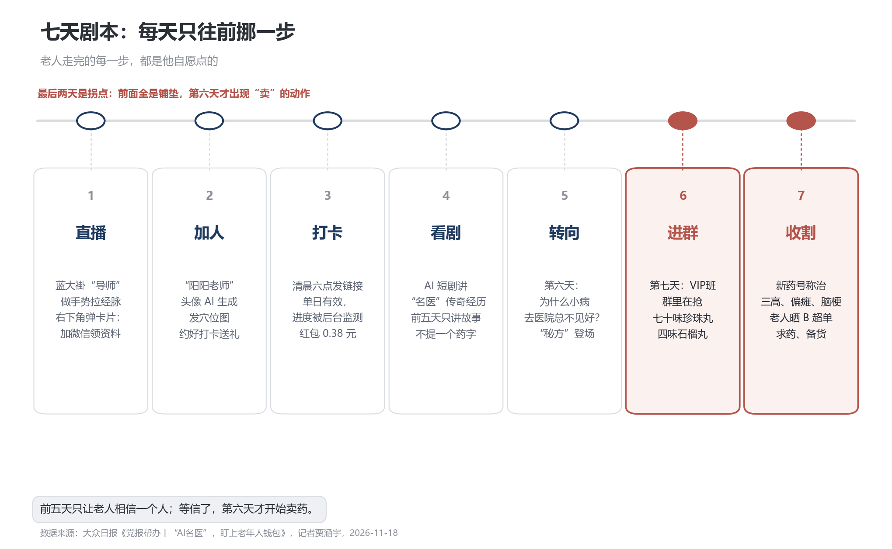
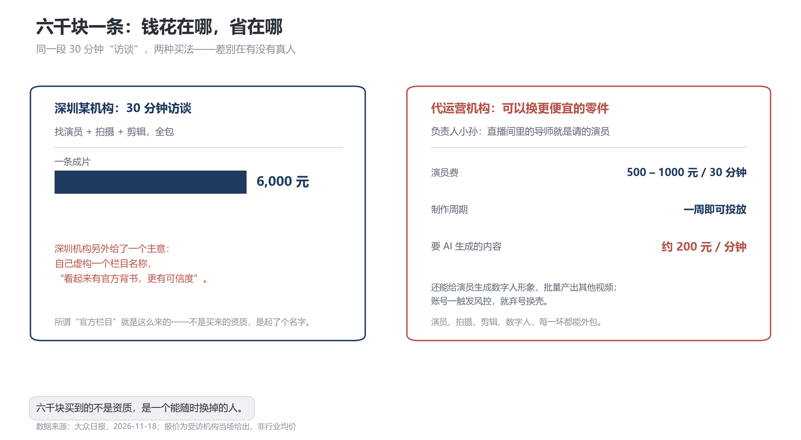
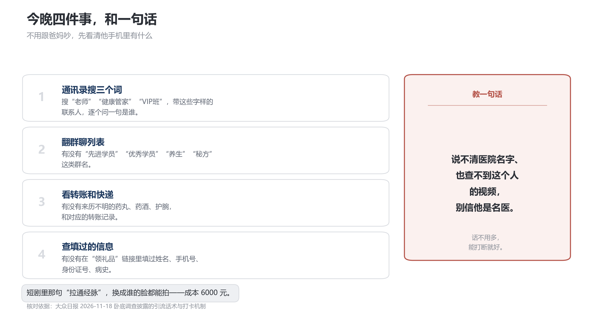

# 你爸手机里那个每天打卡领红包的「阳阳老师」，可能是一条流水线

清晨六点，微信弹来一条链接。看完四十分钟，答对一道选择题，到账 0.38 元。

发链接的是"阳阳老师"，头像是 AI 生成的中年男性肖像。他说连续打卡 14 天送一份藏红花。而到第七天，人已经被拉进一个叫"VIP班"的微信群。

打卡是留住人的，卖药是另一套时钟——两件事同时跑，第七天先到了。那位讲了自己五天求学传奇的"名医"，是 AI 生成的。

11 月 18 日，大众日报记者贾涵宇卧底多个面向老年人的直播间，把这条流水线整条走了一遍。

## 七天，每一步只差一次点击

**直播间**。穿蓝大褂的"导师"站在镜头前，左手食指压住拇指根部，右手往下压左手中指——"做完这个动作，就知道经脉是不是淤堵"。右下角弹出小卡片：加个微信，领学习资料。

**加人**。第二天清晨六点，小鹅通链接发来，有效一天，观看进度被后台实时监测。看完四十分钟、答对选择题，领 0.38 元。

**看短剧**。AI 短剧穿插真人实拍，"画面质感和讲述与纪录片几乎无异"。前五天只讲"名医"经历，不提一个药字。

**第六天**。"为什么小病去了医院总不见好？"话锋一转，七十味珍珠丸、四味石榴丸等"秘方"登场。第七天进"VIP班"，阳阳老师回："药材珍贵，只结缘给有缘人，私信我报名。"

**再往后**。新药号称治三高、偏瘫、脑梗，老人发长文求药，有人直接晒 B 超单。

一个月后，阳阳老师发消息："栏目组安排我去深造了"，让人加他师姐"惠惠老师"，从此不再回复。"阳阳老师"本人，是整条链上第一个被换掉的零件。

## 六千块，是一段视频的价钱

记者换个身份，以保健品销售方名义联系上一家账号代运营机构。负责人小孙开口就说：

> "从直播间把观众引流到私域，现在做大健康保健品的都是这么玩的。"

他还说得直白："直播间里的导师就是请的演员。"还能给演员生成数字人形象批量产出。报价摊在桌上：一段 30 分钟访谈，光演员费 500 到 1000 元，一周即可投放；AI 内容约每分钟 200 元。

另一家深圳机构报得更整：**30 分钟访谈，找演员、拍摄、剪辑全包，6000 元一条。**负责人还附送一个主意：自己虚构一个栏目名称，"看起来有官方背书，更有可信度"。

所谓"官方栏目"，就是这么来的——不是买来的资质，是起了个名字。

这不是孤例。11 月 6 日中央网信办部署"清朗"专项行动，重点之一正是 AI 批量生成健康科普谣言、盗用专家形象带货。

## 它为什么不逼人做决定

因为它在养习惯。每天一次打卡、一个 0.38 元的红包，是持续给的正反馈；群是封闭的，外面的辟谣进不去；短剧接近纪录片，正好对付"眼见为实"。对常年有病、又缺人说话的老人，最狠的不是话术，是"每天有个人在管我"。

## 今晚能做的四件事

一，翻爸妈微信通讯录，搜"老师""健康管家""VIP班"，逐个问一句是谁。

二，看群聊列表，有没有"先进学员""优秀学员""养生""秘方"这类群名。

三，看转账记录和快递，有没有来历不明的药丸、药酒、护腕。

四，查填过的信息：有没有在"领礼品"链接里留过姓名、手机号、身份证号、病史。

最后教爸妈一句话：**说不清医院名字、也查不到这个人的视频，别信他是名医。**

六千块一条视频，一个 AI 生成的脸，十几天打卡。这条流水线最贵的东西不是技术，是老人愿意每天早上六点，点开那条链接。

---

*事实来源：事实主体出自大众日报（大众新闻客户端）2026 年 11 月 18 日 07:05 的卧底调查《党报帮办丨"AI名医"，盯上老年人钱包》，记者贾涵宇，同日《大众日报》07 版刊出。引号内的细节、报价与引语均据该报道：AI 生成"名医"短剧、蓝大褂"导师"、加微信领资料、小鹅通链接单日有效与进度监测、40 分钟视频＋选择题领 0.38 元、连续打卡 14 天送藏红花、前五天讲经历、第六天转向"为什么医院总看不好"并推出七十味珍珠丸与四味石榴丸、第七天进"VIP班"、"药材珍贵，只结缘给有缘人"、新药号称治三高偏瘫脑梗、账号轮换至"惠惠老师"；小孙的"从直播间把观众引流到私域，现在做大健康保健品的都是这么玩的"及演员费 500–1000 元、AI 内容约每分钟 200 元、一周投放；深圳机构 6000 元一条 30 分钟访谈及"虚构栏目名称"的建议。交叉印证：新京报 2026 年 11 月 10 日评论所述央视新闻调查，及中央网信办 11 月 6 日"清朗"专项行动。须说明两处偏差：其一，"6000 元定制官方栏目"的准确含义是一段 30 分钟访谈视频的制作报价（含演员、拍摄、剪辑），"栏目名称"系该机构建议客户自行虚构，并非 6000 元可购得官方资质；其二，14 天打卡送藏红花与"第六天卖药、第七天进群"是两条并行的时间线，非同一周期。"它为什么不逼人做决定"一节为作者判断，非报道原文。*
