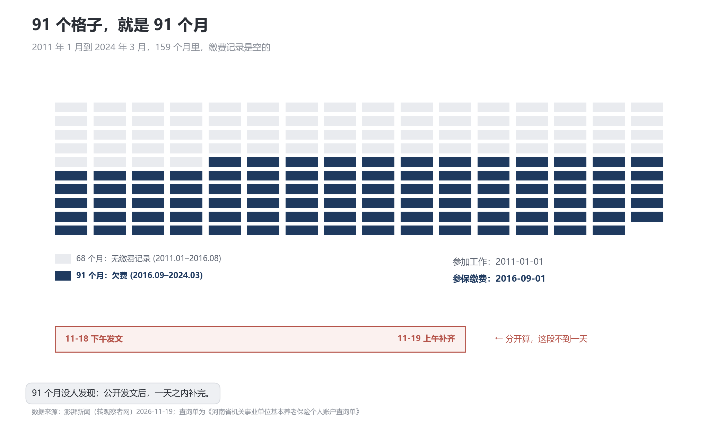
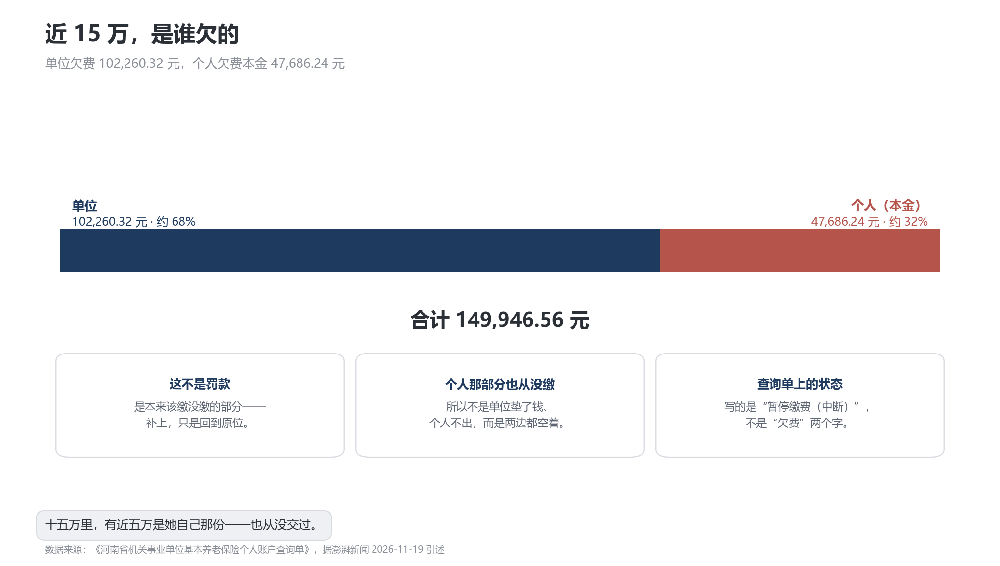
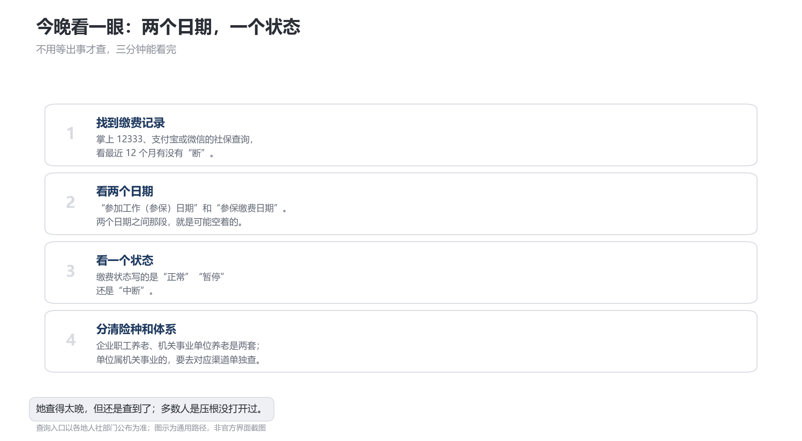

# 91 个月的社保，是怎么在你眼皮底下消失的

芦玉菲，前中国女子体操运动员。2014 年入选国家队，2021 年东京奥运会高低杠决赛第四名。退役后她去查社保，才发现原单位的缴费记录是空的。

从 2016 年 9 月到 2024 年 3 月，91 个月。单位欠费 102,260.32 元，个人欠费本金 47,686.24 元，合计 149,946.56 元。

近 15 万。一个有名有姓、上过奥运决赛的运动员，账户能空这么久。

## 一张单子上的两个日期

她晒出的是一份《河南省机关事业单位基本养老保险个人账户查询单》。上面有两行：

参加工作日期：2011 年 1 月 1 日。

参保缴费日期：2016 年 9 月 1 日。

单子上没有这 68 个月的缴费记录。从 2016 年 9 月起开始"参保"，可状态一栏写的是"暂停缴费（中断）"——名义上参了保，往后又是 91 个月没缴。

两个日期之间的落差，就是"在工作"和"在被缴社保"之间的落差。她 2011 年参加工作，2024 年才发现账是空的——十三年。

91 个月，是七年七个月。

## 近 15 万里，有一份是她自己的

很多人以为这是"单位该交的没交"。不全对。

单位欠 10.2 万，个人那部分 4.7 万，同样从没缴过。

这意味着不是单位替她垫了钱、她不领情，而是两边的账户同时空着。个人部分既然是欠费状态，那笔本该从工资里代扣的钱，也一直没有缴出去——但工资条上看不出这一点。

## 她说了以后，一天就补齐了

11 月 18 日下午发文求助。她那句话问得很直接：退役以后才发现，原单位竟然没给她缴社保和养老保险，"这十年社保和十五年工龄到底该怎么办"。当晚她说，官方已经介入。

11 月 19 日上午，她发声明：欠缴部分已全部缴纳完成。

91 个月没人发现，公开发文后不到一天补完。

她随后补了一句，值得原样引：此事"仅关乎我个人权益，并不代表整个行业群体"，恳请大家理性看待。她的原博文此后在主页上已经看不到了。

这句话很克制，也划出了一条线：她的事解决了，不等于同类的事都解决了。她有名字、有成绩、有公众关注。一个普通职工遇到同样的 91 个月，通常没有这个速度。

## 今晚看一眼

她的问题不在于没维权，而在于发现得太晚。多数人更晚——很多人从来没打开过。

具体是三个地方：缴费记录看最近 12 个月有没有断；单子上把"参加工作（参保）日期"和"参保缴费日期"两个日子对一下，看差多少；缴费状态写的是正常、暂停，还是中断。

还有一条容易漏：企业职工养老和机关事业单位养老是两套系统。你单位属于哪一套，就要去对应渠道查，别在一套里查不到就当没有。

---

*事实来源：本文事实部分出自公开报道。芦玉菲身份与成绩（2000 年 3 月生，河南郑州人，2014 年入选国家体操队，2019 年体操全能世界杯美国站第 6 名，同年亚洲体操锦标赛女团金牌、高低杠金牌、个人全能银牌，2020 年全国体操锦标赛女子自由体操季军，2021 年东京奥运会高低杠决赛第 4 名，后淡出赛场转型裁判）、《河南省机关事业单位基本养老保险个人账户查询单》所载数据（参加工作 2011-01-01；参保缴费 2016-09-01；缴费状态"暂停缴费（中断）"；2016 年 9 月至 2024 年 3 月共 91 个月欠费；单位欠费 102,260.32 元、个人欠费本金 47,686.24 元、合计 149,946.56 元）、其 11 月 19 日声明原文"仅关乎我个人权益，并不代表整个行业群体"及"已于今日上午将欠缴部分全部缴纳完成"、原博文此后在其主页无法查看，据澎湃新闻（转观察者网）2026 年 11 月 19 日《前中国女子体操运动员芦玉菲自曝"退役才发现被单位欠缴 91 个月社保约 15 万元"，最新进展：单位已将欠缴部分全部缴纳》。事件时间线（11 月 18 日下午发文求助、当晚称官方已介入、11 月 19 日上午发布补缴完成声明）据凤凰网体育 2026 年 11 月 19 日《前国家队运动员回应欠缴社保 91 个月：事件发酵后原单位已补缴》。其求助原帖中"这十年社保和十五年工龄到底该怎么办"一句，据 360 体育（转懂球帝）2026 年 11 月 19 日报道引述，为二手引述，未获原帖截图直接核对。经核算，2011 年 1 月至 2024 年 3 月含首含尾共 159 个月，其中 2011 年 1 月至 2016 年 8 月共 68 个月、2016 年 9 月至 2024 年 3 月共 91 个月，与查询单口径一致。**需说明三点：其一，素材中"11 月 20 日舆情热度持续"一项，本文未能独立核实，故未写入正文；其二，报道未说明 2011 年 1 月至 2016 年 8 月这 68 个月为何没有缴费记录，本文仅陈述查询单显示的日期落差，未推断原因；其三，"个人部分欠费说明工资中未代扣"一句系依据查询单状态的推断，报道未直接表述。** 文中关于"发现太晚""普通职工没有这个速度""两套系统要分别查"的讨论为作者判断，非报道表述；各地社保查询入口与机关事业单位养老保险的查询渠道以当地人社部门公布为准。*
