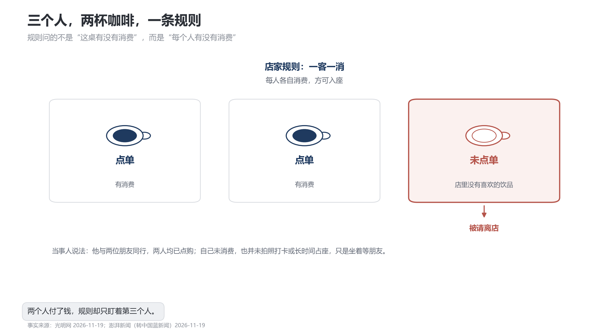
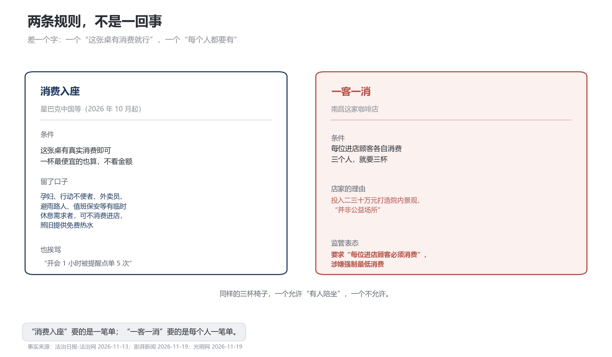
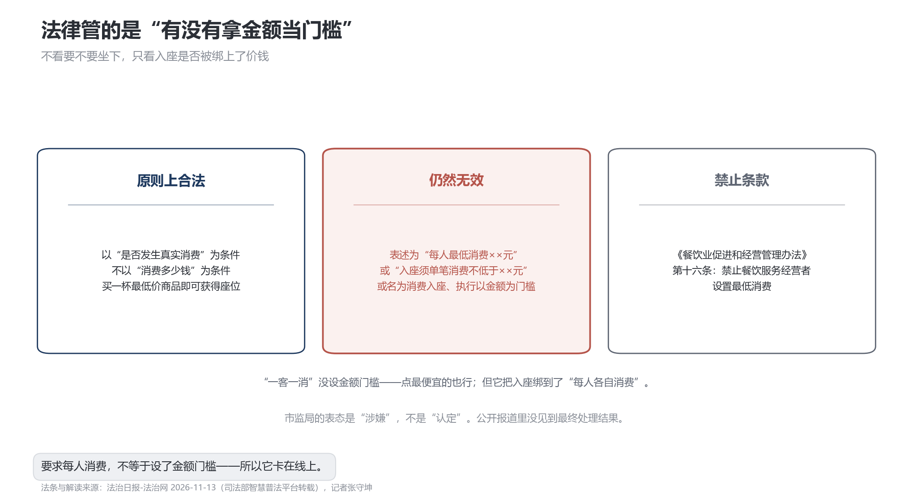

# 两杯咖啡，三个人，一条"一客一消"

三个人进了一家咖啡店。两个人点了咖啡，第三个人没点——店里没有他喜欢的饮品。他坐着等。

店家过来说：一客一消，没点单不能坐。人被请了出去。

这是 11 月中旬发生在南昌的一件事。当事人说，自己没拍照打卡，也没长时间占座。

## 商家的道理，不只是"这是规则"

店方的完整说法有两句：店内确实执行"一客一消"；以及——投入二三十万元打造院内景观，"并非公益场所"。

后半句才是关键。一家独立咖啡店卖的不只是咖啡，还有座位、光线和院子。这些成本按面积算，不按杯数算。一个人坐着不消费，对店主就是一把椅子在空转。

所以"消费入座"这两年扩散得很快：2026 年 10 月 21 日，星巴克中国宣布次日起全国门店实行消费入座。

## 消费者的道理，也不只是"我朋友付了钱"

三个人里有两个消费了。对已经付钱的两人来说，他们买的是一次三个人坐下来的下午。

这就是"陪伴"——陪家人逛街在店门口等，带孩子进餐厅只点一份，朋友聚会有人不喝咖啡。这些场景里，第三个不消费的人不是来蹭空调的，是被同行的人带进来的。

把人请出去，付了钱的两人得到了什么？两个座位，和一个站在门外的朋友。

## 但这两条规则，其实不是一回事

"消费入座"要求的是这张桌子有消费——点一杯最便宜的，就能坐。

"一客一消"要求的是每一位进店的人各自有消费——三个人，就要三杯。

前者留了口子，后者不留。星巴克那条规则也挨骂，但它留了弹性：孕妇、行动不便者、外卖员、避雨路人、值班保安等有临时休息需求的人，可以不消费进店，照旧提供免费热水。

南昌这家没留。

## 监管和法律，已经画了一条线

11 月 19 日，南昌市东湖区市场监督管理局工作人员表态：要求"每位进店顾客必须消费才能入座"，涉嫌强制最低消费，会核实情况并向门店劝导。

界线在哪，《法治日报》11 月 13 日写得很清楚。《餐饮业促进和经营管理办法》第十六条禁止设置最低消费。律师解读：这条禁的是"以消费金额作为提供餐饮服务的前提"，不是禁止经营者安排自己场地的使用。所以"消费入座"原则上合法——它以"是否发生真实消费"为条件，不以金额为条件，买一杯最便宜的就能获得座位。

反过来，如果规则写成"每人最低消费××元"，或者名为消费入座、执行时以金额为门槛，那就仍属设置最低消费，无效。

法律管的不是"要不要坐下"，而是"有没有拿金额当门槛"。

## 那条没被回答的问题

"一客一消"卡在一个位置上：它没设金额门槛，点最便宜的也行；但它把入座绑到了"每人各自消费"上。对那个没有喜欢的饮品的人来说，这等于为一把椅子买一杯不想喝的东西。

市监局的表态是"涉嫌"，不是"认定"；最终结果未见公开下文。

所以真正的问题留给你：

你和朋友进一家店，朋友点了东西，你没点。你觉得自己该被请出去吗？

如果答案是"该"，那"一客一消"只是把一件本来就成立的事写成了牌子。

如果答案是"不该"，那这条规则缺的不是道理，是一个例外——就像星巴克给孕妇和避雨的人留的那扇门。

---

*事实来源：本文事实部分出自公开报道。事件经过（三人同行、两人点购咖啡、第三人因店内没有喜欢的饮品未消费、仅坐等朋友、未拍照打卡或长时间占座、店家仍要求其单独消费并最终要求离店）、店方回应（店内确实执行"一客一消"、投入二三十万元打造院内景观、"并非公益场所"）、南昌市东湖区市场监督管理局工作人员表态（要求"每位进店顾客必须消费才能入座"涉嫌强制最低消费、会核实情况并向门店劝导），据光明网 2026 年 11 月 19 日 17:35《3人同行进咖啡店，2人正常消费，1人因没有喜欢的饮品未点单被劝离；店方称并非公益场所，市监局：涉嫌强制最低消费》。星巴克"消费入座"与"一客一消"的对比、星巴克免消费弹性名单（孕妇、行动不便者、外卖员、避雨路人、值班保安等有临时休息需求者可进店、照旧提供免费热水）、"在星巴克开会 1 小时被提醒点单 5 次"争议，据澎湃新闻（转中国蓝新闻）2026 年 11 月 19 日 22:09 热评《"一客一消"规则引争议 "消费入座"边界在哪？》。星巴克中国 2026 年 10 月 21 日宣布自 10 月 22 日起全国门店实行消费入座并发布《第三空间倡议》、宜家与霸王茶姬及皮爷咖啡部分门店亦有座位规则、《餐饮业促进和经营管理办法》第十六条禁止设置最低消费、律师关于"消费入座以是否发生真实消费为条件、不以金额为条件，原则上合法"与"表述为每人最低消费××元或以金额为门槛则仍属设置最低消费、无效"的解读，据法治日报-法治网 2026 年 11 月 13 日《"消费入座"属商家自主安排还是变相设置最低消费？》，记者张守坤，司法部智慧普法平台转载。**需说明四点：其一，委托素材中的店名"A spoonful·一芍咖啡"，本次未能从任何报道中核实——上述报道均只称"南昌一家咖啡店"，未点名，故本文不写店名；其二，素材称"11 月 20 日舆情信息显示"，本次核到的报道日期为 11 月 19 日，未见 11 月 20 日的具体舆情通报；其三，素材仅记商家回应"这是规则"，实际店方回应更完整，本文已补足其成本理由；其四，市监局的表述是"涉嫌"，非最终认定，且截至检索时未见该事件的最终处理结果公开。** 文中关于"成本按面积算不按杯数算""陪伴需求""付了钱的两人得到了什么""这条规则缺的是一个例外"的论述为作者判断，非报道或监管部门表述；"消费入座"与"一客一消"的效力差异以有权机关认定和司法裁判为准。*