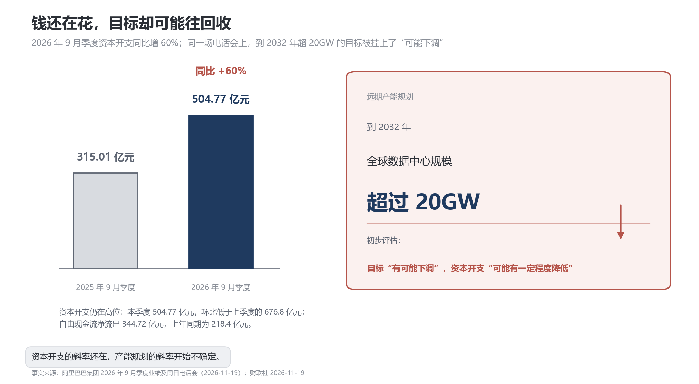
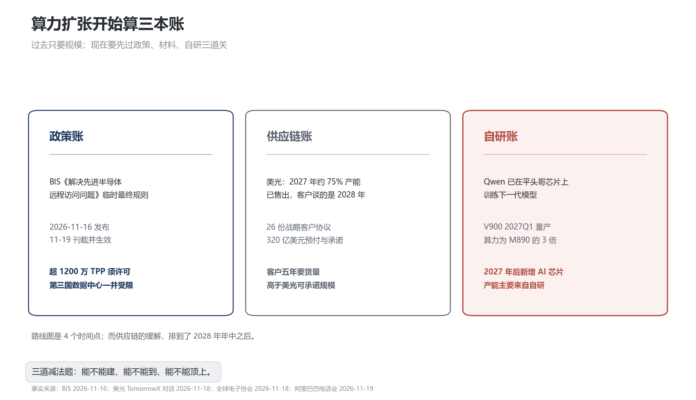
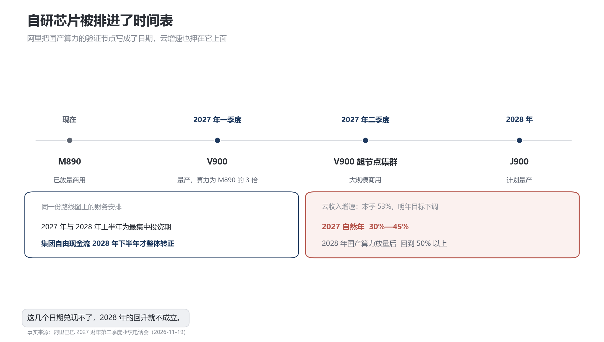

# 阿里可能下调20GW数据中心目标：不是AI需求没了，是算力扩张开始算"政策账"

11月19日，阿里巴巴发布截至9月30日的季度财报。最扎眼的数字是资本开支：504.77亿元，比去年同期的315.01亿元增长60%。

同一天晚上的业绩电话会上，CEO吴泳铭说：全球各个区域的算力政策出现了非常大的变化，将影响阿里云的数据中心建设；初步评估下，到2032年全球数据中心规模超过20GW的目标"有可能下调"，资本开支"可能有一定程度降低"。

钱还在高速往外花，远期目标却可能往回收。这两句的落差才是信息量。

## 政策账：新规管的是"算力被谁用"

这句"政策变化"指向三天前落地的一份美国规则。

11月16日，美国商务部工业与安全局（BIS）发布《解决先进半导体远程访问问题》临时最终规则，11月19日刊于《联邦公报》并当日生效。靶心不是芯片卖到哪里，而是算力被谁用：出口商或数据中心若知悉将向总部设在中国或澳门的企业提供超过1200万"总处理性能"的算力（约合334张B200），就须申请许可——数据中心建在第三国，同样算在内。

这正好落在阿里云最需要增长的那部分资产上：全球32个地域、109个可用区，荷兰、法国、巴西的节点陆续上线。

于是"到2032年超过20GW"第一次被挂上了条件。应对是把节奏调向国内：本季云收入610亿元、同比增长53%，但2027自然年的云增速目标只给到30%—45%，2028年国产算力放量后再指望回到50%以上。

## 供应链账：瓶颈从芯片扩散到材料

只有政策，故事还不完整。同一个月，更上游也在收紧。

11月18日，美光CEO Sanjay Mehrotra在一场公开对话中说，2027年约75%的产能已经售出，客户谈的已经是2028年，2027和2028会比2026更紧。他没停在"缺货"上：已签的26份战略客户协议合计带来320亿美元预付现金与财务承诺，多数五年期、带照付不议条款。谈到客户要的量，他说的是——这些协议未来五年要求的供货量，高于美光能够承诺的规模。

再往上是电路板。同一天全球电子协会发出警报：截至今年9月的一年，PCB订单增56.1%，出货只增13.3%，高多层板交期16至20周以上。症结不在制板产能——亚洲生产全球90%以上电路板——而在玻璃纤维布、树脂、铜箔、覆铜板这些材料本身。一台AI服务器的板子要40到60层以上，一台PC约12层，每加一层都在多消耗上游材料。协会判断：短缺至少持续到2027年上半年，2028年年中之前不太可能实质性缓解。

## 自研账：把替代写进时间表

第三条腿是平头哥。

吴泳铭给出的路线图很具体：M890已放量商用；V900明年一季度量产，算力是M890的三倍，超节点集群明年二季度大规模商用；J900在2028年。更关键的是那句——Qwen已经在平头哥芯片上训练下一代模型。这把自研芯片从"推理侧省钱的选项"挪到了"训练侧可用的路径"。

他还给了两个排序：2027年之后新增的AI芯片产能主要来自自研；2027年和2028年上半年是这一轮最集中的投资期。代价记在现金流上——本季自由现金流净流出344.72亿元，去年同期218.4亿元，集团层面要到2028年下半年才整体转正。

## 落到：是算账，不是消失

需求没有消失。阿里在财报里给出的理由仍是"强劲且不断加速的客户需求"——这也是它敢把资本开支同比再增60%的依据。

变的是算法。过去两年，算力扩张是一道加法题：买卡、建楼、上电，规模越大越安全。现在它变成三道减法题：政策允不允许在这儿建、上游材料能不能按时到、自研芯片能不能顶上。20GW因此从一句承诺，退回成一个待评估的数字。

同一周还有一件事。11月19日，国产存储龙头长鑫科技公告，把回购规模从10亿—20亿元提高到25亿—50亿元，其中新增的15亿—30亿元用于"维护公司价值及股东权益"，回购后注销并减少注册资本。触发条件写得很明确：截至11月6日，公司股价连续20个交易日累计跌幅达20%。

产业端，存储的产能被锁到2028年；资本市场端，这家存储龙头跌到了要"维护公司价值"。公告没写原因。但反差本身说明一件事：紧张不自动等于被重估。

---

*事实来源：阿里巴巴集团2026年9月季度业绩（2026-11-19发布）与同日业绩电话会。20GW目标可能下调、资本开支可能一定程度降低、平头哥芯片路线图（M890已放量商用、V900 2027年一季度量产且算力为M890三倍、V900超节点集群2027年二季度大规模商用、J900 2028年）、Qwen已在平头哥芯片上训练下一代模型、2027年后新增AI芯片产能主要为自研、2027年及2028年上半年为最集中投资期、集团2028年下半年自由现金流整体转正、阿里云在全球32个地域运营109个可用区及荷兰法国巴西节点陆续上线、2027自然年云收入增速目标30%—45%且2028年回到50%以上，据财联社2026年11月19日22:12《吴泳铭：建设超过20GW规模全球数据中心的目标可能下调》（蓝鲸新闻 卢思叶），问答部分以雪球"萨缪尔Samuel"《FY2027Q2 阿里巴巴 财报电话会议》（2026-11-20修订，底本为Motley Fool校订版实录）为辅证。资本开支504.77亿元、2025年同期315.01亿元、同比增长60%、上季度676.8亿元、自由现金流净流出344.72亿元（上年同期218.4亿元）、云收入610亿元同比增长53%，据每日经济新闻2026-11-19《单季超500亿元资金投向AI基建，阿里巴巴资本开支同比增长60%》、第一财经2026-11-19、经济观察网2026-11-19。BIS规则为《解决先进半导体远程访问问题》（Addressing Remote Access to Advanced Semiconductors）临时最终规则，RIN 0694-AK50，2026-11-16发布，2026-11-19刊载于《联邦公报》（91 FR 74970）并自刊载日起生效，60天评论期；1200万"总处理性能"门槛约合334张B200（另有按H200折算约750张的口径），第三国数据中心一并受限，据BIS新闻稿、美国之音2026-11-16、财新网2026-11-17、天元律师事务所与中伦律师事务所2026-11-17至19日解读。美光部分据CEO Sanjay Mehrotra于2026-11-18在TomorrowX Summit（奥斯汀）与Gavin Baker的对话：2027年约75%产能已售出、客户谈判转向2028年、2027与2028比2026更紧、26份战略客户协议合计320亿美元预付现金与财务承诺、多数为五年期且含照付不议条款，原话为"The SCA volume requirements over the course of next 5 years were higher than what we were able to commit to them."；同一表述亦见于美光2026-09-30财季电话会（"More than 75% of our output is already committed for 2027"）。PCB部分据全球电子协会（Global Electronics Association，法律名IPC International Inc.）2026-11-18行业警报及配套报告《PCB Squeeze: A Wake-Up Call for Global Electronics》：截至2026年9月的一年内订单增长56.1%、出货增长13.3%、高多层板交期16—20周或更长、AI服务器板40—60层以上对比PC板约12层、亚洲产量占全球90%以上、东南亚新增PCB厂投资不低于100亿美元且中国近三年投入至少相当、短缺至少持续到2027年上半年且2028年年中前难有实质性缓解、协会称其影响可能与2021年芯片荒相当。长鑫科技部分据其2026-11-19公告（证券代码688825，公告编号2026-023）及澎湃新闻2026-11-19《长鑫科技回购上限拟提至50亿元，最高40亿元股份注销减少注册资本》：回购金额由10亿元至20亿元提高至25亿元至50亿元，调整后分三部分——用于股权激励或员工持股计划不低于5亿元不超过10亿元、用于注销并减少注册资本不低于5亿元不超过10亿元、新增用于维护公司价值及股东权益不低于15亿元不超过30亿元且该部分回购股份在回购完成后注销并减少注册资本；触发情形为截至2026年11月6日收盘40.41元/股、连续20个交易日内收盘价跌幅累计达20%；2026年11月19日收37.5元、涨1.6%；方案尚需股东会审议。**需说明六点：其一，委托素材称长鑫"股份全部注销并减少注册资本"，与公告不符——注销减资对应的是"注销并减少注册资本5亿—10亿元"与"维护公司价值15亿—30亿元"两部分，股权激励或员工持股计划对应的5亿—10亿元股份并不注销，故本文按公告口径改写；其二，素材未载明20GW目标的时间坐标，实际为"到2032年"，本文已补足；其三，素材仅笼统写作"全球算力政策变化"，本文核到其具体所指为BIS 2026-11-16远程访问临时最终规则，但吴泳铭本人未在电话会上点名该规则，二者之间的对应关系为本文据时间线与规则适用范围作出的判断；其四，PCB警报的中文报道多标注11月19日至20日，协会官网原文日期为11月18日，本文以原文为准；其五，美光"75%"为公司自述的自身订单簿口径、非独立审计数据，亦不代表全行业；其六，文中"加法题／减法题""算账阶段""紧张不自动等于被重估"及对长鑫股价与产业景气的并置，为作者判断，非报道或公司表述；长鑫股价下跌的具体原因未见公告或公开信息说明，本文不作归因。*