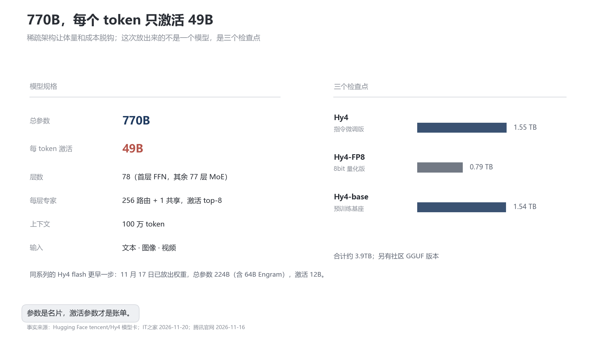
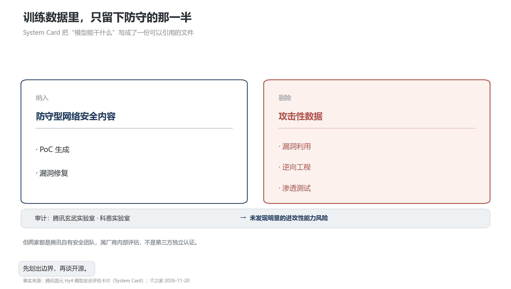
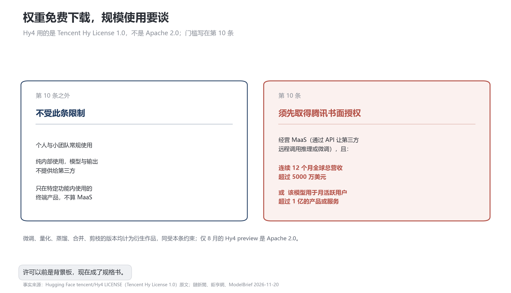

# 腾讯770B大模型全量开源，还附一份安全审计卡：开源不再只拼参数了

11月20日，腾讯混元把Hy4的权重放上了Hugging Face、ModelScope和GitCode。放出来的不是一个模型，是三个：指令微调的Hy4、8位量化的Hy4-FP8、预训练基座Hy4-base，文件加起来约3.9TB。

规格是这样的：总参数770B，每个token只激活49B。78层里第一层是标准FFN，其余77层都是MoE，每层256个路由专家加1个共享专家，每个token激活top-8。上下文100万token，能读文本、图像和视频。同系列的Hy4 flash更早一步，11月17日已放出权重：总参数224B，含64B Engram参数，激活12B，同样支持多模态和100万上下文。

11月4日API首发时，"开源权重"和"发布系统卡片"是并列的两句预告。16天后一起兑现。至此，混元LLM系列——Hy3 preview、Hy3、Hy4 preview、Hy4、Hy4 flash——全部开源。

## 参数不是这次的差异点

770B确实大。但参数这条赛道早就挤满了，千亿规模在开源模型里不再是新闻。

这次真正值得看的，是随权重一起发的两样附件：一份模型安全评估卡片（System Card），和一份不是Apache 2.0的许可证。

## 安全卡：把"能干什么"写成文件

System Card里有一段关于训练数据的说明，写法很具体：网络安全部分只纳入PoC生成、漏洞修复这类防守性内容，漏洞利用、逆向工程、渗透测试等攻击性数据一律剔除。腾讯玄武实验室和科恩实验室对模型做了审计，结论是没有发现明显的进攻性能力风险。

这段说明的价值不在结论，而在它被写下来了。在此之前，一家企业要把开源模型接进生产环境，安全团队问的第一个问题往往是"它会不会照着日志帮我写攻击代码"——厂商不回答，用户只能自己测，或者干脆不用。现在有了一份可以引用、可以放进合规材料的东西。这在国产开源模型的发布节奏里还不算常见。

但成色要说清楚：玄武和科恩都是腾讯自己的安全团队，这是厂商自证加内部红队，不是第三方认证；同一份材料里的模型卡基准表也只有6行，测的还是基座版，全部为腾讯自报。"可审计"目前的意思是"有据可查、可以比对"，不是"已被外部验证"。

## 许可：可商用，但有一道门

Hy4用的不是Apache 2.0。LICENSE第一段就写明"本许可不是Apache License 2.0"。它叫Tencent Hy License 1.0，源自Apache 2.0，前9条基本照搬，差别在第10条。

如果你经营模型即服务（MaaS），通过API让第三方远程调用推理或微调，并且连续12个月全球总营收超过5000万美元，或该模型将用于月活超过1亿的产品——需要先单独取得腾讯的书面授权。纯内部使用豁免；微调、量化、蒸馏、合并、剪枝的版本都算衍生作品，同受约束。换句话说，权重免费下载，规模上使用要谈。

这条门槛放在"开源竞争转向可商用"的语境里，反而更说明问题：许可以前是发布会的背景板，现在成了规格书的一部分。企业选型时除了看跑分，还得先确认自己属不属于第10条框住的那类公司。

## 落到：两张附件决定敢不敢上生产

参数会继续涨。770B今天是头条，明年可能是标配。

但决定一家企业敢不敢把模型放进生产环境的，往往不是跑分高了两分，而是两件更枯燥的事：出问题的时候，有没有一份写清能力边界的文件可以引用；规模做大之后，许可会不会突然变成一道法务流程。

Hy4这次把两样都摆出来了——一份System Card，和一条写明了数字的授权门槛。前者让"安全"从口头承诺变成可引用的文本，后者让"可商用"从一句宣传变成需要读原文的条款。

开源竞争的下一段，大概不在参数表上。

---

*事实来源：Hy4 于 2026-11-20 开源权重，Hy4、Hy4-FP8、Hy4-base 三个检查点分别约 1.55TB、0.79TB、1.54TB（合计约 3.9TB），上架 Hugging Face、ModelScope、GitCode；总参数 770B、每 token 激活 49B、78 层（首层标准 FFN，其余 77 层为 MoE，每层 256 路由专家加 1 共享专家，激活 top-8）、主干外置 DFly2 草稿模型 3.3B、上下文 100 万 token、支持文本图像视频理解，据 Hugging Face `tencent/Hy4` README_CN 与腾讯混元 Hy4 专题页；Hy4 于 2026-11-04 API 首发时即预告"将于近期开源模型权重，发布模型系统卡片"，据腾讯官网 2026-11-04《腾讯混元发布 Hy4，跻身最强开源模型之列》；混元 LLM 系列（Hy3 preview、Hy3、Hy4 preview、Hy4、Hy4 flash）完成全量开源、四平台同步上线、Hy4 与 Hy4 flash 的 System Card 同步发布，据 IT之家 2026-11-20 11:47《腾讯 Hy4 正式开源，混元 LLM 系列实现全量开放》（作者 问舟）。Hy4 flash 总参数 224B（含 64B Engram 参数）、激活 12B、支持多模态与 100 万上下文、每百万 token 输入 0.5 元输出 2 元且缓存命中 0.02 元，据腾讯官网 2026-11-16 与科技日报 2026-11-16（记者 罗云鹏）；其权重先行放出时间据 ModelBrief 与 HIMIAO 视界报道为 2026-11-17。System Card 披露网络安全与生物安全等维度评估，训练数据仅纳入 PoC 生成、漏洞修复等防守性网络安全内容，剔除漏洞利用、逆向工程与渗透等攻击性数据，腾讯玄武与科恩实验室审计未发现明显的进攻性能力风险，据 IT之家 2026-11-20 及腾讯混元模型安全评估卡片（hy.tencent.ai/Hy4_system_card.pdf）。许可证为 Tencent Hy License 1.0，LICENSE 首段载明"This License is not the Apache License, Version 2.0"、其派生自 Apache 2.0，第 10 条对 MaaS 运营者设置门槛：连续 12 个月全球总营收超过 5000 万美元，或该模型用于月活跃用户超过 1 亿的产品或服务，须另行取得腾讯书面授权；纯内部使用豁免，微调、量化、蒸馏、合并、剪枝版本计为衍生作品，据 Hugging Face `tencent/Hy4` 与 `tencent/Hy4-flash` 的 LICENSE 原文，及鏈新聞 ABMedia 2026-11-20、鉅亨網 2026-11-20、ModelBrief 2026-11-20、Daily Inference 2026-11-20 等报道。模型卡基准表仅 6 行（MMLU 91.6、MMLU-Pro 73.9、SuperGPQA 62.7、SimpleQA 57.2、U-MATH 71.6、MBPP-plus 74.0），测的是 Hy4 Base 基座版、few-shot 且为腾讯自报，据 Hugging Face 模型卡与 ModelBrief 2026-11-20。**需说明四点：其一，委托素材称"两者均为 Apache 2.0，商用与修改不设限"，与 LICENSE 原文及多家报道不符——Hy4 与 Hy4 flash 用的均为 Tencent Hy License 1.0，只有 8 月 28 日的 Hy4 preview 是 Apache 2.0；本文按原文改写，"可商用"表述为"分层可商用"，并在正文与图 3 中呈现第 10 条门槛。其二，素材称 Hy4 flash 于 11 月 20 日"同批开放"，实际其权重在 11 月 17 日已先行放出，11 月 20 日开源的是 Hy4 的三个检查点；IT之家原文"与旗舰版 Hy4 同步开放的还有 Hy4 flash"系指同一轮发布周期的报道口径。其三，IT之家 2026-11-20 一文称"Hy4 及 Hy4 preview 采用 Apache 2.0 许可证"，与 LICENSE 原文冲突，本文不采纳该表述。其四，玄武实验室与科恩实验室均为腾讯自有安全团队，其审计属厂商内部评估而非第三方独立认证，正文已就此说明；文中"许可以前是发布会的背景板，现在成了规格书的一部分""开源竞争的下一段大概不在参数表上"及对企业选型逻辑的论述，为作者判断，非腾讯或任何机构的表述。*