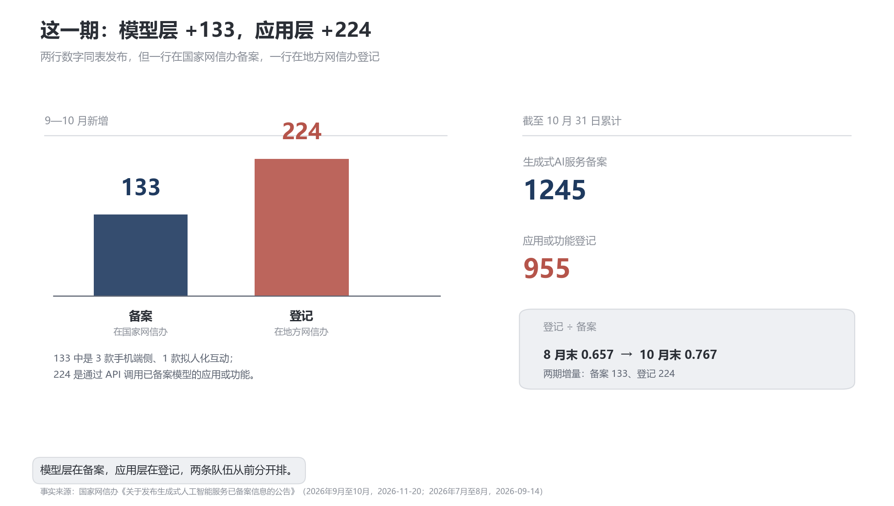
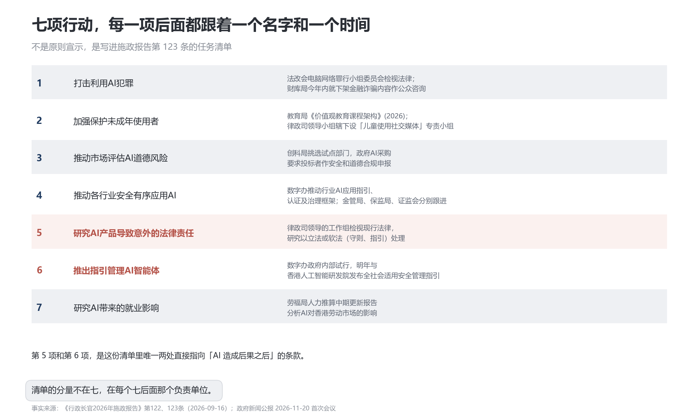
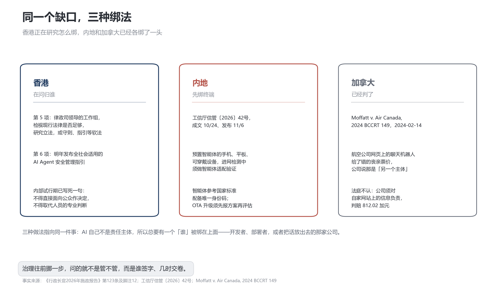

# 香港给AI定七项行动，网信办备案再增133款：AI治理开始"认领任务、定期交卷"

11月20日一天之内，内地和香港各发了一条消息。

下午5点，国家网信办发布《关于发布生成式人工智能服务已备案信息的公告（2026年9月至10月）》：新增133款生成式人工智能服务完成备案，其中3款提供手机端侧服务、1款提供拟人化互动服务；通过API等方式直接调用已备案模型能力的应用或功能，由地方网信办登记，新增224款。截至10月31日，累计1245款完成备案、955款完成登记。

同一天下午1点13分，香港特区政府发布新闻公报：政务司司长陈国基召开"人工智能风险管治统筹工作组"首次会议，检视及统筹AI风险治理策略七项具体行动的工作计划和落实方案——打击利用AI犯罪，加强保护未成年使用者，推动市场评估AI道德风险，推动各行业安全有序应用AI，研究AI产品导致意外的法律责任，推出指引管理AI智能体，研究AI带来的就业影响。

两条消息讲的是同一件事：治理的颗粒度变了。

## 谁在备案，谁在登记

133和224不是同一个动作。备案的是"服务"，在国家网信办；登记的是"应用或功能"，在地方网信办。上一期公告（7月至8月）是新增备案124款、新增登记133款，累计1112款和731款——两期累计相减，正好是133和224。

登记数除以备案数，8月末是0.657，10月末是0.767。长在别人模型上的应用，比模型本身长得快。

依据写在2023年《生成式人工智能服务管理暂行办法》第十七条：提供具有舆论属性或者社会动员能力的服务，应开展安全评估并履行算法备案手续。备案管的是"能不能对外提供服务"，登记管的是"你这个功能用的是谁的模型"。

手机端侧这条线今年才单独拆出来。7月15日网信办首次专门公告"7款提供手机端侧服务"完成备案，含"Apple智能""华为小艺AI大模型""vivo蓝心端侧大模型"。9至10月这一期，端侧只增3款。

## 香港那份清单，后面跟着名字

政府公报的说法是"检视及统筹……工作计划和落实方案"，并写明"工作组会按工作进度定期召开会议，检视及督导政策局及部门落实各项措施的进度"。

每一项由谁做、什么时候做，写在9月16日公布的《行政长官2026年施政报告》第123条里。

第5项，AI产品导致意外的法律责任：由律政司领导的工作组"检视现行法律是否足够，并研究以立法或规例（包括实务守则／行为守则、指引等软法）处理"。这话10月8日就在立法会说过，律政司司长林定国的原话是："AI犯错，谁来负责？……律政司将会牵头成立专责小组，尽快研究运用AI产品造成损害的法律责任问题。"

第6项，AI智能体：数字办正在政府内部试行，已在部门应用指南加入规范，计划明年与香港人工智能研发院发布全社会适用的AI Agent安全管理指引。那份内部规范里已经写死一句——AI Agent"只宜用于标准化、重复性的内部政务，不得直接面向公众作决定，亦不得取代人员的专业判断"，高风险动作须维持人为监督。

第7项，就业影响：劳工及福利局即将公布的人力推算中期更新报告会分析AI对香港劳动市场的影响。

区别就在这里。原则宣示没有下文，这份清单每一项后面都挂着一个局，和一个"今年内"或"明年"。

## 两处缺口，指向同一件事

第5项和第6项，是七项里唯一两处直接指向"AI造成后果之后"的条款。

第5项要回答：AI出错，责任在开发者、部署者和使用者之间怎么分。香港现在的答案是"先检视现行法律够不够"，工具可以是立法，也可以是守则和指引。

这个缺口不止香港有。2024年2月14日，不列颠哥伦比亚民事解决庭在 Moffatt v. Air Canada（2024 BCCRT 149）中判一家航空公司败诉：公司网站上的聊天机器人给出错误的丧亲票价信息，公司辩称聊天机器人是"另一个独立的法律实体"，法庭不认，认定公司须对自己网站上的信息负责，判赔812.02加元。

第6项要回答：当AI自己会连续做事，"谁在操作"这件事还成立吗。内地走得更靠前。工信部办公厅《关于加强智能体终端设备进网管理的通知》（工信厅信管〔2026〕42号）成文于10月24日、11月6日发布，把"预置安装智能体的手机、平板、可穿戴设备"定义为智能体终端，要求进网检测中做智能体适配验证、智能体配备唯一身份码、OTA升级须先报方案再经评估。

要说清的是，这两条不是同一件事：内地管的是终端设备进网，把身份码和检测绑在硬件入口上；香港管的是AI Agent怎么用，绑在行为规范上。方向一致，抓手不同。

三种做法背后是同一个前提：AI自己不是责任主体，责任总要落到一个具体的"谁"身上——开发者、部署者，或者把话放出去的那家公司。

## 落到：从"要不要管"到"几时交卷"

内地这条线，是把模型和应用拆成两条队伍，各自排队、各自记账，累计数字一期一期往上走。香港这条线，是把七件事分给七个手，然后定期开会看进度。

两边做的事不一样，意味的却是一件事：治理不再停在"要不要管"。现在的问法是——这一项谁签字，什么时候交，交不上怎么办。

答案能不能兑现是另一回事。但问题本身已经换了。

---

*事实来源：新增133款生成式人工智能服务完成备案（含3款手机端侧、1款拟人化互动）、1款备案信息变更、通过API等直接调用已备案模型能力的应用或功能由地方网信办登记新增224款、截至2026年10月31日累计1245款备案与955款应用或功能登记，据国家网信办《关于发布生成式人工智能服务已备案信息的公告（2026年9月至10月）》（2026-11-20 17:00，cac.gov.cn/2026-11/20/c_1796918603542950.htm）；上期数据（新增备案124款含7款手机端侧、新增登记133款、截至8月31日累计1112款与731款）据同系列公告（2026-09-14，cac.gov.cn/2026-09/14/c_1791136833136332.htm），本期增量133与224即两期累计数之差；首次单列手机端侧7款（含"Apple智能""华为小艺AI大模型""vivo蓝心端侧大模型"）据网信办2026-07-15公告及新华社《经济参考报》2026-07-15报道；备案与登记的法律依据据《生成式人工智能服务管理暂行办法》第十七条（2023-07-13）。香港：政务司司长陈国基2026-11-20召开"人工智能风险管治统筹工作组"首次会议、检视统筹七项具体行动的工作计划和落实方案、按工作进度定期召开会议检视督导进度，据香港特区政府新闻公报（2026-11-20 13:13，info.gov.hk/gia/general/202611/20/P2026112000406.htm）；工作组组长为政务司司长，成员含律政司司长、教育局局长、财经事务及库务局局长、创新科技及工业局局长、劳工及福利局局长、保安局局长、特首政策组组长、数字政策专员。七项行动的负责单位与时限、AI专员设置，据《行政长官2026年施政报告》第122、123条（2026-09-16，info.gov.hk/gia/general/202609/16/P2026091600242.htm），其中第(v)项"律政司领导的工作组……研究以立法或规例（包括实务守则／行为守则、指引等软法）处理"、第(vi)项"明年与香港人工智能研发院发布全社会适用的AI Agent安全管理指引"、第(vii)项劳福局人力推算中期更新报告分析AI对劳动市场影响；脚注12载明AI Agent"只宜用于标准化、重复性的内部政务，不得直接面向公众作决定，亦不得取代人员的专业判断；高风险动作须维持人为监督，禁止把机密或个人资料输送至外部平台"。律政司司长林定国"AI犯错，谁来负责？……律政司将会牵头成立专责小组，尽快研究运用AI产品造成损害的法律责任问题"，据律政司2026-10-08立法会致辞全文（doj.gov.hk）。工信部《关于加强智能体终端设备进网管理的通知》（工信厅信管〔2026〕42号，成文2026-10-24、发布2026-11-06）：智能体终端指预置安装智能体的手机、平板、可穿戴设备等电信终端设备，须在进网检测中开展智能体适配验证，终端上使用的智能体应参考智能体互联系列国家标准配备唯一身份码，OTA现网升级须提交方案并经专家评估、征求意见后方可正式提供服务。Moffatt v. Air Canada, 2024 BCCRT 149（不列颠哥伦比亚民事解决庭，2024-02-14）：聊天机器人就丧亲票价给出错误信息，公司主张该机器人系独立法律实体未被采纳，判赔812.02加元（650.88元赔偿＋36.14元利息＋125元庭费）。*

*需说明六点。其一，委托素材标题"网信办备案再增133款"只对了一半：133款是模型层备案增量，应用层登记增量是224款；标题保留素材措辞，正文与图1按公告原文拆开表述。其二，素材称七项行动"由具体政策局和部门认领、定期检视进度"——认领单位与时间表确有其事，但出处是施政报告第123条；11月20日政府公报只写"检视及统筹……工作计划和落实方案"与"按工作进度定期召开会议"，未列单位与时限，本文把两处来源分开标注。其三，素材把香港"推出指引管理AI智能体"直接对应"内地对预置智能体进网管理"，两者对象与抓手不同（前者管行为规范，后者管终端进网），本文按两条独立路径处理。其四，素材以"加州对OpenAI诉讼"作对照，本文改用 Moffatt v. Air Canada：加州针对OpenAI的多起诉讼（含2026年5月、9月、10月立案的数起）截至发稿仍在审理、无终局裁判，不宜作"责任如何分配"的已决例证；加拿大该案2024年已裁决，结论可直接引用。其五，素材未提但经核实的四点已补入正文：上期累计数与本期增量的对应关系、登记／备案比由0.657升至0.767、端侧新增由上期7款降为本期3款、律政司表述早于11月20日（10月8日已在立法会说明）。其六，文中"长在别人模型上的应用，比模型本身长得快""治理不再停在要不要管"及结尾关于兑现的议论，为作者判断，非任何机构表述；11月20日两地两份文件之间无任何互相引述，本文并列讨论属作者对照，不构成政策关联。*
