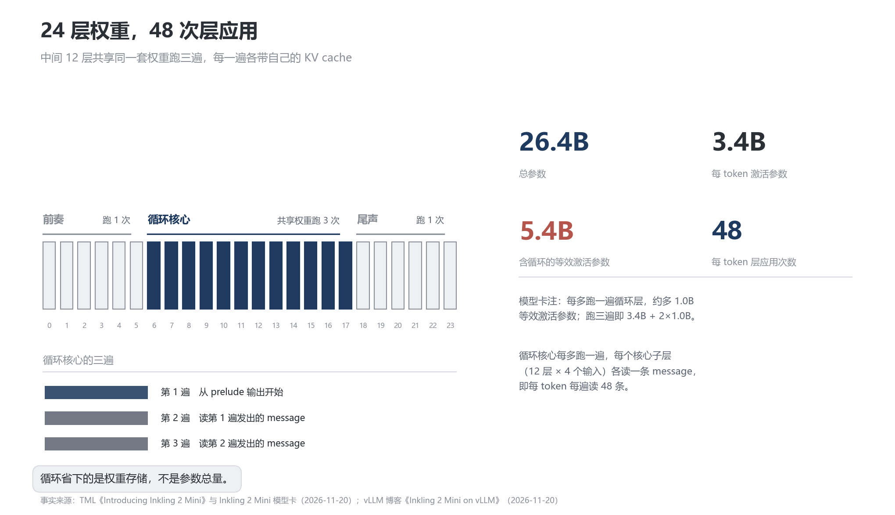
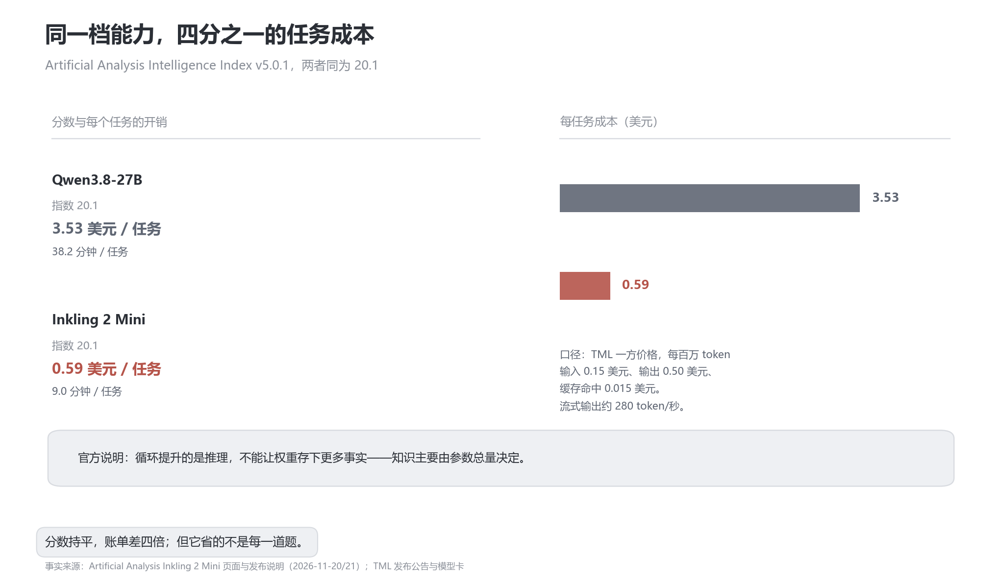
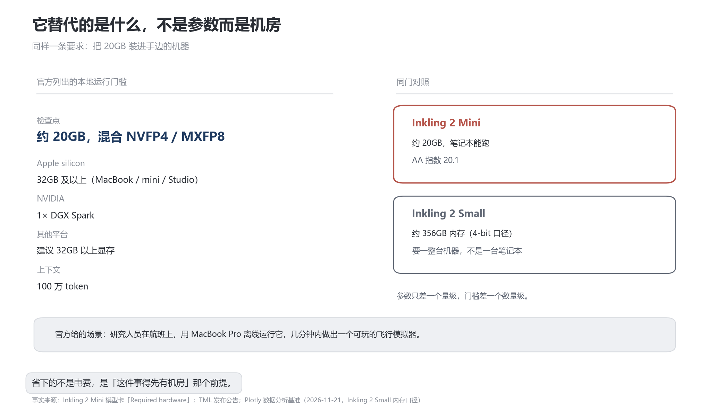

# 264亿参数、20GB检查点，32GB Mac就能跑：这家公司用"循环层"反潮流，不堆参数了

11月20日，Thinking Machines Lab以Apache 2.0发布了Inkling 2 Mini，权重放在Hugging Face上。

先看那个反差。模型卡"所需硬件"一栏写着：单个检查点约20GB，Apple silicon 32GB及以上即可（MacBook、Mac mini、Mac Studio），或者一台NVIDIA DGX Spark；其他平台建议32GB以上显存。发布公告里有个场景——研究人员在一次航班上，用MacBook Pro离线运行它，几分钟内做出了一个可玩的飞行模拟器。

同时它是个264亿参数的多模态MoE，每token激活34亿，上下文100万token。

20GB装下264亿参数，靠的不只是压缩。它换了一条路。

## 不堆参数，改堆"遍数"

Inkling 2 Mini总共24层。按模型卡的写法：24层decoder加稀疏MoE，中间12层**共享同一套权重跑三遍**，于是每处理一个token，实际发生48次层应用——6 + 3×12 + 6。

前面6层和后面6层各跑一次，只有中间那段在循环。

这不是免费的。模型卡专门注了一句：循环层每多跑一遍，大约多1.0B等效激活参数；跑三遍就是34亿加2个10亿，即54亿等效激活参数/token。

vLLM的技术博客把机制写得更细：三遍之间不直接串输出，后一遍通过"message"从上一遍的对应位置读信息；每个核心子层（12层×4个输入）各读一条，所以后两遍每处理一个token要读48条message。更关键的是内存——每一遍都有自己的KV cache和conv-state cache，24层权重对应48个KV cache。

这句话很重要：循环省下的是**权重存储**，不是显存里的其他账。

## 分数打平，账单差四倍

Artificial Analysis的Intelligence Index v5.0.1给20.1分。同一张表里，Qwen3.8-27B也是20.1，Gemma 4 31B是4.4，Muse Glimmer是6.3。

更值得看的是成本。AA给出每任务0.59美元、9.0分钟；Qwen3.8-27B是3.53美元、38.2分钟。价格口径是TML一方报价：每百万token输入0.15美元、输出0.50美元、缓存命中0.015美元。流式输出约280 token/秒。

但有一句话必须放在这里。TML自己写明："循环提升的是模型的推理，但不能让它的权重存下更多事实——知识主要由参数总量决定。"在随附的变循环研究版本上，长上下文基准（GraphWalks BFS、MRCR v2）随遍数增加而变好，知识型基准（AA-Omniscience、SimpleQA等）不随遍数变好。

所以循环换来的是"想得更久"，不是"记得更多"。Inkling 2 Mini补这个缺口的方式是工具和搜索——它在BrowseComp、DeepSearchQA上领先同尺寸开放模型。

同一件事在真实账单上也有反面。第三方Plotly用数据分析基准跑了一整轮，得分36/43，但一轮花掉4.09美元、1.79亿token，比更大更贵的Inkling 2 Small的1.81美元、2200万token还多。原因是某一道题上它跑了585次查询，约占全部工具调用的46%，被Plotly称作一次"失控循环"。

循环能省算力，也能把算力耗在自己绕圈上。

## 它替代的不是参数，是机房

真正的对照在这里。

同门的Inkling 2 Small，按4-bit口径要356GB内存；Inkling 2 Mini是20GB。参数规模只差一个量级，运行门槛差一个数量级。

这就是"本地可跑"这件事的分量。过去一年多，MoE的路线很統一：参数往上堆，激活参数控制在合理区间，然后靠一整个集群去接。这条路没有错，追求的是能力上限。

但它把"能不能先用起来"这个问题，也一并交给了机房。

Inkling 2 Mini给的是另一个方向的答案：不追求把权重堆到千亿，而是用循环层把"计算深度"买回来，代价是推理时多花钱、多花时间。官方数据里，它的能力在同尺寸开放权重里靠前，TML自报在DeepSWE v1.1得48.2%、Vals Index v2.2得46.5%，都是100B以下第一——这组数字标着"自报"，需要独立验证。

## 落到：路线开始分岔

需要说清的是，这不是"小模型打败大模型"的故事。在知识密度、长程复杂规划、需要海量世界知识的地方，参数总量仍然是硬约束，TML自己也承认这一点。

它证明的是另一件事：模型竞争不再只有"更大"一条路可走。

一边是把权重堆到千亿、靠集群承接；一边是把层数循环起来、把20GB装进32GB的笔记本。两条路各有各的账，也各有各的输赢。

真正的信号不是这264亿参数，是有人愿意用Apache 2.0把它发出来，让所有人都能在自己的电脑上验一遍。

---

*事实来源：Inkling 2 Mini 于 2026-11-20 由 Thinking Machines Lab 以 Apache 2.0 发布、权重托管于 Hugging Face（thinkingmachines/Inkling-2-Mini），单个检查点约 20GB、混合 NVFP4 与 MXFP8，支持 1× NVIDIA DGX Spark 与 32GB 及以上 Apple silicon（MacBook、Mac mini、Mac Studio），其他平台建议 32GB 以上显存；研究人员在航班上用 MacBook Pro 离线运行并在数分钟内做出可玩飞行模拟器（演示机 M5 Pro / 48GB，飞行模式），据 TML 发布公告《Introducing Inkling 2 Mini》（2026-11-20，thinkingmachines.ai/news/inkling-2-mini/）。架构：24 层 decoder-only 多模态自回归 looped transformer，稀疏 MoE，中间 12 层共享权重跑三遍、每 token 48 次层应用（6+3×12+6），每层每 token 路由 8/128 专家，局部与全局注意力混合（20 局部 / 4 全局），总参数 26.4B、激活 3.4B、每多一遍循环约增 1.0B 等效激活参数（三遍即 5.4B），上下文 100 万 token，图像经 23 层 ViT；据 Inkling 2 Mini 模型卡（thinkingmachines.ai/model-card/inkling-2-mini/）。prelude（层 0–5）/ loop core（层 6–17）/ coda（层 18–23）划分、每遍独立 KV cache 与 conv-state cache（24 层对应 48 个 KV cache）、后两遍每个核心子层各读一条 message（12 层×4 输入，每 token 每遍 48 条），据 vLLM 技术博客《Inkling 2 Mini on vLLM: Day-0 Support for a Looped Model》（2026-11-20，vllm.ai）。Intelligence Index v5.0.1 得 20.1（与 Qwen3.8-27B 同为 20.1，Gemma 4 31B 为 4.4，Muse Glimmer 为 6.3，Nemotron 3.5 Super VL 为 13.6）、每 Intelligence Index 任务 0.59 美元与 9.0 分钟（Qwen3.8-27B 为 3.53 美元与 38.2 分钟）、流式输出约 280 token/秒、价格为 TML 一方口径每百万 token 输入 0.15 / 输出 0.50 / 缓存命中 0.015 美元，据 Artificial Analysis Inkling 2 Mini 页面与发布说明（2026-11-20/21，artificialanalysis.ai）。TML 自述"循环提升推理但不能让权重存下更多事实，知识主要由参数总量决定"，变循环研究版本上长上下文基准（GraphWalks BFS、MRCR v2）随遍数提升而知识型基准（AA-Omniscience、SimpleQA Verified、SimpleVQA、WorldVQA）不随遍数提升；DeepSWE v1.1 48.2%、Vals Index v2.2 46.5% 为 100B 以下开放权重模型最高，该组数字在参数表中标注为第三方指数/自报口径，据 TML 发布公告。Plotly DataAnalyticsBench（2026-11-21）一轮 36/43、花费 4.09 美元、1.79 亿 token，对照 Inkling 2 Small 39/43、1.81 美元、2200 万 token；其中单题 585 次查询约占全部工具调用 46%，被表述为一次 runaway loop；Inkling 2 Small 约需 356GB 内存（4-bit 口径），据 plotly.com。*

*需说明四点。其一，素材称"每Token激活34亿"，与模型卡一致（3.4B），但模型卡同时给出计入循环的等效激活为 5.4B；只说 3.4B 会低估它的实际算力开销，本文两个数都给出。其二，素材称"十二层循环运行三次"成立，但只有 24 层中的中间 12 层在循环，首尾各 6 层只跑一次；素材"用等效的单步计算深度替代存储更多权重"的表述基本准确，本文按模型卡原文表述为"循环省下的是权重存储"。其三，素材的"性价比"说法需要加限定：AA 口径 0.59 美元/任务确为 Qwen3.8-27B 的六分之一、时间也短得多，但第三方 Plotly 的分析基准里它单轮反而比更大的 Inkling 2 Small 贵 2.3 倍，因一次失控循环。本文把两种口径都呈现，未采纳"性价比全面占优"的单向结论。其四，"循环层路线此前多停留在论文和小型实验中"这一说法本文未采用——TML 同时发布了变循环研究检查点，模型卡对比表里已列出 Dory 1.0 4B（4 遍）、SenseNova-Loop-9B（2 遍）等同类 looped 模型，说明该路线并非空白；另 TML 自报的 DeepSWE、Vals Index 领先成绩标有自报口径，尚待独立复现，正文已注明。*
