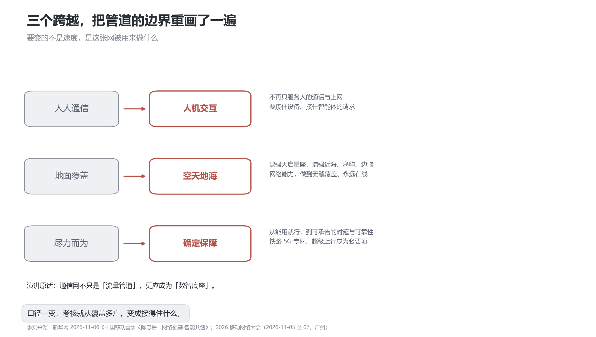
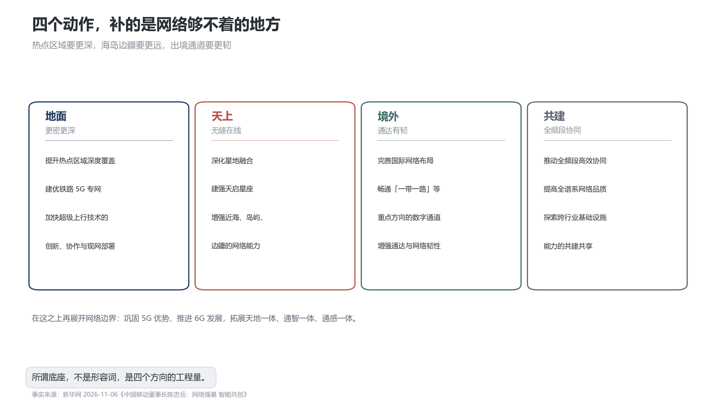
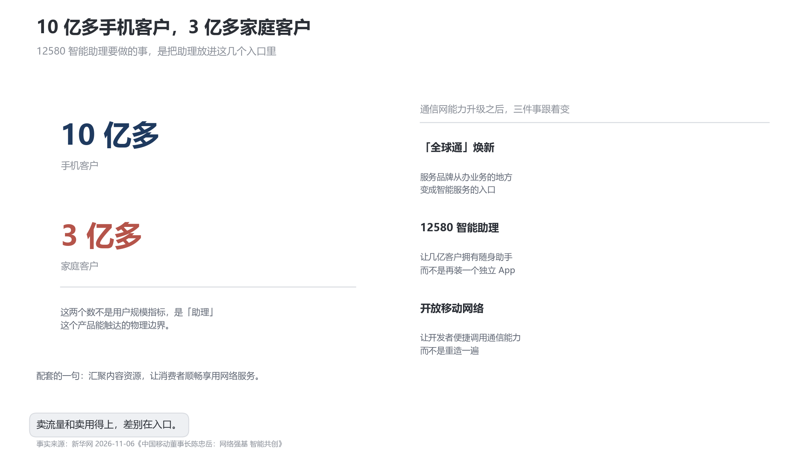

# 通信网不只是「流量管道」：从人人通信到人机交互，底座换了

11月5日至7日，2026移动网络大会在广州举行。11月6日上午，中国移动董事长陈忠岳做了一场题为《网络强基 智能共创》的主旨演讲。

演讲里有一句判断值得单独拎出来：通信网不只是"流量管道"，更应成为"数智底座"。

这句话听着像口号，但它前面紧跟着三个"从……到……"，是有具体所指的。

## 三个跨越，各自对应一笔工程量

**第一个：从人人通信到人机交互。** 过去一张网的设计前提是"人在打电话、在上网"，连接数大致等于用户数。现在要接的是设备和智能体——它们发起请求的频率、时长、突发性跟人完全不一样。

**第二个：从地面覆盖到空天地海。** 演讲给的动作是具体的：深化星地融合、建强天启星座、增强近海、岛屿、边疆网络能力，目标是无缝覆盖、永远在线。这几个词指的都是地面基站不容易覆盖的地方。

**第三个：从尽力而为到确定保障。** 传统互联网是"尽力而为"（best effort），发出去就算完成任务，不保证什么时候到。而铁路调度、工业控制、远程操作这些场景，要的是可承诺的时延。配套的两个动作是建优铁路5G专网，以及加快超级上行的技术创新、产业协作和现网部署。

三个跨越共同的落点，是这句话后面那段：巩固5G优势，推进6G发展，拓展天地一体、通智一体、通感一体的网络边界。

## 为什么"底座"这个词不是修辞

演讲里有一个细节，比宏观判断更说明问题。

三张网各有各的路由：通信网贯通流量路由，连接平台与终端，让字节高效传递；算力网贯通模型路由，连接算力与数据，让词元高效流动；智能网贯通任务路由，连接模型与场景，让意图高效执行。

把这三句并排放，会发现一个变化：网络要"路由"的东西，从字节扩展到了词元和任务。

字节路由靠带宽，词元路由靠算力调度，任务路由靠什么？还得靠网络本身知道对面是什么、要干什么。

这也是为什么演讲要花一整段讲IPv6全栈通用路由协议——中国移动主导和定义，已在国内外300多家运营商网络规模部署，促进互联网传送效率提升25%以上。这句话的位置很关键：它出现在讲完三张网分工之后，落点是"让通信网更加匹配智算方向"。

一根老协议，被重新拿出来讲，说明网络层面的创新和模型层面是连着的。

## 但"底座"要落到人身上

技术侧讲完，演讲转向了服务侧，落点很朴素。

加快"全球通"服务焕新；推出12580智能助理，让10亿多手机客户、3亿多家庭客户都拥有中国移动随身智能助手；开放移动网络，让应用开发者便捷调用通信能力；汇聚内容资源。

这四个动作里，最值得注意的是那个数字组合。

10亿多手机客户、3亿多家庭客户——这不是用户规模指标，这是"助理"这个产品能触达的物理边界。一个新助手最难的不是训练，是让它在几亿人的手机里真的被打开。

而"开放移动网络，让应用开发者便捷调用通信能力"，是另一种逻辑：与其自己把每个功能都做一遍，不如把网络能力做成接口，让开发者去用。这跟"流量管道"的思路正好相反——管道只负责运，底座要负责被调用。

## 落到：口径变了，考核也就变了

回到那三个跨越。

如果通信网的目标只是覆盖广、网速快，那它的KPI很清楚：基站数、覆盖率、平均速率。

但如果它要接住智能体、要承诺时延、要在海岛和边疆永远在线、要能被开发者调用成接口，那考核项就换了一批：能不能接得住、能不能算得准、能不能在关键场景不掉线。

演讲里有一句："每一种经济形态，都有与之相适应的基础设施。新的智能经济，需要有新的基础设施。"

这句话反过来读也成立：基础设施换了一代，衡量它的尺子也得换一把。

至于这把尺子长什么样，10亿用户打开那个助理时的体验，大概会比任何PPT上的指标都更早给出答案。

---

*事实来源：2026 移动网络大会于 2026 年 11 月 5 日至 7 日在广州举行，中国移动董事长陈忠岳于 11 月 6 日上午发表题为《网络强基 智能共创》的主旨演讲；演讲指出从网络数据看呈现人工智能驱动移动网络流量加速增长、引发数据传送结构显著变化、呼唤网络与算力融合协同三个特征；提出落实"六张网"建设部署，制定实施网络强基、全栈创新发展战略，坚持智为先、算为要、通为本，一体建强通信网、算力网、智能网；通信网部分表述为"从人人通信到人机交互、从地面覆盖到空天地海、从尽力而为到确定保障，通信网不只是'流量管道'，更应成为'数智底座'"；具体举措包括提升热点区域深度覆盖、建优铁路 5G 专网、加快超级上行技术创新产业协作和现网部署、深化星地融合建强天启星座、增强近海岛屿边疆网络能力实现无缝覆盖永远在线、完善国际网络基础设施布局畅通"一带一路"等重点方向数字通道、加强共建共享推动全频段高效协同、巩固 5G 优势推进 6G 发展拓展天地一体通智一体通感一体；服务侧包括加快"全球通"服务焕新、推出 12580 智能助理让 10 亿多手机客户与 3 亿多家庭客户拥有随身智能助手、开放移动网络让开发者调用通信能力、汇聚内容资源；三张网路由分工为通信网贯通流量路由连接平台与终端让字节高效传递、算力网贯通模型路由连接算力与数据让词元高效流动、智能网贯通任务路由连接模型与场景让意图高效执行；中国移动主导和定义了 IPv6 全栈通用路由协议，是全球互联网根技术，已在国内外 300 多家运营商网络规模部署，促进互联网传送效率提升 25% 以上。以上均据新华网 2026-11-06 10:52 刊发的演讲全文（news.cn/info/20261106/04c53cb5449f4fada3bfde5a07860cc7/c.html）。*

*需说明三点。其一，本文所有事实、引语与数字均出自上述演讲原文，凡属作者的分析与推论（如"网络路由的东西从字节扩展到词元和任务""考核项换了一批"等）已在正文中与前文事实分开表述，不代表中国移动观点。其二，演讲中"从尽力而为到确定保障"未在原文展开技术定义，本文对其含义的解释（尽力而为=best effort、不保证时延）为通行技术口径，非演讲原话。其三，"10 亿多手机客户、3 亿多家庭客户"为演讲给出的客户规模表述，本文未作额外推算。*
