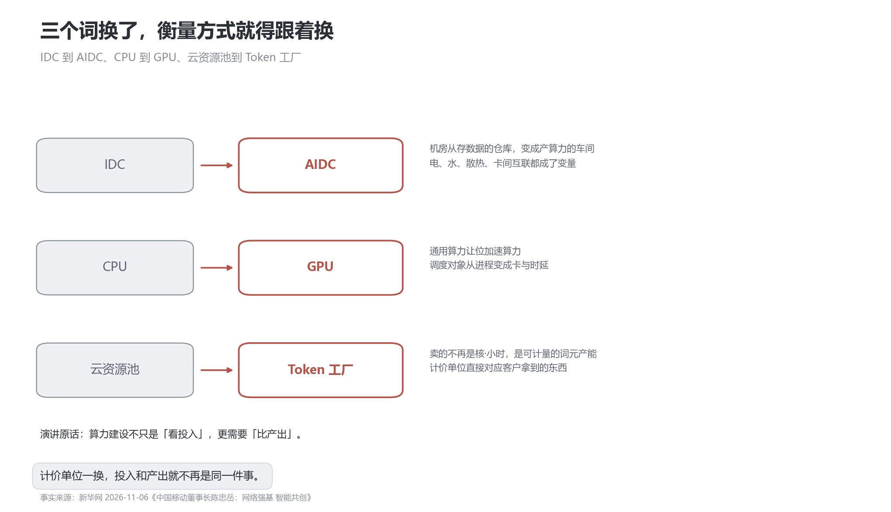
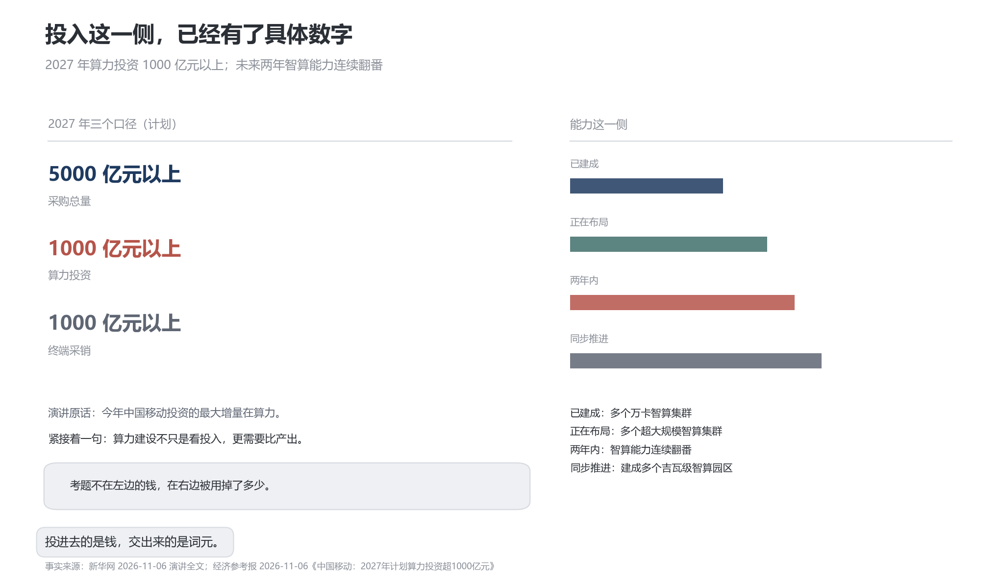
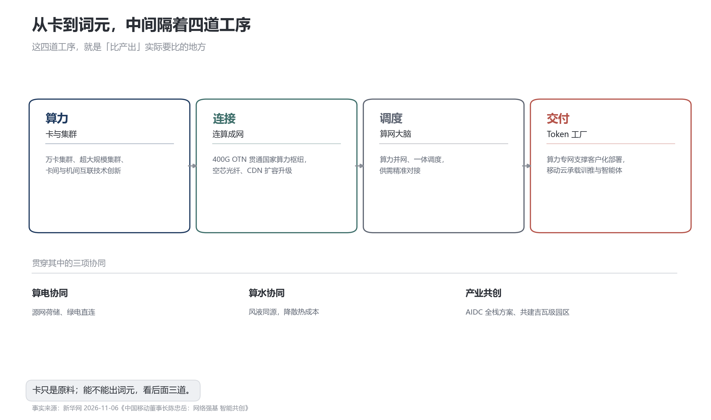

# 算力建设不只是「看投入」，更需要「比产出」：三个词的换算

11月6日的新华网演讲全文里，中国移动董事长陈忠岳讲算力那段，开头是一句结论，后面才跟数字。

结论是：算力建设不只是"看投入"，更需要"比产出"。

这句话放在一堆亿元数字前面，是刻意的。因为同一段话里紧接着就是：今年中国移动投资的最大增量在算力。

## 三个词换了，账本也就换了

演讲对算力网的描述，用了三个"从……到……"。

**从IDC到AIDC。** 传统IDC是存数据的机房，考核的是机柜出租率、PUE。AIDC是产算力的车间，考核的东西完全变了——电够不够、水冷不冷得下来、卡和卡之间通不通、持续跑满时的稳定性。演讲给的动作也对应：正在布局多个超大规模智算集群，未来两年智算能力连续翻番，建成多个吉瓦级智算园区。

注意"吉瓦级"这个单位。它谈的是功率，并非机柜数量。一个园区要消耗多少电，本身就是选址和成本的核心变量。

**从CPU到GPU。** 调度对象从此改变。以前调度的是进程和虚机，现在调度的是卡、显存和时延。

**从云资源池到Token工厂。** 这个词最容易滑过去。云资源池卖的是核·小时和存储，客户买完还得自己调；Token工厂卖的是可计量的词元产能，计价单位直接对应客户最后拿到的东西。

三个词一换，"投入"和"产出"就在同一条链上了——投进去的是钱，交出来的是词元。

## 投入这一侧，数字已经摆出来了

据经济参考报同日报道，2027年中国移动计划进一步提升采购总量，预计总金额5000亿元以上，算力投资1000亿元以上，终端采销1000亿元以上。

新华网刊发的演讲全文里，同一层意思的表述是"加大算力投资、确保智算能力倍增"。

三个数字放在一起看，能读出一个结构：算力投资和终端采销各占一千亿，体量相当。终端有量就能摊销，算力要靠被调用才能回收。

但演讲并没有停在钱上。它把话锋转回去了——"比产出"。

投多少钱是可以公布的，产出多少却很难公布。一份愿意把"比产出"写进战略表述的文件，本身就是在给自己立一个更难的考核项。

## 产出这一侧，要过四道工序

从卡到词元，中间不是一步，是四步。演讲里的动作，恰好对应这四步。

**第一道是算力本身。** 万卡集群、超大规模集群、卡间与机间互联技术创新。

**第二道是连接。** 拓展400G OTN能力，全面贯通国家算力枢纽、各类算力资源，加大空芯光纤应用，加快CDN扩容升级。演讲用三个词概括目标：入算连接更顺畅、算间互联更高效、边缘分发更敏捷。

**第三道是调度。** 升级算网大脑，推动算力并网、一体调度，决定的是"卡闲着、任务却在排队"这类浪费能否被消掉。

**第四道是交付。** 联建算力专网支撑客户化Token工厂部署；升级"移动云"，建强算网一体、安全可信、敏捷高效的智算云，支撑模型训推、算力定制、智能体构建。演讲的总结是"算力设施部署在云上、智能应用成长在云上"。

四道工序里，卡只占第一道。后面三道都关乎"能不能用上"——这正是"比产出"实际要比的地方。

## 还有一笔账不算在钱里

演讲有一组容易被忽略的技术词：源网荷储、绿电直连、风液同源，对应算电协同、算水协同。

这说明算力扩张的约束不只是芯片能不能买到，还有电从哪来、热往哪排、水够不够用。吉瓦级园区的落地，本质上是一场能源规划。

所以"比产出"的分子分母都不止是钱：电、水、散热、地，都计在里面。

## 落到：考题换了

回到那句话。

如果算力建设只看投入，那KPI很简单：投资额、机架数、算力规模。

但如果要比产出，考核就得往下走一层：这些卡上架之后跑起来了吗？跑起来的产能被谁用掉了？客户拿到的词元，单位成本和单位时延是多少？

演讲里那句"算力设施部署在云上、智能应用成长在云上"，其实已经把答案的方向说了——算力设施本身不产生价值，能被智能应用长在上面的那部分才算。

投进去的是钱，交出来的是词元。中间那四道工序，就是这笔账真正的对账表。

---

*事实来源：中国移动董事长陈忠岳于 2026 年 11 月 6 日上午在 2026 移动网络大会（11 月 5 日至 7 日，广州）发表题为《网络强基 智能共创》的主旨演讲，其中算力网部分载明："从 IDC 到 AIDC、从 CPU 到 GPU、从云资源池到 Token 工厂，算力建设不只是'看投入'，更需要'比产出'"；"算力，是中国移动高质量发展的重要引擎。今年中国移动投资的最大增量在算力，在建成多个万卡智算集群的基础上，正在布局建设多个超大规模智算集群，未来两年智算能力将连续翻番，建成多个吉瓦级智算园区"；连算成网部分为"拓展 400G OTN 能力，全面贯通国家算力枢纽、各类算力资源，加大空芯光纤应用，加快 CDN 扩容升级，让入算连接更顺畅、算间互联更高效、边缘分发更敏捷"；"升级算网大脑，推动算力并网、一体调度，实现算力供需精准对接"；共创部分为"推出 AIDC 全栈解决方案，共建定制化吉瓦级智算园区""加强卡间、机间互联技术创新""创新应用源网荷储、绿电直连、风液同源等技术，推动算电协同、算水协同""联建算力专网，支撑客户化 Token 工厂部署""升级'移动云'服务，建强算网一体、安全可信、敏捷高效的智算云，拓展更多政务云、工业云等行业标杆，支撑模型训推、算力定制、智能体构建等多元需求，实现算力设施部署在云上、智能应用成长在云上"；并载"2027 年，中国移动计划进一步提升采购总量，加大算力投资、确保智算能力倍增"。以上据新华网 2026-11-06 10:52 刊发的演讲全文（news.cn/info/20261106/04c53cb5449f4fada3bfde5a07860cc7/c.html）。2027 年三个投资口径（采购总量 5000 亿元以上、算力投资 1000 亿元以上、终端采销 1000 亿元以上）据经济参考报 2026-11-06《中国移动：2027年计划算力投资超1000亿元》（jjckb.xinhuanet.com/20261106/09726dcd47d94aa9bc7ed3a5942f913f/c.html），与新华网同日演讲全文的表述互为印证。*

*需说明三点。其一，本文的"四道工序"划分（算力、连接、调度、交付）为作者对演讲内容的归纳，非官方口径；官方原文为并列陈述，未作此分层。其二，"吉瓦级园区谈的是功率而非机柜数量""投进去的是钱、交出来的是词元""考题换了"等论述为作者判断，不代表中国移动观点。其三，2027 年的 5000 亿／1000 亿／1000 亿三项均为"计划"口径（经济参考报原文为"预计总金额"），非已实现的财务数据，正文已标注为计划。*
