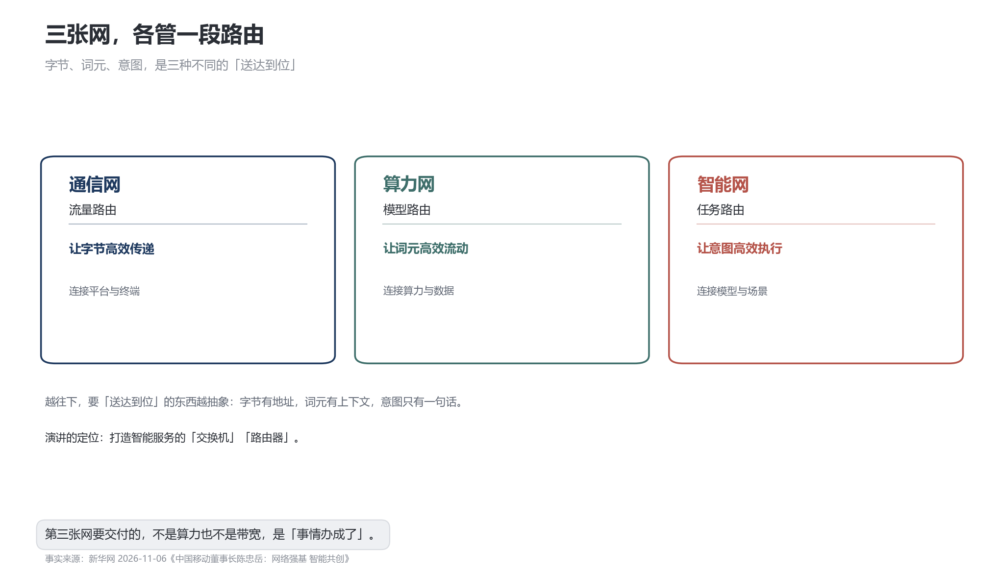
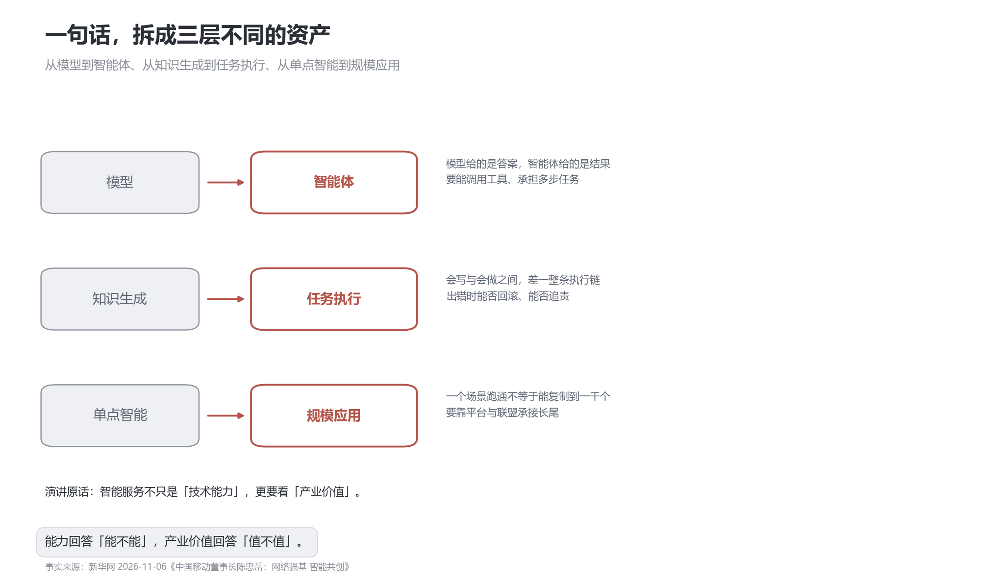
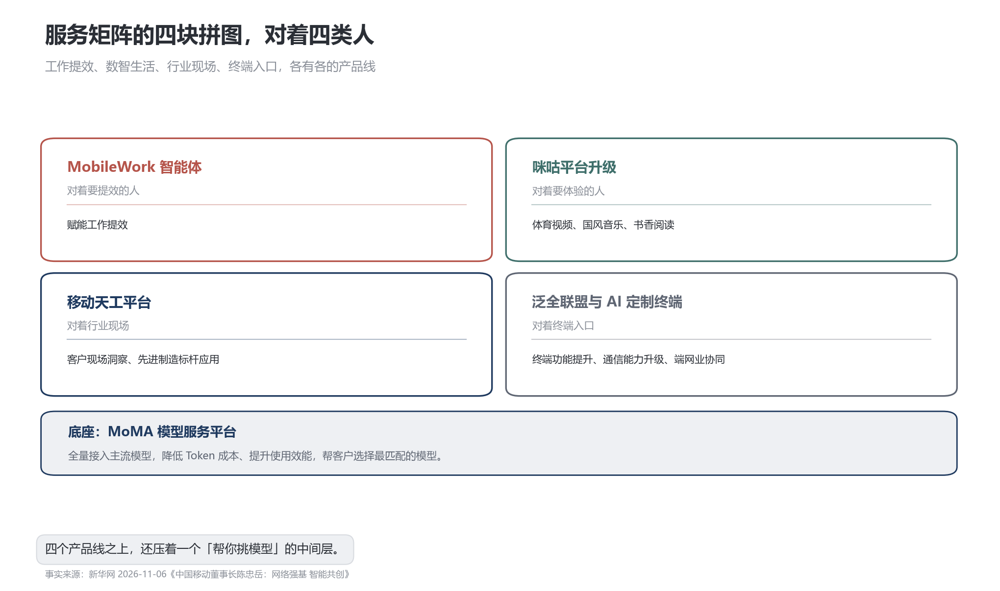

# 智能服务不只是「技术能力」，更要看「产业价值」：三张网各管一段路由

同一场演讲里，第三张网的开头也是一句结论先行。

从模型到智能体、从知识生成到任务执行、从单点智能到规模应用，智能服务不只是"技术能力"，更要看"产业价值"。

前面两张网讲的是路怎么修、算力怎么供；这一段讲的是——路修好了，上面跑的东西值不值钱。

## 先看一个很少被并列摆出来的句子

演讲在收尾处，把三张网的分工写成了一句话：

通信网贯通流量路由，连接平台与终端，让字节高效传递；算力网贯通模型路由，连接算力与数据，让词元高效流动；智能网贯通任务路由，连接模型与场景，让意图高效执行。

这三句并排放，最值得注意的是最后一段的落点——"让意图高效执行"。

字节有地址，词元有上下文，意图只有一句话。越往后，"送达到位"这件事越抽象，也越难判断做没做到。

演讲给智能网的定位是"打造智能服务的交换机、路由器"。交换机管的是把包送到该去的端口；路由器管的是在多条路里挑一条。换成智能服务，也就是：把用户的一句话，送到最合适的模型、最合适的数据、最合适的工具那儿去。

## 三个转变，换的是三种资产

演讲那三个"从……到……"，每一个都在换一种资产。

**从模型到智能体。** 模型给的是答案，智能体给的是结果。差别在于智能体要调用工具、承担多步任务、在中间出错时自己纠正。

**从知识生成到任务执行。** 会写与会做之间，差一整条执行链：能不能查、能不能改、改错了能不能回滚、出了事谁负责。

**从单点智能到规模应用。** 一个场景跑通，不等于能复制到一千个。长尾场景的成本结构完全不同。

三个转变合起来，就是那句"不只技术能力，更看产业价值"的具体含义：技术能力回答"能不能"，产业价值回答"值不值"。

## 服务矩阵：四块拼图，对着四类人

演讲给的落地产品，可以拆成四块，每一块对着不同的人。

**MobileWork 智能体**——对着要提效的人。表述是"赋能工作提效"。

**咪咕平台升级**——对着要体验的人。做优体育视频、国风音乐、书香阅读。

**移动天工平台**——对着行业现场。协同行业伙伴加强客户现场洞察，推动数智赋能与场景适配，打造更多先进制造标杆应用。这里的"现场洞察"四个字值得留意：它承认行业AI的难点在车间里，不在实验室里。

**泛全联盟与AI定制终端**——对着终端入口。推动终端功能提升、通信能力升级，实现端网业高效协同。

四块之外，还压着一个底座：MoMA模型服务平台。

演讲对它的描述很直接——全量接入主流模型，降低Token成本、提升使用效能，帮客户选择最匹配的模型。

这句话里藏着智能网最实际的商业逻辑：绝大多数客户不需要"最好的模型"，需要的是"这件事用哪个模型最划算"。而"帮你挑模型"这件事，本身就是一个可以收费的中间层。

## 三个词：连接、协同、普惠

演讲在讲完产品之后，补了一句判断标准：做大智能服务产业价值，需要更加注重连接、协同、普惠，让更多人用得上、用得起、用得好。

三个词对应三种门槛。

**用得上**，是覆盖问题——终端、网络、平台得先铺到那儿。
**用得起**，是成本问题——Token价格得降到普通行业算得过来账的水平。
**用得好**，是适配问题——得有人懂客户现场，把通用能力改成本行业的解法。

这三个词排在一起，其实是在给"产业价值"下定义：不是技术多先进，是有多少人真的用上了。

## 落到：值不值，得由客户来答

回到那句结论。

技术能力的评价，同行能做——跑分、延迟、上下文长度，都有尺子。

产业价值的评价，同行做不了，得由客户做：这一单省了多少人、这一趟少停了多少时间、这个月的差错率降了几个点。

演讲里"打造智能服务的交换机、路由器"这个说法，如果成立，意味着智能网最终交付的不是一个模型，而是一次"事情办成了"。

这件事办没办成，只有用的人知道。

---

*事实来源：中国移动董事长陈忠岳于 2026 年 11 月 6 日上午在 2026 移动网络大会（11 月 5 日至 7 日，广州）发表题为《网络强基 智能共创》的主旨演讲。智能网部分载明："从模型到智能体、从知识生成到任务执行、从单点智能到规模应用，智能服务不只是'技术能力'，更要看'产业价值'"；"智能，是中国移动高质量发展的坚定方向。中国移动致力于打造智能服务的'交换机''路由器'，依托通信基础和算力资源，协同建设网络化智能基础设施，创新构建智能互联网，实现模型、数据、智能体的安全可信供给、泛在高效互联，支撑从场景到平台、从终端到云端、从应用到模型的全链条智能服务，推动智能惠及千家万户、融入千行百业"；"做大智能服务产业价值，需要更加注重连接、协同、普惠，让更多人用得上、用得起、用得好"；"依托 MoMA 模型服务平台，全量接入主流模型，降低 Token 成本、提升使用效能，帮客户选择最匹配的模型、让客户享用高可信的服务"；"构建'移动智能'服务矩阵，推出 MobileWork 智能体，赋能工作提效；推动咪咕平台升级，做优体育视频、国风音乐、书香阅读体验，丰富数智生活；建强'移动天工'平台，协同行业伙伴加强客户现场洞察，推动数智赋能与场景更加适配，打造更多先进制造标杆应用"；"持续做强泛全联盟，共同推动终端功能提升、通信能力升级，打造 AI 定制终端，实现端网业高效协同"。三张网路由分工原文为："通信网贯通流量路由，连接平台与终端，让字节高效传递；算力网贯通模型路由，连接算力与数据，让词元高效流动；智能网贯通任务路由，连接模型与场景，让意图高效执行。"以上均据新华网 2026-11-06 10:52 刊发的演讲全文（news.cn/info/20261106/04c53cb5449f4fada3bfde5a07860cc7/c.html）。*

*需说明三点。其一，"三个转变换的是三种资产""帮你挑模型本身是一个可以收费的中间层""三个词对应三种门槛（覆盖、成本、适配）"等论述为作者分析，非演讲原文，也不代表中国移动观点。其二，演讲未披露 MoMA 平台的接入模型数量、Token 具体价格、MobileWork 与移动天工的具体客户数或商用数据，本文亦未作任何推算与补充，凡未披露处均只保留官方表述。其三，本文对"交换机/路由器"的释义（交换机管送达端口、路由器管在多条路中择一）为通行网络技术口径，用以说明功能定位，非演讲对该比喻的定义。*
