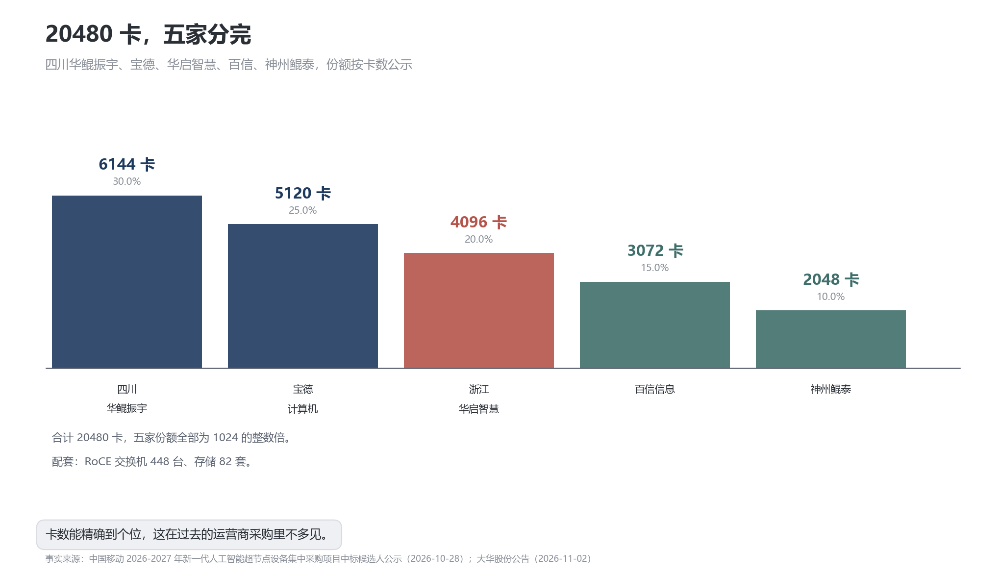
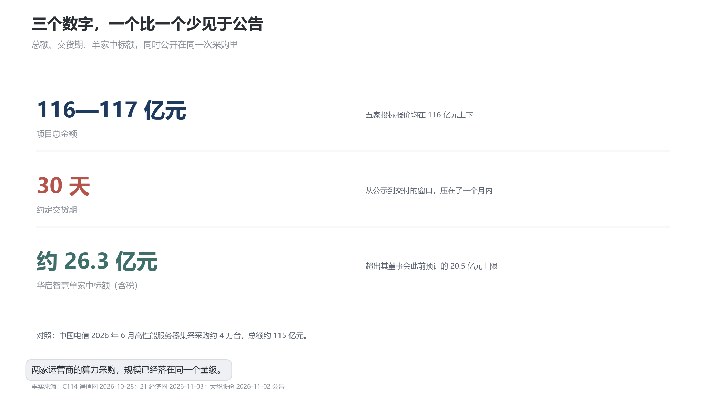
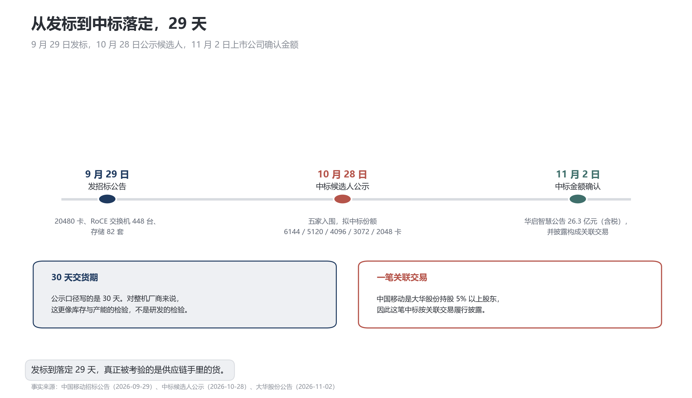

# 20480 卡、117 亿、30 天：中国移动这笔算力大单，把三个数字同时摆上了公告

9 月 29 日，中国移动发了一份招标公告：采购"2026 年至 2027 年新一代人工智能超节点设备"，AI 超节点合计 20480 卡，配套 RoCE 交换机 448 台、存储 82 套。

10 月 28 日，中标候选人公示：四川华鲲振宇、宝德计算机、浙江华启智慧、百信信息、神州鲲泰五家入围。份额按卡数写得很具体——6144、5120、4096、3072、2048。

11 月 2 日晚，大华股份发公告，子公司华启智慧中标，金额约 26.3 亿元（含税）。

从发标到落定，29 天。

## 卡数精确到个位

这份公示最不寻常的地方，不是金额，是单位。

过去运营商采购服务器，公告里写的是"若干台""若干套"，因为一台机器里装什么卡、装几张，供应链自己配。这次直接写"卡"，而且精确到 20480 这个数，五家份额全是 1024 的整数倍：6144 是 6 个 1024，5120 是 5 个，4096 是 4 个，3072 是 3 个，2048 是 2 个。

换算成比例就是 30%、25%、20%、15%、10%——一个非常整齐的分配。

这说明采购口径从"买机器"变成了"买算力单元"。对买方来说，卡数可以直接对应到可调度的算力规模；对卖方来说，供货能力必须精确到卡，差 1024 张就是一个档次。

## 三个数字里，最短的那个最硬

项目金额约 116 亿至 117 亿元。这个数字不小，但放在三大运营商的资本开支里，算不上惊人。

真正值得注意的是交货期：30 天。

公示里写的是"交货期 30 天"。对一个上万卡的项目，这个窗口几乎没有留出备产时间。它意味着两件事：一是这几家厂商手里大概率已有现货或准现货；二是这次采购考的更像库存管理和产线调度，而不是研发能力。

30 天交货，本质上是一次对国产算力整机供应链的实盘检验。能不能按时交付，比标书里写什么参数更能说明问题。

## 中标的五家，没有一家是老牌服务器厂

华鲲振宇、宝德、百信、神州鲲泰，加上华启智慧，五家的共同点是都属于国产算力整机生态。

这里有个容易被忽略的门槛：公告明确要求"新一代人工智能超节点"。超节点不是把卡插进机箱就算，它要求卡间高速互联、整机柜级供电与散热、配套的交换与存储一起交付。能接这个单的，通常是已经跟着国产芯片做过整机适配的厂商。

其中华启智慧最特殊。它脱胎于大华股份，2022 年成立，原本做的是智能物联，算力是大华新开辟的业务线——用公告里的话，是"第二增长曲线"。一个从安防视觉硬件延伸过来的公司，在第一笔大单里就拿到了 20% 的份额。

外界容易把这读成"跨界抢单"，但换个角度：超节点需要的整机集成、散热、结构设计能力，和安防硬件那套产线并非毫无交集。这或许正是它能进围的原因。

还有一个细节必须说清：中国移动本身是大华股份持股 5% 以上的股东，所以这笔中标构成关联交易，需要单独披露。

这不构成问题——关联交易在上市公司体系里有明确的披露和审议程序，大华也把"超出董事会此前预计的 20.5 亿元上限"一并说了。但它确实说明一件事：运营商和它的供应商之间，不只是买卖关系，还有资本关系。这在算力投资里会越来越常见——投你、也买你，账要分两本算。

## 30 天之后

这笔单子的意义，不在于 117 亿这个数额，而在于它把三个数字同时公开了：买了多少卡、多少钱、多久交货。

过去这几项里至少有一项是不对外说的。现在三项都在公告上，意味着算力采购正在从"示范项目"变成一件可以被外部对照、被同行比较的常规业务。

当采购变得常规，评价标准也会跟着变。示范项目比的是"有没有做成"；常规采购比的是"多少钱一张卡、多少天到货、能不能续上"。

30 天交货期，就是这个新标准第一次被写进合同。

至于交付之后跑得怎么样，那是另一张考卷——卡到货只是上半场，能不能被真正用满，要等运行数据说话。

---

*事实来源：2026 年 9 月 29 日，中国移动发布"2026 年至 2027 年新一代人工智能超节点设备集中采购项目"招标公告，计划采购 AI 超节点合计 20480 卡，及配套 RoCE 交换机 448 台、存储 82 套。2026 年 10 月 28 日中标候选人公示：四川华鲲振宇 6144 卡、宝德计算机 5120 卡、浙江华启智慧 4096 卡、百信信息 3072 卡、神州鲲泰 2048 卡，交货期 30 天，项目金额预计 116 亿至 117 亿元之间。2026 年 11 月 2 日晚，大华股份（002236）公告子公司浙江华启智慧科技有限公司中标，金额约 26.3 亿元（含税），超出董事会此前预计的 20.5 亿元上限；中国移动为大华股份持股 5% 以上股东，该交易构成关联交易；华启智慧成立于 2022 年，算力业务为大华第二增长曲线。以上据智东西/新浪新闻 2026-11-02、C114 通信网 2026-10-28、21 经济网 2026-11-03、同花顺财经 2026-11-06 及大华股份 2026-11-02 公告。对照数据：中国电信 2026 年 6 月发布高性能服务器（2026-2027 年）集中采购，采购约 4 万台，总额约 115 亿元。*

*需说明四点。其一，本项目在发稿时处于"中标候选人公示"与"上市公司确认中标金额"阶段，最终合同签署与全部份额的正式落地以中国移动后续公告为准。其二，各厂商卡数份额引自公示，五家合计 20480 卡；"1024 的整数倍"为本文据公示数字所作归纳，公示未作此表述。其三，"过去公告写若干台、这次写卡数"为本文对比判断，未逐份核验历史公告，属作者观察。其四，本文未对 26.3 亿元与 4096 卡的单价作换算推算，因集采含交换机、存储等配套，简单折算会失真；文中"30 天交货更像库存与产能检验"为作者分析，不代表采购方或中标方观点。*
