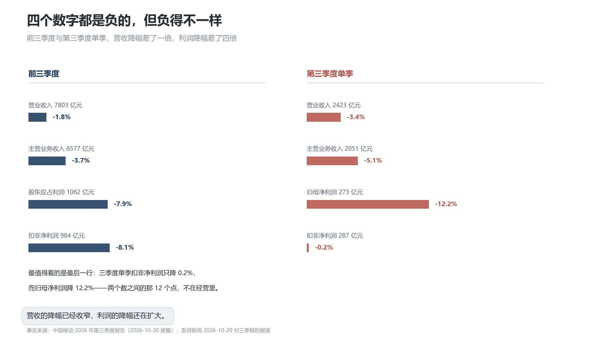
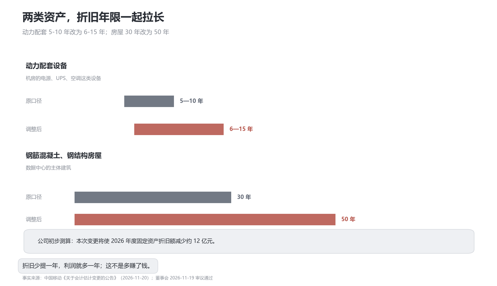
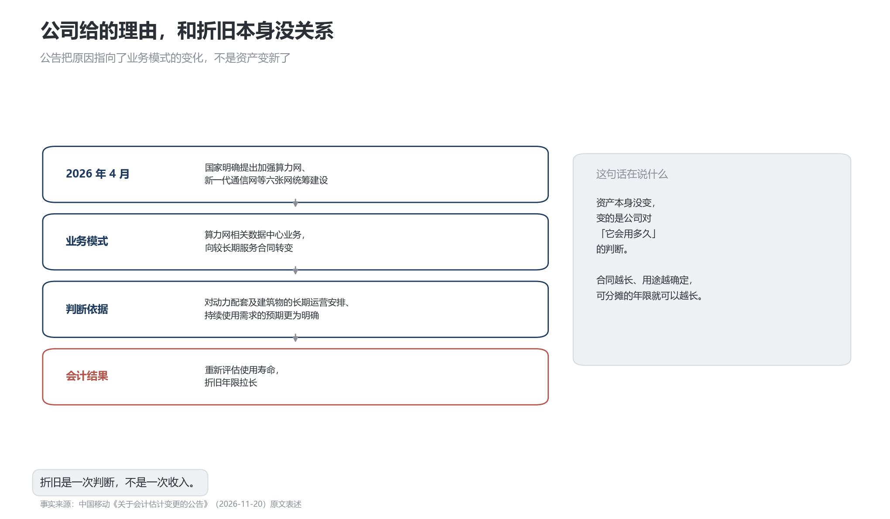

# 净利降 7.9%，折旧却少提 12 亿：中国移动三季报里的两个方向

10 月 20 日，中国移动披露 2026 年三季报。

一个月后，11 月 20 日，又发了一份《关于会计估计变更的公告》。

两份文件放在一起看，会发现它们指向两个相反的方向。

## 四个数字都是负的，但负法不一样

先看三季报。

前三季度营业收入 7803 亿元，同比下降 1.8%；主营业务收入 6577 亿元，下降 3.7%；股东应占利润 1062 亿元，下降 7.9%；扣非净利润 984 亿元，下降 8.1%。

单看第三季度：营业收入 2423 亿元，下降 3.4%；主营业务收入 2051 亿元，下降 5.1%；归母净利润 273 亿元，下降 12.2%。

但同一行里还有一个数：三季度单季扣非净利润 287 亿元，只下降 0.2%。

这是个很关键的裂口。归母净利润降 12.2%，扣非只降 0.2%——两个数之间差了 12 个百分点。扣非的意思是"扣掉不经常发生的损益"，也就是说，这 12 个点的差距，不是主业赚得少了，而是主业之外的东西在拖。

## 用户还在涨

和利润的下降同时发生的，是用户数继续增长。

截至 9 月 30 日，移动客户 10.14 亿户，本年累计净增 888.6 万户，5G 网络客户达 7.02 亿户。宽带联网客户 3.42 亿户，本年累计净增 1304.9 万户——这个增速比移动客户快得多。

物联网卡连接数 14.97 亿户，本年累计净增 1503.2 万户，但三季度单季净减 1454.6 万户。

这组数据说明的是：连接规模还在扩，结构在往宽带和物联网挪，但物联网这块的波动很大，一个季度就能减少一千多万。

## 折旧年限，突然拉长了

现在看那份 11 月的公告。

董事会 11 月 19 日审议通过了《关于部分资产折旧年限调整的议案》，自议案生效之日起执行：部分动力配套设备折旧年限由 5-10 年调整为 6-15 年；钢筋混凝土、钢结构房屋由 30 年调整为 50 年。

按公司初步测算，这次变更将使 2026 年度固定资产折旧额减少约 12 亿元。

12 亿是什么概念？对照前三季度 1062 亿元的利润，占比约 1%。不是决定性的，但方向很明确——折旧少了，利润就多了。

这里必须说清楚一件事：折旧年限拉长，不等于公司多赚了钱。它是一次会计判断的调整，钱没有变多，只是成本被摊到更长的年份里去了。

## 公司给的理由，和折旧本身没关系

公告没把原因写成"资产状态变好"，而是给了一条完整的逻辑链。

第一步：2026 年 4 月，国家明确提出加强算力网、新一代通信网等"六张网"统筹建设、多网协同的长期战略。

第二步：2026 年以来算力服务规模快速增长，算力网相关数据中心业务的经营模式，向较长期服务合同转变。

第三步：对动力配套及建筑物等数据中心相关基础设施的长期运营安排，以及持续使用需求的预期更为明确，因此对相关资产的使用寿命做综合评估。

这条链的关键在第二步：合同变长了。

传统 IDC 租机柜，客户一年一签甚至更短，机房设备什么时候淘汰说不准。而算力网的数据中心业务如果转向较长期服务合同，设备的用途和使用年限就变得可预期——既然要用更久，折旧自然可以摊更久。

所以这次调整的真正含义是：公司认为自己那些机房，从"随时可能改用途"变成了"长期稳定的生产设施"。

## 落到：两份文件不矛盾

三季报说利润在降，公告说折旧可以少提。看起来一个坏一个好，其实是同一件事的两面。

利润承压，说明传统业务的增长见顶了——主营业务收入单季降 5.1%，这不是短期波动能解释的。

而折旧年限调整，说明公司正在把资产的性质重新定义：从通信机房的配套，变成算力基础设施。这个重新定义的依据，是合同的期限，不是会计的技巧。

至于 12 亿能不能兑现，要看那些长期服务合同是否真的签下来、签了多长。会计估计只能反映已有的判断，改变不了判断本身。

三季报里那 12 个百分点的裂口，和这份公告里的 12 亿元，数字巧合，但它指向同一件事：中国移动的账，正在从"通信"往"算力"上挪。

---

*事实来源：中国移动 2026 年第三季度报告（2026-10-20 披露，按中国企业会计准则、未经审计）：前三季度营业收入 7803 亿元（同比降 1.8%）、主营业务收入 6577 亿元（降 3.7%）、其他业务收入 1226 亿元（增 9.9%）、股东应占利润 1062 亿元（降 7.9%）、股东应占利润率 13.6%、扣非归母净利润 984 亿元（降 8.1%）、EBITDA 2475 亿元（降 6.7%）、EBITDA 率由 33.4% 降至 31.7%；第三季度单季营业收入 2423 亿元（降 3.4%）、主营业务收入 2051 亿元（降 5.1%）、归母净利润 273 亿元（降 12.2%）、扣非归母净利润 287 亿元（降 0.2%）；截至 2026-09-30 移动客户 10.14 亿户（本年累计净增 888.6 万户）、5G 网络客户 7.02 亿户、宽带联网客户 3.42 亿户（本年累计净增 1304.9 万户）、物联网卡连接数 14.97 亿户（本年累计净增 1503.2 万户，三季度单季净减 1454.6 万户）；据澎湃新闻 2026-10-20 对三季报及运营数据的报道、中国经济网 2026-10-21、格隆汇 2026-10-20、证券日报 2026-10-21。会计估计变更据中国移动《关于会计估计变更的公告》（2026-11-20 披露，董事会 2026-11-19 审议通过《关于部分资产折旧年限调整的议案》）：部分动力配套设备折旧年限由 5-10 年调整至 6-15 年，钢筋混凝土、钢结构房屋折旧年限由 30 年调整至 50 年；初步测算使 2026 年度固定资产折旧额减少约 12 亿元；无需提交股东大会审议；原因表述为"2026 年 4 月国家正式明确提出加强算力网、新一代通信网等'六张网'统筹建设、多网协同的长期战略……2026 年以来，集团算力服务规模快速增长，算力网相关数据中心业务的经营模式向较长期服务合同转变……对相关资产的使用寿命进行综合评估"；据证券日报网 2026-11-20、同花顺 2026-11-20、香港交易所披露易海外监管公告（2026-11-20）。*

*需说明四点。其一，"归母净利润与扣非净利润相差 12 个百分点、差距来自主业之外"为本文据公开财务数据的推断，公司未就此作出解释，具体构成须以财报附注为准。其二，12 亿元与前文 12 个百分点无任何数量关系，文中已点明属"数字巧合"，不应解读为同一来源。其三，"传统业务增长见顶""从通信机房变成算力基础设施"等为作者分析，不代表公司观点；公司对本次变更的表述仅为资产使用寿命的重新评估。其四，本次会计估计变更自议案生效之日起执行，12 亿元是"初步测算"的 2026 年度折旧减少额，非已实现利润，实际金额以年度审计结果为准。*
