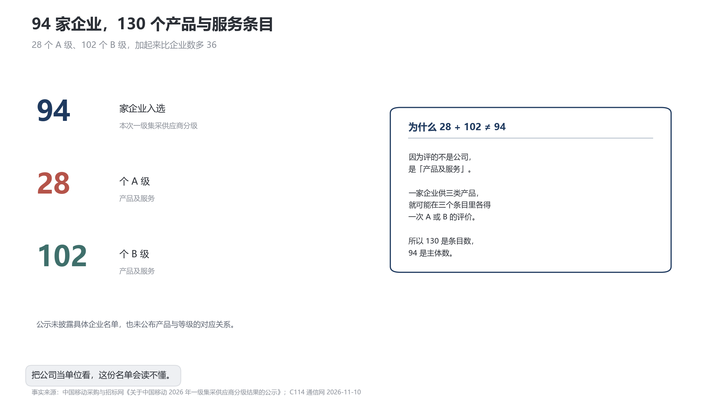
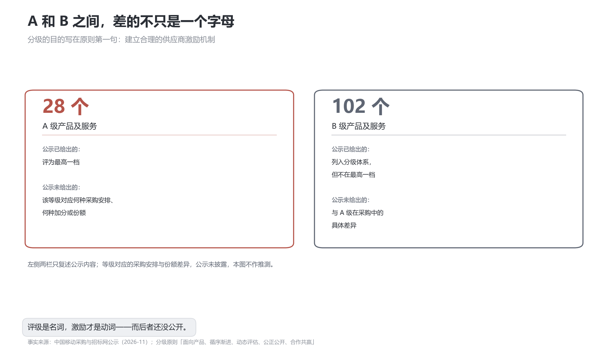
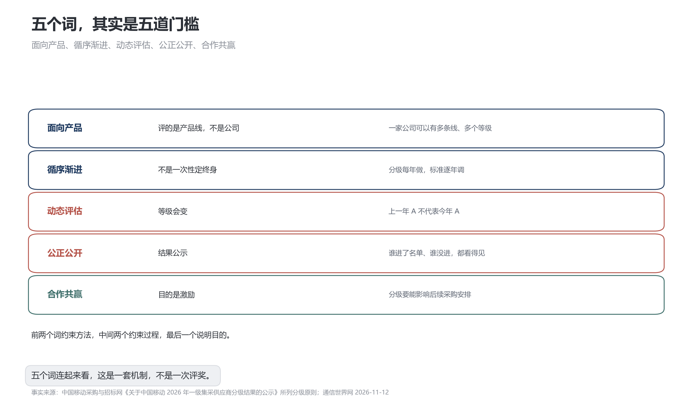

# 94 家供应商、28 个 A 级：中国移动这份名单，评的不是企业

11 月，中国移动采购与招标网挂出一份公示：《关于中国移动 2026 年一级集采供应商分级结果的公示》。

公开报道的口径是：94 家企业入选，其中 28 家获评 A 级"产品及服务"，102 家获评 B 级"产品及服务"。

看到这三个数字，第一反应通常是算不清：28 加 102 是 130，比 94 多了 36。

这份名单的入口就在这里。

## 多出来的 36 个，是产品线

差额不是笔误，是口径。

这次分级评的对象写得很清楚——"产品及服务"，不是"企业"。

一家公司如果同时供三类产品，它就可能在三个条目里各得一次评价：某条产品线评上 A，另一条评 B，第三条只进 B 级。

所以 130 是条目数，94 是主体数。把公司当单位去读这份名单，一定读不通。

这也是"面向产品"四个字的意思。它写在分级原则的第一句——"面向产品、循序渐进、动态评估、公正公开、合作共赢"。

## 为什么要把评价拆到产品线

从采购方的角度，这几乎是必然的。

一家大厂的光纤光缆做得很好，不代表它的服务器也好；一个厂商的路由器是行业标杆，它的摄像头可能只是合格水平。

如果按企业整体打分，结果是两头都不准：好的产品线被拖累，差的产品线被掩护。

拆到产品线之后，采购方能做的事就细了——同一个招标包里，可以让某家的强项多拿份额，弱项少拿，而不是"要么全用、要么全不用"。

这类调整在集采里价值很高。集采的特点是量大、周期长，一次错配的代价会被放大很多倍。

## A 和 B 之间差什么

这是最容易被过度解读的地方，得说清边界。

公示给出的只有等级本身：28 个 A、102 个 B。它没有说 A 级在后续采购里能加几分、能拿多少份额、能不能免检或走简化流程。

网上有不少解读，把"分级"直接等同于"评审加分""份额倾斜"。这些安排在实践中确实常见，但那是行业惯例，不是这份公示的内容。

公示能确认的只有一件事：有一个 130 条的等级清单存在，其中 28 条在最高一档。

至于这个等级会带来什么，要看后续的采购文件怎么写。

## 五个原则，五个不同的约束

那份原则里的五个词，其实在约束不同的东西。

**面向产品**——约束评价对象。评产品线，不评公司整体。

**循序渐进**——约束节奏。不是一次性定终身，标准逐年调整。

**动态评估**——约束时效。上一年是 A，不代表今年还是 A。

**公正公开**——约束过程。结果要公示，谁进了名单、谁没进，都能看到。

**合作共赢**——约束目的。分级不是为了排名，是为了影响后续的采购安排，让做得好的拿到更多。

前两个词管方法，中间两个管过程，最后一个管目的。五个词连起来，是一套机制，不是一次评奖。

## 落到：公示给了一半

这份名单的价值，在于它把"供应商管理"这件事从黑箱里拉出来了一半。

过去供应商和运营商的关系，外界只能看到中标结果；中间怎么评、评了什么、谁在哪个品类强，是不透明的。

现在至少能看到：有 94 家企业、130 个产品条目、28 个最高档。

没看到的是另一半：具体名单、产品与等级的对应关系、等级对应的采购后果。

一份公示能公开到什么程度，本身就是治理水平的一部分。这次公开了结构，还没公开细节。

对供应商来说，这已经足够改变行为——知道自己被按产品线打分，就会知道该往哪条线上投研发。

对观察者来说，能读出的只有一个方向：集采正在从"一次性招标"变成"长期分级管理"。

---

*事实来源：2026 年 11 月，中国移动采购与招标网发布《关于中国移动 2026 年一级集采供应商分级结果的公示》。分级工作原则为"面向产品、循序渐进、动态评估、公正公开、合作共赢"。公示包含 94 家供应商，其中 28 家获评 A 级产品及服务，102 家获评 B 级产品及服务。据 C114 通信网 2026-11-10《94 家企业入选中国移动 2026 年一级集采供应商》、通信世界网 2026-11-12《94 家！中国移动公布 2026 年一级集采供应商名单》、光电通信 2026-11-10、通信产业网 2026-11-16。*

*需说明四点。其一，28 与 102 相加为 130，多于 94 家企业，本文据此判断分级对象为"产品及服务"条目而非企业主体；该解释与公示表述（"A 级产品及服务""B 级产品及服务"）一致，但公示未直接说明两者数量关系的成因，本文的"一家企业可对应多个条目"为合理推断，非公示原文。其二，公示未披露具体企业名单、产品与等级的对应关系，亦未公布 A 级与 B 级在后续采购中的具体差异；本文对此明确标注"公示未给出"，未引用任何未经证实的加分比例、份额倾斜或免检安排。其三，"评产品线不评企业更准确""集采正从一次性招标变成长期分级管理"等为作者分析，不代表中国移动观点。其四，A 级与 B 级的评定标准、评分细则不在本次公示范围内，本文未作推测。*
