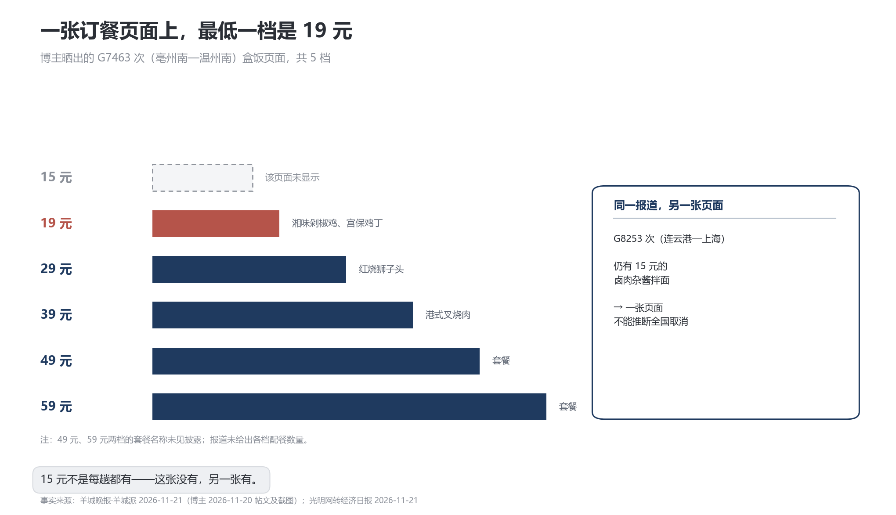
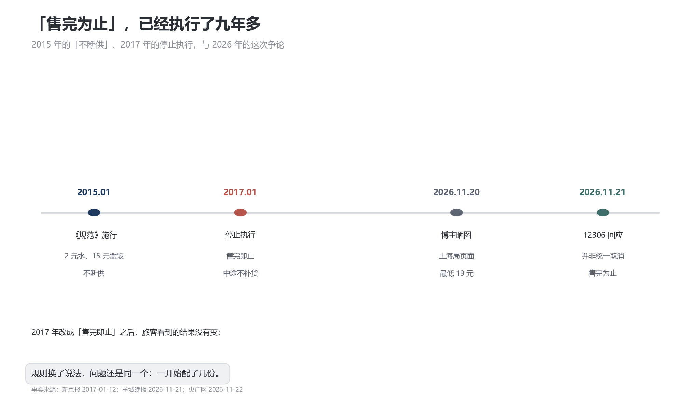
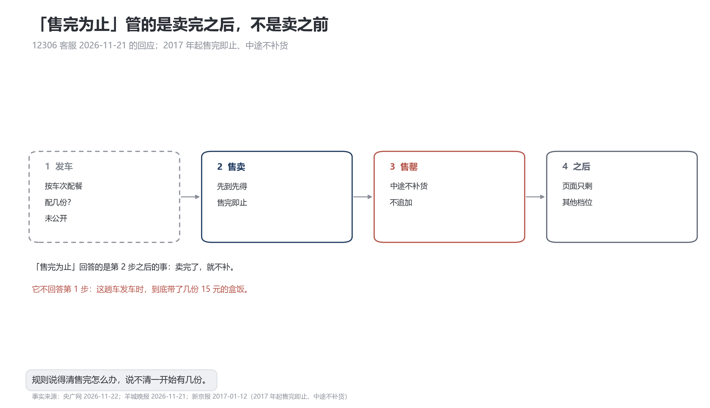

# 15元盒饭「售完为止」：你上次在高铁上吃到它，是哪一年

你上一次在高铁上买到15块钱的盒饭，是哪一年的事？

11月20日，有博主在社交平台发帖：“以后高铁的‘15元盒饭’貌似就要消失了。”配图是一张列车餐食订购页面截图。博主说，上海局高铁盒饭价格已调整为19元、29元、39元、49元、59元等档位。

评论区有人接了一句：“19号还有，20号就没了。”

11月21日，12306客服回应：并非统一取消低价餐食；不同车次的餐食种类、价格、库存都不同，列车提供高、中、低不同价位的餐食，实行“售完为止”。15元盒饭售罄，就买不到了。

“售完为止”在程序上没有问题。问题在另一头：一趟车到底配了几份15元的饭？这个数字，有人知道吗？

## 那张截图上，最低一档是19元

羊城晚报记者看到了博主发布的截图原图：G7463次（亳州南—温州南），湘味剁椒鸡套餐、宫保鸡丁套餐都是19元，红烧狮子头29元，港式叉烧肉39元，页面上没有15元盒饭。

同一篇报道里还有另一张截图：网友晒出的G8253次（连云港—上海），页面上仍有15元的卤肉杂酱拌面。这位网友说，15元餐食还有，但部分餐食的价格和品种变了。

两张截图放在一起，能确认的只有：有的车次页面没有15元，有的还有。凭一张图说“全国取消”，不成立——12306否的也正是这个。

## “售完为止”不是新词

把时间往前拨。

2015年1月1日起施行的《铁路旅客运输服务质量规范》第九条写明：列车餐饮“供应品种多样，有高、中、低不同价位的预包装饮用水、2元预包装饮用水和15元盒饭不断供”。

2017年1月，新京报从12306确认：自当年1月1日起，“15元盒饭不断供”已以“内部要求”的形式停止执行，具体表现是售完即止、中途不再补货。

也就是说，“售完为止”到今天已经执行了将近十年。它不是这次才有的说法，而是一条旧规则，被一张新截图重新照亮。

## 缺的那个数字

规则说的是“卖完之后怎么办”：售完即止，不补货。规则没说的是“一开始配了几份”。

12306说不同车次的“库存有所不同”。库存不同，配餐数量就不同。这本身正常。但从旅客这端看，能看到的只有订餐页面：有，或者没有。这趟车发车时带了几份15元盒饭、卖到第几份售罄、中途有没有补过，页面不显示，公告里也没有。

于是“售完为止”成了一个无法验证的答案：它可能真的卖完了，也可能本来就没配几份。两种情况下，旅客听到的是同一句话。

如果你也从来没在高铁上买到过15元的盒饭，原因大概就在这里：不是它不存在，而是它一趟带几份、什么时候卖完，从来不写在你能看到的地方。

## 落到：问一句，比猜一句有用

12306给了一个可操作的口径：具体价格以列车实际标价为准，可以扫车厢二维码，或者去餐车问工作人员；15元盒饭售罄了，也可以问有没有其他低价食品。

想吃到15元那一档，与其等推车，不如上车后先去餐车问一句。这不能保证有，但比坐在座位上碰运气多一步。

而那个真正该被回答的问题还在原地：一条线上，15元的盒饭到底配了几份？“售完为止”是规则，但规则要让人信服，得先让人看得见它一开始摆了多少。

在看见之前，每个人只能用自己的记忆作答：你上次在高铁上吃到15块钱的盒饭，是哪一年？

---

*事实来源：2026年11月20日博主帖文及截图（上海局盒饭档位19元、29元、39元、49元、59元，“19号还有，20号就没了”跟评），据羊城晚报·羊城派2026-11-21《高铁15元盒饭要消失了？12306回应：不同车次有所不同，15元餐“售完为止”》、光明网转经济日报2026-11-21、央广网2026-11-22；G7463次（亳州南—温州南）页面未见15元盒饭、G8253次（连云港—上海）页面仍有15元卤肉杂酱拌面，据羊城晚报同日报道；12306客服“不同车次的餐食种类、价格及库存有所不同，列车提供高、中、低不同价位的餐食，实行‘售完为止’，并非统一取消低价餐食”及“售罄可询问列车工作人员是否有其他低价食品”“具体价格以列车实际标价为准，可扫车厢二维码或到餐车询问”，据央广网、羊城晚报；2015年1月1日施行《铁路旅客运输服务质量规范》第九条“2元预包装饮用水和15元盒饭不断供”、2017年1月1日起以“内部要求”停止执行、售完即止中途不补货，据新京报2017-01-12《12306：不再执行“15元盒饭不断供”政策》。*

*需说明三点。其一，“上海局盒饭价格已调整”是博主个人陈述，12306未确认统一调价，本文只作为帖文内容引用；“19号还有，20号就没了”是网友跟评，未核实到具体车次。其二，15元盒饭是否“消失”不能由单张截图推断：同一报道中另一车次页面仍有15元餐食，12306亦明确“并非统一取消”。其三，“每列车配几份15元餐未公开”是本文基于公开信息的判断，不是铁路部门表述；本文未获得任何车次的具体配餐数量，也未对某趟车是否真的“售完”作判断。*