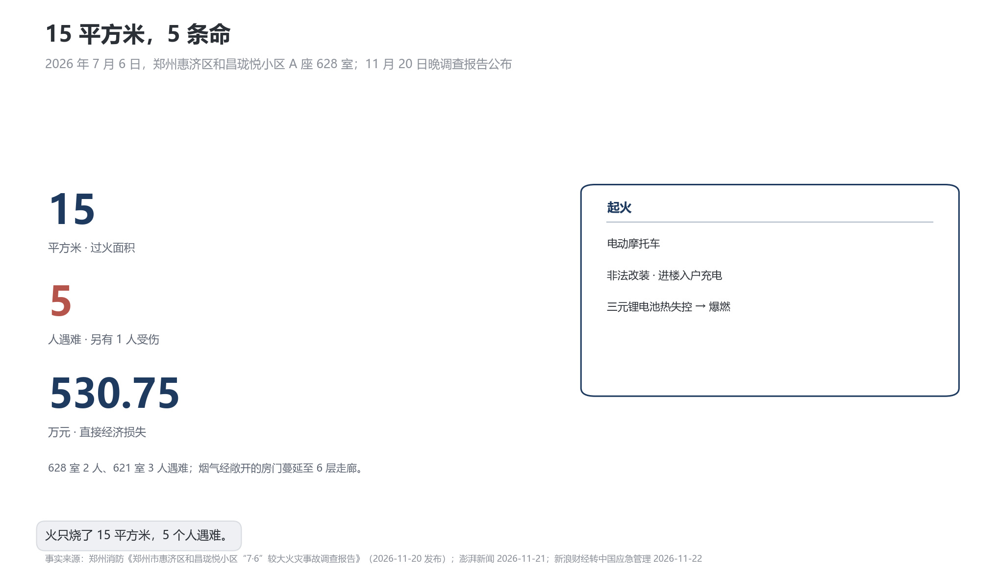
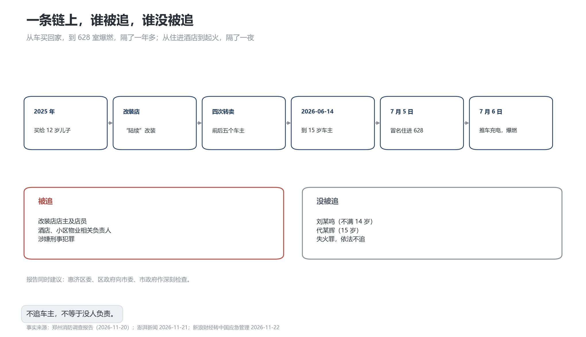
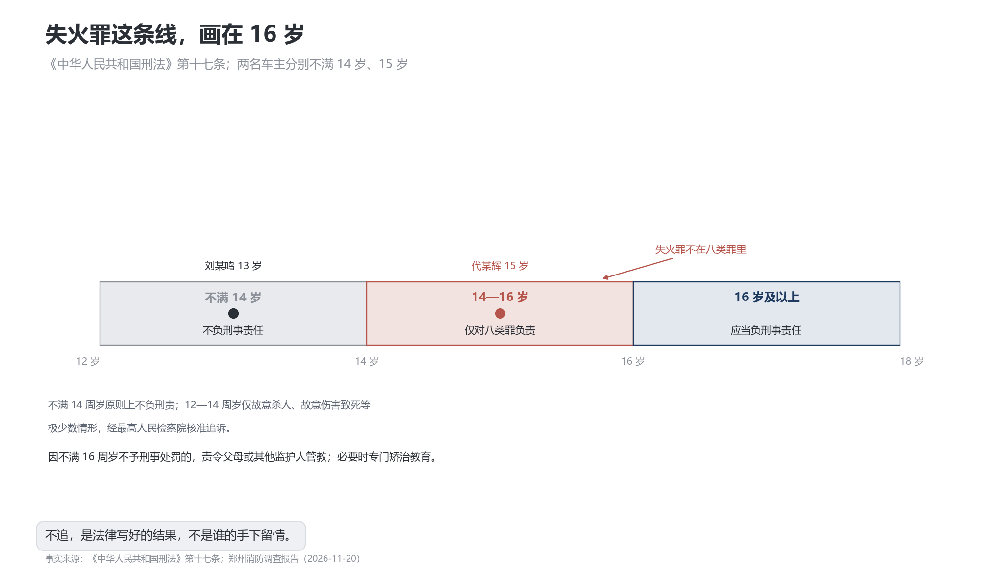

# 5条命，两个不满16岁的车主：不追刑责，追谁

7月6日早上7点50分，郑州惠济区和昌珑悦小区A座628室，一辆电动摩托车爆燃。烟从房间涌进走廊，5人遇难，1人受伤。

11月20日晚，郑州市政府事故调查组公布调查报告：过火面积约15平方米，直接经济损失530.75万元。认定这是一起电动摩托车非法改装、违规进楼入户充电，锂电池热失控后爆燃引发的火灾事故。

报告里有一句比“5死1伤”更扎眼：涉事车辆一手车主刘某鸣，不满14岁；现任车主代某辉，15岁。两人都涉嫌失火罪，调查组建议不追究刑事责任。

同一份报告的另一句是：酒店和小区物业相关负责人、电动车改装店店主及店员，涉嫌刑事犯罪，已被采取强制措施或建议移送司法机关。

一边建议不追，一边建议移送。评论区大概会吵成两派：年龄是不是挡箭牌？追两个未成年人有什么用？

先把法律这层说清楚。

刑法第十七条：已满16周岁的人犯罪，应当负刑事责任；已满14周岁不满16周岁的人，只对故意杀人、故意伤害致人重伤或者死亡、强奸、抢劫、贩卖毒品、放火、爆炸、投放危险物质这八类罪负责；不满14周岁，原则上不负刑事责任（12至14周岁仅故意杀人、故意伤害致死等极少数情形，经最高检核准才追诉）。失火罪，不在八类罪里。

所以“建议不追”不是调查组心软，是法律没留别的选项。一个15岁的人犯了失火罪，依法就是追不了。把这条线当成“挡箭牌”，是把立法画的年龄线，当成了办案者的态度。

但法律还有后半句：因不满16周岁不予刑事处罚的，责令其父母或者其他监护人加以管教；必要时，依法进行专门矫治教育。不追刑责，不等于没有后果。

更不等于没人负责。报告把链条摆了出来：2025年，刘某亮把这辆车买给12岁的儿子刘某鸣；刘某鸣在邓某昊经营的改装店“陆续”改装；车经四次转卖，2026年6月14日到了15岁的代某辉手里；7月5日，三个15岁少年冒用他人身份信息，订了酒店628室；当晚，他们把余电不多的车骑进电梯门厅，底盘电池包磕到台阶，再推进电梯、推进房间充电；第二天早上，电池爆燃。

这条链上，每一环都能问一句为什么：改装店为什么给一个不满14岁的孩子改车，还“陆续”改？四次转卖，有没有人看过这辆车的电池？酒店前台为什么没拦住三个冒用身份入住的未成年人？物业为什么让一辆电摩进了电梯？还有报告专门写到的：起火楼层自动喷水灭火系统管道无水，喷头没起作用。

报告给了部分答案：改装店店主及店员、酒店和物业相关负责人，涉嫌刑事犯罪；惠济区委、区政府被建议向市委、市政府作深刻检查。

年龄线是死的，16岁就是16岁，为一场火灾去改它，既不该也不能。但改装店的门、酒店的前台、电梯口的阻拦、喷淋管里的水，都是活的。

5条命换来的报告，如果只被读成“两个孩子不用坐牢”，那才是真正的轻放。

下一次，一辆改装电摩被推进电梯时，车主会是几岁？这一次，链条上该被追的人，追到了没有？

---

*事实来源：2026年11月20日晚，“郑州消防”微信公众号发布《郑州市惠济区和昌珑悦小区“7·6”较大火灾事故调查报告》，据澎湃新闻2026-11-21《爆燃致5人遇难，郑州市调查组：建议不追究车主刑责，酒店负责人、改装店店主及店员涉嫌刑事犯罪》、新浪财经2026-11-22转“中国应急管理”《非法改装+入户充电+锂电池爆燃！这起较大火灾事故调查报告公布》、新华社2026-07-06火灾通报及凤凰网2026-11-21报道。报告载明：2026年7月6日7时51分，惠济区刘寨街道北三环和昌珑悦小区A座628室起火，过火面积约15平方米，5人死亡、1人受伤，直接经济损失530.75万元；起火原因为628室内电动摩托车经改装的三元锂电池充电热失控后爆燃；蔓延扩大原因包括房门敞开致烟气扩散、起火楼层自动喷水灭火系统管道无水。涉事车辆2025年由刘某亮买给儿子刘某鸣（当年12岁），刘某鸣在邓某昊经营的电动车改装门店“陆续”改装，经四次转卖于2026年6月14日到代某辉（15岁）手中；7月5日，谢某泽、孙某博、代某辉（均15岁）冒用他人身份信息预订凯缤悦旅馆628室并入住，当晚将车推入电梯上楼充电。处理建议：酒店和小区物业相关负责人、改装店店主及店员涉嫌刑事犯罪，已被采取强制措施或建议移送司法机关；刘某鸣涉嫌失火罪、不满14岁，建议不予追究刑事责任；代某辉涉嫌失火罪、不满16岁，建议不追究刑事责任；建议惠济区委、区政府向市委、市政府作深刻检查。刑事责任年龄依据《中华人民共和国刑法》第十七条（2023年修正文本，四川省公安厅发布）。*

*需说明四点。其一，调查报告全文未公开，本文依据“郑州消防”发布内容及新华社、澎湃新闻、新浪财经转“中国应急管理”的报道，未引用未见于上述来源的细节。其二，“建议不追”是调查组建议；对不满16周岁者犯失火罪，依法不负刑事责任，最终处理以司法机关决定为准。其三，5名遇难者身份及1名伤者后续情况，公开报道未披露，本文未作推断；对改装店、酒店、物业“涉嫌刑事犯罪”的具体罪名，公开报道未载明，本文未猜测。其四，“喷淋管道无水”是报告列明的蔓延扩大原因，其管理责任认定以报告及后续处理为准；文中“每一环都能问一句为什么”为作者提问，不代表调查报告已认定上述各环节均有过错。*