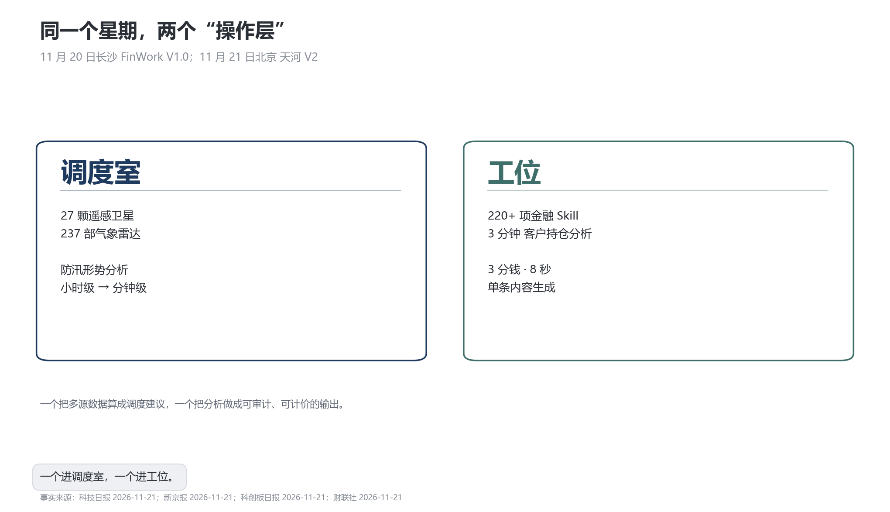
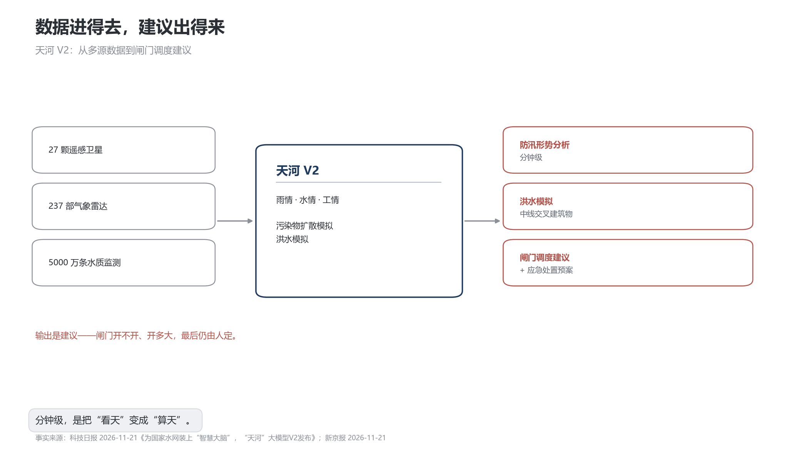
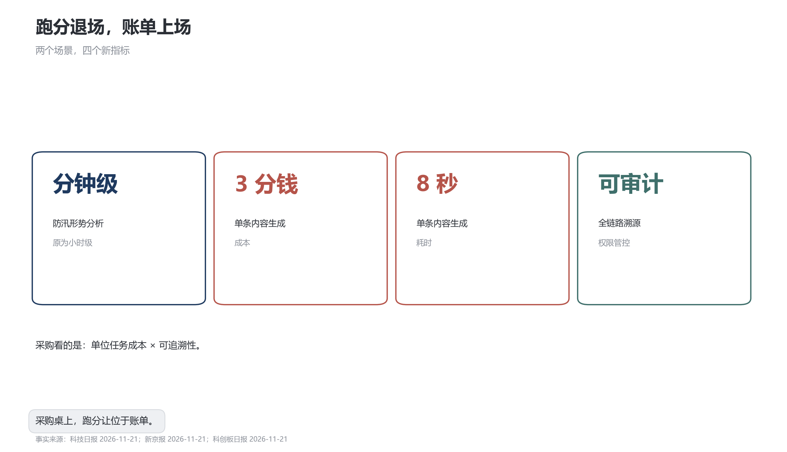

# 大模型不进聊天框，进调度室

11月21日，北京，南水北调“天河”大模型V2在第三届国家水网论坛上发布。前一天，长沙，财跃星辰发布金融智能体FinWork V1.0。一北一南，两场发布会说的是同一件事：大模型正在离开聊天框。

## 水利：从“看天”到“分钟级”

“天河”V2接入遥感卫星27颗、气象雷达237部，汇聚雨情、水情、工情，防汛形势分析从小时级压缩到分钟级。2026年汛期，“巴威”“白海豚”等超强台风来袭时，它实时跟踪路径、比对相似台风的降雨特征，对南水北调中线交叉建筑物做洪水模拟。冰期输水，这套模型还帮调度多供了1.58亿立方米水。这条线累计调水已超920亿立方米，近2亿人受益——调水越多，越经不起“拍脑袋”。

水质这条线更具体：覆盖水源区、输水区、受水区的5000万条监测数据整编入库，水质预演智能体可模拟污染物、藻类迁移扩散，生成闸门调度建议和应急处置预案。

为什么能进调度室？天河V2的底座是“1+2+3+N”：一个信创智算云，通用大模型、多模态模型加水利专业模型，再往上长场景智能体。数据、机理、模型拧在一起，输出才敢写进值班表。

注意措辞：是“建议”。闸门开不开、开多大，最后仍由人定。模型做的是把多源数据算成一张可执行的方案，不是替人按下按钮。

## 金融：3分钱、8秒、可审计

FinWork内置220余项金融Skill，3分钟完成客户持仓分析；内容生产场景下，单条成本约3分钱、耗时8秒。国泰海通已落地1300余个Agent，覆盖260余个场景；国金证券也报了数：150余个场景、400余个Skill、累计调用超8000万次。

比数字更值得看的是配套：全链路溯源、企业级权限管控——关键数据与观点可追溯到来源和工具调用链，权限按“独立确权、最小确权、限时授权”管理。金融业不缺聪明模型，缺的是出了事能查、能定责的模型。

## 评价标准换了

过去两年，大模型比的是跑分：榜单第几、参数多少。现在，水利比“小时级到分钟级”，金融比“3分钱、8秒、能不能审计”。

单位任务成本和可追溯性，越来越像采购桌上的硬指标。原因不复杂：调度室不为“聪明”买单，工位也不为“参数量”买单，只为“可用、可控、算得过账”买单。对采购方来说，这比榜单名次好验：跑一次，记时间、记成本、查日志。

## 但别急着封神

天河给的是建议，不是自动调度；“分钟级”是防汛形势分析，不是整个决策链条。FinWork的3分钱，是单条内容生成成本，不是全流程成本。大模型进了操作层，但还没拿到方向盘。

## 落点

下一阶段的竞争，不在“谁有最强模型”，在“谁能以可审计的成本，把能力嵌进真实生产回路”。模型再大，进不了调度室，就只是聊天框里的一段回答。

---

*事实来源：南水北调“天河”大模型V2于2026年11月21日在第三届国家水网及南水北调高质量发展论坛（北京）发布，据科技日报2026-11-21《为国家水网装上“智慧大脑”，“天河”大模型V2发布》、新京报2026-11-21《南水北调“天河”大模型完成升级》、央广网2026-11-22；FinWork V1.0于2026年11月20日在长沙发布，据科创板日报2026-11-21《财跃星辰发布FinWork V1.0 金融智能体开启“按岗位交付”规模化落地新阶段》及财联社同日电讯。具体数据：天河V2接入遥感卫星27颗、气象雷达237部，防汛形势分析由小时级压缩至分钟级；2026年汛期跟踪“巴威”“白海豚”等超强台风、开展中线交叉建筑物洪水模拟；水质监测数据入库5000万条，可模拟污染物、藻类迁移扩散并生成闸门调度建议及应急处置预案；2025—2026年度冰期比计划多供水1.58亿立方米。FinWork内置220余项金融Skill，3分钟完成客户持仓分析，单条内容生成成本约3分钱、耗时8秒，支持全链路溯源与企业级安全权限管控，权限遵循独立确权、最小确权、限时授权；国泰海通已落地1300余个Agent、覆盖260余个场景。*

*需说明三点。其一，“天河”输出的是“建议”，闸门调度与应急处置的最终决定权在人，本文未称其为自动调度；“分钟级”指防汛形势分析，不等于整个防汛决策链条的耗时。其二，FinWork“3分钱、8秒”是内容生产场景下“单条内容生成”的成本与耗时，不是全部任务或全流程成本；“3分钟”指客户持仓分析。其三，“单位任务成本和可追溯性正成为采购硬指标”为本文基于两场发布会信息的判断，不是发布方原话；两产品的实际采购与验收数据尚未公开。*