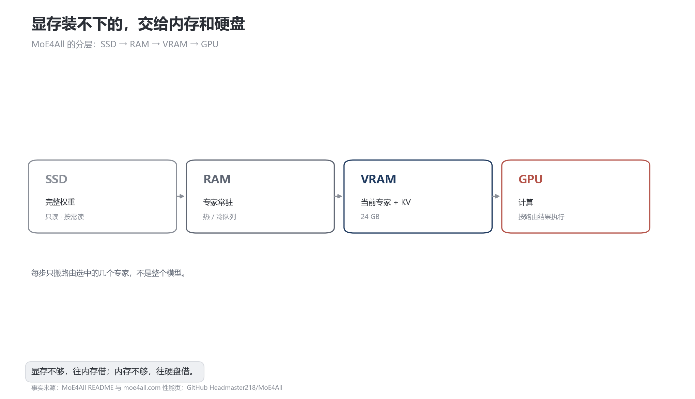
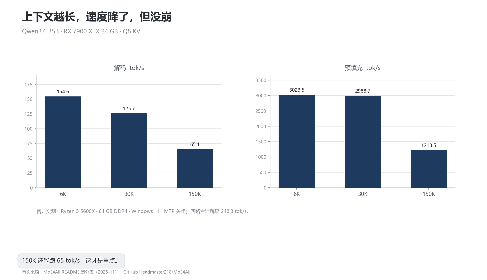
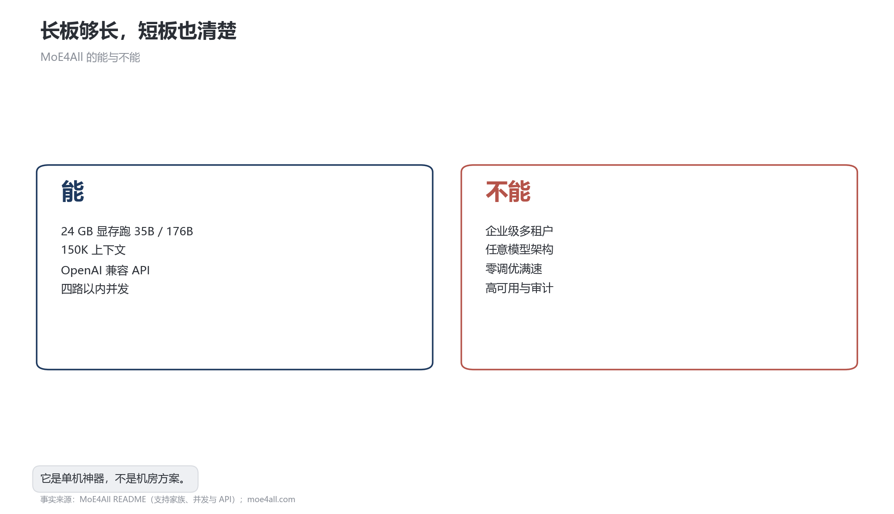

# 显存只有24G，模型有35B：MoE4All 把专家搬进了内存

一台 RX 7900 XTX，24GB 显存。要跑 Qwen3.6 35B，按 5.91 比特/权重算，光权重就超过 25GB。装不下。MoE4All 的办法是：不装。

## 只把当前用到的专家搬进显存

MoE 模型总参数大，但每步只激活一小部分专家。稠密模型每步都要过全部权重，MoE 每步只走一小撮——搬运量按激活比例缩小，这就是“按需搬运”的机会。

MoE4All 把专家权重留在内存，GPU 计算前按路由结果把选中的几块搬进显存，用完换出。像操作系统的分页：内存是页表，显存是物理页。内存也放不下时，权重还能放 SSD，按需读。

官方把这套调度叫“热/冷队列”：常用的专家留在显存热区，冷门的退回内存；预填充阶段把分块、专家加载和计算重叠起来，避免 GPU 干等。

## 显存里到底放了什么

24GB 不是全给权重。KV 缓存、激活值、热专家都要挤在里面。MoE4All 的策略是：热专家常驻、冷专家在内存排队、KV 按 Q8 存。官方测试把 Q8 KV 写成固定条件，换成更高精度，能塞的上下文就会缩水。

这也是为什么“24GB 跑 35B”听起来夸张，实际却很挑配置：内存要够大，带宽要够宽，SSD 最好也是 NVMe。三者缺一个，速度就往下掉。

## 跑分：从 6K 到 150K

官方在 RX 7900 XTX（24GB 显存、64GB DDR4、Windows 11、Q8 KV）上测：

- 6K：单路解码 154.6 tok/s，四路合计 248.3，预填充 3023.5；
- 30K：单路 125.7，预填充 2988.7；
- 150K：单路 65.1，预填充 1213.5。

更大的 Flash-Next 176B（4.27 比特）在 30K 下也有 50.4 tok/s。

看跑分先看条件：154.6 tok/s 是 6K 上下文、Q8 KV、MTP 关闭、四路并发的成绩；换成长上下文或更高精度，数字会掉。官方把测试机配置、量化方式、预热轮次都列了出来，这比只给一个峰值诚实。

预填充是“读题”，可以并行；解码是“答题”，只能一个个吐字，更吃带宽。所以上下文越长，解码掉得越明显——从 154.6 到 65.1。但没有 OOM，也没有掉到个位数。对消费卡，这是“能用”和“不能用”的区别。

## 代价写在架构里

分页的代价是搬运。专家在内存和显存之间来回走，带宽不够、多人同时抢，速度就断崖。它挑模型：目前覆盖 Qwen、Llama、Gemma、Ling、DeepSeek 等家族，冷门架构不一定认；多模态要手动挂 mmproj。

## 它不只跑模型

README 里还挂着 Agent 整合包、DSH 插件、语音与 Embedding 模型——引擎是底座，外面长了一圈本地 AI 工具。对只想“在自己电脑上有个能用的模型”的人，这比跑分更有吸引力。

## 谁该关心

如果你只是偶尔跑 7B、14B 的稠密模型，显存够，用 Ollama 更省事。MoE4All 的价值在“模型比显存大”的场景：权重加 KV 缓存超过显存，才轮得到它上场。判断标准就这么简单：装不下，才用得上。

## 落点

MoE4All 不是把消费卡变成 A100。它做的是把“跑不动”变成“跑得慢一点，但跑得完”。24GB 显存跑 35B、150K 上下文，两年前是机房的活，现在是一台游戏机。

真正的门槛不在模型，在内存条和主板：DDR 带宽、PCIe 通道，比跑分更能决定你的体验。

---

*事实来源：MoE4All 开源项目（GitHub Headmaster218/MoE4All，Apache-2.0，Rust，2026 年 8 月创建，截至发稿 372 星、51 个 fork）及其 README、官网 moe4all.com 性能页。跑分为官方公布：RX 7900 XTX 24GB、Ryzen 5 5600X、64GB DDR4、Windows 11、Q8 KV、MTP 关闭；Qwen3.6 35B Balanced（约 5.91 比特/权重）6K 上下文预填充 3023.5 tok/s、单路解码 154.6 tok/s、四路合计 248.3 tok/s；30K 预填充 2988.7、解码 125.7；150K 预填充 1213.5、解码 65.1；Flash-Next 176B（4.27 比特/权重）30K 解码 50.44 tok/s。*

*需说明三点。其一，本文未采用素材中“96 tok/s、1720 tok/s、256K、Q6”等数字——这些条件未能在项目 README 与官网当前页面核到；官方实测最高上下文为 150K，量化约 5.91 比特/权重。不同版本、驱动、内存配置会显著改变结果。其二，“热/冷队列”“分块与计算重叠”是项目文档对调度机制的描述，具体实现以其文档为准。其三，“真正的门槛在内存带宽与 PCIe”是作者判断；本文未对未公开的路线图作推测。*