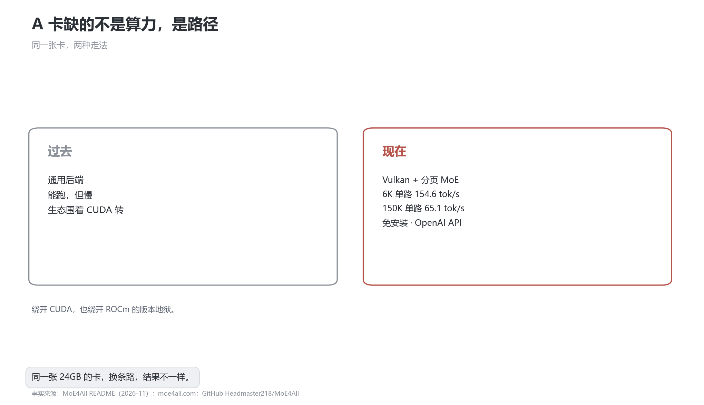
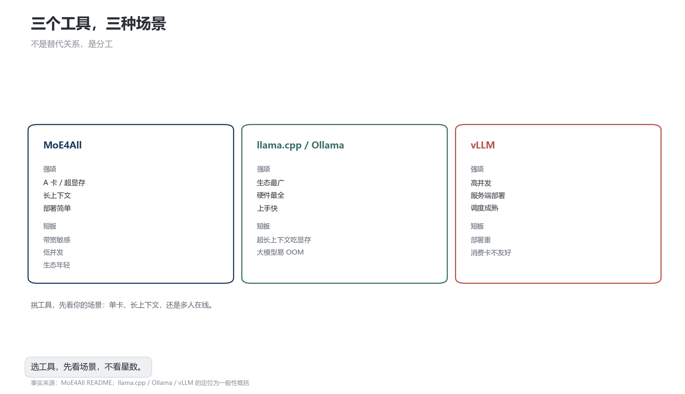
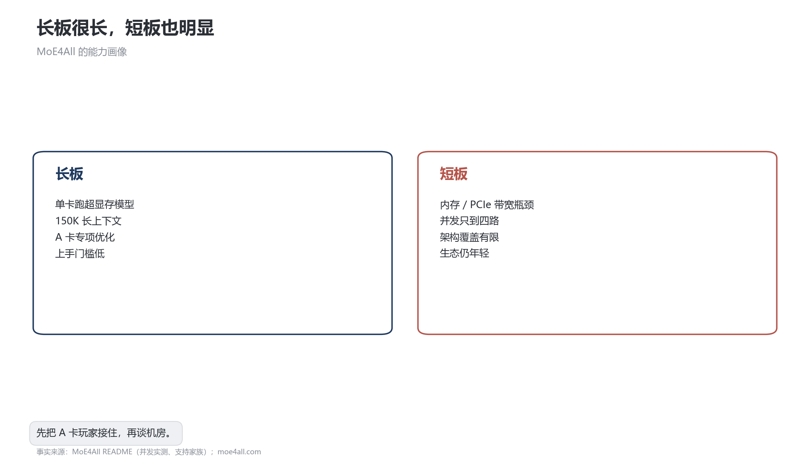

# A 卡的本地大模型，终于有人认真做了

过去几年，本地跑大模型基本是 N 卡的默认盘：CUDA 生态成熟，教程、量化、加速库都围着它转。A 卡用户要么用通用后端慢慢跑，要么放弃。MoE4All 是个例外——一个三百多颗星的开源项目，Rust 写的，主打 AMD，也支持 NVIDIA 和 Intel。

## 它解决的不是“能不能跑”，是“值不值得跑”

MoE4All 用 Vulkan 后端加分页 MoE，把专家权重放在内存、按需搬进显存。一张 24GB 的 RX 7900 XTX 能跑 35B 的 Qwen3.6：6K 上下文单路 154.6 tok/s，150K 还能保持 65.1 tok/s。这个数字放在半年前，A 卡用户不敢想。

门槛也低：Windows 免安装包二十兆左右，双击启动、向导选模型，自带 OpenAI 兼容 API。不用编译、不用配环境。这是“玩家能上手”和“工程师才配玩”的分界线。

## 为什么是现在

MoE4All 2026 年 8 月才建仓，三个月三百多颗星。这个速度说明的不是项目多成熟，是需求积压了多久：想在自己电脑上跑大模型、手里却只有 A 卡的人，一直没有一个“不用折腾”的选项。

## 但它是偏科生

官方的并发测试只做到四路（合计 248.3 tok/s），定位是单机、低并发；企业级的多租户与细粒度调度，仍是 vLLM 的地盘。它挑架构，Qwen、Llama、Gemma、Ling、DeepSeek 等家族之外不一定认；多模态要手动挂 mmproj；内存带宽和 PCIe 是硬瓶颈。

## 它对 AMD 意味着什么

一个社区项目补不上 ROCm 的坑，也改不了驱动。但它证明了一件事：A 卡的算力不是问题，路径才是。Vulkan 是跨厂商的通用接口，绕开 CUDA，也绕开 ROCm 的版本地狱——代价是少了些底层优化，换来的是“能跑”。

## 和另外两个选项比

llama.cpp / Ollama：生态最广、硬件覆盖最全，上手也快；但超长上下文更吃显存，模型大了容易 OOM。

vLLM：机房里的高并发王者，面向服务端；部署重，消费卡不友好。

MoE4All 夹在中间：用内存换显存，把“单卡长上下文”做到极致。三者不是替代关系，是场景分工。

## 谁适合用

手里有一张 24GB 级别的 A 卡，想跑 30B 以上的 MoE，主要自己用或小团队内部用——它是目前少数对口的选项。反过来，如果你要开多人共享的 API、要细粒度配额、要企业级审计，它现在给不了。

## 什么时候别用它

要 99.9% 可用性、要按部门计费、要完整的审计日志——这些不是它的设计目标。README 写得很直白：本机聊天，或提供 API 服务。把它塞进机房当共享推理池，是拿偏科生的短板去考试。

## 落点

MoE4All 的价值，不是“打败 CUDA”，而是让 A 卡用户第一次有一个“专门为我优化”的选项。它证明了一件事：消费级硬件上，显存不是唯一的路，内存和硬盘也能凑出一条。

这条路能走多远，看两件事：AMD 驱动和 Vulkan 生态能不能跟上，项目能不能从“单机神器”长成“能托管”的框架。在那之前，它是偏科生——单卡极限很惊艳，机房里的活，还得交给别人。

---

*事实来源：MoE4All 开源项目（GitHub Headmaster218/MoE4All，Apache-2.0，Rust，2026 年 8 月创建，截至发稿 372 星、51 个 fork），README 与官网 moe4all.com。官方实测条件：RX 7900 XTX 24GB、Ryzen 5 5600X、64GB DDR4、Windows 11、Q8 KV；Qwen3.6 35B（约 5.91 比特/权重）6K 单路解码 154.6 tok/s、四路合计 248.3 tok/s，150K 单路 65.1 tok/s；项目宣称支持 AMD、NVIDIA、Intel，Windows 免安装包约 20MB，提供 OpenAI 兼容 API；支持 Qwen、Llama、Gemma、Ling、DeepSeek 等模型家族。*

*需说明三点。其一，llama.cpp / Ollama / vLLM 的定位为一般性概括，不是同一硬件、同一模型、同一条件下的跑分对比；“OOM”“部署重”是常见使用体验，不构成对具体版本的评测结论。其二，“A 卡过去只能走通用后端”指 CUDA 之外缺乏专用优化路径的长期状态，不否认其他项目已做的 AMD 适配。其三，本文跑分采用项目 README 公布的官方数据；素材中“96 tok/s、1720 tok/s、256K”等数字未能核到对应条件，未采用。*