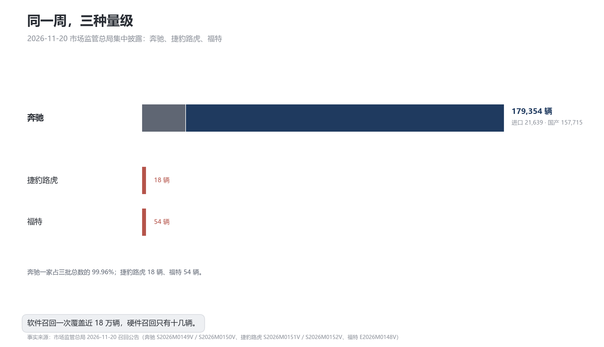
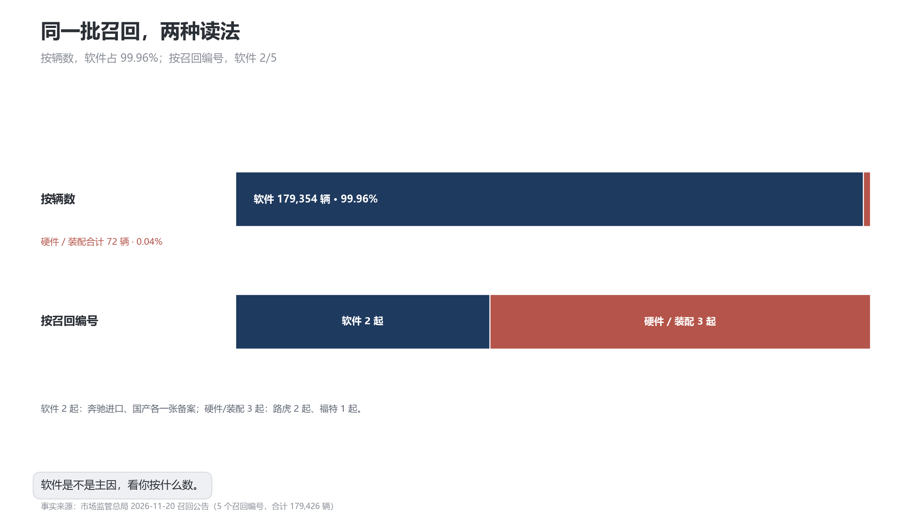
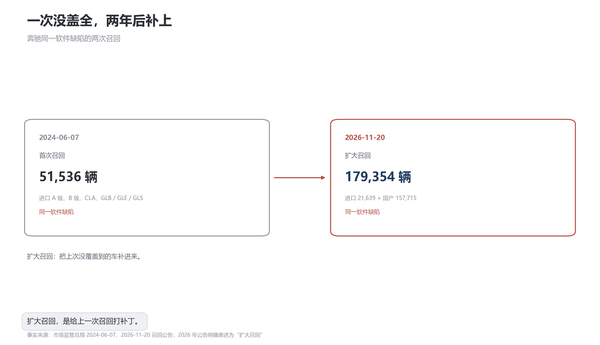

# 后雾灯的一个符号，召回近18万辆车

11月20日，市场监管总局集中披露三批汽车召回：奔驰、捷豹路虎、福特，合计179,426辆。最大的一笔来自奔驰——179,354辆，原因不是刹车，不是电池，是组合仪表上后雾灯的标志，可能不符合国家标准。

## 一个符号的召回

召回分两张备案：进口A级、B级、CLA、GLA、GLB、GLE、GLS共21,639辆；国产A级、GLA、GLB共157,715辆。缺陷描述很短：组合仪表控制单元软件开发过程中的偏差，导致后雾灯标志可能不满足国标对后雾灯符号的规定。处理方式是免费升级仪表控制单元软件。

后雾灯亮度远高于普通尾灯，雨雾天用错会晃到后车；仪表上的标志，是驾驶员判断开关状态的依据。符号不对，等于提示失真。

这不是第一次。2024年6月7日，奔驰就因同一问题召回过51,536辆进口车。这次是“扩大召回”——范围从进口扩到国产，数量从5万涨到近18万。

## 另外两起，量级完全不同

捷豹路虎：揽胜运动版17辆，后副车架可能存在裂纹，极端情况下影响行驶稳定性；卫士1辆，动力总成控制模块的PCB在装配中定位偏差、可能变形，极端情况下行驶中失去动力。

福特：F-150 54辆，燃油箱固定带可能未正确固定至车架纵梁，极端情况下油箱松脱、泄漏，有起火风险。

三起加起来72辆，不到奔驰的零头。

## 软件是不是“主因”，看你怎么数

按车辆数：软件缺陷179,354辆，占99.9%以上。
按召回编号：软件2起，硬件与装配3起。

所以“软件缺陷成为主因”是一句按数量成立、按事件不成立的话。软件召回的特点是“一次覆盖一大片”：同一个控制单元的偏差，可能写进同平台的所有车型；硬件缺陷往往按批次、按零件号切割，数量小，但更致命。

## 扩大召回，是给上一次打补丁

2024年的召回只覆盖进口车5万余辆；2026年把国产车和更多进口车型纳进来。至少说明，最初的追溯边界没有覆盖到后来这批车——可能是软件版本、生产日期或车型范围的判断偏差。扩大召回不是丑闻，它是召回制度里的纠错机制；但它也提醒：软件缺陷的“影响面”，比硬件更难一次划清。

## 成本账不一样

硬件召回要拆、要换，单辆车工时高；软件召回是一次升级，单辆成本低，但覆盖近18万辆，总量和组织成本并不低。更麻烦的是追溯：硬件按批次切，软件按版本切，版本一多，边界就模糊。

## 落点

对车主，这是一次免费软件升级，仪表上的图标改过来，事情就结束了。对行业，这是一次信号：软件定义汽车，意味着合规缺陷可以细到一个符号。今天召回的是后雾灯标志，明天可能是任何一个图标、一句提示、一次默认设置。

软件让车变得更可修，也让缺陷变得更可复制。这两件事，是同一枚硬币。

---

*事实来源：国家市场监督管理总局2026-11-20召回公告——梅赛德斯-奔驰（中国）及北京奔驰召回（S2026M0149V、S2026M0150V，合计179,354辆，因组合仪表控制单元软件开发偏差致后雾灯标志可能不符国标，免费升级软件，属2024年6月7日召回活动的扩大召回）；捷豹路虎（中国）及捷豹路虎（宁波）召回（S2026M0151V，揽胜运动版17辆，后副车架可能裂纹；S2026M0152V，卫士1辆，PCM的PCB装配定位偏差可能变形、极端情况行驶中失去动力）；福特（中国）召回（E2026M0148V，F-150 54辆，燃油箱固定带可能未正确固定，存在松脱、泄漏、起火风险）。2024-06-07首次召回为进口A级、B级、CLA、GLB SUV、GLE SUV、GLS SUV共51,536辆，同一软件原因。*

*需说明三点。其一，“合计179,426辆”为三批召回数量相加（179,354＋18＋54）；“占比99.9%以上”指软件缺陷车辆数占三批总数，按召回编号计则为2/5。其二，“追溯边界没有覆盖到后来这批车”是就召回范围变化作的判断，不推测奔驰内部原因；“可能是软件版本、生产日期或车型范围的判断偏差”为可能性列举，不是结论。其三，“软件让缺陷更可复制”为作者判断；文中未对未披露的维修成本、OTA方式作推测，实际处理以授权经销商执行为准。*