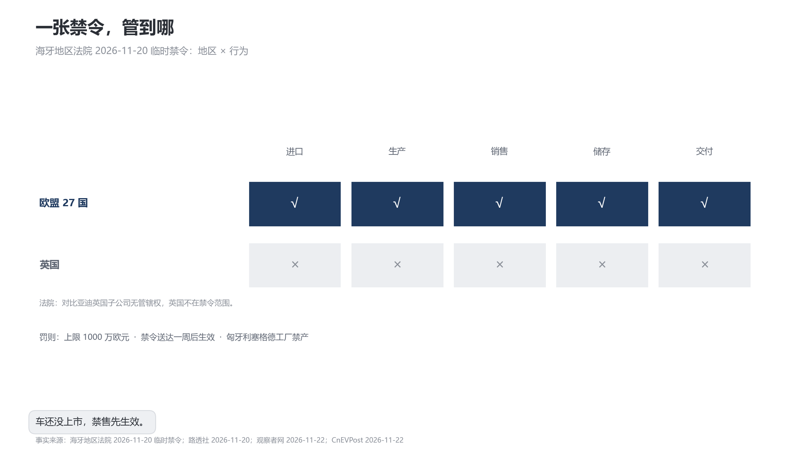
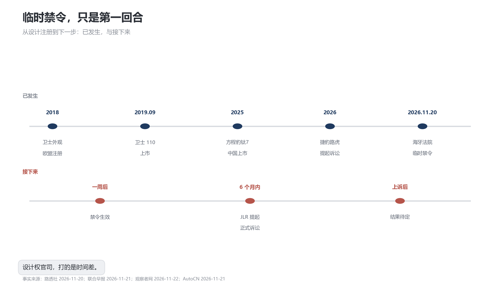
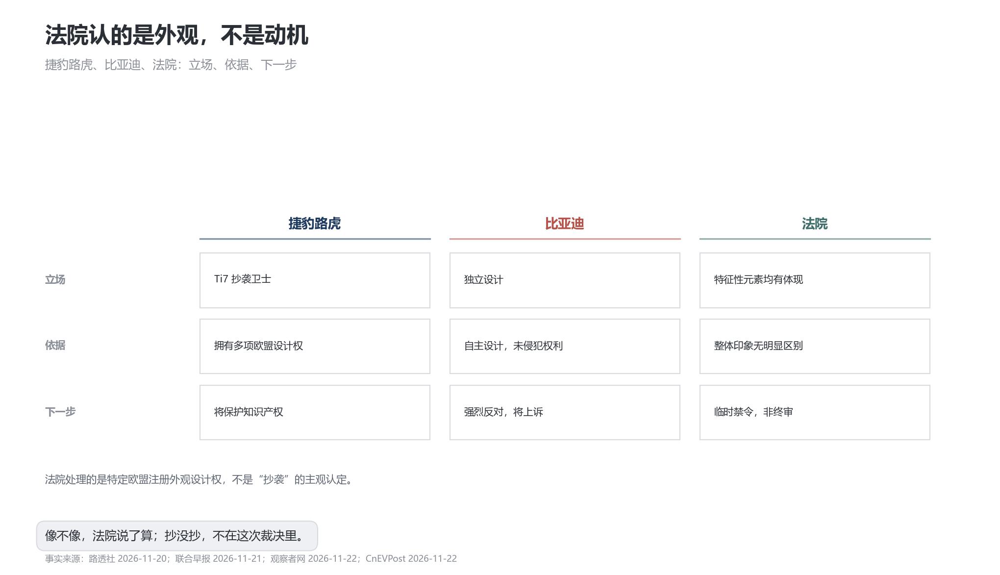

# 一辆还没在欧洲上市的车，先被禁了

11月20日，荷兰海牙地区法院作出一项临时禁令：比亚迪Ti7（国内叫方程豹钛7）侵犯了捷豹路虎卫士（Defender）的欧盟注册外观设计权，禁止在欧盟境内进口、生产、销售、储存、交付这辆车。禁令一周后生效，违反者罚款上限1000万欧元。车还没上市，禁令也可以先下——这是临时禁令最狠的地方。

Ti7还没在欧洲开卖。比亚迪英国官网此前已放出预订信息，交付从2027年1月开始。车没到，禁令先到。Ti7于2025年在中国上市；这道禁令不影响中国和英国市场。

## 法院认的是“像”

判决摘要写得很直接：卫士外观设计的“特征性和独特性元素”，在Ti7上都有体现。媒体列举的相似点包括：方盒子造型、平直车顶、垂直的车身比例、尾门样式、方形轮拱，以及后门后方那块车身同色面板。法院比对的特征，则集中在车肩线条、轮拱、连续侧窗和车身比例。

卫士是捷豹路虎最畅销的车型，2025年全球销量超过10万辆。对它来说，这不是一场小官司。

这份临时裁决处理的是外观设计权，不是“抄袭”的主观认定。外观设计侵权的判断，看的是整体视觉印象——在知情用户眼里，两辆车有没有明显区别。法院认为没有。

这套判断不要求证明“抄袭”。欧盟注册外观设计保护的是产品外观，侵权看整体视觉印象：在“知情用户”眼里，两辆车是否产生相同或无明显区别的印象。设计过程完全独立，结果太像，也可能侵权；反过来，证明“没抄”也挡不住禁令。

## 禁令管到哪

范围是欧盟27国，动作包括进口、生产、展示、销售、储存、交付。英国不在内：法院认定自己对比亚迪英国子公司没有管辖权。

还有一条容易被忽略：匈牙利塞格德工厂也被禁止生产Ti7，直到知识产权案了结。那座工厂原计划明年初量产。

这是临时禁令，不是终审。捷豹路虎要在6个月内提起正式诉讼，否则禁令可能失效；比亚迪已表示“强烈反对”，将上诉，称Ti7是独立设计、没有侵犯任何权利。

对BYD来说，选择不多：上诉、在主诉里抗辩，或者改设计再进欧洲。英国市场暂时不受影响，匈牙利工厂的排产却已被按下暂停键。

## 为什么在荷兰告

欧盟注册外观设计在27个成员国统一有效，一份注册、一地起诉，禁令可以覆盖整个欧盟。荷兰的临时禁令程序节奏快，海牙地区法院又集中处理知识产权案件。JLR把第一枪放在这里，不意外。

## 为什么是设计

过去中国车企出海，被卡的是关税、补贴、数据；设计权是另一条线。欧盟注册外观设计是另一套规则：一份注册覆盖27国，维权可以直接申请禁令。它只管“看起来一样”，不管技术方案——所以往往比专利更早成为出海的第一道坎。对车企，一款车的造型是最大的辨识资产；对后来者，也是最容易“撞”的地方。

捷豹路虎说，这是它针对中国竞争对手一系列诉讼中的第一项裁决。路透社的补充是：在欧洲，主流车企为外观设计对簿公堂并不常见；在诉讼这么早的阶段就出禁令，更不常见。

这不是孤例。方盒子SUV这两年成了中国品牌的热门造型，设计语言趋同，撞上欧洲外观设计权的概率也在上升。外观设计注册便宜、审查快、保护期5年一续、最长25年，对老牌车企是一道成本不高、但很管用的防线。

## 落点

比亚迪的欧洲销量，今年前三季度超过28万辆，已经超过福特、特斯拉和日产。卖得越快，越容易撞上这类官司。

Ti7能不能进欧洲，最终要看上诉和正式诉讼。但信号已经清楚：出海的下一个门槛，可能不是续航、不是价格，是“长得像不像”。

---

*事实来源：荷兰海牙地区法院2026-11-20临时禁令（ECLI:NL:RBDHA:2026:34365）；路透社2026-11-20《Dutch court bars Chinese SUV in Europe over resemblance to Land Rover Defender》（经 Euronext 转载）；联合早报2026-11-21、观察者网2026-11-22、CnEVPost 2026-11-22及汽车媒体报道。判决要点：Ti7侵犯捷豹路虎卫士（Defender 110，2019年9月上市，欧盟外观设计于2018年注册）的欧盟注册外观设计权；禁令覆盖欧盟27国，禁止进口、生产、展示、销售、储存、交付；英国不在范围（法院无管辖权）；匈牙利塞格德工厂在案件了结前禁产；禁令送达一周后生效；捷豹路虎须在6个月内提起正式诉讼；比亚迪称独立设计、强烈反对并将上诉。*

*需说明四点。其一，这是临时禁令（ preliminary injunction ），不是终审判决；法院认定的是特定欧盟注册外观设计权受侵犯，未对著作权、逆向工程等指控作全面裁判，最终结果取决于上诉与正式诉讼。其二，“罚款上限1000万欧元”据汽车媒体及 CnEVPost 等报道，判决全文未能直接核到，具体金额以法院文书为准。其三，“整体视觉印象”“知情用户”为外观设计侵权的一般判断标准，本文未复述判决全文的比对细节；“法院认的是像，不是抄”为作者概括。其四，“过去被卡的是关税、补贴、数据”为背景性概括；“卖得越快越容易撞上官司”为作者判断。*