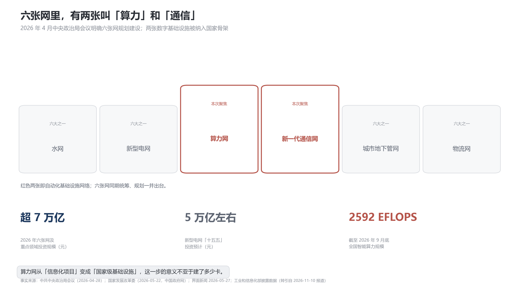
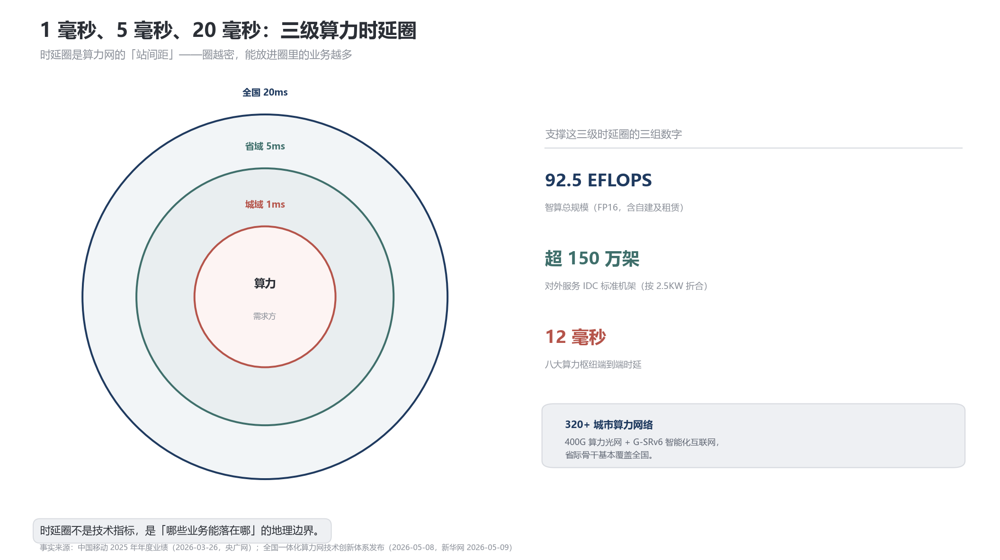
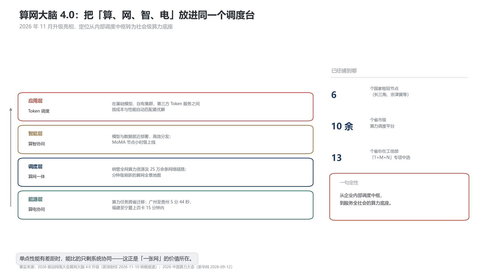

# 算力网为什么开始"联网"：一张全国性网络的系统协同难题

2026 年，"六张网"成了基础设施领域的一个高频词。

水网、新型电网、算力网、新一代通信网、城市地下管网、物流网——六张网被放在同一张规划蓝图上，统筹建设、多网协同。

对算力行业来说，这是坐标系的改变。过去十几年，算力建设基本是企业自己的事：建多少集群、买多少卡、放在哪个机房，各自算各自的经济账。现在它被放进了和电网、水网同一层的规划序列里，问题也就跟着换了。

## 换了坐标，问题就变了

孤立地看，一个数据中心的效率取决于它自己的显卡、网络、供电和运维水平。

但放在一张全国性的网里看，一个数据中心的效率还取决于另一件事——它和全国其他算力之间，能不能被有效地串起来用。

这就是"一体化"三个字的实际含义。它要解决的不是单点更快，而是整体更顺。

行业数据也说明了这个转折。据公开披露，截至 2026 年 9 月底，国内智能算力规模达 2592 EFLOPS，同比增长 146%。规模增长很快，但同一个语境下被反复提到的问题是：资源分布不均、架构异构、东西部供需错配。

换句话说，矛盾已经从"有没有算力"转向"算力能不能被用上"。

这两件事需要的解法完全不同。前者靠投资，后者靠协同。

## 四道关，卡在哪一道

一张算力网要真正成立，至少要过四道关。

**第一关：算力本身够不够、规格全不全。** 训练需要万卡级集群，推理可能只需要几张卡。只有超大规模集群，接不了边缘的碎活；只有小集群，扛不住大模型训练。规格必须从百卡铺到万卡。

**第二关：连得上。** 算力放在西部，用户在东部，中间这段距离必须用光网络补回来。没有低时延的骨干网，西部的电再便宜也没用，因为算出来的结果送不回去。

**第三关：调得动。** 异构的卡、不同的架构、不同的运营主体，能不能被同一个系统看见、被同一次调度分配。这一关是软件问题，但它决定了前面两关的投入能不能被盘活。

**第四关：能源跟得上。** 一个吉瓦级园区，本质上是把电变成算力。电从哪来、热往哪排，直接决定了这张网能铺多大。

四关里，第一关最容易上新闻——卡多、集群大，数字好看。但真正决定这张网能不能用的，是后面三关。

## 一组数字，对着四道关看

中国移动 2025 年年度报告披露的数据，正好可以按这四道关来排。

**算力规格：** 智算总规模 92.5 EFLOPS（FP16，含自建及租赁），实现百卡至超万卡的全规格计算能力。从百卡到超万卡都能接，这是第一关的答案。

**连接：** 城域 1 毫秒、省域 5 毫秒、全国 20 毫秒的三级算力时延圈；省际骨干 400G OTN 网络基本覆盖全国；对外服务 IDC 标准机架超 150 万架（按单架 2.5KW 折合）。这是第二关的答案。

**地理布局：** 智算训练全国中心节点和区域中心节点基本覆盖八大枢纽。这是第三关的物理基础。

三级时延圈这个说法值得多说一句。它不是一个宣传词，而是把全国分成三层"站间距"：1 毫秒圈里能放什么业务，5 毫秒圈里能放什么，20 毫秒圈里能放什么，是一条硬边界。

工业控制、远程操作这类业务，只能在 1 毫秒圈里做；一般的 AI 推理和视频服务，5 毫秒够用；离线训练和数据备份，20 毫秒也无所谓。

所以时延圈决定了哪些业务能落在哪。它把"算力在哪"这件事，从地理问题变成了能力问题。

## 从"看得见"到"调得动"

有了算力和网络，第三关的核心是一个调度系统。

2026 年 5 月，中国移动在移动云大会期间发布"全国一体化算力网技术创新体系"。据当时披露，算网智脑实现资源一体化纳管，八大枢纽端到端时延降至 12 毫秒，网络能力开放超 2900 项。

2026 年 9 月的中国算力大会上，又补了几个数字：自研"算网大脑"纳管合作算力，落地 8 个枢纽级、区域级平台。

到 2026 年 11 月，算网大脑升级到 4.0，定位从企业内部的调度中枢，转向服务全社会的算力底座。

按公开报道的口径，4.0 版本的三个变化是：纳管全网算力资源及 25 万余条网络链路，把过去按月盘点的算力家底变成分钟级刷新的全景地图；完成首次算力集群跨时空协同调控验证，广州至贵州的算力任务跨省迁移用时 5 分 44 秒，福建到宁夏的上百卡任务 15 分钟内完成迁移；在基础模型、自有集群和第三方 Token 服务之间自动匹配成本与性能的最优解。

第三个变化最值得注意。它说明这个系统调度的对象已经不只是"卡"，而是"词元"——一个应用要调用模型，系统会算一算是用自己的集群便宜，还是买第三方的 Token 划算。

调度从算力层上升到服务层，这才是"底座"两个字的实际内容。

## 为什么"协同"成了主线

这条路径的选择，有它的现实约束。

单看芯片的单点性能，国内与最先进水平仍有差距。这个差距短期内难以靠单点突破填平。

但算力不只是芯片。它还包括网络、调度、能源和运维。这几项里，国内有可以比较的优势：全球规模最大的 400G OTN 骨干网和 G-SRv6 智能化互联网，西部清洁能源，以及一张已经铺开的城域网络。

于是路径变成：单点拼不过，就用系统协同把整体效率拉起来。

算电协同是这个逻辑最直接的体现。东部的数据中心面临用电高峰，西部的绿电却可能被弃掉。如果能把这部分算力任务在几分钟内迁到西部，就同时解决了两个问题——东部削峰，西部消纳。

公开报道里，这条路径的进一步说法是"西算东输"，与传统"西电东送"并列。

## 落到：基础设施的标准变了

一张网被称作基础设施，衡量它的标准就不再是"建成了多少"，而是三件更朴素的事：

**能不能被普遍接入。** 不是少数大客户能用，而是千行百业都能用。

**价格能不能算得过来。** 词元成本要降到普通企业能承受的位置。

**供给稳不稳定。** 关键业务需要的是"确定"，不是"尽力而为"。

中国移动 2025 年算力服务收入 898 亿元，同比增长 11.1%；其中智算服务收入增速 279%，数据中心收入同比增长 8.7%，AIDC 收入同比增长 35.4%。

这组数字说明算力已经从"投入项"变成了"收入项"。

但作为一个刚被纳入基础设施序列的行业，它离"像水电一样即取即用"还有距离。基础设施的成败，最终看的是每年兑现了多少，不是规划书写得多好看。

单点落后的时候，能比的只有系统效率。这既是国内算力网的现实起点，也是它唯一可能跑通的路径。

---

*事实来源："六张网"指水网、新型电网、算力网、新一代通信网、城市地下管网、物流网，2026 年被纳入统筹规划建设、多网协同的部署范畴（据界面新闻 2026-05-27、人民邮电报 2026-05-29 等公开报道）；2026 年 5 月有关方面表示将抓紧出台"六张网"相关规划和实施方案，明确各领域投资重点、将目标任务分解到年度、明确时间和进度安排（中国政府网 2026-05-22，来源央视网）。中国移动运营数据（2025 年年度报告，2026-03-26 公布）：智算总规模 92.5 EFLOPS（FP16，含自建及租赁）、实现百卡至超万卡全规格计算能力、城域 1 毫秒/省域 5 毫秒/全国 20 毫秒三级算力时延圈、省际骨干 400G OTN 网络基本覆盖全国、对外服务 IDC 标准机架超 150 万架（按单架 2.5KW 折合）、智算训练中心与区域中心节点基本覆盖八大枢纽、2025 年算力服务收入 898 亿元同比增长 11.1%、数据中心收入同比增长 8.7%、AIDC 收入同比增长 35.4%、智算服务收入增速 279%（央广网 2026-03-26；中国证券报 2026-03-27）。2026-05-08 移动云大会"全国一体化算力网技术创新体系"：算网智脑资源一体化纳管、八大枢纽端到端时延降至 12 毫秒、网络能力开放超 2900 项、400G 算力光网与 320+ 城市算力网络（新华网 2026-05-09）。2026-09-12 中国算力大会：算网大脑纳管合作算力、落地 8 个枢纽级与区域级平台（新华网 2026-09-12）。截至 2026 年 9 月底智能算力规模 2592 EFLOPS、同比增长 146%（公开披露数据）。算网大脑 4.0（2026 年 11 月）：纳管全网算力资源及 25 万余条网络链路、分钟级刷新算网全景地图、广州至贵州算力任务跨省迁移 5 分 44 秒、福建到宁夏上百卡任务 15 分钟内完成迁移、支撑 6 个枢纽节点和 10 余个省市级算力调度平台（新浪财经 2026-11-10 转载媒体报道）。*

*需说明四点。其一，算网大脑 4.0 的具体性能数据（25 万余条链路、5 分 44 秒、15 分钟、6 个枢纽节点）出自 2026-11-10 的媒体报道转载，未见公司公告原文，引用时已标明为报道口径，建议以公司正式披露为准。其二，"资源分布不均、架构异构、东西部供需错配"为公开报道对行业现状的概括，本文引用时保留其判断，未作量化。其三，"单点性能有差距、靠系统协同弥补""调度从算力层上升到服务层""基础设施标准看普遍接入、价格与稳定性"等为作者分析，不代表中国移动观点。其四，本文未对 92.5 EFLOPS 与 2592 EFLOPS 作比例换算，两者口径不同（前者为公司含自建及租赁的 FP16 智算规模，后者为行业智能算力规模），直接相除会失真。*
