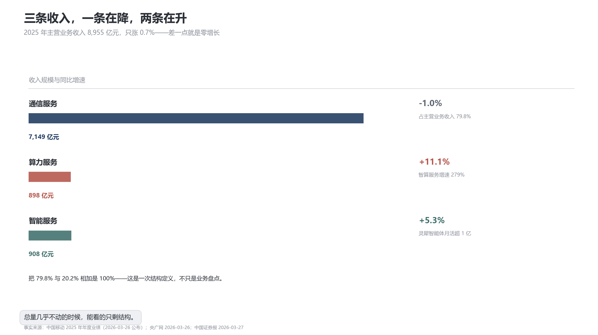
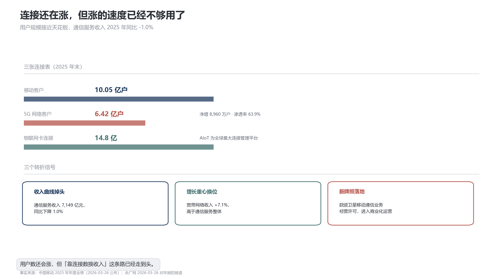
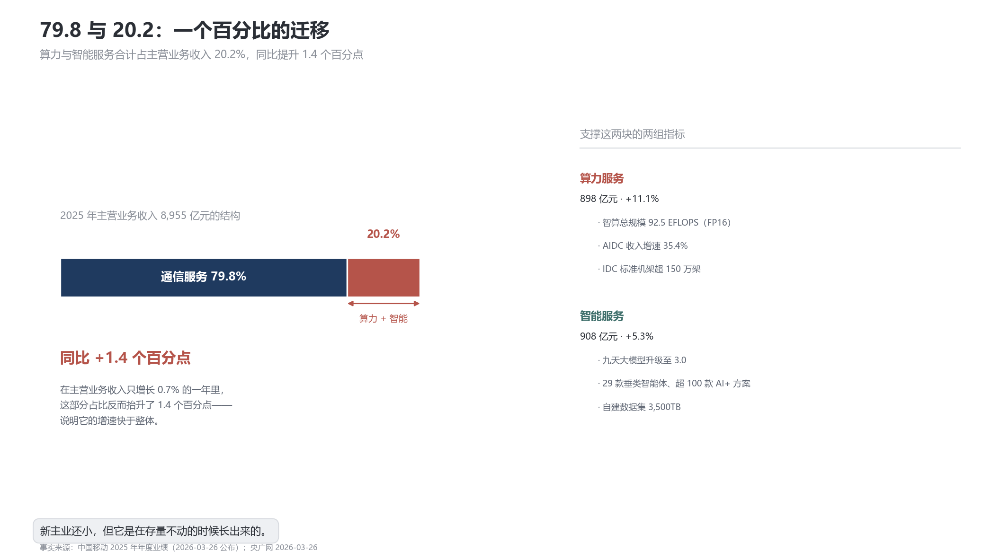

# 营收只涨 0.9%，但结构换了一层：三大主业这件事，财务上是什么样子

2026 年 3 月 26 日，中国移动公布 2025 年全年业绩。

先说最不显眼的两个数字：营运收入 10,502 亿元，同比增长 0.9%；主营业务收入 8,955 亿元，同比增长 0.7%。

0.9% 和 0.7%，放在任何一家公司的财报里都不算亮眼。但对一家营收过万亿的公司来说，这两个数字的意义不在增速，在增速背后的换挡。

因为拆开看，三条收入曲线走向完全不同。

## 一条在降，两条在升

通信服务收入 7,149 亿元，同比下降 1.0%。

算力服务收入 898 亿元，同比增长 11.1%。

智能服务收入 908 亿元，同比增长 5.3%。

如果把总收入看成一辆车，那么 2025 年的情况是：主引擎在轻微减速，两台新引擎在加速，三者的合力让车速刚好维持住。

年报里有一个更直接的说法：通信服务收入占主营业务收入比 79.8%；算力服务、智能服务收入合计占比 20.2%，同比提升 1.4 个百分点。

这两个数相加正好是 100%。这不是巧合——它说明公司已经把主营业务重新切成了两块，而不是在原来的通信大类下面挂几个新业务。

这是一次结构定义，不只是业务盘点。

## 为什么必须换引擎

理解这次换挡，要回到通信行业的增长逻辑。

过去二十年，通信服务的增长靠两件事：用户数增加，和单用户消费提升。前者有天花板——全国手机用户总量就那么多；后者在提速降费的政策环境下，很难持续上行。

2025 年的数据把这个天花板画得很清楚：移动客户 10.05 亿户，5G 网络客户 6.42 亿户、渗透率 63.9%，物联网卡连接 14.8 亿。

三张连接表都已经很大，但再大也有限。而通信服务收入同比下降 1.0%，说明连接规模的扩张，已经无法转化为收入的增长。

两个细节能说明结构在动：宽带网络收入同比增长 7.1%，高于通信服务整体；公司获颁卫星移动通信业务经营许可，卫星通信迈入商业化运营阶段。

一个是在存量里找结构性增量，一个是开新的牌照赛道。两条路都指向同一个判断——靠连接数换收入的时代结束了。

## 算力这一块，增长点在哪

算力服务 898 亿元，同比 11.1%。这个增速不惊人，但内部结构很值得看。

数据中心收入同比增长 8.7%，其中 AIDC（智算中心）收入同比增长 35.4%。

真正的爆点在更下面一层：智算服务收入增速达 279%，并拉动云算服务收入同比增长 13.9%。

这组数字的关系是：传统 IDC 增速一般，AIDC 明显更快，而纯智算服务是三位数增长。层级越往"算力+智能"走，增速越高。

支撑这些收入的，是一套已经建成的物理设施：智算总规模 92.5 EFLOPS（FP16，含自建及租赁），实现百卡至超万卡的全规格计算能力；城域 1 毫秒、省域 5 毫秒、全国 20 毫秒的三级算力时延圈；省际骨干 400G OTN 网络基本覆盖全国；对外服务 IDC 标准机架超 150 万架（按单架 2.5KW 折合）。

"全规格"这三个字容易被忽略。它意味着从几张卡的小任务到上万卡的训练都能接，不必因为规格不全把客户推给别家。

## 智能服务：908 亿，略大于算力

有意思的是，智能服务收入 908 亿元，比算力服务的 898 亿元还高一点点。

同比增速 5.3%，慢于算力，但基数已经不小。

这个板块的内容比名字复杂：升级九天基础大模型 3.0；推出超 100 款 AI+ 产品及应用解决方案、29 款垂类智能体；自主打造高质量数据集 3,500TB；重点布局超 50 款自研行业大模型，并联合能源、水利、农业等行业龙头共建；AI 智能助理灵犀智能体月活跃客户超 1 亿。

里面有两个增速值得单拎出来：数据算法收入同比增长 12.6%，数智文化收入同比增长 13.3%。

数据算法增速高于板块整体，说明"卖数据能力和算法能力"这件事，比"卖应用"更容易增长。

## 三块业务不是并列的，是串联的

三大主业这个说法，容易被理解成"三条并行的业务线各自跑"。但从年报的表述看，它们之间更像是串联的。

通信服务提供的是网络和连接——它既是收入的存量基本盘，也是算力服务能卖出去的前提。算力不是凭空交付的，客户要的是"能连上、时延低、不中断"的算力，这恰恰要通信网兜底。

算力服务提供的是物理底座——没有智算集群，智能服务的模型没地方跑。

智能服务提供的是出口——算力和网络的最终价值，要靠具体的应用场景兑现成收入。

三者的关系可以这样理解：网络是路，算力是电厂，智能服务是送到用户手上的产品。少了任何一环，另外两环的价值都会打折。

这也解释了为什么"20.2%"这个数不能孤立地看。它不是两块新业务自己的收入占比，而是整个串联链条的下游产物。链条跑通了，比例自然往上走。

年报里的另一组说法可以印证这个逻辑：公司提出"通信、算力、智能服务"要"持续做强做优做大"，而不是只做强其中一块。

## 20.2% 这个数，怎么看

回到那个 20.2%。

一个常见的误读是：这两块加起来才两成，说明转型还早。

但这个数要看两个方向。

看存量，20.2% 意味着八成收入仍来自通信服务——转型确实还在过程中，这一点不必粉饰。

看增量，情况不一样。2025 年主营业务收入只增长了 0.7%，而这部分占比抬升了 1.4 个百分点。数学上，这在存量几乎不动的前提下，只能靠新业务跑得比整体快来实现。

这就是"结构换了一层"的实际含义：总量没变多少，但里面的成分变了。

年报里还有一组数字佐证产品化程度：收入百亿级产品 13 项，客户超亿户产品 17 项。

百亿级产品是收入的支柱，亿级客户产品是规模的底座。13 和 17 这两个数，说明新业务不是在实验室里，而是已经在账上。

## 一个容易被忽略的成本面

转型不只有收入侧的故事。

算力服务的高速增长，对应的是资本开支结构的改变——从建基站转向建数据中心。这两种资产的折旧年限、能耗结构、回本周期完全不同。

2026 年 11 月的那份会计估计变更公告提供了一个侧证：公司把部分动力配套设备的折旧年限从 5-10 年调整为 6-15 年，房屋从 30 年调整为 50 年，理由是"算力网相关数据中心业务的经营模式向较长期服务合同转变"。

这条理由本身就说明，算力这块业务的商业形态，跟通信业务不一样——它更接近"长期租约"，而不是"按月付费"。

所以看三大主业的转型，不能只看收入占比，还要看资产结构、折旧政策和合同期限的变化。这三样一起变，才算真的换了引擎。

## 落到：第三张考卷

把三块业务放在一起，会看到三种不同的成熟度。

通信服务是成熟业务——规模巨大、增速转负、靠效率和成本维持利润。它的考题是"怎么守"。

算力服务是成长业务——增速两位数、内部结构快速升级、需要持续投入。它的考题是"怎么快"。

智能服务是期权业务——基数已过九百亿、增速温和、但天花板最高。它的考题是"怎么落"。

三张考卷同时摆在桌上，这是三大主业这个说法真正的分量。

一家运营商最难的不是建新业务，而是在旧业务还在赚钱的时候，愿意让它慢下来，把资源挪到新业务上。

2025 年的这份财报说明，这件事已经在发生，只是还没有完成。

---

*事实来源：中国移动 2025 年年度报告及年度业绩（2026-03-26 公布）：营运收入 10,502 亿元（同比 +0.9%）、主营业务收入 8,955 亿元（同比 +0.7%）；通信服务收入 7,149 亿元（同比 -1.0%），占主营业务收入比 79.8%；算力服务、智能服务收入合计占主营业务收入比 20.2%（同比提升 1.4 个百分点）；算力服务收入 898 亿元（同比 +11.1%）；智能服务收入 908 亿元（同比 +5.3%）；移动客户 10.05 亿户、5G 网络客户 6.42 亿户（净增 8,960 万户、渗透率 63.9%）、宽带联网客户 3.29 亿（净增 999 万、宽带网络收入同比 +7.1%）、物联网卡连接 14.8 亿（AIoT 平台为全球最大连接管理平台）、获颁卫星移动通信业务经营许可；数据中心收入同比 +8.7%、AIDC 收入同比 +35.4%、智算服务收入增速 279%、拉动云算服务收入同比 +13.9%、云盘月活 2.1 亿户、云视频客户超 8,670 万户；智算总规模 92.5 EFLOPS（FP16，含自建及租赁）、百卡至超万卡全规格、城域 1ms/省域 5ms/全国 20ms 三级算力时延圈、省际骨干 400G OTN 基本覆盖全国、对外服务 IDC 标准机架超 150 万架（按单架 2.5KW 折合）；升维九天基础大模型 3.0、超 100 款 AI+ 产品及应用解决方案、29 款垂类智能体、高质量数据集 3,500TB、数据算法收入同比 +12.6%、数智文化收入同比 +13.3%、超 50 款自研行业大模型、灵犀智能体月活超 1 亿；收入百亿级产品 13 项、客户超亿户产品 17 项。据央广网 2026-03-26（记者黄昂瑾）、中国证券报 2026-03-27、每日经济新闻及中国移动投资者关系页面业务概览。*

*需说明四点。其一，算力服务 898 亿元与智能服务 908 亿元合计 1,806 亿元，占主营业务收入 8,955 亿元的约 20.2%，与年报口径一致；本文未将"算力+智能"与其他业务拆分口径混用。其二，"增长引擎换挡""靠连接数换收入的时代结束""三张考卷"等为作者分析，不代表公司观点；公司年报的表述为"持续做强做优做大通信、算力、智能服务"。其三，智算服务收入增速 279% 为单项业务增速，其基数远小于板块整体，不宜与 11.1% 的板块增速直接比较放大。其四，本文所有 2025 年数据均为年报口径，未对 2026 年三季报数据作混用；AIDC 与 IDC 的定义差异、各业务收入的确认方式，以年报附注为准。*
