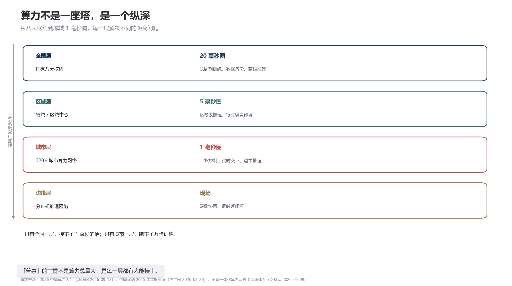
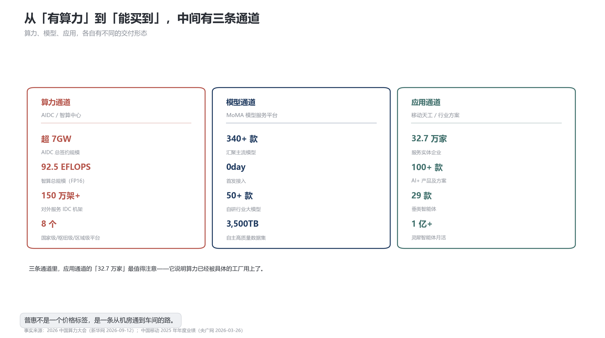
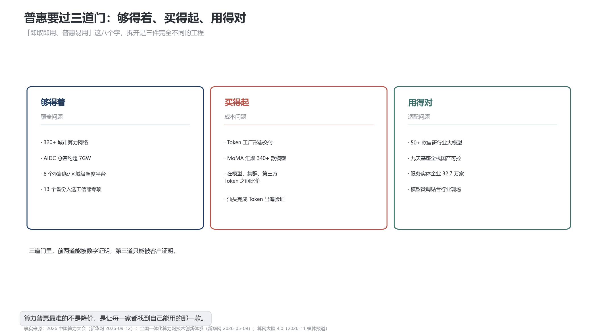

# 一张算力网要铺到哪：从 1 毫秒圈到 32.7 万家实体企业

2026 年 9 月 12 日，河北廊坊，中国算力大会。

中国移动总经理陈扬帆在主论坛上说了一句话：将算力服务明确为公司三大主业之一，加快建设全国一体化算力网，着力提供"即取即用、普惠易用"的算力服务。

"普惠"这个词，放在算力行业里是有点重量的。

因为算力天生不是普惠的——它需要电、需要水、需要散热、需要工程师。越大的集群越经济，越小的客户越贵。这跟自来水、电网的天然属性正好相反。

所以"普惠易用"这四个字，其实是一份难度很高的承诺。它要回答的是：一张算力网，究竟要铺到什么程度，普通工厂才真的用得上？

## 普惠的第一层意思：够得着

算力普惠的第一个门槛，是物理上的距离。

同一个模型，放在不同的地方，能做的事完全不一样。

放在八大枢纽的万卡集群里，它适合跑长周期的训练、海量数据的批处理、离线的模型迭代——这些任务对时延不敏感，但对算力总量和电费极其敏感，所以要放在西部。

放在省域或区域中心，适合做区域级的推理、行业模型的微调——既要一定的规模，又要能快速响应。

放在城市的 320 多个算力节点上，能接的是一毫秒圈里的活：工业控制、实时交互、边缘推理。

再往下一层，是分布式推理网络，直接贴着现场。

这四层不是重复建设，是四种不同的距离。少一层，就有一类客户接不上。

中国移动 2025 年年报里有一句表述："智算训练全国中心节点和区域中心节点基本覆盖八大枢纽。"

这句话的重点在"基本覆盖"三个字——八大枢纽是一个行业级的地理布局，覆盖它意味着算力落在了规划位置上，而不只是落在便宜的地方。

而"城域 1 毫秒、省域 5 毫秒、全国 20 毫秒"这三级时延圈，是把"距离"这件事量化成了可以验收的标准。

## 普惠的第二层意思：买得起

第二个门槛是钱。

算力贵的根源有两个：一是硬件贵，二是用不满。一个客户为了跑一个模型买几张卡，大部分时间是闲着的，但他必须为峰值付费。

要解决这个，靠的不是降价，是靠共享和调度。

中国移动在 2026 年 5 月的移动云大会上提了一个说法：围绕 Token 生产、传输、运营全链条构建全栈算力基础设施，推动产业链形成"模型迭代—Token 运营—智能应用"的飞轮效应。

这里的"Token 运营"，是把算力从"卖机器"变成"卖词元"。

这个转变的意义在于：客户不再买一台服务器、一条带宽，而是按用掉的词元付费。用多少付多少，闲时不付钱。

要让这个模式成立，中间需要一个会算账的系统。

2026 年 11 月的算网大脑 4.0 提供了这样一个能力：在基础模型、自有集群以及第三方 Token 服务之间，自动匹配成本与性能的最优解。

也就是说，当客户提交一个任务，系统会替他判断：这个任务用自己的集群便宜，还是买第三方的 Token 划算；用哪个模型够用，不必上最大的那个。

这是"普惠"最实在的一层——不是把单价压低，而是帮客户少花冤枉钱。

## 普惠的第三层意思：用得对

第三个门槛最容易被忽略：会用。

很多企业不是买不起算力，是不知道怎么把算力变成生产力。一个水泥厂、一个农机厂，它知道自己的痛点在哪，但不知道哪个模型能解决。

这一层靠的不是算力，是行业知识和适配能力。

中国移动的做法是两条腿：一条是把通用大模型改成行业模型——九天基座大模型提供底座，通过模型微调形成面向能源、农业等重点领域的超 50 款行业模型；另一条是通过"天工"工业互联网平台，把解决方案直接送到工厂。

这里有一个数字值得单独拎出来：服务实体企业 32.7 万家。

32.7 万家是一个什么样的量级？它不是一个客户数量指标，而是一个验证指标——说明这套东西已经跑出了试点阶段，进入了规模化复制。

过去几年，几乎所有云厂商都能拿出几个漂亮的 AI 标杆案例，共性是投入大、定制深、不可复制。能服务三十二万家，说明中间那一层"标准化"已经做出来了。

## 三张网怎么咬合

把三块放在一起看，会发现一个内部逻辑。

算力通道解决"够得着"——AIDC 总签约规模超 7GW，智算总规模 92.5 EFLOPS，对外服务 IDC 机架超 150 万架。

模型通道解决"选得对"——MoMA 平台汇聚超 340 款主流模型，实现 0day 首发接入，让客户不必自己去找模型。

应用通道解决"用得起来"——超 100 款 AI+ 产品及解决方案、29 款垂类智能体，直接对口具体场景。

三层缺一层，普惠就断在哪一层。

有算力没模型，客户买了卡不知道跑什么；有模型没应用，客户拿到的是一堆需要自己拼装的零件；有应用没算力，则一切都是 PPT。

## 还有一件事：算力和电的关系

讲算力普惠，绕不开一个现实约束：电。

AIDC 总签约规模超 7GW 是什么概念？吉瓦级的数据中心，本质上是巨型用电户。它的选址、电价、绿电比例，直接决定算力成本底线。

所以"普惠"能不能持续，取决于算力和能源能不能协同。

公开报道提到的一条路径是"东数西算"与"西电东送"的联动：东部算力需求高峰时，把任务迁到西部，用西部的绿电跑，跑完再把结果送回来。这样既缓解东部用电压力，也让西部绿电有了消纳出口。

这条路如果走通，算力成本就有了长期下降空间——不是因为芯片便宜了，是因为电用对了地方。

## 为什么这件事落到了运营商头上

算力普惠要走通，必要条件不是技术，是"谁能承担不赚钱的部分"。

一个纯粹的商业公司做算力，逻辑很清晰：哪里客户多、哪里回报快，就在哪里建。结果是东部扎堆、大城市扎堆、头部客户扎堆。剩下那些偏远地区的、规模小的、需求零散的部分，没人愿意碰。

但普惠的含义，恰恰是这些"没人愿意碰"的部分也要被覆盖。

这就是运营商的特殊位置。它有三样别人不容易同时具备的东西。

**一是既有的物理网络。** 320 多个城市的算力网络、覆盖全国的省际骨干 400G OTN、全球规模最大的智能化互联网，这些是几十年建通信网攒下来的。要做算力网，不必从零开始铺路。

**二是能算长期账。** 建一张覆盖边远地区的网，短期看是亏损的。但基础设施的账本本来就不是按单个项目算的，它按十年、二十年算。这也是"六张网"要放在同一张蓝图上统筹、而不是各自决定的原因。

**三是跨省协调的能力。** 把东部的任务迁到西部跑，涉及网络、电力、土地多个方面。这不是一家企业能单独谈成的事。

这三样决定了：算力普惠落到运营商头上不是偶然。

但反过来说，这也给运营商立了更严的标准。既然用的是几十年积累的网络资源，衡量它的就不该只是收入增速，还有覆盖面——多少地市连上了、多少行业用上了、多少中小企业第一次用上了算力。

## 落到：普惠不是一句口号，是三个可验收的动作

回到陈扬帆那句话：即取即用、普惠易用。

拆开看，它对应三个可验收的动作。

"即取即用"，考验的是调度——算力能不能像自来水一样拧开就有。这对应算网大脑、对应 8 个枢纽级和区域级平台、对应 13 个省份在"1+M+N"算力互联互通专项中的中选。

"普惠"，考验的是成本——词元价格能不能降到普通企业算得过来账。这对应 Token 工厂、对应 MoMA 的比价能力。

"易用"，考验的是适配——有没有人懂客户现场。这对应 50 多款行业模型、对应 32.7 万家实体企业。

三个动作里，前两个能被数字证明，第三个只能被客户证明。合起来才是"算力网"跟"算力中心"的区别：算力中心是一个点，算力网是一张能覆盖到车间门口的网。

---

*事实来源：2026 年 9 月 12 日，以"共织算力网 智启新未来"为主题的 2026 中国算力大会在河北廊坊开幕，中国移动总经理陈扬帆出席大会开幕式及主论坛，提出将算力服务明确为公司三大主业之一、加快建设全国一体化算力网、着力提供"即取即用、普惠易用"的算力服务；AIDC 总签约规模超 7GW；布局多个万卡智算中心与分布式推理网络；自研算网大脑纳管合作算力，落地 8 个枢纽级、区域级平台，承建国家算力互联互通河北区域节点；MoMA 平台汇聚超 340 款主流模型、实现 0day 首发接入；打造自主可信九天基座大模型，实现从芯片到模型的全栈国产自主可控，通过模型微调形成面向能源、农业等重点领域的超 50 款行业模型；赋能"天工"工业互联网平台，服务实体企业 32.7 万家。据新华网 2026-09-12《中国移动参加 2026 中国算力大会》。2026 年 5 月 8 日移动云大会发布"全国一体化算力网技术创新体系"：围绕 Token 生产、传输、运营全链条构建全栈算力基础设施，推动"模型迭代—Token 运营—智能应用"飞轮效应；在汕头完成 Token 出海全链路验证；算网智脑资源一体化纳管、八大枢纽端到端时延降至 12 毫秒、网络能力开放超 2900 项；"N+31+X"算力布局、400G 算力光网与 320+ 城市算力网络（新华网 2026-05-09）。中国移动 2025 年年度业绩：智算训练全国中心节点和区域中心节点基本覆盖八大枢纽；智算总规模 92.5 EFLOPS（FP16）；城域 1 毫秒/省域 5 毫秒/全国 20 毫秒三级算力时延圈；对外服务 IDC 标准机架超 150 万架；超 100 款 AI+ 产品及应用解决方案、29 款垂类智能体（央广网 2026-03-26）。算网大脑 4.0（2026 年 11 月移动网络大会）：在基础模型、自有集群与第三方 Token 服务之间自动匹配成本与性能最优解；支撑 6 个枢纽节点和 10 余个省市级算力调度平台；"1+M+N"算力互联互通专项中支撑 13 个省份申报并中选（新浪财经 2026-11-10 转载媒体报道）。*

*需说明四点。其一，"33.7 万家""32.7 万家"以新华网 2026-09-12 原文为准，本文按 32.7 万家引用；该数字为公司披露的服务实体企业数，本文未对其统计范围（是否含平台注册、是否存在重复计算）作补充说明，具体口径以公司披露为准。其二，"AIDC 总签约规模超 7GW"为签约规模，非已建成规模，二者不可混淆；本文按原文表述引用，未作换算。其三，"普惠天生不是算力行业属性""三张网咬合""普惠不是降价而是帮客户少花冤枉钱"等为作者分析，不代表公司观点；"东数西算与西电东送联动"为公开报道中提及的路径方向，本文未披露具体调度规模与成效数据。其四，本文未对 32.7 万家企业中的行业分布、付费规模、复购情况作任何推测，公司未公开这些细分数据。*
