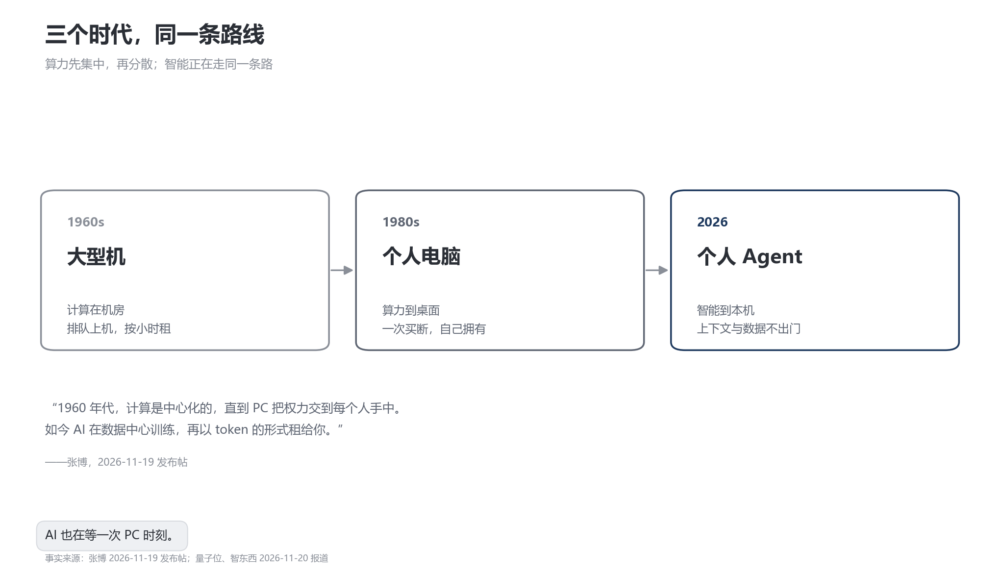
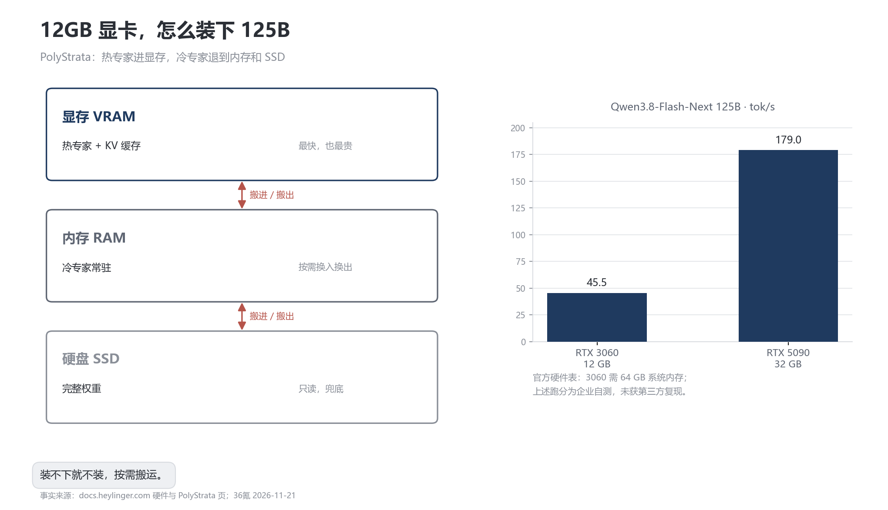
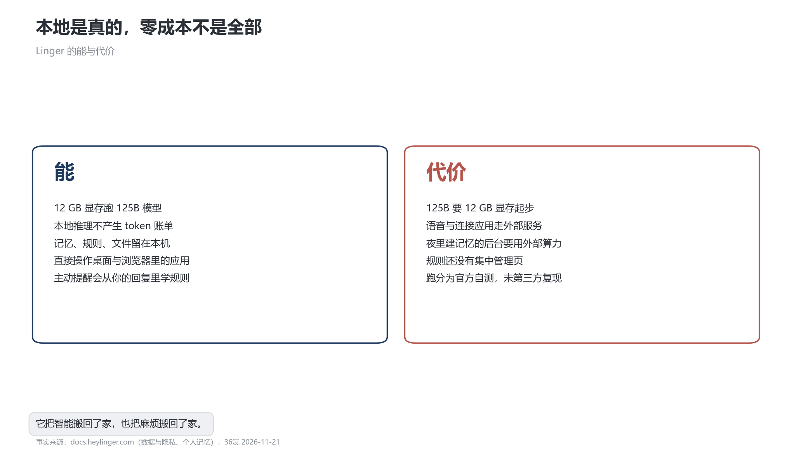

# 把智能搬回自己的电脑：前 DeepSeek-VL 负责人张博开源 Linger

你为 AI 付的钱，本质是租金。模型跑在别人的机房里，你按 Token 计费，上下文顺着网线出去，再回来。前 DeepSeek-VL 项目负责人张博（Tony Zhang）把这套结构比作 1960 年代的大型机：算力集中在机房，普通人排队上机。11 月 19 日，他创办的 Simplex AI 开源了个人智能体 Linger，想做的事只有一件——把 AI 装回你自己的电脑。

## 从 DeepSeek-VL 到 Simplex AI

张博 2013 年从浙江大学本科毕业，2019 年获香港科技大学电子与计算机工程博士，随后进入微软亚洲研究院，做视觉与生成模型，参与 VQ-Diffusion、Rodin 等项目。2023 年他加入 DeepSeek 任 AI 科学家，参与初代 DeepSeek LLM，并担任 DeepSeek-VL 项目负责人——2024 年 3 月的 VL 技术论文里，他署名 Project Lead。

2024 年 3 月，他离开 DeepSeek，回浙江大学计算机学院任教，2025 年创办 Simplex AI。今年 1 月，公司拿到高瓴创投领投的 600 万美元种子轮。按目前的公开资料，他是已离职的 DeepSeek 核心论文作者里，唯一公开创业并做出产品的人。

## 另一个我：先说，还是先等

Linger 的主助手叫 Another Me。它读你授权的 Gmail、Outlook、Google 日历和 Slack，也读你的笔记与会议转录，然后自己判断：现在说、晚点跟，还是不说。

判断有边界。夜里，或当天提醒已经够多时，普通事件先记成待办；会议取消这类急事照旧送达。周一收到的报价请求，可以压到周三早上再提醒。这套“该急的急、该缓的缓”不是预设的规则表，而是它每次自己判断。

记忆是它的底座。连上收件箱后，Linger 回读最近几个月的邮件，按人、客户、项目、话题建起分页 Wiki；白天的新邮件、对话、会议进“原始层”，每晚只重写当天被触达的页面，同时更新一份每次对话都要读的 memory.md。每页带变更日志，每条事实指向来源消息或文件。官方在 LoCoMo 长期对话记忆基准上给出的准确率是 95%，称高于 Mem0、MemOS。

## 越用越懂你，靠的是线索变规则

你回一句“这种事直接告诉我”，它记成线索；同类线索出现第二次，才升级成规则；直接说“以后这类都立刻通知”，则当场成规则。36 氪报道称，官方把这套从反馈里改行为的设计叫 Dreaming，量子位则记作“隐式强化”；官方文档只写行为，不解释叫法。规则和记忆一起留在本机。

## 12GB 显卡，125B 模型

模型装不下，是本地化的第一道坎。配套开源的 PolyStrata 把 MoE 的热专家放显存，其余放内存和 SSD，按需搬运。官方硬件表：RTX 3060 12GB 加 64GB 内存跑 125B 的 Qwen3.8-Flash-Next，45.5 token/s；RTX 5090 32GB 上 179 token/s。这是企业自测，36 氪明确提示未获充分第三方验证。

零 Token 费也有边界。本地推理不产生 API 账单，硬件和电费照付；语音、连接应用，以及夜里构建记忆的后台任务，官方文档写明会用到外部服务。门槛也实在：125B 要 12GB 显存起步，8GB 笔记本只能退到更小的模型。截至 11 月 23 日，GitHub 星标 3,924、fork 370。

## 落点

真正值得记的不是跑分，是那句“智能应该是分布式的”。过去两年，AI 的竞争几乎都在比谁的数据中心更大；Linger 换了个问法——如果智能能像 1980 年代的软件一样装进个人电脑，拥有权就该跟着换手。

它现在还是一台需要折腾的机器：安装要选运行时，模型要单独下载，规则出错只能靠回话去纠。但它至少把“我的上下文、我的数据、我的智能”变成了一份可以 git clone 的代码。

你会为完全本地的 AI 助手换一台电脑吗？评论区聊聊。

---

*事实来源：Linger 官网 heylinger.com 与文档 docs.heylinger.com（Another Me 与主动提醒、个人记忆与 Wiki、硬件与 PolyStrata 页）；GitHub simplexai-labs/linger（2026-11-23 数据：星标 3,924、fork 370、TypeScript、Apache 2.0 加附加条件的 Co-Workspace 许可证）；智东西 2026-11-20《前DeepSeek研究员，开源本地版Muse，实现token自由》；量子位 2026-11-20《DeepSeek V1作者创业项目曝光：开源Agent》；36氪/融中财经 2026-11-21《DeepSeek首位创业者，公开了》；张博 2026-11-19 发布帖（经上述媒体报道转述）。*

*需说明四点。其一，“95%”是官方在 LoCoMo 基准上公布的成绩，本文未能找到第三方复现，也未核到完整评测脚本；36 氪对 PolyStrata 的 45.5 token/s 明确标注“企业测试，尚未得到充分第三方验证”。其二，“数据不出本机”有边界：官方文档写明语音、连接应用、构建记忆的后台任务会用到外部服务，云端模型是可选而非默认，选择它数据就会离开本机。其三，素材称“每晚整理成个人 Wiki”方向正确，但机制不是把全部资料重写一遍，而是每晚只更新当天来源触达的页面。其四，“Dreaming”与“隐式强化”是两处报道对同一机制的不同叫法，官方文档只描述行为（线索→规则），未使用这两个词。*
