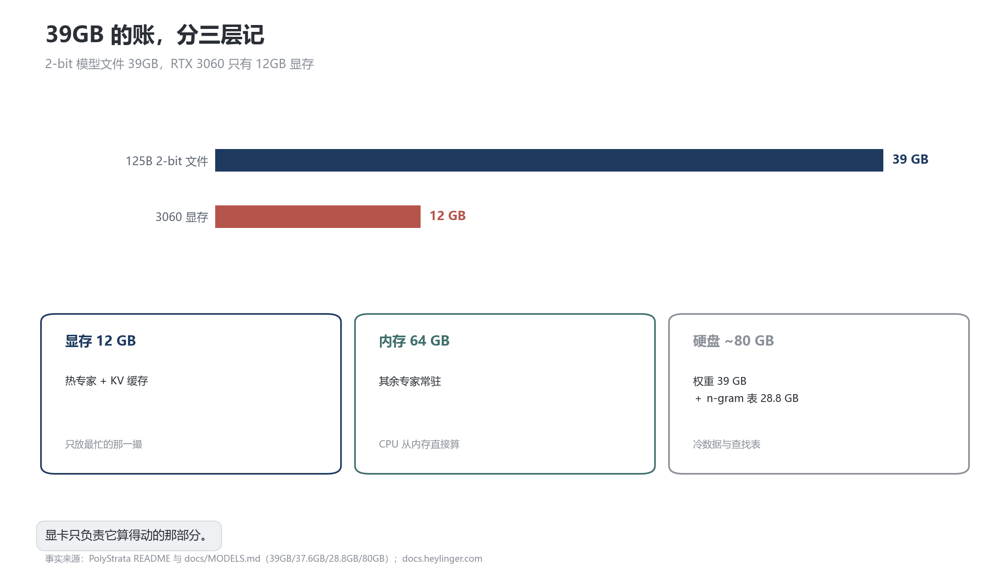
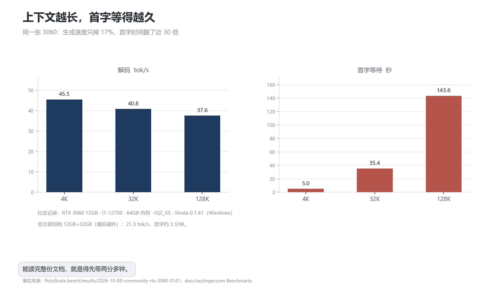
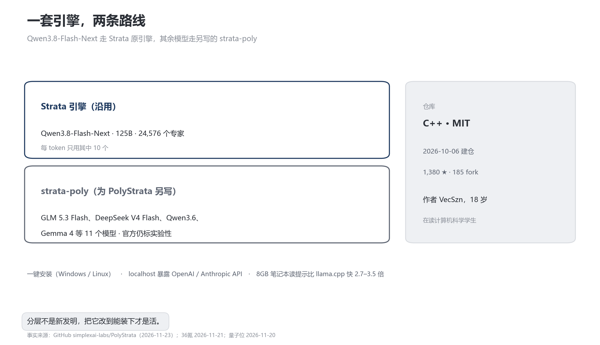

# 12GB 显存跑 125B：PolyStrata 的三层账本

一张 RTX 3060，12GB 显存，跑 1250 亿参数的 Qwen3.8-Flash-Next。官方 README 说，这模型的 2-bit 文件有 39GB，是显存的三倍多，速度还能到 45.5 tokens/s。听起来像变魔术；拆开看，是一笔把显存、内存、硬盘和 CPU 一起算进去的账——关键不在显卡多强，而在哪些计算必须由显卡做。

## 为什么装不下也能跑

MoE 模型不是每个 token 都过全部参数。Qwen3.8-Flash-Next 有 24,576 个专家，每个 token 只挑 10 个。125B 是总参数量，不是每步的计算量。

PolyStrata 顺着这条缝隙分层：最忙的专家留在显存做缓存，其余留在内存，更冷的放硬盘。NVIDIA 机器上，CPU 直接从内存里算没进显存的专家，和 GPU 同时干活——不是把每个专家搬上显卡，而是让两边一起算。项目文档里还有一张约 28.8GB 的 n-gram 查找表，由 SSD 和系统缓存供给。官方尺寸表给 Q2_0 档的内存加显存需求约 37.6GB，IQ2_XS 约 39.2GB；下载量 66–76GB，建议留 80GB 磁盘。

同一套引擎还有两件提速工具：多 token 预测（MTP）一次草拟最多 3 个 token，交给一次完整前向校验；对话缓存让追问只读新增的部分。

## 45.5 这个数字，条件比数字重要

官方 README 的表里，RTX 3060 12GB 是 45.5 tokens/s，RTX 5090 32GB 是 179。表里没写量化档、提示长度和首字时间。45.5 tokens/s 大致是一秒吐出三十多个英文单词，比人读得快。

社区记录把这些补齐了：RTX 3060、i7-12700、64GB 内存、IQ2_XS，4K 提示下 45.5 tokens/s，首字约 5 秒；32K 提示 40.8，首字约 35 秒；128K 提示 37.6，首字约 144 秒。生成速度只掉了 17%，等第一个字的时间翻了近 30 倍。

官方另一组规划测试是 12GB 显存配 32GB 内存，用的是 96GB 卡限到 12GB 预算的模拟环境：短提示 21.3 tokens/s，首字约 3 分钟。内存砍一半，速度只剩不到一半。没有 PolyStrata，这个模型得整只放进 80GB 的 H100。

## 做这套引擎的人，18 岁

PolyStrata 用 C++ 写，MIT 协议，10 月 6 日建仓，到 11 月 23 日 1,380 星、185 个 fork。它不是从零长出来的：仓库描述写明，Qwen3.8-Flash-Next 跑在 Strata 引擎上，另外十来个模型（GLM 5.3 Flash、DeepSeek V4 Flash、Qwen3.6、Gemma 4 等）走为 PolyStrata 另写的 strata-poly 路线，仍标实验性。

36 氪和量子位都提到，这套引擎出自团队里一位 18 岁的开发者 VecSzn；按他的 GitHub 主页，是在读的计算机科学学生。他没推翻 Strata，而是把它改到能装进消费级机器：8GB 笔记本上，官方对比 llama.cpp，读提示快 2.7–3.5 倍，写快 1.5–1.8 倍。

配套的 Model Autopilot 管选型：检测显卡、显存、内存和带宽，从 49 个模型、两套引擎、多种量化与上下文长度的组合里挑一个装得下的；装完要真答一道题才算通过。

## 落点

这项技术改的是“多大的模型配多大的卡”这条老规矩。以前 125B 是机房的事，现在一张 3060 加 64GB 内存能跑，代价写在首字延迟、量化损失和内存条上：这一档的质量保留率官方按模型发布方的任务分估到 0.957，不是本地实测；读 128K 的长文档，要先等两分多钟。它也没让 125B 变成人人可用：同一套规划里，8GB 显卡的机器仍只被安排 4B 到 35B 级的模型，12GB 卡想跑 125B 就得配够 64GB 内存。

但方向清楚：当显存不再是硬门槛，本地 AI 的瓶颈就从“买不买得起卡”变成“愿不愿意等”。

---

*事实来源：Linger 文档 docs.heylinger.com 的 PolyStrata 页与 Benchmarks 页（专家数、MTP、45.5/179、8GB 对比 llama.cpp 2.7–3.5 倍与 1.5–1.8 倍、H100 80GB、Q2_0 保留率 0.957）；GitHub simplexai-labs/PolyStrata（MIT、C++、2026-10-06 建仓、2026-11-23 数据：1,380 星、185 fork、两套引擎的仓库描述）；PolyStrata 仓库的社区记录 bench/results/2026-10-09-community-rtx-3060-0141（经 Mycelium Protocol 2026-11-20 整理：4K/32K/128K 三档速度与首字延迟、Q2_0 与 IQ2_XS 的 37.6GB/39.2GB 内存需求、28.8GB n-gram 表、66–76GB 下载量）；36氪/融中财经 2026-11-21（18 岁开发者 VecSzn、基于 Strata）；量子位 2026-11-20（Model Autopilot 的 49 个模型与两套引擎）。*

*需说明四点。其一，“39GB”是 README 里 2-bit 模型文件的体积，不等于内存占用（Q2_0 约 37.6GB 内存加显存），也不等于下载量（含其他组件约 66–76GB），三个数不能混用。其二，45.5 与 21.3 不是同一配置：前者是 64GB 内存下的社区记录，后者是官方 12GB+32GB 规划档、且跑在限流后的模拟硬件上，二者不能互相否定。其三，官方跑分多为自测，部分档位为模拟硬件；社区记录也注明量化放置策略不同、存在 GPU 热降速。其四，素材称该引擎“降低了内存占用、优化首字延迟、提升并发支持”，这三项未在官方文档核到对应表述，本文改用可核的对比数据（对 llama.cpp 的 2.7–3.5 倍 / 1.5–1.8 倍）与“基于 Strata 扩展”的公开描述。*
