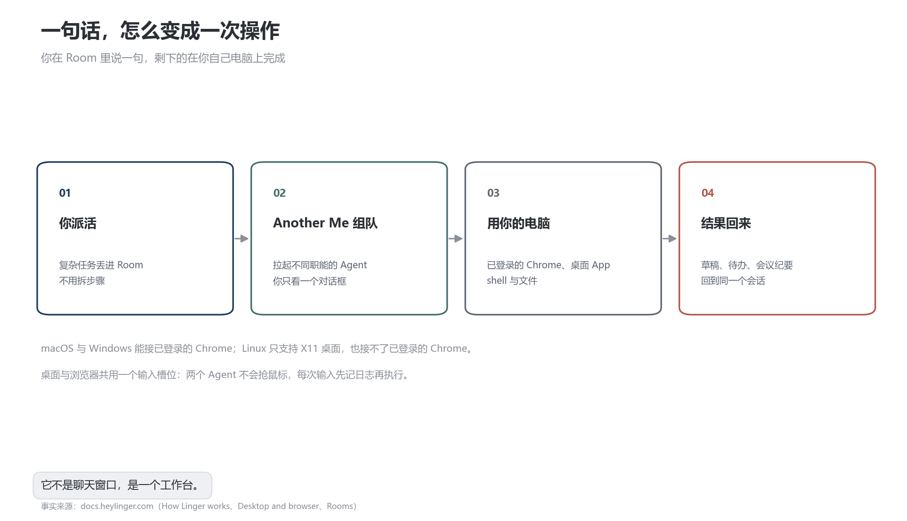
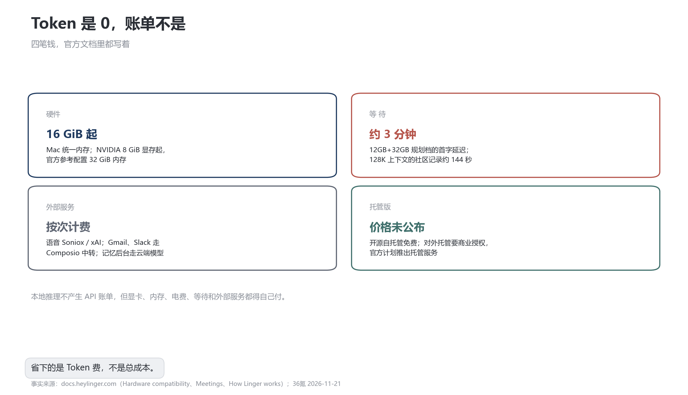
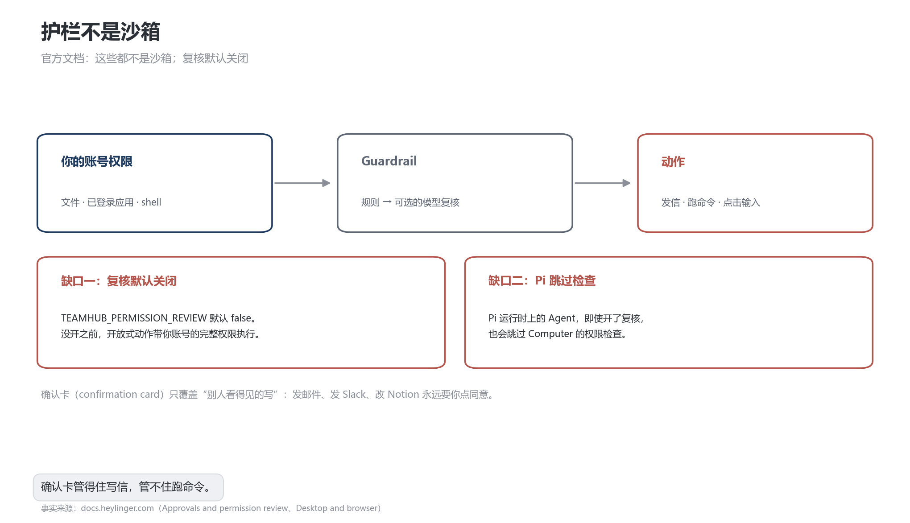

# 零 Token 费的账单：Linger 好用吗，边界在哪

云端 AI 助手都长一个样：你问，它答；关掉网页，它就不记得你。Linger 换了个位置——它住在你的电脑里，记得你的人、项目和文件，还能自己去点鼠标、敲键盘。11 月 19 日开源，四天 GitHub 星标 3,924。问题是：它到底能替你干什么，代价又是什么。

## 它能替你干的四件事

最直接的用法不是聊天，是派活。复杂任务丢进 Room，主助手 Another Me 会拉起几个不同职能的 Agent 分工，你只看一个对话框。

第二件是用你的电脑。macOS 和 Windows 上，它能接你已登录的 Chrome，在 Google Sheets、LinkedIn 里以你的身份操作；也能像读屏软件一样读窗口、点击、输入。桌面和浏览器的输入共用一个槽位，两个 Agent 不会抢鼠标；每次输入先记日志再执行。Linux 只支持 X11 桌面，也接不了已登录的 Chrome。

第三件是会。开会时实时转录、分说话人，边开边问“发布日定了没”；散会后转录和待办进你的会话，待办变成提醒。它需要配一个 Soniox 的 key。

第四件是邮件。连上 Gmail、Outlook、Slack 后，它盯着收件箱和日历，判断现在提醒、晚点跟，还是不说。

## 零 Token 费的账单

本地推理确实没有 API 账单。但账单换了个地方收。

硬件是最大一笔：Mac 要 16GiB 统一内存起步，NVIDIA 要 8GiB 显存加够用的内存，官方参考配置从 32GiB 内存起；想跑 125B 那档，得 12GB 显存配 64GB 内存。

第二笔是等。12GB 显卡配 32GB 内存的规划档，首字延迟约 3 分钟；社区记录里，128K 上下文的首字约 144 秒。

第三笔是外部服务。语音要 Soniox，实时对话靠 xAI；Gmail、Slack 这类连接器走 Composio 中转，请求会出本机；记忆在后台整理时用的是 Codex 或 Claude Code 的默认模型，订阅走云端，内容就送到了那家厂商。

第四笔还没定价。36 氪报道，Simplex AI 计划推出托管版，价格未公布；开源自托管免费，但对外提供托管服务要商业授权。

## 它不是沙箱

官方文档写得很直白：“这些都不是沙箱”——Agent 拥有你账号在那台机器上的权限，能碰你的文件、已登录的应用和 shell。

护栏分两层：规则先过一遍，可选的模型复核再判一次；会被人看到的写操作（发邮件、发 Slack、改 Notion）永远要确认卡，隐私权限变更则直接拦下。

但有两个缺口必须知道。第一，模型复核默认关着，要手动把 TEAMHUB_PERMISSION_REVIEW 设成 true；没开之前，跑命令、点击输入这类开放式动作带着你账号的完整权限直接执行。第二，Pi 运行时上的 Agent 即使开了复核，也会跳过检查。

还有一层：网页、文件、邮件里的文字永远不能代替你授权。文档把这条写死了，但正因为 Agent 读得到这些内容，提示注入仍是这类产品最实际的风险。

## 谁该现在用

两类人值得试：对隐私极敏感、手里有 12GB 以上显卡或高配 Mac 的极客；以及想把邮件、会议、待办串成一条流水线、愿意自己调规则的人。

普通用户建议再等。官网下载区还标着 Coming soon，安装要照仓库文档自己走；规则错了只能靠回话去纠；首字三分钟的等待，也不像“助手”，更像“排队”。

零 Token 费是真的，零成本不是。它把智能搬回了家，也把显卡、电费、等待和权限一起搬了回来。

---

*事实来源：Linger 文档 docs.heylinger.com（How Linger works、Desktop and browser、Meetings、Approvals、Proactive Another Me、Hardware compatibility、Personal memory）；Linger 官网 heylinger.com（下载区状态、数据与隐私说明）；GitHub simplexai-labs/linger（2026-11-23：3,924 星；Co-Workspace 许可证，Apache 2.0 加附加条件）；36氪/融中财经 2026-11-21（托管版计划、600 万美元种子轮）；PolyStrata 社区记录与 Linger Benchmarks 页（首字延迟）。*

*需说明三点。其一，星标数与下载状态是 2026-11-23 的快照，会变。其二，“模型复核默认关闭”指 `TEAMHUB_PERMISSION_REVIEW` 默认 false；确认卡（confirmation card）不受此影响，始终生效，二者不要混为一谈。其三，官方称“本地优先、云端可选”，但连接器（Composio）、语音（Soniox/xAI）、记忆后台（Codex/Claude Code 默认模型）会离开本机——本文按“哪一步出机”逐项写，没有用“完全离线”概括。*
