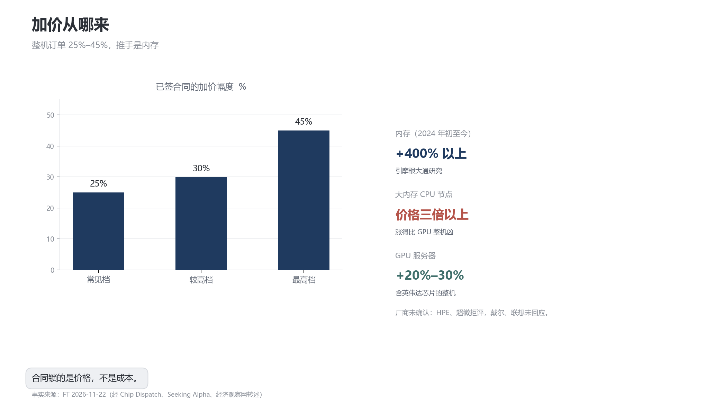
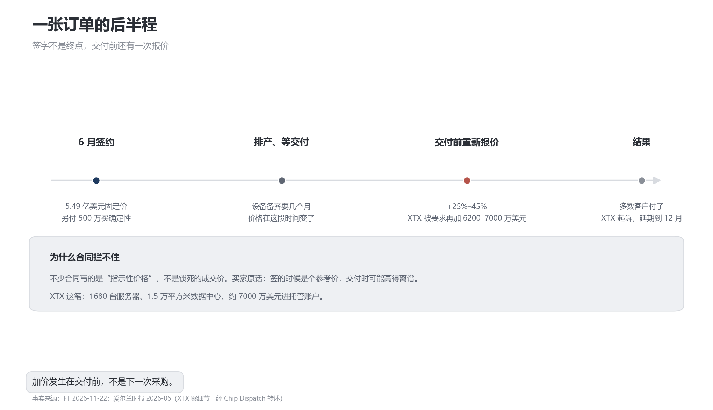
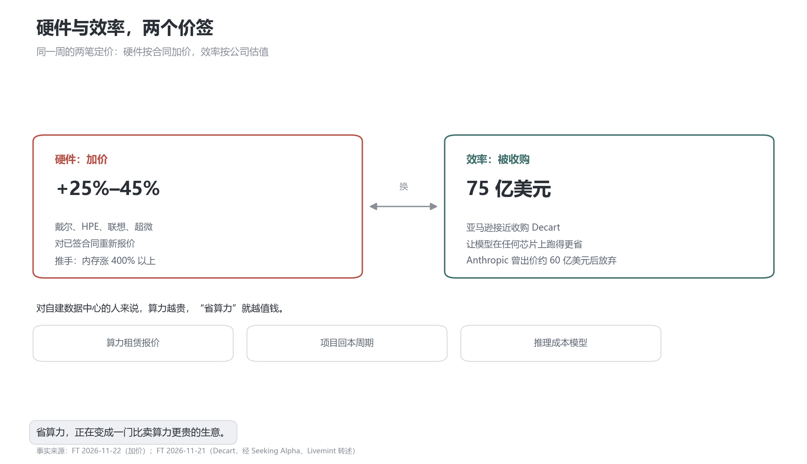

# 合同签完还能加价 45%：AI 服务器的账开始往回算

11 月 22 日，英国《金融时报》报道了一件事：戴尔、慧与（HPE）、联想、超微电脑正在要求客户为几个月前签好的 AI 服务器订单多付钱，幅度 25%、30%，最高 45%——设备快交付时才重新报价。

## 涨多少，谁在涨

报道给的数字分得很细：整机订单加价 25%、30% 或 45%；GPU 服务器至少涨 20%–30%；配大容量内存的 CPU 节点，价格翻了三倍甚至更多。

被加价的是自建数据中心、直接买服务器的客户。报道点名三家交易公司：Jane Street、Optiver、Hudson River Trading，后者的数据中心建在挪威一座改造过的矿里。

一位买家对 FT 说：“现在的标准做法是，我们签一个带指示性价格的合同，到交付时价格可能高得离谱。”另一位消息人士说，多数客户最后还是付了，“他们从没说过不”。

厂商这边，HPE 的 CEO Antonio Neri 把这套做法叫“敏捷定价”：缩短报价有效期，把元器件涨价的风险挡在毛利之外。HPE 和超微拒绝置评，戴尔和联想没有回应。联想上周的财报倒给了个侧面：AI 服务器收入涨 48%，按香港会计准则仍是净亏损——量在涨，利润没跟上。

## 为什么合同挡不住涨价

主因是内存。FT 引用摩根大通的研究：自 2024 年初以来，内存价格涨了 400% 以上。

合同为什么拦不住？因为不少单子写的是“指示性价格”，不是锁死的成交价。真撕破脸的例子也有：量化交易公司 XTX Markets 今年 6 月在爱尔兰起诉戴尔。它签的是 5.49 亿美元固定价，还额外付了 500 万美元买“价格确定性”；戴尔后来要求再加 6200 万到 7000 万美元，理由是吞不下成本上涨。这笔订单是 1680 台服务器、1.5 万平方米数据中心，约 7000 万美元进了托管账户，案子延期到 12 月。

## 另一边，效率开始值钱

同一周，FT 还报道亚马逊接近以 75 亿美元收购以色列公司 Decart——它的软件能让模型在“任何厂商的芯片”上跑得更快、更省。据报道，Anthropic 今年夏天曾出价约 60 亿美元，最后放弃。

两件事放在一起很刺眼：一边是硬件按合同加价 45%，一边是让硬件跑得更满的软件卖到 75 亿美元。算力越贵，“省算力”就越值钱。

## 落点

对自建数据中心的中小云和 AI 公司，这不是新闻标题，是现金流：同样的机柜，交付前多付三成，回本周期就得往后推；算力租赁报价、推理成本模型，都要重算。

大厂议价能力强，受影响小；真正被动的是那些签了固定价、以为锁住成本的人。合同里那行“指示性价格”，现在成了最贵的一行字。

戴尔和 HPE 这周发财报，AI 订单里有多少被重新报价，会是第一个能量化的答案。

---

*事实来源：英国《金融时报》2026-11-22 报道（经 Chip Dispatch、Seeking Alpha、DIGITIMES、经济观察网/财联社转述）：戴尔、HPE、联想、超微对已签合同要求加价 25%/30%/45%，GPU 服务器至少涨 20%–30%，大内存 CPU 节点价格三倍以上；内存自 2024 年初涨超 400%（引摩根大通）；买家含 Jane Street、Optiver、Hudson River Trading；HPE CEO Antonio Neri 的“敏捷定价”表述；XTX 诉戴尔案（5.49 亿美元固定价、另付 500 万美元、戴尔追加 6200 万–7000 万美元、1680 台服务器、1.5 万平方米、约 7000 万美元托管、延期至 12 月）。亚马逊接近 75 亿美元收购 Decart、Anthropic 曾出价约 60 亿美元后放弃：FT 2026-11-21 报道（经 Seeking Alpha、Livemint、Calcalist 转述）。*

*需说明三点。其一，25%–45% 的加价来自 FT 的匿名信源，厂商没有确认——HPE、超微拒评，戴尔、联想未回应；这是“正在发生的谈判”，不是一份公开价目表。其二，材料把涨价归因于“搭载英伟达芯片的 AI 服务器”，FT 给的推手是内存：GPU 服务器涨 20%–30%，大内存 CPU 节点涨得更多，涨价并不只发生在英伟达整机上。其三，材料把影响面写成“云厂商、大模型公司”，报道点名的买家其实是自建数据中心的交易公司；云厂商是否同样被加价，本文没有核到证据。*
