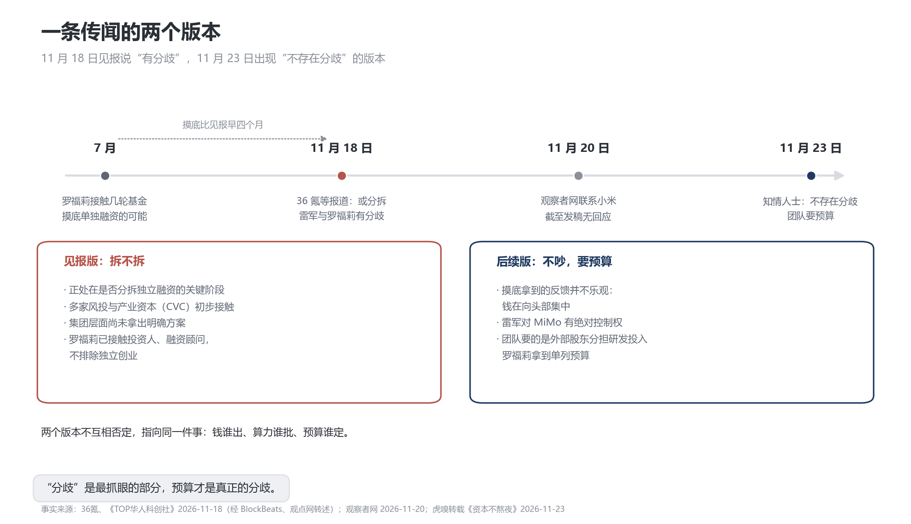
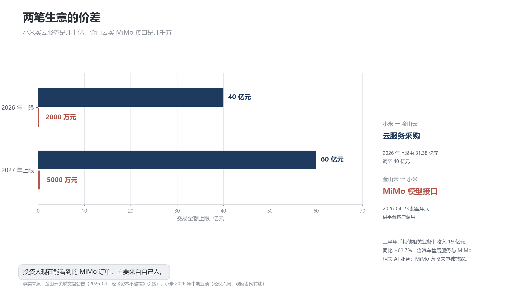
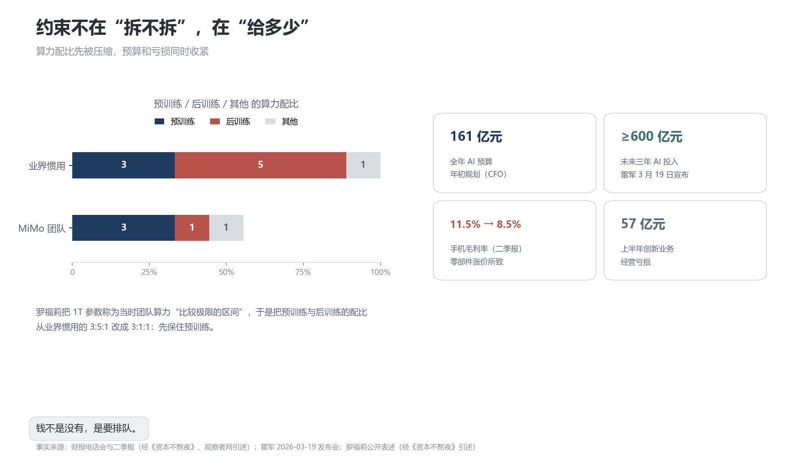

# MiMo 拆不拆：一条传闻的两个版本，卡在同一笔预算上

11 月 18 日，36 氪、《TOP华人科创社》等报道，小米正讨论是否把 MiMo 大模型业务分拆独立融资，已有多家风投和产业资本（CVC）初步接触，集团尚未拿出明确方案。报道称雷军与 MiMo 负责人罗福莉存在分歧，罗福莉已接触少数投资人和融资顾问，不排除独立创业。截至 11 月 23 日，双方均未公开回应。

11 月 23 日出现另一个版本。虎嗅转载《资本不熬夜》的独家报道：罗福莉接触基金投资人发生在 7 月，比见报早四个月；一位知情人士称，雷军对 MiMo 拥有绝对控制权，"不存在分歧"，团队真正想争的是外部股东分担研发投入、罗福莉拿到单列预算。

## 两个版本，差在"分歧"两个字

两个版本不互相否定。见报版问"要不要拆"，后续版说"拆不动，退一步要预算"，最后落在同一件事：钱谁出、算力谁批。

据 36 氪等报道，雷军一方的逻辑是 MiMo 不是靠卖 API 吃饭的模型公司，而是"人车家全生态"的 AI 底座。7 月小米调整组织架构，明确 MiMo 团队为小爱同学提供基础模型，端侧开发交给手机、汽车等业务的操作系统团队。

团队诉求也具体：罗福莉 9 月 22 日升到 22 级，接近小米的人士称为最高职级，从入职到登顶用了十个月。职级到顶，集团能给的增量只剩股权和预算，而集团期权与独立公司股权是两个量级。

## 拆不动的原因，可以先算一笔服务费

判断 MiMo 能否单独估值，最硬的证据是关联交易公告。按金山云披露的安排，小米向金山云采购云服务，2026 年上限由 31.38 亿元调至 40 亿元，2027 年 60 亿元；反方向，金山云向小米采购 MiMo 模型接口供平台客户调用，2026 年 4 月 23 日至年底上限 2000 万元，2027 年 5000 万元。

一边几十亿，一边几千万。这是外部投资人现在能看到的 MiMo 订单：几乎全部来自集团内部和关联方。上半年"其他相关业务"收入 19 亿元、同比增 62.7%，公司归因于汽车售后服务和 MiMo 相关 AI 业务，但未单独披露 MiMo 营收。按公开价目，MiMo-V2.6-Pro 每百万 token 输入 3 元、输出 6 元——靠卖 API 挣出一次万卡级训练，坡还很长。

## 更紧的约束是算力和预算

罗福莉公开承认算力紧张：1T 参数是当时团队"比较极限的区间"，预训练、后训练与其他的算力配比从业界惯用的 3:5:1 改成 3:1:1，先保住预训练。

集团的账也在收紧。CFO 林世伟称全年 AI 预算年初规划 161 亿元、后续可灵活调整；雷军 3 月 19 日宣布的是三年至少 600 亿元，覆盖全集团，MiMo 下一轮训练分到多少要单独决定。同期手机毛利率从 11.5% 降到 8.5%，上半年创新业务经营亏损 57 亿元，三季度手机出货 3070 万台、同比降 29%（Omdia）。

钱不是没有，是要排队。这也解释了分拆为何先以预算的形式上桌：外部股东进来，研发有人分担，单列预算和采购权限才立得住。

## 落点

11 月 24 日小米发三季度业绩，是传闻之后第一个可验证节点：AI 投入口径、创新业务亏损、财报和电话会提不提 MiMo。

短期更可能的形态不是完整分拆，而是"集团控股＋外部股东＋单列预算"。《资本不熬夜》提到金山系关联主体联合持股是一种可能路径，目前没有公开方案。报道里那句"下一代模型何时启动、能用多少算力，仍由小米逐轮决定"，可能比"分歧"更接近现状。

---

*事实来源：2026-11-18 36 氪、《TOP华人科创社》报道（经 BlockBeats、观点网、观察者网转述）：小米讨论 MiMo 是否分拆独立融资、多家风投与 CVC 初步接触、集团未拿出明确方案、雷军与罗福莉存在分歧、罗福莉已接触投资人和融资顾问、不排除独立创业。2026-11-20 观察者网：联系小米暂无回应；MiMo 系 2025 年 4 月推出；罗福莉 2025 年 11 月确认加入、9 月 22 日升至 22 级、团队百余人、小爱同学基础模型由其提供、7 月端侧开发交由操作系统团队；MiMo-V2.6-Pro 在 Artificial Analysis 现行指数 30 分、开源权重第五；API 每百万 token 输入 3 元、输出 6 元；上半年"其他相关业务"收入 19 亿元、同比 +62.7%；二季报手机毛利率 11.5%→8.5%；Omdia 三季度出货 3070 万台、同比 -29%；雷军 11 月 17 日 APEC 工商领导人峰会表态。2026-11-23 虎嗅转载《资本不熬夜》：摸底发生在 7 月；知情人士称雷军拥有绝对控制权、"不存在分歧"、团队要外部股东分担研发投入与单列预算、谈不拢则留在集团且下一代模型启动时间与算力由小米逐轮决定、金山系联合持股是可能方向；全年 AI 预算 161 亿元（CFO 林世伟）、上半年创新业务经营亏损 57 亿元、雷军 3 月 19 日宣布三年至少 600 亿元、罗福莉"比较极限的区间"与 3:5:1→3:1:1、金山云关联交易上限（云服务 31.38 亿→40 亿→60 亿；MiMo 接口 2000 万→5000 万）。*

*需说明四点。其一，分拆与"分歧"均未获小米或罗福莉确认；见报版信源为 36 氪、《TOP华人科创社》，"不存在分歧"出自《资本不熬夜》引述的一位知情人士，属单一信源，代表该信源说法，不是事实认定。其二，榜单口径有出入：11 月 18 日报道称 MiMo-V2.6-Pro 曾登顶 Artificial Analysis 开源权重榜，观察者网 11 月 20 日核对的现行指数为 30 分、开源权重第五（第一为 Kimi K3.1 Pro 46 分），时间点与指数版本不同，本文不采用"登顶"表述。其三，原文材料里的"参考月之暗面、DeepSeek 融资路径""资产归属、商业化、控制权三重考验"是分析框架而非报道事实，本文按框架改写但未当作已发生的事。其四，19 亿元是分部下的"其他相关业务"收入，含汽车售后服务，不等于 MiMo 营收；600 亿、161 亿、57 亿、毛利率、出货量均为公开宣布或财报数字，非本文测算。*
