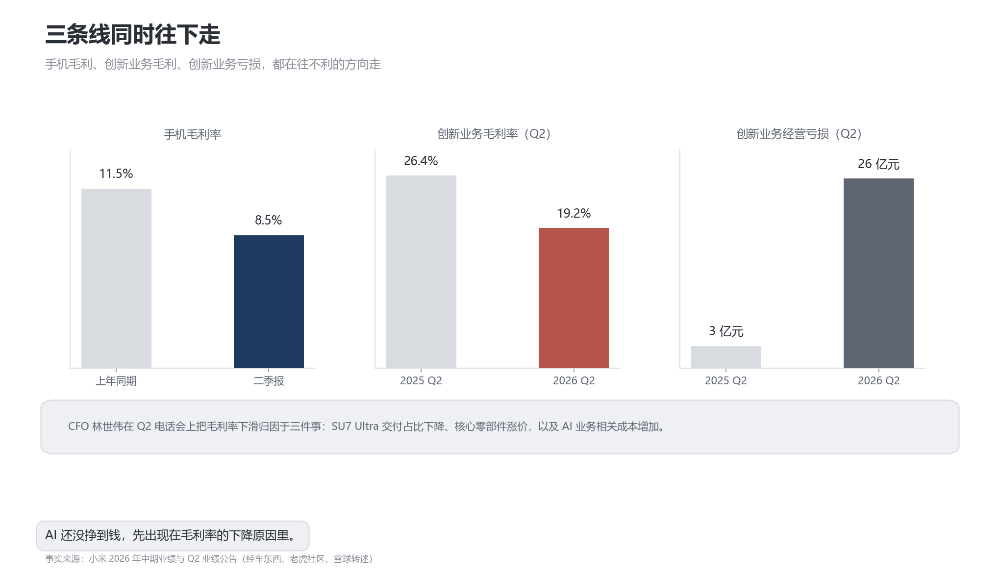
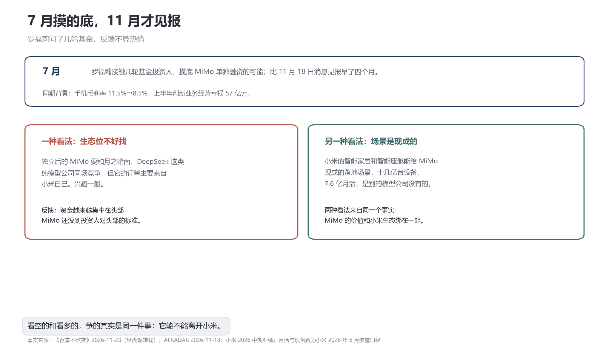
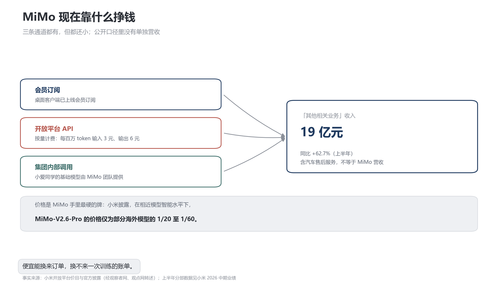

# 600 亿压顶，MiMo 的钱从哪来

今年 3 月 19 日，雷军在新一代 SU7 发布会上宣布：未来三年，小米计划向 AI 领域投入至少 600 亿元。八个月后，这份投入开始出现在别处——二季报里手机毛利率从上年同期的 11.5% 掉到 8.5%，创新业务上半年经营亏损 57 亿元。

一笔三年期的承诺，撞上几条业务线同时烧钱的当期报表。这才是 MiMo 分拆传闻真正的底色：不是要不要独立，是钱从哪来。

## 600 亿是三年的，161 亿是今年的

两个数字先分开看。600 亿元覆盖整个集团的 AI 项目，MiMo 下一轮训练分到多少仍要单独决定；CFO 林世伟给的当期口径是全年 AI 预算年初规划 161 亿元，后续可灵活调整。

压力不在承诺，在结构。上半年"智能电动汽车及 AI 等创新业务"分部收入 448 亿元、同比增长 12.3%，同期经营亏损 57 亿元——一季度 31 亿，二季度 26 亿，二季度亏损同比扩大约 767%。

二季度电话会上，林世伟把分部毛利率从 26.4% 降到 19.2% 归因于三件事：SU7 Ultra 交付占比下降、核心零部件涨价，以及 **AI 业务相关成本增加**；他还补了一句，大模型业务收入刚开始起步，对整个板块毛利率有负面影响。

AI 已经出现在毛利率的下降原因里，还没出现在收入的上升原因里。这就是分拆讨论的现实起点。

## 7 月摸的底，反馈不算热

据《资本不熬夜》11 月 23 日报道，罗福莉今年 7 月就接触过几轮基金投资人，摸底 MiMo 单独融资的可能性——比 11 月 18 日消息见报早了四个月。这轮接触的结果并不理想：钱在向头部集中，MiMo 还没达到投资人对头部的判断标准。

投资人的看法是分裂的。一种意见是生态位不好找——独立后的 MiMo 要和月之暗面、DeepSeek 这类纯模型公司同场竞争，而它的订单主要来自小米自己；另一种意见看好闭环，小米的智能家居和智能座舱能提供现成的落地场景，十几亿台 AIoT 设备、7.6 亿月活，是纯模型公司拿不到的。

两种看法指向同一个事实：MiMo 的估值和它能不能离开小米生态，是同一道题。据同一篇报道，几家基金在摸底时问得很具体——小米自己的业务，究竟能给 MiMo 多少订单。

## 造血的三条通道，都还小

能查到的收入线索只有一条。中报显示上半年"其他相关业务"收入 19 亿元、同比增长 62.7%，增长归因于汽车售后服务和 MiMo 相关 AI 业务——但 MiMo 营收从未单独披露，这 19 亿元里还含着汽车售后。

通道是齐的：桌面客户端已有会员订阅，开放平台按量收费（MiMo-V2.6-Pro 每百万 token 输入 3 元、输出 6 元），集团内部由 MiMo 团队为小爱同学提供基础模型。

价格是 MiMo 手里最硬的牌。官方口径是，相近智能水平下，MiMo-V2.6-Pro 的价格仅为部分海外模型的 1/20 至 1/60。但低价能换来调用量，换不来一次万卡级训练的账单——这也是为什么"外部股东分担研发投入"会成为团队真正想要的东西。

## 双刃剑

独立融资的好处直白：研发费用有人分担，团队拿到单列预算和股权激励，MiMo 从成本中心变成可以单独定价的资产。

代价同样直白：一旦分拆，模型与手机、汽车、家居的协同要重新定价，内部调用变成关联交易，响应速度要排在外部订单后面。小米既想减轻现金压力，又不想让"人车家全生态"的底座变成需要谈判的供应商。

11 月 24 日小米发三季度业绩，是这条线索上第一个可验证的节点：AI 投入的实际口径、创新业务亏损有没有收窄、财报和电话会里怎么提 MiMo。传闻会散，这笔账不会。

---

*事实来源：雷军 2026-03-19 新一代 SU7 发布会宣布未来三年 AI 投入至少 600 亿元（经观点网、《资本不熬夜》转述）。小米 2026 年中期业绩与二季报（经车东西、老虎社区、雪球转述）：手机毛利率 11.5%→8.5%；智能电动汽车及 AI 等创新业务上半年收入 448 亿元、同比 +12.3%，经营亏损 57 亿元（Q1 31 亿元、Q2 26 亿元），Q2 亏损同比扩大约 767%；Q2 分部毛利率 26.4%→19.2%；CFO 林世伟在 Q2 电话会上的归因（SU7 Ultra 交付占比下降、核心零部件涨价、AI 业务相关成本增加）及"大模型业务收入刚开始起步，对板块毛利率有负面影响"的表述；全年 AI 预算年初规划 161 亿元、后续可灵活调整。上半年"其他相关业务"收入 19 亿元、同比 +62.7%（含汽车售后服务及 MiMo 相关 AI 业务，MiMo 营收未单独披露）；MiMo 系 2025 年 4 月推出，桌面客户端已上线会员订阅，开放平台每百万 token 输入 3 元、输出 6 元；官方口径价格仅为部分海外模型的 1/20 至 1/60；2026 年 6 月全球月活 7.665 亿、AIoT 连接设备超 11.6 亿台（以上经观察者网、观点网转述）。罗福莉 7 月接触几轮基金投资人摸底单独融资、反馈不乐观、资金向头部集中；投资人"生态位不好找"与"智能家居和智能座舱可形成闭环"两种看法；基金打听小米自身能给 MiMo 多少订单：均出自《资本不熬夜》2026-11-23（经虎嗅转载）与 AI·RADAR 2026-11-18 转述。*

*需说明三点。其一，600 亿元、161 亿元是两个口径：前者是三年期、覆盖全集团的投入承诺，后者是本年度 AI 预算规划，不能相减或直接对比，本文只用来说明"承诺大、当期额度有限"。其二，19 亿元是分部下的"其他相关业务"收入，含汽车售后服务，不等于 MiMo 营收；MiMo 至今没有单独披露过收入，任何把它等同于 MiMo 营收的算法都不成立。其三，"反馈不乐观""生态位不好找"来自匿名信源与投资人转述，小米与罗福莉均未公开确认；7 月摸底一事为单一信源（《资本不熬夜》），11 月 18 日的分拆传闻同样未获官方回应。*