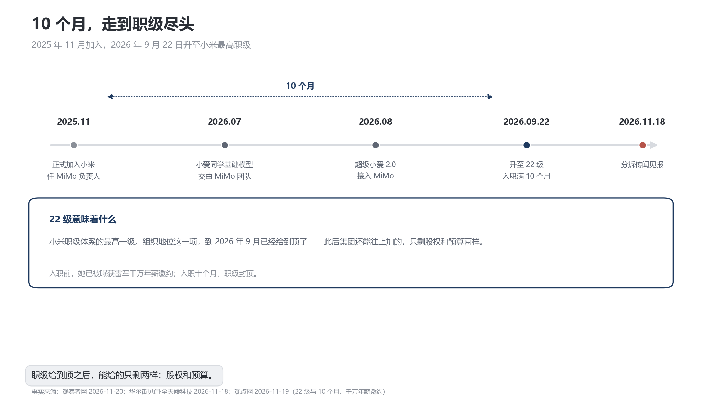
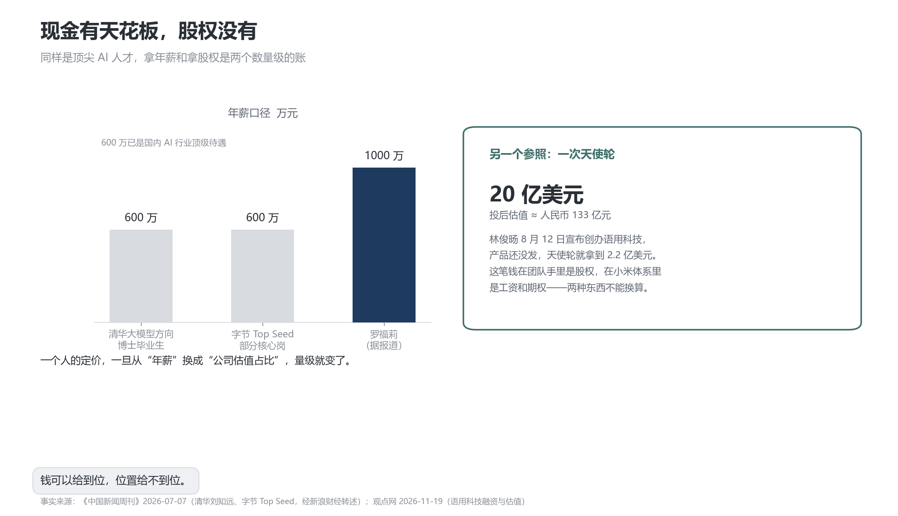
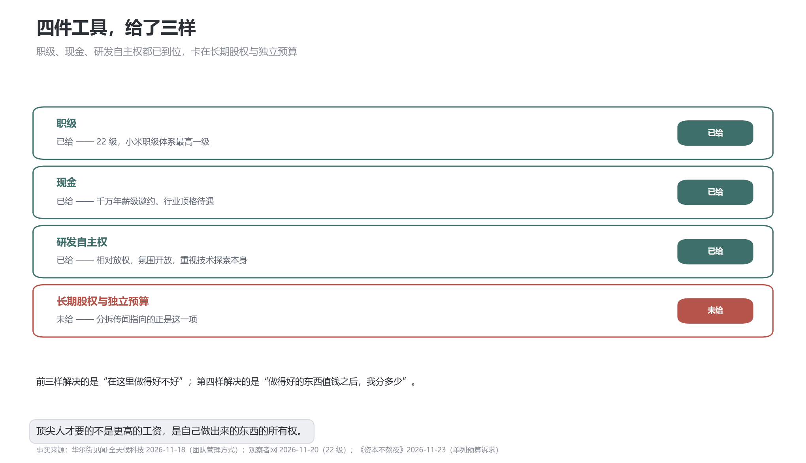

# 10 个月登顶 22 级，然后呢

罗福莉 1995 年出生，北大计算语言学硕士，在阿里达摩院、幻方量化待过，是 DeepSeek-V2 的关键开发者之一。2024 年底，媒体曝出雷军以千万年薪邀约；2025 年 11 月，她正式加入小米，任 MiMo 大模型负责人。

2026 年 9 月 22 日，小米内部晋升名单公布，她升到 22 级——接近小米的人士说，这已是小米职级体系的最高一级。从入职到登顶，10 个月。

问题也在这里：职级给到顶、年薪给到千万级、团队给到相对放权，为什么还会传出分拆和单飞？

## 22 级是天花板，也是终点

小米对 MiMo 团队的管理方式确实不像传统大厂。据华尔街见闻·全天候科技报道，团队内部相对放权，研究氛围开放自由，不过度强调内部竞争和高强度节奏，更多靠自我驱动，相比榜单排名更看重技术探索本身。对大模型研究者来说，这种自由度本身就是稀缺资源。

但组织激励有一个硬边界：职级是有限的。22 级封顶之后，集团还能往上加的只剩两样——股权和预算。

而这两样，恰恰是小米最不愿意松手的。

## 现金已经在通胀

先看行业价码。清华大学计算机系教授刘知远对《中国新闻周刊》说，他组里大模型方向的博士毕业生能拿到 600 万元以上年薪，硕士也能到百万以上。字节 Top Seed 的校招薪资，2024 年约 150 万元，2025 年涨到 300 万至 500 万元，2026 年部分核心岗位已突破 600 万元。

三年翻四倍。这意味着靠加薪留人的边际效果在快速衰减——今天开出顶格现金，明年可能只是市场均价。对一家要连续投入三年、总额至少 600 亿元的公司来说，用现金打人才战，是一笔会持续涨价的开支。

## 现金买时间，股权买所有权

林俊旸给了一个参照。这位前阿里通义千问技术负责人 8 月 12 日宣布创办语用科技，产品还没发布，天使轮就拿到 2.2 亿美元，投后估值 20 亿美元，约合人民币 133 亿元。

同样是顶尖技术负责人，一边是年薪，一边是自己公司估值里的一块。这不是钱多钱少的差别，是两种东西：工资买的是当下的时间，股权买的是自己做出来的东西的所有权。

对一个已经把职级走到尽头的人来说，前者能给的空间基本到顶了。

## 小米能给的第四样

所以分拆传闻里团队真正在争的东西，并不玄。据《资本不熬夜》11 月 23 日报道，罗福莉及团队想要的是外部股东分担研发投入、她本人拿到单列预算——不是"再涨点工资"。

这条路在业内已有先例，小米自己也不是没有工具。同一篇报道提到，若分拆推进，金山系等关联主体联合持股可能是方向之一：既能分担资金压力，也能维持控制。换言之，小米更可能选择"给一部分股权、但不让出控制权"，而不是把 MiMo 整个放出去。

## 落点

这件事真正的考题，不是罗福莉会不会走，而是小米愿不愿意承认一件事：MiMo 已经是可以单独估值的资产，而创造它的人，理应在这份估值里有一份位置。

职级、薪酬、研发自主权，小米都给到了相当高的水平。第四样——长期价值分享——目前还卡在集团控制权与团队收益之间。11 月 24 日的三季报回答不了这个问题。

---

*事实来源：罗福莉 1995 年生于四川宜宾、北大计算语言学硕士、曾任阿里达摩院与幻方量化、参与 DeepSeek-V2 研发、2025 年 11 月加入小米任 MiMo 大模型负责人、2024 年底被曝获千万年薪邀约、2026 年 9 月 22 日升 22 级且为职级体系最高一级、入职到登顶 10 个月：观察者网 2026-11-20、观点网 2026-11-19（经澎湃新闻、《每日经济新闻》佐证加入时间）。MiMo 团队相对放权、氛围开放自由、不过度强调内部竞争与高强度节奏、重视技术探索：华尔街见闻·全天候科技 2026-11-18（经新浪财经、腾讯新闻转述）。清华计算机系教授刘知远称组内大模型方向博士毕业生年薪 600 万元以上、硕士百万元以上；字节 Top Seed 校招薪资 2024 年约 150 万元、2025 年 300 万至 500 万元、2026 年部分核心岗位突破 600 万元（引《晚点LatePost》）：《中国新闻周刊》2026-07-07（经新浪财经转述）。林俊旸 2026-08-12 宣布创办语用科技、2.2 亿美元天使轮、投后估值 20 亿美元约合人民币 133 亿元：观点网 2026-11-19。团队争取外部股东分担研发投入与单列预算、金山系等关联主体联合持股可能是方向之一：虎嗅转载《资本不熬夜》2026-11-23。*

*需说明三点。其一，素材中"雷军大约每两周听取一次汇报、通常不干预具体技术决策"这一说法，我在公开报道中没有核到出处；可核对的是华尔街见闻·全天候科技对团队"相对放权、氛围开放"的描述，正文按后者写。其二，"千万年薪"是 2024 年底的媒体报道口径，小米与本人均未确认具体数字；22 级为最高职级出自"接近小米的人士"表述，小米未公开职级表。其三，分拆、单飞、接触投资人等均未获小米或罗福莉确认；林俊旸的估值与 MiMo 不可直接类比，两者的资产范围、股东结构和业务成熟度都不同，本文只用来说明"现金"与"股权"是两类不同的激励工具。*