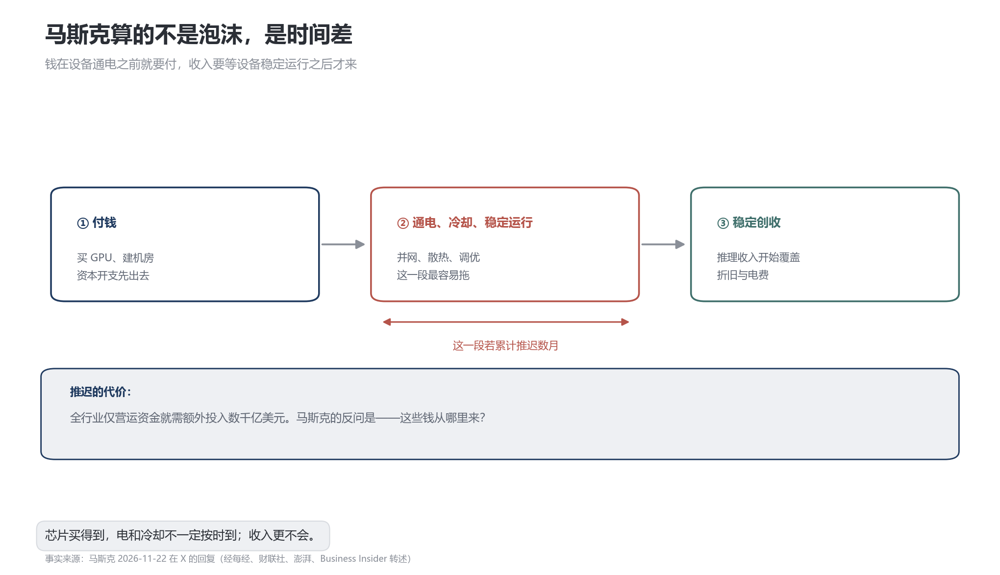
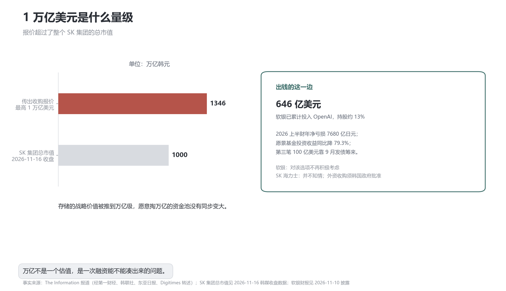
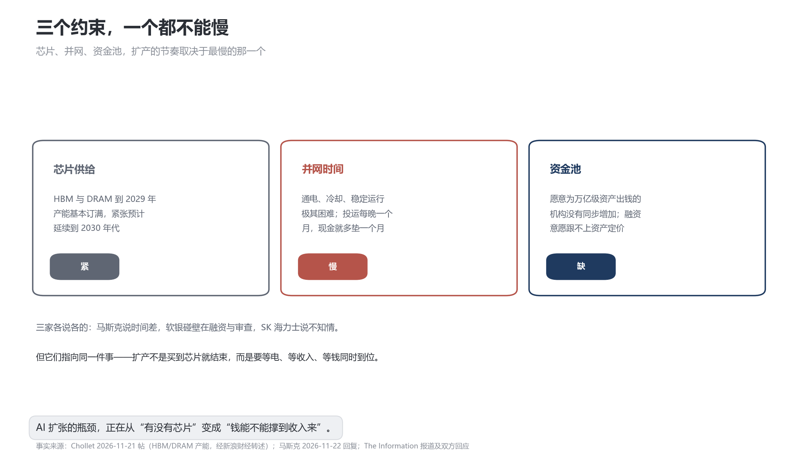

# 马斯克算的不是泡沫，是时间差

11 月 22 日，马斯克在 X 上回了一条帖子，四个字概括他的判断："明年的现金短缺也会非常疯狂。"

他回复的原帖来自 Keras 创始人弗朗索瓦·肖莱。肖莱把市场对 AI 基建的两种判断摆在一起：要么认为建设已经结束、算力需求见顶，这轮行情是泡沫；要么认为现在是难得的买点。他给出的理由是几条硬件数据——GPU 现货价格仍在涨、算力难锁定；HBM 和 DRAM 到 2029 年的产能基本订满，存储紧张预计延续到 2030 年代；前沿模型训练算力约每 5 个月翻一番；AI 推理业务利润率能到 70% 至 85%。

马斯克没有接着讨论估值，他把话题拉到了通电、冷却和稳定运行上：让这么大规模的算力设备真正跑起来极其困难。如果全行业从支付算力成本到设备稳定创收之间的时间累计推迟几个月，仅营运资金就得多投数千亿美元。然后他反问：这些钱从哪里来？

## 这不是泡沫论，是现金流的时间轴

按泡沫论，问题出在需求是假的。按马斯克的算法，问题出在时间错位：钱在设备通电之前就要付，收入要等设备稳定运行之后才来，中间那段是真空。

数据中心并网要排队，散热要调，负载要爬坡。这些环节单个都不新鲜，但当一个行业同时在几千亿量级上扩张时，"各环节各拖几周"叠起来就是几个月的现金缺口。而且垫资是刚性的——芯片款、电费、工程款不因为你还没创收就可以缓付。

## 另一边，软银碰到的是一堵墙

同一周还有另一条消息。据 The Information 报道，孙正义近期接洽华尔街机构，商讨为一笔最高 1 万亿美元的收购融资，标的是 SK 海力士。软银发言人随后表示，公司会探索很多机会，但对该选项不再积极考虑；SK 海力士称并不知情，并按韩国法律提示，外资收购须事先获得政府批准。

1 万亿美元约合 1346 万亿韩元。作为对照，SK 集团总市值在 11 月 16 日收盘时勉强守住 1000 万亿韩元——报价超过整个集团的总市值。

而软银自己正处在另一个方向上。截至 11 月 10 日，它已累计向 OpenAI 投入 646 亿美元、持股约 13%；2026 上半财年净亏损 7680 亿日元，愿景基金投资收益同比下降 79.3%，第三笔 100 亿美元靠 9 月发行外币高级债券筹来。

这两件事放在一起，逻辑就清楚了：存储芯片的战略价值被推到了万亿级，愿意为这个价格掏钱的资金池并没有同步变大。软银不是不想买，是既要说服华尔街出钱，又要过韩国政府审查这一关。

## 三个约束，一个比一个难等

把马斯克和软银放在一张图里，算力扩张的约束其实是三条：

芯片——HBM 与 DRAM 到 2029 年产能订满，加钱也变不出货；并网——投运每晚一个月，现金就多垫一个月；资金池——愿意为万亿级资产出钱的机构没增加，融资意愿跟不上资产定价。

三条里任何一条慢下来，另外两条都会跟着淤住。芯片到货了没法通电，是库存；通电了没收入，是现金流缺口；有收入但没人愿意提供下一轮融资，就得自己扛。

## 落点

过去两年，市场担心的约束是"有没有芯片"。现在这个约束正在换位置：芯片依然紧，但真正决定扩张节奏的，是钱能不能撑到收入来的那一天。

对具体公司来说，这意味着两件很实际的事。一是数据中心的投运时间表，从此要和融资时间表放在一起看，而不是分开汇报；二是"算力订单"和"算力收入"之间的那段垫资，会成为财务报表上最先暴露风险的地方。

马斯克那条回复之所以被反复引用，不是因为他唱空——他自己就在大规模买算力。他指出的是一场全行业的期限错配：资产是长的，资金是短的。

---

*事实来源：2026-11-21（当地）Keras 创始人弗朗索瓦·肖莱在 X 发帖，列 GPU 现货价上涨与算力难锁定、HBM 与 DRAM 到 2029 年产能基本订满且紧张预计延续至 2030 年代、前沿模型训练算力约每 5 个月翻一番、AI 推理业务利润率 70%–85%；2026-11-22 马斯克回复"明年的现金短缺也会非常疯狂"，称让大规模算力设备通电、冷却并稳定运行极其困难，若付款到稳定创收的时间累计推迟数月，仅营运资金就需额外数千亿美元，并反问"这些钱从哪里来"；原帖背景为半导体制造商股票估值相对预期利润偏低（经每日经济新闻、财联社、澎湃新闻、Business Insider 转述）。孙正义接洽华尔街机构商讨为最高 1 万亿美元收购 SK 海力士融资：The Information 报道（经第一财经、韩联社、东亚日报、Digitimes 转述，约合 1346 万亿韩元）；软银发言人称对该选项不再积极考虑；SK 海力士称并不知情，并指按韩国法律外资收购须事先获政府批准。SK 集团总市值 2026-11-16 收盘勉强守住 1000 万亿韩元。软银累计向 OpenAI 投资 646 亿美元、持股约 13%；2026 上半财年净亏损 7680 亿日元，愿景基金合并口径投资收益同比降 79.3%；第三笔 100 亿美元来自 9 月发行的外币高级债券、过桥融资额度已取消：软银财报 2026-11-10（经每日经济新闻、界面新闻转述）。*

*需说明三点。其一，"明年"指 2027 年，马斯克原文为"明年的现金短缺也会非常疯狂"，中文转述中有媒体写成"2027 年"、也有写成"明年"，实指同一时间窗口；"数千亿美元"是马斯克对全行业的量级描述，不是测算模型，本文不据此推算任何单家公司数字。其二，1 万亿美元收购一事仅来自 The Information 的知情人士报道，软银称不再积极考虑、SK 海力士称不知情，交易从未公开确认；"1346 万亿韩元"为报道给出的折算值，汇率口径未披露。其三，SK 集团总市值包含 SK 海力士之外的资产，用它来对照收购报价只为说明量级，不等于对 SK 海力士单独估值的判断。*