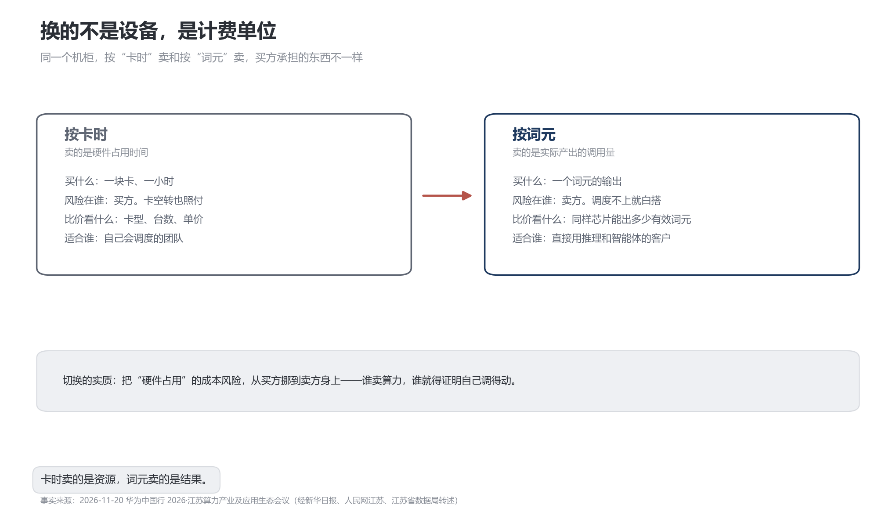
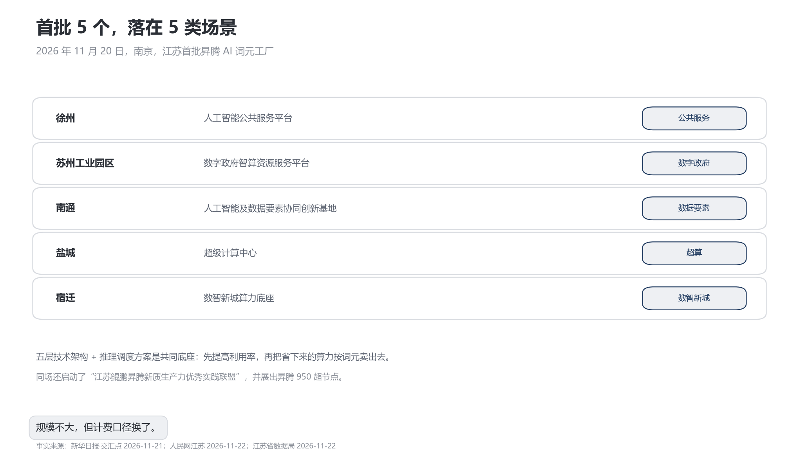
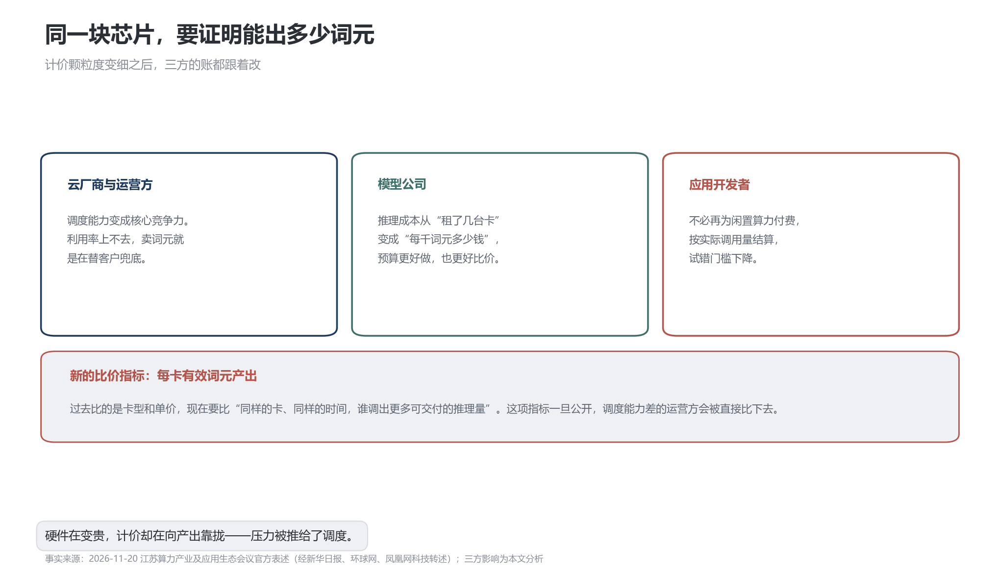

# 算力不按卡时卖，改按词元卖

11 月 20 日，华为主办的"数智引领 苏智跃升——华为中国行 2026·江苏算力产业及应用生态会议"在南京举行。会上发布了江苏首批 5 个昇腾 AI"词元工厂"：徐州人工智能公共服务平台、苏州工业园区数字政府智算资源服务平台、南通人工智能及数据要素协同创新基地、盐城超级计算中心、宿迁市数智新城算力底座。

官方对"词元工厂"的定义里，最要紧的不是"5 个"，而是半句话：推动算力模式从售卖"卡时"转向输出"词元"产能。

## 换的不是设备，是计费单位

按"卡时"计价，买的是硬件占用时间——一块卡、一小时，卡空转也照付。按"词元"计价，买的是模型实际产出的调用量，调度不上就是卖方自己白搭。

这一换，成本风险的位置变了。过去算力利用率低，亏的是买方；现在按词元结算，利用率低，亏的是运营方。所以官方表述里"通过优化调度大幅提升算力利用率"不是修饰语，是这套模式能成立的前提：先得把同样的卡调出更多有效产出，才有词元可卖。

它也顺带造出一个新指标：同样芯片、同样时间，能产出多少可交付的词元。这个数一旦被摆上台面，调度能力差的运营方会被直接比价下去。

## 五个工厂，五类场景

五地落点对应的场景并不重复：徐州是公共服务平台，苏州工业园区是数字政府智算资源服务平台，南通是人工智能及数据要素协同创新基地，盐城是超级计算中心，宿迁是数智新城算力底座。共同底座是"五层技术架构 + 推理调度方案"。

同场还启动了"江苏鲲鹏昇腾新质生产力优秀实践联盟"，展出昇腾 950 超节点。中国信通院人工智能研究所副总工程师闫树在会上提到，大模型正加速向智能体演进。这一点和计费口径的变化是配套的：智能体应用的调用频次高、单次请求短、峰谷波动大，按卡时包月对这类负载最不划算。

## 三方的账都跟着改

对运营方，核心能力从"有多少卡"变成"能把卡用到多满"。卖词元等于承诺交付量，调度不稳就要自己贴。

对模型公司，推理成本从"租了几台卡"变成"每千词元多少钱"。好处是预算可预测、可横向比价；难处是模型效率的差异会被直接折算成价格差。

对应用开发者，不必再为闲置算力付费。按调用量结算，试错门槛下降——这对智能体这类需要反复试的应用尤其重要。

## 落点

过去两年算力生意的单位是"卡"和"P"，比的都是供给侧的规模。词元工厂把计价单位挪到了产出侧，这是计费逻辑的变化，不只是产品改名。

但要看清一件事：官方的表述停留在模式与架构层面，5 个工厂的词元单价、利用率提升幅度、结算系统怎么落地，目前都没有公开。计费单位换了，价目表还没换——这一轮真正要观察的，是后续会不会出现可比价的公开报价。出现了，"按词元卖"才算真正开始；出不来，它还只是一个更好听的说法。

硬件在变贵，计价却在向产出靠拢。这两件事同时发生，压力最终都落到同一个地方：谁能让同样的芯片跑出更多能交付的结果。

---

*事实来源：2026-11-20 华为主办的"数智引领 苏智跃升——华为中国行 2026·江苏算力产业及应用生态会议"在南京举行，会上发布江苏首批 5 个昇腾 AI"词元工厂"，分别为徐州人工智能公共服务平台、苏州工业园区数字政府智算资源服务平台、南通人工智能及数据要素协同创新基地、盐城超级计算中心、宿迁市数智新城算力底座；"词元工厂"通过五层技术架构与推理调度方案优化调度、提升算力利用率，推动算力模式从售卖"卡时"转向输出"词元"产能，本地算力供给从"按卡计费"走向"按词售卖"，服务颗粒度更贴近大模型推理与智能体应用需求；五个工厂覆盖公共服务、数字政府、数据要素协同、超算、数智新城等场景；同场启动"江苏鲲鹏昇腾新质生产力优秀实践联盟"、发布鲲鹏与昇腾双生态典型场景方案、展出昇腾 950 超节点；中国信通院人工智能研究所副总工程师闫树称大模型正加速向智能体演进。以上经新华日报·交汇点（2026-11-21）、人民网江苏（2026-11-22）、江苏省数据局（2026-11-22）、中共江苏省委新闻网（2026-11-22）、环球网、凤凰网科技转述。*

*需说明三点。其一，本文对"风险从买方转移到卖方""新比价指标"的论述属于分析判断，官方通稿只给了模式描述，没有给出利用率、单价或结算细则。其二，截至发稿，5 个词元工厂均未公布词元单价、计费系统或可对外采购的报价，也没有公开的利用率对比数据；"按词元卖"目前是建设方向，不是已经跑通的商业条款。其三，"硬件在变贵"为背景性描述，指同期 AI 服务器与存储涨价的行业状况，与本次发布会无直接因果关系，本文不据此推算任何价格。*