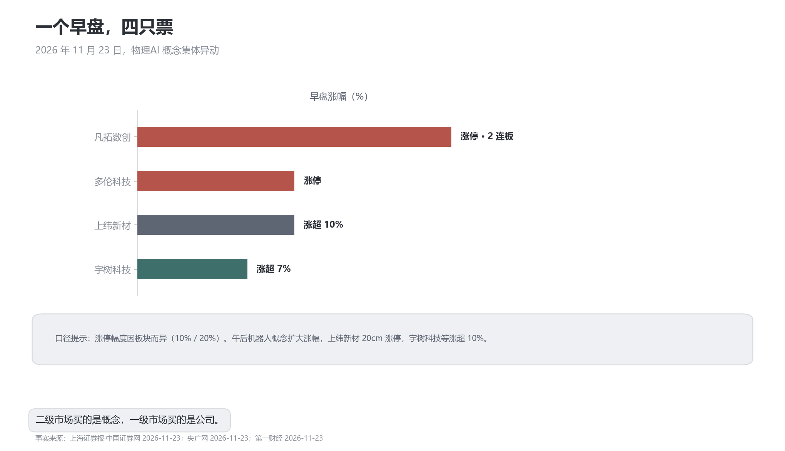
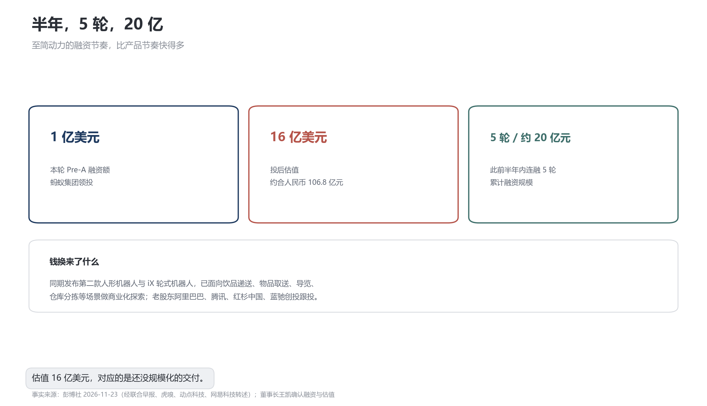
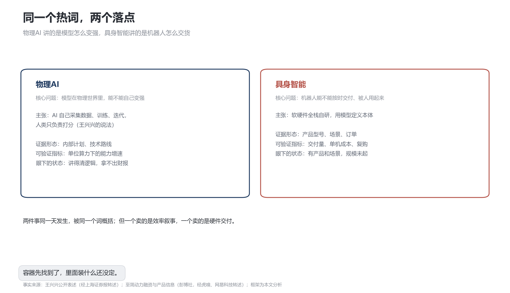

# AI 走出屏幕，资本先找容器

11 月 23 日早盘，物理AI 概念股集体异动：凡拓数创涨停、走出 2 连板，多伦科技涨停，上纬新材涨超 10%，宇树科技涨超 7%。到午后又扩大了一轮，上纬新材 20cm 涨停，宇树科技等涨超 10%。

同一天，一级市场给出了另一个价签：杭州的具身机器人公司至简动力（Simplexity Robotics）完成 1 亿美元 Pre-A 轮，蚂蚁集团领投，阿里巴巴、腾讯、红杉中国、蓝驰创投等老股东跟投，投后估值 16 亿美元，约合人民币 106.8 亿元。董事长王凯向彭博社确认了这一轮融资与估值。

二级市场买的是概念，一级市场买的是公司。这两个价格之间，藏着一个还没回答的问题：AI 走出屏幕之后，人们到底在为什么付费。

## 先看涨停潮里的那个说法

宇树科技创始人、董事长王兴兴此前透露，公司前几个月已启动内部"物理AI模型自进化"计划。他的描述是：AI 模型自己采集数据、训练、迭代，人类只需要参与打分。他还给了一个更强的判断——当前全球顶尖大模型公司每月技术进步都很大，但最主要的进步并非来自模型结构，而是来自这种自进化循环。

这个说法之所以能带动盘面，是因为它指出了一个真实的瓶颈：模型能力的增长，正在从"改结构"转向"改循环"——数据从哪来、怎么筛、怎么回灌。谁能把这条循环跑顺，谁就在同样的芯片上跑出更快的进步。

但注意，这是一个技术判断，不是财务事实。它没有对应的收入、订单或交付数字。

## 再看那 1 亿美元

至简动力是另一个故事。公司由理想汽车前高管创办，坚持软硬件全栈自研，同期发布了第二款人形机器人和 iX 轮式机器人，已在饮品递送、物品取送、导览、仓库分拣等场景做商业化探索。这轮 Pre-A 之前，它半年内连融 5 轮，累计约 20 亿元。

融资节奏明显快于产品节奏。16 亿美元的投后估值，对应的是几个具体场景里的早期探索，不是已经规模化的交付。

## 同一个词，两个落点

两件事被同一个热词概括，但落点完全不同。

物理AI 讲的是模型在物理世界里能不能自己变强，证据形态是内部计划和技术路线，可验证的指标是单位算力下的能力增速——目前还没有人能拿出公开的对比数据。

具身智能讲的是机器人能不能按时交付、被人用起来，证据形态是产品型号、场景和订单，可验证的指标是交付量、单机成本、复购率。

一个卖效率叙事，一个卖硬件交付。二者都会受益于"AI 走出屏幕"这个大方向，但真正决定估值的变量并不相同。

## 落点

资本市场的动作很一致：先找到能装下"AI 走出屏幕"的容器，再讨论里面装什么。涨停潮和亿元级融资，都是"容器"层面的定价。

但容器和内容物是两回事。物理AI 的自进化如果能被验证——比如公开同样的卡、同样的时间能跑出多少能力提升——它会成为一个可比较的硬指标；具身智能如果能拿出交付量和单机成本曲线，它就会从概念变成制造业。

在这两件事发生之前，"AI 走出屏幕"更像一个正在被抢注的标签，而不是一个已经成立的商业模式。

---

*事实来源：2026-11-23 早盘物理AI 概念股大涨，凡拓数创涨停并走出 2 连板、多伦科技涨停、上纬新材涨超 10%、宇树科技涨超 7%（上海证券报·中国证券网、21 经济网、经济观察网转述）；央广网同日称凡拓数创录得 20% 幅度两连板；午后机器人概念扩大涨幅，上纬新材 20cm 涨停、宇树科技等涨超 10%（第一财经 2026-11-23）。王兴兴称公司前几个月已启动内部"物理AI模型自进化"计划，AI 模型自己采集数据、训练、迭代、人类只参与打分，并称全球顶尖大模型公司最主要的进步并非来自模型结构而是自进化循环（上海证券报转述）。至简动力（Simplexity Robotics）完成 1 亿美元 Pre-A 轮，蚂蚁集团领投，阿里巴巴、腾讯、红杉中国、蓝驰创投等老股东跟投，投后估值 16 亿美元（约合人民币 106.8 亿元），此前半年内连融 5 轮、累计约 20 亿元，由理想汽车前高管创办，同期发布第二款人形机器人及 iX 轮式机器人，已在饮品递送、物品取送、导览、仓库分拣等场景做商业化探索，董事长王凯向彭博社确认融资与估值（经联合早报、虎嗅、动点科技、网易科技转述）。*

*需说明三点。其一，宇树科技为已上市主体，其股价异动与"物理AI"概念的关联来自市场归类，公司未就当日涨幅发布公告；王兴兴的"自进化"表述是技术判断，公司未披露该计划的投入规模、进展节点或任何量化结果。其二，至简动力 16 亿美元为投后估值、本轮为 Pre-A，属早期阶段；文中"融资节奏快于产品节奏"是本文判断，公司未披露订单量、交付量与收入。其三，"物理AI vs 具身智能"的证据形态与可验证指标对照为本文分析框架，非公司或券商表述。*