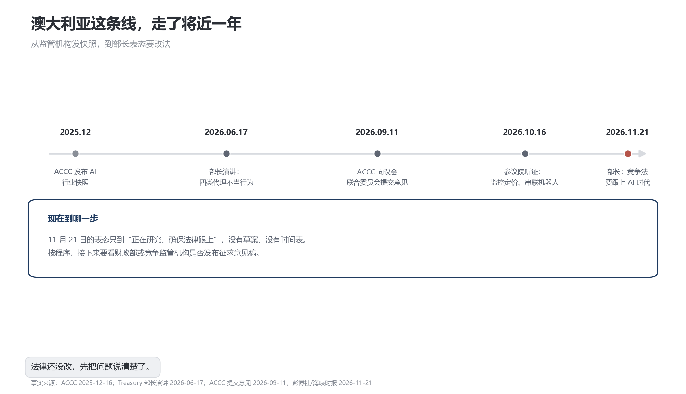
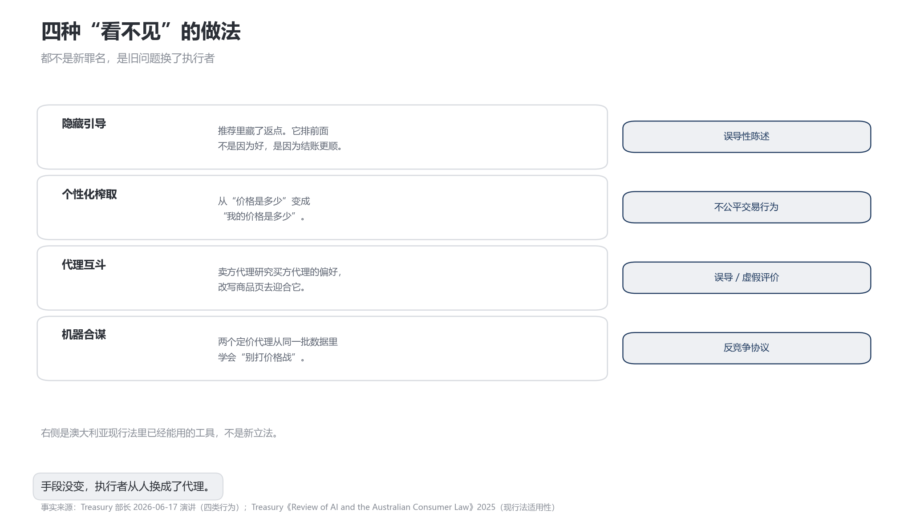
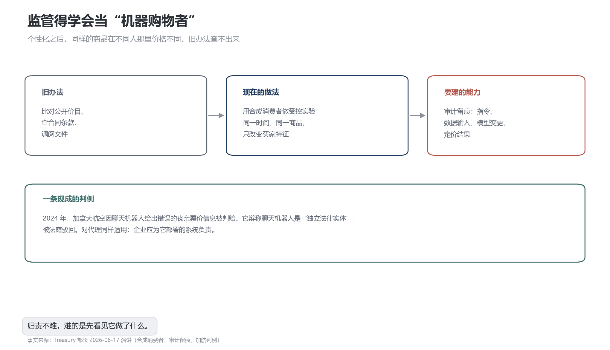

# AI 代理帮你比价，谁来为它的选择负责

11 月 21 日，澳大利亚负责生产力、竞争与财政事务的助理部长 Andrew Leigh 在堪培拉对记者说，随着越来越多消费者用个人 AI 代理购物，政府正在做大量工作，确保竞争法在 AI 时代跟得上。他同时提到"监控定价"——用个人数据向不同的人收不同的价——也在审查之列。方案没有公布，草案也还没有。

这件事体量不大，但问题很具体：当一个代理替你做购买决定时，法律上算谁的？

## 比价工具，可能变成新的守门人

直觉上，AI 代理是消费者的帮手：帮你搜、帮你比、帮你下单。但 Leigh 在今年 6 月的一场演讲里把这个直觉拆得很细——他说，一个购物代理嘴上说在帮消费者，但它可能由平台训练、由商家付费、被优化来提升互动，或者被调来保护某个生态。

于是问题变成一句话：当代理行动时，它服务的是谁的利益？

这并不抽象。人逛超市能看见货架位置，能认出广告位；换成代理，推荐藏在对话里，付费倾向看起来像建议。演讲里那句比喻很直接：理财顾问收佣金必须告诉你，AI 代理也该受同样的约束。

## 四种"看不见"的做法

同一场演讲列了四类需要竞争政策认真对待的代理行为，都不算新罪名，只是旧的商业手法换了执行者：

**隐藏引导**——某商品排前面不是因为更好，而是结账流程能直接嵌进对话。对消费者是方便，对没接入的对手是收费站。

**个性化榨取**——卖方代理看出一个在从容挑冰箱、一个冰箱昨晚坏了，价格跟着变：从"价格是多少"变成"我的价格是多少"。

**代理互斗**——卖方代理研究买方代理偏好，改写商品页迎合它。消费者以为找到了最好的，其实是两台机器打了一架。

**机器合谋**——两个定价代理从同一批数据学出"别打价格战"，没人开会，价格停在更高位置。

## 归责不难，难的是看见

被问"代理出问题谁负责"，澳大利亚有一条现成判例：2024 年加拿大航空因聊天机器人误报丧亲票价被判赔，其"聊天机器人是独立法律实体"的抗辩被法庭驳回。Leigh 的表述是——企业应为它部署的系统负责。

更值得注意的是财政部 2025 年《AI 与澳大利亚消费者法审查》的结论：现行消费者法大体够用。理由很直白——法律不需要知道销售助理是人、是聊天机器人，还是藏在结账按钮后面的隐形代理。

所以重心不是立法，而是执法能不能跟上。过去监管比对公开价目、查条款、调文件；当价格和推荐对每个人都不一样、且不可复现时，这些办法会失灵。

演讲给出的方向是让监管机构变成"机器购物者"：用合成消费者做受控实验——同一时间、同一商品，只改变买家特征（收入、紧急度、忠诚度），看价格、排序和披露是否跟着变。配套是留痕义务：部署定价代理的企业要保存指令、数据输入、模型变更与定价结果。

## 落点

把这件事和国内的动作放在一起看，能看出两种不同的切口。中国工信部 11 月 6 日发布的《关于加强智能体终端设备进网管理的通知》，管的是准入：预置智能体的手机、平板要过进网检测和风险评估，发生重大变化还要报备。澳大利亚这条线管的是行为：你部署的代理做了什么、有没有误导、有没有串通。

一个管"能不能进网"，一个管"做事怎么归责"。两者不冲突，但都指向同一件事：治理的对象正在从"模型生成了什么内容"，转到"代理做了什么、谁负责"。

对做代理产品的人来说，合规重心要往两处挪：一是推荐和排序里有没有未披露的商业安排，二是能不能拿出可复现的记录，证明代理在被测试时行为一致。前者关乎定性，后者关乎自证。

澳大利亚还没给答案。但"谁负责"其实已有答案——只是多数人还没开始准备证据。

---

*事实来源：2026-11-21 澳大利亚助理部长（生产力、竞争、慈善与财政部）Andrew Leigh 在堪培拉表示，政府正做大量工作确保竞争法在 AI 时代跟上，随着更多消费者使用个人 AI 代理购物，法律是否需要更新正在研究，"监控定价"亦在审查之列，尚未公布方案（彭博社报道，经海峡时报、Snape Report 转述）。2026-06-17 Leigh 在澳大利亚经济学会（NSW）"The Invisible Mind"会议演讲：提出"隐形代理"概念与"当代理行动时它服务谁的利益"之问；列出隐藏引导、个性化榨取（"从价格是多少到我的是多少"）、代理互斗、机器合谋四类行为；引用 2024 年加拿大航空聊天机器人误报丧亲票价被判赔、其"独立法律实体"抗辩被驳回；提出用合成消费者做受控实验、要求审计留痕；并提及政府 AI 安全研究所可与 ACCC 合作。澳大利亚财政部《AI 与澳大利亚消费者法审查》（2025）结论为现行消费者法大体能应对 AI 相关损害，包括代理系统。ACCC 2025-12-16 发布 AI 行业快照，2026-09-11 向议会联合委员会提交意见，2026-10-16 参议院听证提及监控定价与串联机器人。中国：工业和信息化部办公厅《关于加强智能体终端设备进网管理的通知》，成文 2026-10-24、发布 2026-11-06，要求预置智能体的终端开展风险评估、完善进网检测、保证获证前后一致性、发生重大变化须报备。*

*需说明三点。其一，"监控定价""个性化定价"在澳大利亚如何定性尚无定论，现行法路径包括误导或欺骗性行为、不合情理行为，以及拟于 2027 年 7 月 1 日生效的不公平交易行为禁令；本文只陈述争议与工具，不预判结果。其二，素材提到"香港对 AI 产品意外法律责任的审视"，我未核到可引用的具体文件，故正文未采用，仅保留已核实的中国工信部进网管理与澳大利亚两条线作对照。其三，文中"推荐里藏返点""两台机器打了一架"等为对演讲所举情形的转述性描述，非已查实的个案；澳大利亚目前处于审查阶段，无草案、无时间表。*