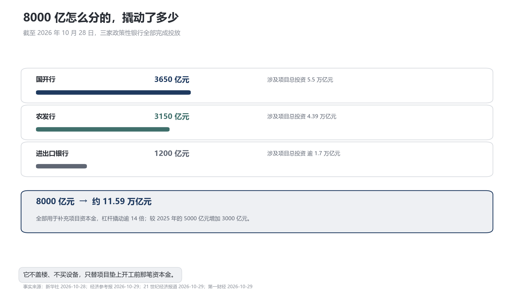
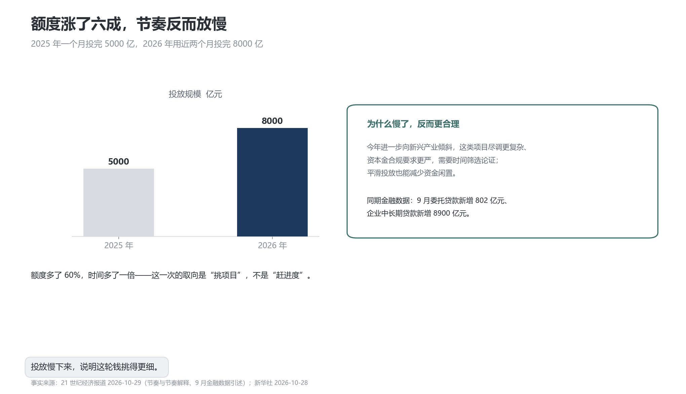
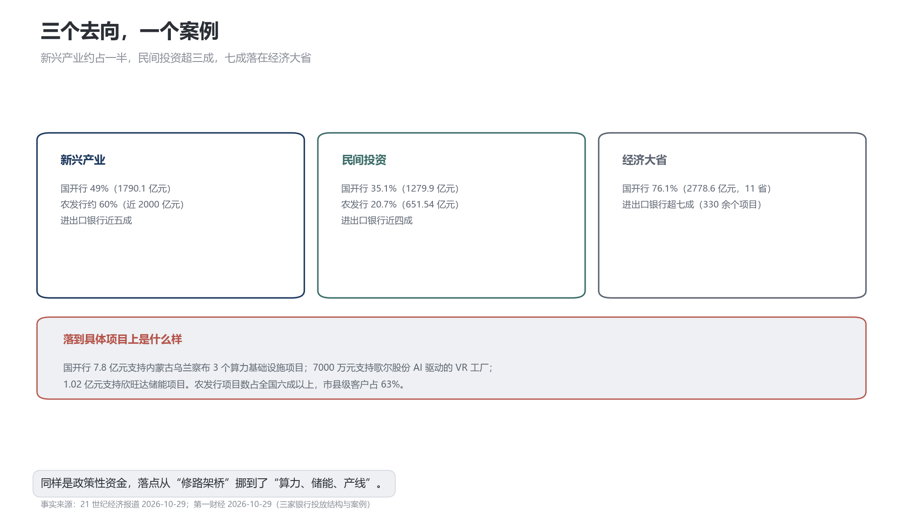

# 8000 亿进场，这笔钱不盖楼

截至 2026 年 10 月 28 日，今年的 8000 亿元新型政策性金融工具全部投放完成。三家政策性银行分头实施：国开行 3650 亿元、农发行 3150 亿元、进出口银行 1200 亿元。

这笔钱有个容易被忽略的限定：全部用于补充项目资本金。它不是贷款、不是补贴，也不用来盖楼买设备发工资——只做一件事：替凑不齐自有资金的重大项目，把开工前那块资本金垫上。

## 垫的不是工程款，是开工的门槛

项目要开工，得先有资本金，剩下才能配贷款。资本金不到位，整条资金链就卡住——这是长期存在的堵点。

所以 8000 亿元的真正作用不在它自己的规模，而在它撬动的部分：三家银行支持的项目总投资合计约 11.59 万亿元，杠杆逾 14 倍。国开行 3650 亿元对应 5.5 万亿元项目总投资，农发行 3150 亿元对应约 4.39 万亿元、3027 个项目，进出口银行 1200 亿元拉动逾 1.7 万亿元。

额度也比去年大。2025 年首次设立时是 5000 亿元，今年增加到 8000 亿元，多了 60%。

## 多花钱，却花了更长时间

有个细节值得注意：2025 年的 5000 亿元在约一个月内投完；今年的 8000 亿元从 9 月初开始，用了近两个月。

额度涨了六成，时间多了一倍。这不是效率下降。今年的资金进一步向新兴产业倾斜，这类项目尽调更复杂、资本金合规要求更严，需要更充裕的时间做筛选和论证；投放节奏拉平，也能减少资金闲置。

配套的金融数据能对上：9 月委托贷款新增 802 亿元，企业中长期贷款新增 8900 亿元，分别创下去年 11 月和今年 4 月以来的新高。

## 钱去了哪

三个去向可以量化。

新兴产业约占一半：国开行向人工智能、数字经济、绿色低碳、生物医药、消费等领域投放 1790.1 亿元、占比 49%；农发行在这几个领域投入近 2000 亿元、占比约 60%；进出口银行推动 220 余个数字经济和人工智能项目落地、放款占比近五成。

民间投资占比超三成：国开行 1279.9 亿元、35.1%；农发行 378 个项目、651.54 亿元、20.7%；进出口银行 210 余个项目、放款近四成。

七成落在经济大省：国开行向 11 个经济体量较大省份投放 2778.6 亿元、占 76.1%；进出口银行对 11 个经济大省的 330 余个项目放款占比超七成。

落到项目上，画风已经很具体：国开行 7.8 亿元支持内蒙古乌兰察布的 3 个算力基础设施项目——优刻得数据中心、秦淮数据辉腾火山五号基地一期、世纪互联云智算中心三期；7000 万元支持歌尔股份 AI 驱动的 VR 可穿戴产品工厂；1.02 亿元支持欣旺达的储能项目。农发行这一侧则明显下沉：项目数占全国六成以上，市县级客户占 63%、县级占 45%。

三家银行的分工因此很清楚：国开行抓大项目和大省，进出口银行偏产业与外向型项目，农发行铺面向县域。

## 落点

这笔钱能不能算成功，不看投放完成得多快，要看三件事。

一是实物工作量。资金变成工地上的进度才算真的投出去，账面上的资本金只是开始。

二是会不会变成新的隐性债务。以资本金形式注入，若股权、退出安排与风险隔离设计不清，容易在几年后变成地方账上的负担。

三是投向的克制。新兴产业前期投入大、盈利周期长，与市场化资金的风险偏好错配，确实需要耐心资本补位；但项目仍要与国家和地方产业规划、区域比较优势衔接，防止一哄而上。

8000 亿元两个月走完流程，速度已不是问题。接下来的问题是它留下什么——厂房、机柜和产线，还是一堆要再想办法消化的账。

---

*事实来源：截至 2026-10-28，2026 年新型政策性金融工具全部完成投放，共 8000 亿元，国开行 3650 亿元、农发行 3150 亿元、进出口银行 1200 亿元，全部用于补充项目资本金（新华社 2026-10-28、经济参考报 2026-10-29）。国开行 3650 亿元涉及项目总投资 5.5 万亿元；农发行 3150 亿元支持项目 3027 个、涉及项目总投资约 4.39 万亿元、项目数占全国六成以上、市县级客户占 63%、县级占 45%；进出口银行 1200 亿元支持项目超 500 个、拉动总投资逾 1.7 万亿元（新华社 2026-10-27/28）。合计撬动项目总投资约 11.59 万亿元、杠杆逾 14 倍；2025 年额度为 5000 亿元、在今年之前一个月内投完，今年自 9 月初开始历时近两个月；国开行向人工智能、数字经济、绿色低碳、生物医药、消费等领域投放 1790.1 亿元占比 49%、向民间投资项目投放 1279.9 亿元占比 35.1%、向 11 个经济体量较大省份投放 2778.6 亿元占比 76.1%；农发行上述领域近 2000 亿元占比约 60%、民间投资项目 378 个 651.54 亿元占比 20.7%；进出口银行 220 余个数字经济和人工智能项目放款占比近五成、210 余个民间投资项目放款占比近四成、11 个经济大省 330 余个项目放款占比超七成；案例含国开行 7.8 亿元支持乌兰察布 3 个算力项目、7000 万元支持歌尔股份 VR 工厂、1.02 亿元支持欣旺达储能项目；9 月委托贷款新增 802 亿元、企业中长期贷款新增 8900 亿元（21 世纪经济报道 2026-10-29、第一财经 2026-10-29）。"投放节奏更平稳源于新兴产业尽调更复杂"及"防止一哄而上、重复建设"的提示，来自财达证券胡恒松、联合资信等机构观点（21 世纪经济报道、第一财经转述）。*

*需说明三点。其一，11.59 万亿元是"支持项目的总投资规模"，含项目全周期投资，不是这 8000 亿元直接带动的当年投资；各家口径略有差异（界面新闻统计为 11.6 万亿元）。其二，各银行披露的领域占比分母不同（分别为该行投放额），三行简单相加无意义，本文只作分列，不计算合计占比。其三，"是否会形成隐性债务""实物工作量能否兑现"是业内提示的风险点，目前无公开评估结论，本文不作判断。*