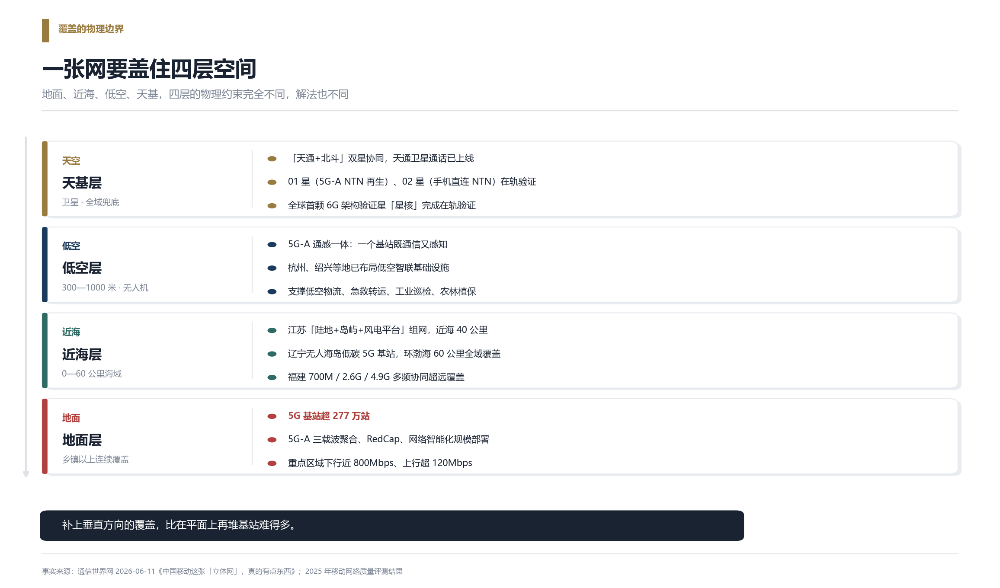
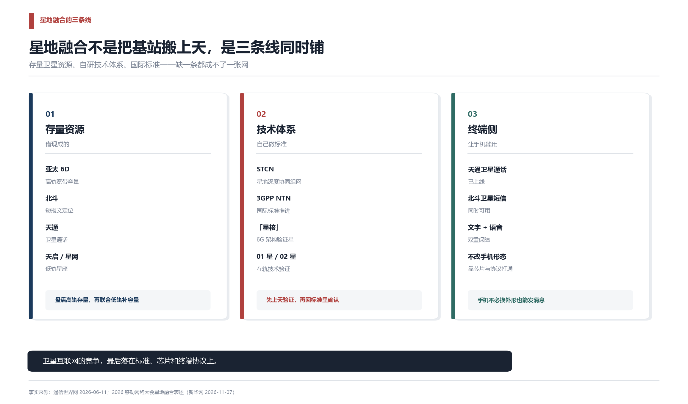
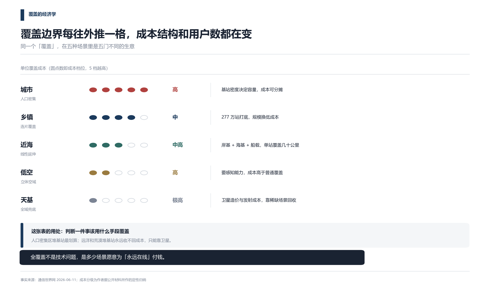

# 从地面到天基：一张通信网要盖住四层空间

通信行业过去几十年做的是一件事：把基站铺满地面。

这条路已经走到相当程度。截至 2025 年底，国内 5G 基站超过 277 万站，实现乡镇以上连续覆盖。在人口稠密的地方，覆盖和容量都不再是主要矛盾。

但"通信无处不达"这句话要成立，光靠地面这一层是不够的。人还在往别处走——往海上、往低空、往没有基站的深山里。

于是覆盖这件事，从平面问题变成了立体问题。

## 四层空间，四种完全不同的物理约束

**地面层**最成熟。基站的覆盖半径由频段和功率决定，山区可能几百米一站，平原几公里一站。这一层的问题是密度和容量，解决方案是加站、加频段、加载波聚合。

**近海层**不一样。海面没有遮挡，视距传播条件好得出奇，但也没地方架铁塔。内陆经验到这里基本失效——你不能在海上打地基，只能用岸基站向外推，或者把设备放到风电平台、岛屿、船上去。

江苏的做法是"陆地+岛屿+风电平台"组网，把 5G 信号推到近海 40 公里。辽宁在无人海岛上建低碳 5G 基站，环渤海 60 公里海域实现全域覆盖。福建用 700M、2.6G、4.9G 多频协同，配合中继设备做超远覆盖。

三个省三种做法，共同点是都在想办法把"站"放到一个本来不适合放站的地方。

**低空层**是新的。300 到 1000 米的空域，过去不是通信业的生意，现在无人机物流、巡检、植保都要用。这一层的难点不在覆盖，在感知——基站不仅要传数据，还要知道天上那个东西在哪、飞得稳不稳。

这就是 5G-A 通感一体的由来：同一个基站，一边通信一边当雷达。杭州、绍兴等地已经在布低空智联基础设施。

**天基层**是最后一层补齐的。卫星覆盖不受地形限制，但容量小、成本高、时延大。它注定不是主力，只能是兜底。

四层里，越往上越难。地面上加一个站很成熟；把站放到海上，要解决供电和回传；把站放到天上，要解决卫星和标准；把感知加进基站，要解决算法和频谱。

## 天基这一层，怎么补

卫星通信不是新鲜事，但手机直连卫星是。

过去的卫星电话需要专用终端，一根粗天线，几千上万块。现在要做的是：普通手机，不加任何外设，直接连卫星。

这件事要成立，需要三条线同时推进。

**第一条是存量资源。** 天上已有的高轨卫星是现成的——亚太 6D 提供宽带容量，北斗能发短报文，天通能打电话。这些资源盘活之后，先能覆盖一批场景，不用等新星座建好。

同时联合天启、星网等低轨星座补容量。低轨的时延和带宽比高轨好，但需要成百上千颗才能连续覆盖。

**第二条是技术体系。** 卫星和地面网络的协议不同，直接连会撞车。中国移动提出的 STCN（星地深度协同组网）就是解决这件事，同时推进 3GPP NTN 国际标准——非地面网络的标准。

标准这件事必须自己做，否则终端芯片没法兼容。

验证则靠卫星。中国移动发射了全球首颗 6G 架构验证星"星核"，以及首颗 5G-A NTN 再生技术验证星（01 星）。2026 年 6 月，02 星发射入轨，任务是全面验证手机直连卫星的 NTN 技术和典型业务。

三级验证的关系是：星核验证架构，01 星验证再生技术，02 星验证业务。一步一步往上走。

**第三条是终端侧。** 天通卫星通话已经上线，北斗卫星短信同时可用，构成"天通+北斗"双星协同。用户拿到的体验是"文字+语音"双重保障——在深山、荒漠、远洋、海岛，以及灾后地面网络中断的场景里，都能发出消息。

这条线最容易被低估。服务上线意味着不只是技术通了，计费、鉴权、客服、终端适配全都跑通了。

## 四个难点，卡在不同的地方

四层空间听起来只是"多盖几层"，实际每一步遇到的障碍完全不同。

**地面的难点是密度。** 城市里基站已经密到互相干扰，再加密的边际收益在下降。真正的增量在室内、在地下、在高铁和地铁这类高速移动场景，靠加大功率解决不了。

**近海的难点是供电和回传。** 海上没有市电，基站要靠柴油、风电或光伏；没有光纤，回传要靠微波或卫星。辽宁那座无人海岛基站之所以被单拎出来讲，因为它同时解决了低碳供电和远程运维两个问题。

**低空的难点是感知和监管。** 通信只要覆盖，无人机要的是"看得见、管得住"。所以低空网络必须带感知能力，还要和空域管理系统对接。这不是通信一家能做完的事。

**天基的难点是标准和成本。** 卫星绕地球飞，多普勒频移、长时延、断续连接，每一项都和地面协议假定不符。要改协议，就得改标准；要改标准，就得先在轨验证。而验证一次的成本，是发射一颗星。

四个难点里，只有地面那层是成熟工程，另外三层都还在解决问题。

## 覆盖的经济学

四层空间铺开之后，会出现一个尴尬的问题：谁来为覆盖付费？

同一个"覆盖"，在五种场景里是五门完全不同的生意。

城市里，基站密度决定容量，单个基站服务几千人，成本可以分摊。这是最赚钱的一层。

乡镇和农村，覆盖连片但用户密度低，靠 277 万站的规模效应把单站成本压下来，勉强算得过来。

近海，岸基站加海基站加船载设备，一个站覆盖几十公里，服务的可能是几百条渔船和一个海上风电项目。这一层已经很难按纯商业逻辑算。

低空，要加感知能力，设备成本高于普通覆盖，客户是物流公司和政府监管部门，数量有限。

天基，卫星造价加发射成本，前期投入以亿计，服务的却是最稀缺的场景——远洋、极地、灾后。

如果按单个项目的回报算，后三层都算不过来账。

这就引出通信行业一个长期存在的结构性矛盾：覆盖的社会价值和经济价值，在空间上是错配的。人越多的地方越便宜，越需要通信的地方越贵。

## 为什么这件事仍然要做

因为通信网的定价逻辑，从来不是按单点成本算的。

一张网的价值取决于它能连到多少人，而不是每个连接赚多少钱。这个道理在电话时代就成立——偏远地区的线路亏钱，但没有它，整张网就不算"公用"。

卫星这一层同理。它服务的人群可能只有百分之几，但这百分之几在关键时刻没有替代方案：海上遇险、地震断路、边境巡逻、远洋航运。

所以这四层的关系不是"哪个更划算"，而是"哪一层缺了会出事"。

从这个角度看，"空天地海一体化"这个词的重点不在"一体化"三个字有多宏大，而在于它承认了一件事：一张网要真正可靠，必须在物理上有多条互不依赖的路径。

地面断了，天上还有；天上信号弱，地面补上。

## 落到：覆盖的下一站

回到开头那个判断：覆盖从平面变成了立体。

这个转变背后，是通信业对"覆盖"这个词的重新定义。

过去"覆盖"指的是信号强度——能不能打电话、能不能上网。现在它要回答更多问题：能不能给一架无人机定位、能不能在海上发一条求救短信、能不能在灾后十分钟内恢复联络。

每加一个维度，"覆盖"的门槛就高一层，成本也高一层。

四层空间的完整覆盖，短期内不可能全部算得过账。但只要有一层缺席，整张网的可靠性就会被打回原形。

通信网的价值，最终是由它最薄弱的那一环决定的。

---

*事实来源：截至 2025 年底，5G 网络基站超过 277 万站，实现全国乡镇以上连续覆盖；持续推进 5G-A 三载波聚合、RedCap 及网络智能化规模部署；重点区域 5G 平均下载速率近 800Mbps、上行速率超 120Mbps（2025 年移动网络质量评测结果，超大/特大、大型及中小型城市前三名均为中国移动）。近海覆盖：江苏采用"陆地+岛屿+风电平台"组网模式，5G 信号覆盖近海 40 公里；辽宁打造全国首座无人海岛低碳 5G 基站，环渤海 60 公里海域实现 5G 全域覆盖；福建应用高增益天线与"海舟宝"等中继设备，建成 700M、2.6G、4.9G 多频协同超远覆盖网络。天基：提出"以地强天、星地融合"路径，盘活亚太 6D、北斗、天通等高轨存量卫星资源，联合天启、星网等低轨星座；已上线天通卫星通话服务，与北斗卫星短信构成"天通+北斗"双星协同天地一体通信保障体系；推进 3GPP NTN 国际标准制定，创新"星地深度协同组网（STCN）"技术体系；发射全球首颗 6G 架构验证星（"星核"验证星）与首颗 5G-A NTN 再生技术验证星（中国移动 01 星）并完成在轨验证；2026 年 6 月，中国移动 02 星发射入轨，将全面验证手机直连卫星 NTN 技术和典型业务。低空：依托 5G-A 通感一体技术搭建立体低空网络，在杭州、绍兴等城市布局低空智联基础设施，支撑低空物流、急救转运、工业巡检、农林植保、应急安防等应用。以上据通信世界网 2026-06-11《中国移动这张"立体网"，真的有点东西》。2026 移动网络大会（2026-11-05 至 07，广州）提出持续深化星地融合建设、做强天启星座，提升近海、海岛、边疆等区域网络承载能力（新华网 2026-11-07）。*

*需说明四点。其一，本文"四层空间"（地面、近海、低空、天基）为作者据公开材料所作的归纳，非官方分类口径；各层具体技术路线以公司披露为准。其二，图 3 中"单位覆盖成本高/中/极高"的分级为作者依据公开材料的定性判断，公司未披露各场景的单站成本、投资回收期等数据，本文不作量化推算。其三，"覆盖的社会价值与经济价值在空间上错配""一张网的价值取决于最薄弱一环"等为作者分析，不代表中国移动观点。其四，文中未使用"手机直连卫星覆盖 14 省、用户超 4 亿"这一转述数据，因其出自媒体转述、未见公司公告原文，故不作引用。*
