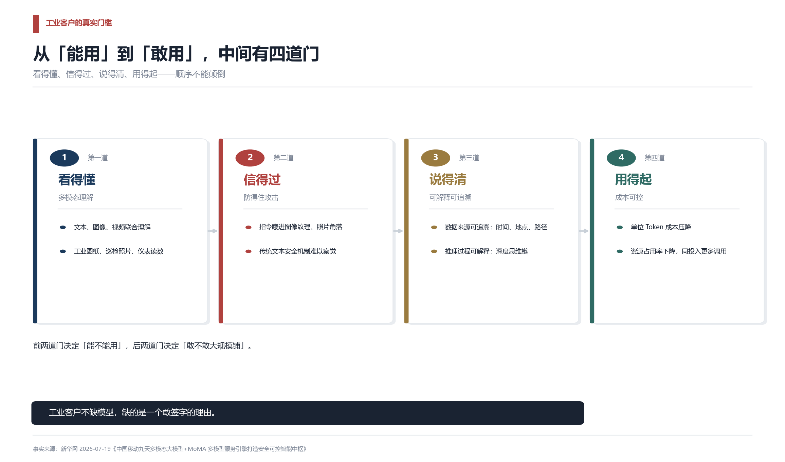
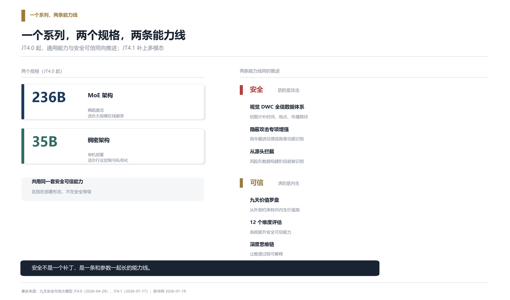
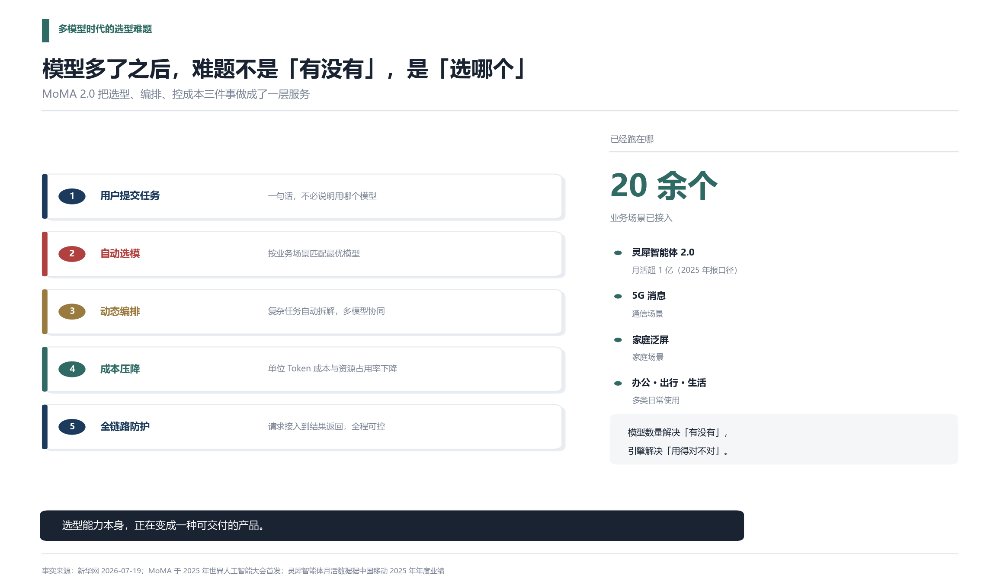

# 国产大模型先解决的不是"能不能"，是"敢不敢用"

2026 年 7 月 17 日，世界人工智能大会上，中国移动发布了九天安全可信多模态大模型的升级版本（JT4.1）和 MoMA 多模型服务引擎 2.0。

发布会给出的行业痛点描述，措辞很值得琢磨：不仅要"看得懂"，更要"信得过"；不仅要"反应快"，更要"成本优"。

四句话里，两句是关于可信和成本的。这不是随口排的序——它反映的是大模型在工业场景里真实卡住的位置。

## 第一道坎：模型看得懂，但企业不敢用

过去两年，大模型的能力演示已经足够多了：写文案、做表格、答问题、生成代码。这些场景的共同点是容错率高——错了一句，改一下就行。

工业场景不一样。

矿山、石化、工程设计这些领域，模型输出的不是建议，是要被签字确认的判断。一个巡检照片的判读结果，可能决定一台设备停不停机；一张工程图纸的核算，可能连着几百万的返工成本。

这些场景里，模型不能出错，更不能出错以后说不出为什么错。

所以行业里有个说法：不是模型不够聪明，是它聪明得不让人放心。

这道坎具体卡在两个地方——数据来源不可追溯，推理过程不可解释。

一张巡检照片传进去，模型说"这里有问题"，但它不会告诉你：这张照片是什么时候拍的、在哪拍的、之前有没有类似的记录。缺少这些上下文，判断就只是一个孤立的结论，没法被验证。

推理过程更是如此。传统大模型给出答案是一步到位的，中间怎么想的，外界看不到。对容错率高的场景，这是效率；对要签字的场景，这是风险。

## 安全这件事，被拆成了两条线

中国移动的解法是，把"可信"从一个抽象要求拆成两条可以做的能力线。

**第一条是安全，防的是攻击。**

多模态模型有一个传统文本安全机制覆盖不到的漏洞：恶意指令可以编码进图像的纹理里，或者藏在照片的角落。人眼看起来是一张正常的图，模型读到的是完全不同的东西。

这类攻击之所以难防，因为它不违反任何文本规则——文字部分是干净的，问题全在像素里。

应对办法从源头开始：视觉 DWC 全信数据体系给每张图补齐时间、地点、传播路径等信息，风险在数据构建阶段就被识别出来。比如一张设备巡检照片，DWC 体系会为它增加安全隐患分析描述，让模型不只看到外观，还看到风险。

再叠加针对多模态隐蔽式攻击的专项安全增强。公开材料的说法是：即使恶意指令藏进图片，模型也能识别风险并进行合规引导。

**第二条是可信，求的是内生。**

"九天价值罗盘"做的是价值观校准，思路是从外部行为约束转向内生价值观。配套的是 12 个维度的系统评估，加上深度思维链增强可解释性。

这条线的价值在于：它让"可信"从一句承诺变成一组可以逐项检查的指标。

## 两个规格，一种取舍

JT4.0 在 2026 年 4 月 29 日发布，一次给了两个版本：236B 的 MoE 架构和 35B 的稠密架构。

这个组合透露了一个判断：同一个模型体系，要同时服务两种完全不同的客户。

236B 的 MoE 走的是稀疏激活路线，参数多但每次只调用一部分，适合大规模在线服务——一次投入，服务大量请求。

35B 的稠密版本参数量小，可以单机部署，适合行业定制、私有化部署的客户。数据不出机房，这是很多工业客户和政务客户的硬门槛。

更值得注意的是那句表述：从 4.0 开始，所有基础模型都追求通用智能能力与安全可信能力的同向进步。

这句话的潜台词是，安全和能力不能分两次做。过去的常见做法是先做一个能力强的模型，再在外面套一层安全过滤——这本质上是打补丁，补丁永远比漏洞慢一步。

把安全做进训练里，成本和难度都高得多，但它是唯一能让"可信"成为模型固有属性的路径。

## 第二道坎：模型太多，选不出来

解决可信之后，还有一道更实际的门槛：怎么用。

现在的企业面对的不是一个模型，是几百个。开源的有几百家，闭源的有十几家，每隔几个月还有新版本。选哪个、怎么调、Token 花多少，这些具体问题直接决定 AI 能不能从试点走进生产。

MoMA 引擎 2.0 针对的正是这一层。

它的第一个能力是自主选模：按业务场景自动匹配最优模型，用户不需要有模型选型的专业知识。第二个能力是动态编排：复杂任务自动拆解，调用不同模型协同完成。

第三个能力是成本控制——单位 Token 成本与资源占用率都明显压降。

还有一个容易被忽略的部分：全链路防护，从请求接入到结果返回。企业在用第三方模型时最担心的，就是数据在中间环节被留存或滥用，这一层解决的是这个问题。

MoMA 不是 2026 年才有的。它在 2025 年的世界人工智能大会上首发，一年之后升到 2.0。截至目前，它已经在中国移动内部支撑灵犀智能体 2.0、5G 消息、家庭泛屏等 20 余个业务场景，覆盖办公、生活、出行、家庭、通信。

先在自家业务里跑通，再对外销售——这是运营商做产品的典型路径。

## 行业模型的分层逻辑

再往下一层，是行业模型。

公开信息显示，基于九天基础大模型，已自主研发并发布超 50 款行业大模型。这个数字背后的结构，比数字本身更有意思。

对内，网络、客服、营销、办公四款行业大模型已经实现生产级规模应用。

对外，政务、能源化工、医疗、物联水利、社会综治、金融风控等多款，与中国石油、中国中化、解放军总医院等行业龙头形成超 20 项实质性合作。

对内四款先做，对外几十款后铺——这个顺序是有讲究的。

内部场景的好处是数据完整、反馈快、容错相对可控。网络优化、客服应答、营销触达这些场景，本身就是高频、海量、有明确评价标准。模型在这里跑通，等于先在"自己家"做完了压力测试。

对外场景则是另一个逻辑：每个行业的知识密度、合规要求、业务流程都不同，没法用一个通用模型覆盖，只能一家一家做。

所以超 50 款这个数字，本质上是"能力可复制、场景不可复制"的结果。模型底座可以共用，行业适配必须重做。

## 落到：可信是入场券，不是加分项

回到开头那两句话。

"看得懂"和"反应快"，这两件事在过去两年被反复证明，已经不算稀缺能力。

"信得过"和"成本优"，这两件事才刚刚开始被当成产品指标来做。

这个顺序的调整，说明国产大模型正在过一个转折点：从技术演示阶段，进入生产部署阶段。

演示阶段的标准是"能不能做到"，生产阶段的标准是"敢不敢依赖"。

而"敢不敢依赖"这件事，最终不是由模型的跑分决定的，是由模型出错时的表现决定的——能不能说清为什么错、能不能追到证据链、能不能在规定范围内拒绝。

安全可信不是一个可以贴上去的标签，它是一条要和参数一起长的能力线。

---

*事实来源：2026 年 7 月 17 日，2026 年世界人工智能大会企业人工智能高质量发展论坛上，中国移动发布九天安全可信多模态大模型升级成果（JT4.1）与 MoMA 多模型服务引擎 2.0；行业痛点表述为"不仅要'看得懂'，更要'信得过'；不仅要'反应快'，更要'成本优'"；多模态大模型在矿山、石化、工程设计等复杂工业场景中面临数据来源不可追溯、推理过程不可解释等短板，部分行业仍"不敢用"；安全层面通过视觉 DWC 全信数据体系为图片补齐时间、地点、传播路径等信息，使风险在数据构建阶段被识别（如设备巡检照片增加安全隐患分析描述），并针对多模态隐蔽式攻击做专项安全增强；可信层面通过九天价值罗盘开展价值观校准、围绕 12 个维度系统提升安全可信能力，配合深度思维链增强可解释性；已启动"九天安全伙伴计划"，携手中国电气装备、中国石油等落地。MoMA 引擎 2.0 具备自主选模、智能路由、复杂任务自动拆解与动态编排能力，单位 Token 成本与资源占用率明显压降，构建从请求接入到结果返回的全链路防护；已在中国移动内部支撑灵犀智能体 2.0、5G 消息、家庭泛屏等 20 余个业务场景，覆盖办公、生活、出行、家庭、通信；MoMA 于 2025 年世界人工智能大会首发。据新华网 2026-07-19《中国移动九天多模态大模型+MoMA 多模型服务引擎打造安全可控智能中枢》、通信世界网 2026-07-20。九天安全可信大模型 JT4.0 于 2026-04-29 第九届数字中国建设峰会期间发布，含 236B（MoE 架构）与 35B（稠密架构）双版本，从 4.0 起所有基础模型追求通用智能能力与安全可信能力的同向进步（据搜狐营销观察 2026-05-15 转述发布会内容）。行业模型：已自主研发并发布超 50 款行业大模型，对内网络、客服、营销、办公 4 款实现生产级规模应用，对外与中国石油、中国中化、解放军总医院等形成超 20 项实质性合作（数字经济观察网 2026-02-25）。灵犀智能体月活跃客户超 1 亿（中国移动 2025 年年度业绩）。*

*需说明四点。其一，JT4.0 的 236B/35B 双版本参数与架构信息出自 2026-05-15 的发布会转述报道，未见公司公告原文，引用时已标明来源性质。其二，"安全与能力同向推进""内部场景先做、对外场景后铺"等因果解释为作者分析；公司公开表述仅为"从 4.0 开始所有基础模型均追求通用智能能力与安全可信能力的同向进步"，未说明内部四款先行的原因。其三，原文在列举价值罗盘的 12 个评估维度时包含价值观类表述，本文仅保留技术维度（安全、合规、个人信息保护等）的概括，未逐条展开。其四，文中"不是模型不够聪明，是它聪明得不让人放心""可信是入场券不是加分项"等为作者判断，不代表中国移动观点；九天系列模型的基准跑分未在本文引用，因公开材料中缺乏可与其他模型直接对照的第三方评测数据。*
