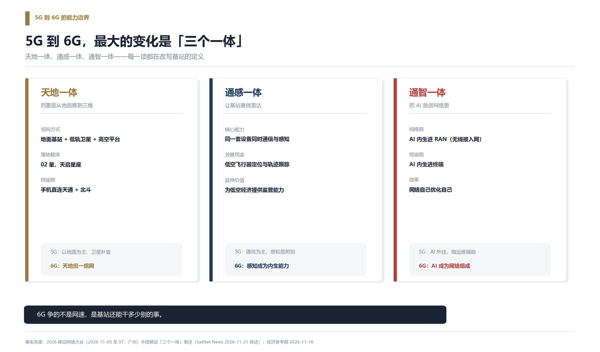
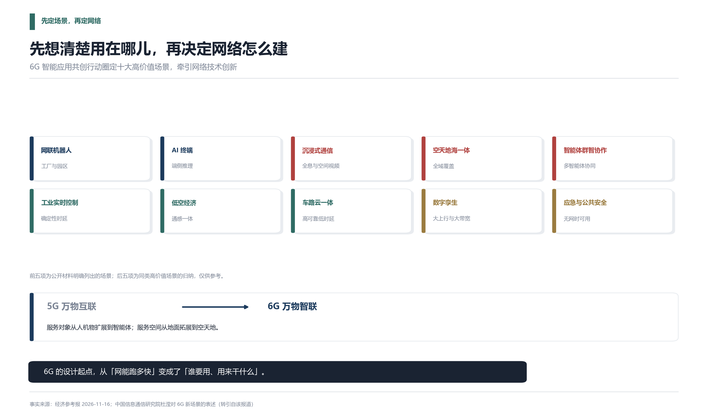
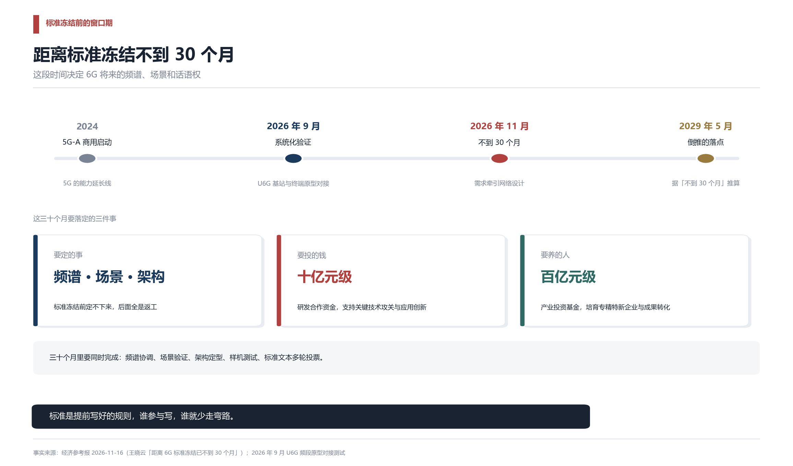

# 6G 还有三十个月：标准冻结前的窗口期，比的是什么

2026 年 11 月，乌镇。

中国工程院院士、中国移动总工程师王晓云说了一句话，把 6G 的时间表讲得很具体：距离 6G 标准冻结已不到 30 个月。

三十个月，两年半。对一项要在未来十年支撑整个社会连接的通信技术来说，这是一个非常短的窗口。

而且这个窗口不是"研发时间"，是"定规则的时间"。

## 为什么"标准冻结"这四个字这么重

通信行业有一句话：一代技术，先定标准，后做设备。

5G 的标准冻结在 2018 年，商用从 2019 年开始。中间这段时间，全球的设备商、芯片商、终端商都在按同一份标准做产品，谁也不能自作主张。

这就是标准的分量：它决定了今后十年，天上飞的信号用什么调制方式、手机上装什么芯片、基站要支持哪些频段。

如果一家企业在标准写成之前没有参与，那它就只能按别人写好的规则做产品——技术上不落后也可能落后，因为它得等标准，而参与写过的人不用等。

所以这三十个月里，真正在比的不是"谁的样机快"，是"谁的方案会被写进标准"。

## 三个一体：6G 到底改了什么

2026 年 11 月的移动网络大会上，中国移动把 6G 的核心能力概括成"三个一体"。

**天地一体。** 地面基站、低轨卫星、高空平台共同组网。落地载体包括 02 星、天启星座，以及手机直连天通加北斗。

这一条在 5G 时代已经有了雏形——5G 也在做卫星补盲——但 6G 的野心是统一组网，不是"地面为主、卫星补盲"。

差别在于：补盲模式下，卫星是应急手段；统一组网下，卫星是网络的一部分，用户不需要知道自己的信号来自哪儿。

**通感一体。** 同一个设备，一边通信一边感知。

这一条是为低空经济准备的。无人机要飞，必须要有一套"看得见"的系统——知道它在哪、高度多少、往哪飞。用通信基站顺带做这件事，比另建一套雷达网便宜得多。

5G 时代也有通感一体的试验，但那是附加功能；6G 里，感知是内生能力。

**通智一体。** AI 进无线接入网，也进终端。

这条最微妙。5G 网络里也有 AI，但基本是外挂的——用 AI 做运维优化、做故障预测。6G 的设计思路是让 AI 成为网络的组成部分：网络自己会调参数、自己会分配资源、自己会预判拥塞。

三个一体合起来，基站的定位发生了根本变化——从"通信设备"变成"环境感知与算力节点"。

这个变化对运营商的意义很大。如果基站只是一个管道口，那它的价值就是卖流量；如果它同时能感知、能算、能连天上，那它的价值就有了新的计价方式。

## 从"网能跑多快"到"谁要用"

6G 的第二个变化，在设计方法上。

过去几代通信技术的设计起点，基本是"更快的速率、更低的时延、更大的连接数"——这是从技术指标出发的路径。

6G 的做法不太一样。中国移动发布了"6G 智能应用共创行动"，圈定十大高价值场景：网联机器人、AI 终端、沉浸式通信、空天地海一体、智能体群智协作等。

这个顺序值得注意——先定场景，再定网络。

为什么会反过来？因为 6G 要服务的对象变了。

中国信息通信研究院的杜滢有一个概括：6G 的服务对象从人机物进一步扩展到智能体，服务空间从地面拓展到空天地，实现由"5G 万物互联"到"6G 万物智联"的跃升。

"智能体"这个词是关键。人和物的通信需求是相对可预测的——人要看视频，物要传数据。但智能体的需求不一样：它可能突然需要大带宽去调度一群机器人，也可能长时间只需要极低功耗地待机。

这种需求没法用"平均速率"来设计网络，只能按场景来。

## 与 5G 相比，6G 少了一个前提

这里还有一个容易被忽略的背景。

5G 的设计有一个明确的前提：人需要更快的网速。从 4G 到 5G，带宽涨了一个数量级，容量涨得更多。这个前提在 2015 年提出时是成立的——视频、直播、云应用都在爆发。

但 5G 商用七年之后，行业的普遍反思是：网络能力上去了，能把这些能力用满的应用并没有同步出现。

消费者侧最难的问题不是"网不够快"，而是"拿这么快的网干什么"。

6G 不愿意重演这个剧本。

所以"先定场景"这件事，本质上是在回答一个更早的问题：这一代网络到底是给谁用的？

从十大场景看，答案偏向产业侧——网联机器人、工业实时控制、低空经济、车路云一体，这些都不是消费级应用，而是生产系统的组成部分。

这也解释了为什么 6G 的三个一体里有"通智一体"：工业场景的智能体需要网络自己会判断，而不是傻等着配置。

## 系统化验证：从论文走到样机

2026 年 9 月有一件事，行业内的分量不轻。

高通与中国移动完成了符合 3GPP 最新定义的 U6G 频段基站原型与 6G 终端原型对接测试。

这条消息的关键词是"对接测试"——它意味着 6G 关键技术从研究探索，进入了系统化验证阶段。

在此之前，6G 的讨论大多停留在论文、仿真和单点技术验证。对接测试意味着两端都做出了实物，而且能互通。

这是一个分水岭。技术上"能算出来"和工程上"能跑起来"之间，往往隔着好几年。

## 三十个月，要定三件事

窗口期里，真正要落定的是三件事。

**第一件是频谱。** U6G 是候选频段之一，但频段的选择涉及频谱规划、产业配套、国际协调。定得早，产业链有足够时间准备；定得晚，设备商来不及做。

**第二件是场景。** 前面说的十大场景，实际上是在为标准里的技术指标找依据。如果 6G 标准里没有一个场景需要"确定性时延 1 毫秒"，那这项指标就不会被写进去。

**第三件是架构。** 天地一体、通感一体、通智一体，每一项都会改变网络架构。架构定在标准里，改起来极难。

三件事之外，还有一个"人"的问题。

王晓云提到两个数字：配置十亿元级规模的研发合作资金，支持关键技术攻关与应用创新；依托百亿元规模的产业投资基金，加大对专精特新企业的培育支持力度。

前者买的是技术方案，后者养的是产业链。

这两个数字放在一起，说明 6G 的竞争不只发生在实验室，也发生在供应链上——一项技术能不能落地，最终要看有没有足够多的企业能供货。

## 落到：窗口期的意义

三十个月听起来不短，但如果把要做的事排一排：频谱要协调、场景要验证、架构要定型、样机要测试、标准文本要一轮轮投票——时间其实很紧。

这也是为什么"提前谋划布局"这几个字，在此刻被反复提起。

通信行业的规律是，一代技术的胜负，在它商用之前就已经决定了大半。等到商用那一年再发力，通常已经晚了。

所以这三十个月比的不是速度，是判断力——判断哪些场景会真的起来，判断哪些指标值得写进标准，判断产业链上哪些环节必须自己掌握。

判断对了，标准写对了，后面十年就顺。

---

*事实来源：2026 年 11 月乌镇世界互联网大会期间，中国工程院院士、中国移动总工程师王晓云表示"现在距离 6G 标准冻结已不到 30 个月，要提前谋划布局，让需求更好牵引网络设计"；中国移动发布 6G 智能应用共创行动，挖掘网联机器人、AI 终端、沉浸式通信、空天地海一体、智能体群智协作等十大 6G 高价值场景领域，牵引 6G 网络技术创新；王晓云表示将配置十亿元级规模的研发合作资金支持关键技术攻关与应用创新，依托百亿元规模产业投资基金加大对专精特新企业培育支持力度。据经济参考报 2026-11-16（记者郭倩）。2026 年 9 月，高通与中国移动完成符合 3GPP 最新定义的 U6G 频段基站原型与 6G 终端原型对接测试，标志 6G 关键技术从研究探索迈入系统化验证阶段（据同一报道）。中国信息通信研究院无线与移动通信研究所副所长杜滢：6G 新引入通信与 AI 融合、通信与感知融合、星地融合等新技术新场景，服务对象从人机物进一步扩展到智能体，服务空间从地面拓展到空天地，实现由"5G 万物互联"到"6G 万物智联"的跃升（据同一报道）。2026 移动网络大会（2026-11-05 至 07，广州）中国移动将 6G 核心能力概括为"三个一体"：天地一体（地面基站、低轨卫星和高空平台组网，落地 02 星、天启星座与手机直连天通+北斗）、通感一体（基站兼具感知能力）、通智一体（AI 内生进 RAN 与终端）（据 SatNet News 2026-11-21 转述）。相关规划安排：到 2030 年全面建成覆盖完善、性能领先的新一代通信网；适时启动 6G 商用；到 2030 年信息通信行业收入达 4.1 万亿元、信息基础设施累计投资 3.8 万亿元（据经济参考报 2026-11-16 对专项规划的引述）。*

*需说明四点。其一，本文图 2 中"2029 年 5 月"为本文据"2026 年 11 月起不到 30 个月"推算的落点，并非官方公布的 6G 标准冻结日期；3GPP 及各标准组织的具体冻结时间表以官方文件为准。其二，"三个一体"的完整表述出自 2026 移动网络大会的媒体转述（SatNet News），未见公司公告原文，引用时已注明来源性质。其三，"先定场景再定网络""基站从通信设备变为算力节点""窗口期比的是判断力"等为作者分析，不代表中国移动或王晓云本人观点。其四，本文未使用"6G 将于某年商用"的确定性表述；相关规划文件中的表述为"适时启动 6G 商用"，本文引用时保留"适时"二字。*
