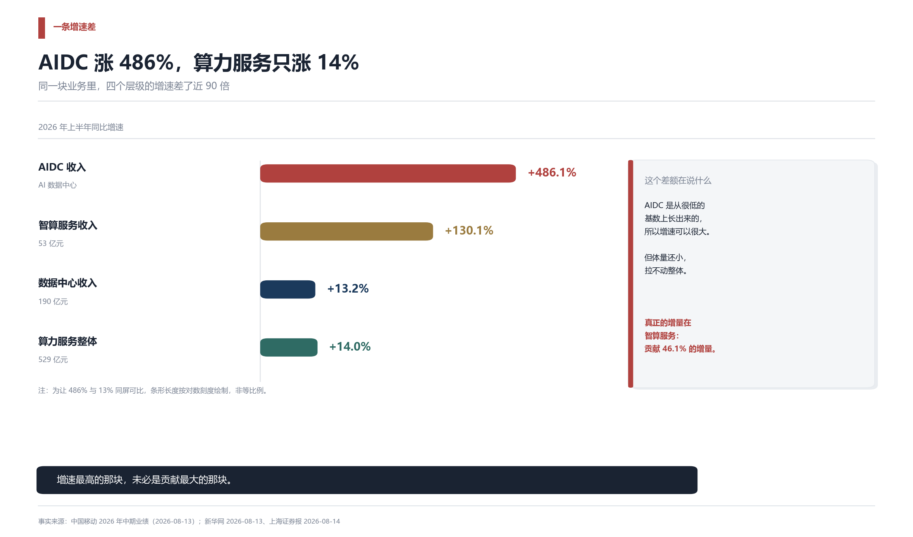
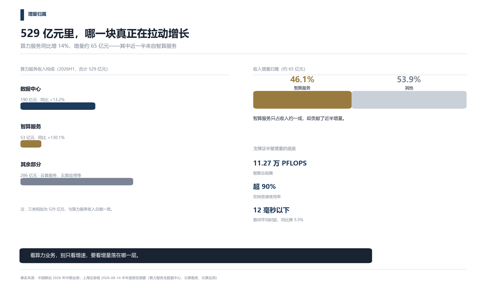
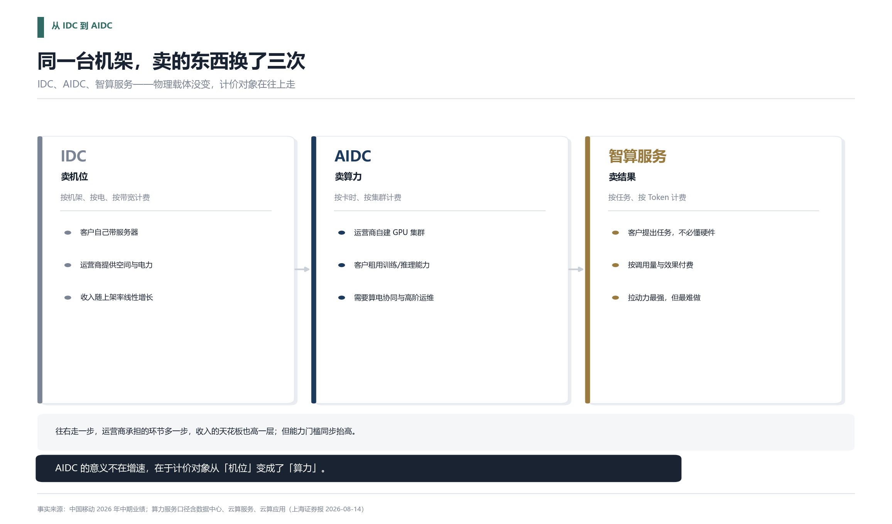

# AIDC 收入涨 486%，算力服务只涨 14%：一条增速差说明的事

2026 年 8 月 13 日，中国移动发布中期业绩。

财报里有一组数字，值得单独拿出来看：上半年算力服务收入 529 亿元，同比增长 14.0%；其中数据中心收入 190 亿元，同比增长 13.2%；**AIDC 收入同比增长 486.1%**。

486% 和 13% 放在同一段里，看上去像两个不同业务的事。但它们其实是同一块业务的两个层级。

这个差异本身，就是理解算力生意的一个切口。

## 先把四个数排一排

如果按层级拆开，算力服务这条线有四个不同的增速：

**算力服务整体**：+14.0%，529 亿元。

**数据中心**：+13.2%，190 亿元。

**AIDC（AI 数据中心）**：+486.1%。

**智算服务**：+130.1%，53 亿元。

四个数里，AIDC 最扎眼。但真正该问的是：为什么最高的那个，不是最该关注的那个？

答案在基数。

AIDC 是从一个很小的基数上长起来的。486% 这个数字，如果基数是 5 亿，增长到 29 亿；如果基数是 10 亿，增长到 58 亿。不管哪种，它都还是算力服务里的一个小块。

而算力服务整体只涨了 14%，说明拉动它的主力不在 AIDC 这一层。

## 增量到底落在哪

财报里给了另一个更关键的数：智算服务收入增速 130.1%，**贡献算力服务收入增量的 46.1%**。

这句话的意思是：算力服务比去年同期多出来的那部分钱，接近一半来自智算服务。

按 529 亿、增速 14% 倒推，增量大概是 65 亿元上下。其中智算服务贡献 46.1%，其他部分贡献 53.9%。

智算服务只有 53 亿元收入，占总盘子的约一成——但它贡献了近半增量。

这就是"增速"和"增量"的差别。前者说的是变化率，后者说的是实际装进兜里多少钱。两个指标常常指向不同的结论。

看算力业务，只看增速会被高倍数的数字带跑；看增量，才知道钱是从哪一层流进来的。

顺便说一句，智算服务 53 亿元这个体量，还说明另一件事：这块业务仍在很早期。一年前它可能只有二十几亿，所以能涨 130%。

## 从卖机位到卖算力

要理解 AIDC 的意义，得先看清这块业务的计价对象在往上走。

**第一层是 IDC。** 客户自己带服务器来，运营商提供机架、电力、带宽、制冷。收入随上架率线性增长，本质上是"卖机位"——一门类地产的生意，拼的是位置、电价和机房数量。

**第二层是 AIDC。** 运营商自己买卡、自建 GPU 集群，客户来租训练或推理能力。这一层卖的是"算力"，按卡时、按集群计费。它要求运营商会建集群、会调度、会做算电协同和高阶运维。

**第三层是智算服务。** 客户提出任务，不必懂硬件，按调用量、按效果付费。这一层卖的是"结果"。

三层的难度依次递增，但收入的天花板也依次抬高。

IDC 的天花板由机房面积决定，AIDC 的天花板由资本开支和电力决定，智算服务的天花板由客户愿不愿意为结果付费决定——理论上最大，但也最难做。

AIDC 涨 486%，说明中国移动已经把第二层做起来了。这是从"卖机位"迈向"卖算力"的关键一步。

## 底座撑不撑得住

业务能长多快，最终取决于底座。

财报里给了三个数：

**智算总规模 11.27 万 PFLOPS。** 这是算力供给的总盘子。

**在网资源使用率超 90%。** 这个数字很关键——它说明算力不是压在库里，是真的被用起来了。很多算力中心的实际利用率远低于这个数。

**算间平均时延降至 12 毫秒以下，同比降低 5.5%。** 时延降下来，跨域调度才成立。

三个数连起来看，是一个从"建集群"到"用集群"的闭环。建了算力用不满，是这轮算力投资最大的风险；使用率超 90%，说明这一步暂时走对了。

还有一件事值得说：财报提到面向智算卡间互联，发布了 OISA（全向智感互联）商用 IP 核。

卡间互联是超大规模训练的效率瓶颈。做自研 IP 核，说明不只是买卡装机，还在往上做技术栈。

## 一家运营商的算力账

把这几件事放在一起，能看到一个更大的背景。

2026 年上半年，中国移动营运收入 5380 亿元，同比下降 1.1%；主营业务收入 4527 亿元，同比下降 3.1%。

传统通信服务在承压——同期通信服务收入 3504 亿元，同比下降 5.7%。

在这个背景下，算力服务 14% 的增长、智算服务 130% 的增长，分量就不一样了：它不是"锦上添花的亮点"，而是"顶住下降的那部分"。

财报说算力服务、智能服务收入占主营业务收入比重达 22.6%，同比提升 2.2 个百分点。

这个 22.6% 也说明：新业务还没到能完全对冲传统业务下滑的体量。转型还在路上。

## 为什么 AIDC 能涨这么快

486% 这个数，光看结果会以为是产品突然卖爆了。但拆开看，它至少有三个来源。

**第一，口径本身在扩。** AIDC 指的是面向 AI 的数据中心。这个概念几年前还不存在——早年所有的机房都叫 IDC，AI 只是其中一部分负载。当业务被重新分类，新口径的基数是"过去的 AI 专用部分"，很小。基数小，增速自然大。

**第二，需求端确实在爆发。** 智算服务 130% 的增速是同一方向的旁证。如果只是口径游戏，智算服务不会有这么高的增速，也不会有 53 亿元的绝对体量。

**第三，供给端刚刚建好。** 财报提到在建成多个万卡集群的基础上，正在布局建设超大规模智算集群。集群投产是有台阶的——去年可能只有几处，今年多了几处，收入就跳一下。这种台阶式增长在基础设施行业很常见。

三个原因叠在一起，才拼出了 486%。

理解这一点很重要：它意味着这个数字不可持续，也不应该被期待可持续。基数一旦变大，明年的增速不可能还是三位数。

真正该跟踪的，是 AIDC 的绝对金额什么时候能被单独披露——那才是这块业务到底多大的答案。

## 一个容易被忽略的参照

把中国移动的算力数据和一个纯云厂商对比，会发现一个结构性差异。

纯云厂商的算力业务，收入几乎全部来自"卖算力"和"卖服务"两层，很少涉及最底层的机房地产。它们大多租机房，不建机房。

运营商反过来：从机房、电力、网络到算力、服务，全链条自己干。

这个差异带来两个后果。

一是资本开支更重。建一个吉瓦级园区，投的都是重资产，回收周期以年计。

二是抗风险能力更强。当上游卡供应紧张、机房租金上涨时，全链条自持的一方受冲击更小。

所以运营商的算力业务，不能只看增速和利润率，还要看资产周转——这是它和纯云厂商最不可比的地方。

## 落到：别被最高那个数带走

回到开头那组数字。

AIDC 增长 486%，是一个真实的、值得关注的信号——它证明从 IDC 到 AIDC 的升级跑通了，团队能建集群、能交付、能拿到订单。

但它不是这块业务的主叙事。主叙事是：

算力服务的整体增速是 14%，而这个增速在承压的大盘里已经是难得的正数；智算服务以约一成的收入贡献了近半增量；底座的使用率超过 90%，说明需求是真的。

三个事实叠在一起，比一个 486% 更能说明这家公司的算力业务到了哪一步。

财报里最容易传播的，往往是最大的那个百分比。但真正该记住的，是它旁边那个小一点的数字。

---

*事实来源：中国移动 2026 年中期业绩（2026-08-13 发布）：营运收入 5380 亿元（同比 -1.1%）、主营业务收入 4527 亿元（同比 -3.1%）、其他业务收入 854 亿元（同比 +11.2%）、股东应占利润 789 亿元（同比 -6.3%）、剔除增值税税目政策调整影响后同口径实现正增长；通信服务收入 3504 亿元（同比 -5.7%）；算力服务收入 529 亿元（同比 +14.0%），其中数据中心收入 190 亿元（同比 +13.2%）、AIDC 收入同比增长 486.1%、智算服务收入 53 亿元（增速 130.1%，贡献算力服务收入增量的 46.1%）、云算应用收入同比 +5.9%、移动云盘收入同比 +14.1%；移动云公有云收入规模首次进入国内业界前三；智能服务收入 493 亿元（同比 +0.9%）；国际市场收入 182 亿元（同比 +30.1%）；算力服务、智能服务收入占主营业务收入比 22.6%（同比提升 2.2 个百分点）；算力基础设施"4+N+31+X"体系、智算总规模 11.27 万 PFLOPS、在网资源使用率超 90%、算间平均时延降至 12 毫秒以下（同比降低 5.5%）、发布 OISA 商用 IP 核。据新华网 2026-08-13《中国移动 2026 上半年营运收入 5380 亿元 算力服务成重要增长引擎》（记者孙云龙）、上海证券报 2026-08-14《中国移动有限公司 2026 年半年度报告摘要》（算力服务口径含数据中心、云算服务、云算应用）、经济参考报 2026-08-13。*

*需说明四点。其一，本文"增量约 65 亿元"为据 529 亿元与 14.0% 同比增速倒推的估算值，非财报直接披露数字；财报仅披露智算服务贡献算力服务收入增量的 46.1%，未披露增量的绝对金额。其二，"IDC 是类地产生意""三层难度与天花板依次抬高"等为作者据行业通行理解的归纳，非财报表述。其三，AIDC 收入 486.1% 的增速基数未在财报中披露具体金额，本文未对其绝对值作任何推算，仅指出其基数较小这一事实逻辑。其四，OISA 的完整名称为"全向智感互联"，本文按财报与公开报道口径引用，其商用 IP 核的具体性能指标财报未披露。*
