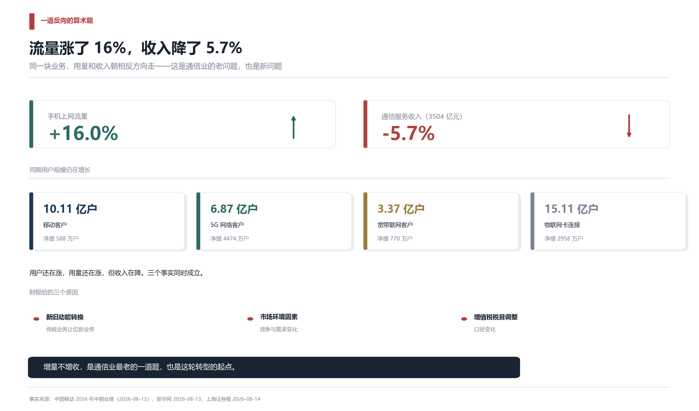
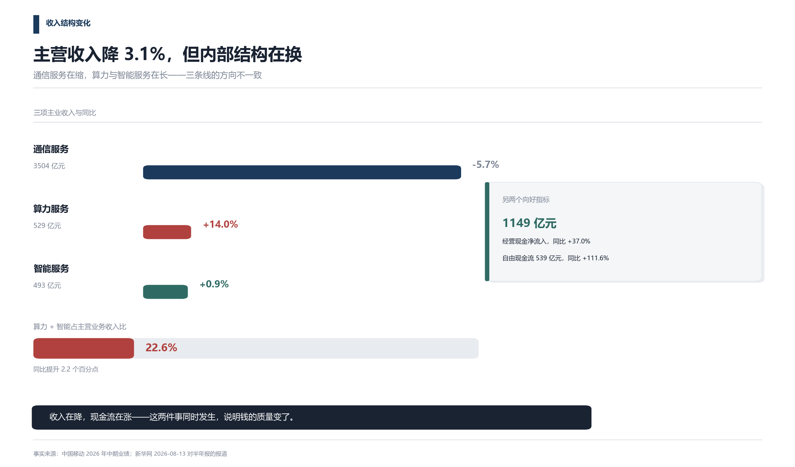
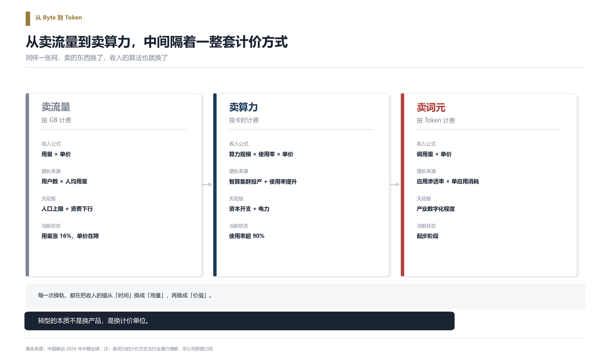

# 流量涨 16%，通信服务收入降 5.7%：这道算术题怎么解

2026 年上半年的中期业绩里，有两个数字放在一起看会让人停一下。

手机上网流量同比增长 16.0%。同期，通信服务收入 3504 亿元，同比下降 5.7%。

用得更多了，收入反而更少了。

这不是一个新问题——通信业讨论"增量不增收"至少有十年了。但这一次的背景不太一样，值得重新拆开看。

## 三个事实同时成立

先把三个事实摆出来。

**第一，用户还在涨。** 移动客户 10.11 亿户，净增 588 万户；5G 网络客户 6.87 亿户，净增 4474 万户；宽带联网客户 3.37 亿户，净增 770 万户；物联网卡连接数 15.11 亿户，净增 2958 万户。

**第二，用量还在涨。** 手机上网流量同比增长 16.0%，财报的表述是"增速显著提升"。这个数字比前几年都快。

**第三，收入在降。** 通信服务收入 3504 亿元，同比下降 5.7%。

用户涨、用量涨、收入降——三者并列，说明问题不在需求端。

财报给了三个原因：新旧动能转换、市场环境因素、增值税税目政策调整。

第三个原因值得单独说一句。增值税税目调整是口径变化，会直接影响收入的可比性。财报同时提到，剔除这一影响后，营运收入和利润"同口径均实现正增长"。

也就是说，5.7% 这个降幅里，有一部分是会计口径造成的，不是业务真的缩了那么多。

但即便把口径因素剔除，通信服务收入的可比增速大概也只是微增或持平——离流量的 16% 还差得很远。

## 单价在往下走，这是结构性的

流量涨、收入不涨，最直接的解释是单价在跌。

这件事的机制很清楚：套餐里包含的流量越来越大，单位流量价格持续下行。用户用得更放心，但每 GB 收的钱更少。

过去几年，这个下行主要由竞争和"提速降费"推动。现在多了一个新变量：**流量增长本身正在被 AI 拉动**。

财报里有一句值得注意的话：AI 正在成为移动网络流量增长的重要来源。也就是说，16% 这个增速里，有相当一部分来自 AI 应用——视频生成、智能体调用、端侧模型交互。

这就带来一个新的结构性矛盾：AI 制造的流量，是不是也按传统流量的价格卖？

如果是，那 AI 越发展，运营商的流量收入压力越大。因为 AI 产生的流量，单价比人看视频还低，但对网络的要求更高——上行更大、时延更敏感、连接更密集。

## 收入降了，现金流为什么涨

这里有一个反直觉的数字。

同期，经营活动现金净流入 1149 亿元，同比增长 37.0%；自由现金流 539 亿元，同比增长 111.6%，财报称"为近年来较高水平"。

收入在降，现金流在涨。这两件事同时发生时，通常意味着三件事中的一件或几件：应收账款回收变好、资本开支节奏放缓、成本结构变化。

财报没有展开解释原因。但从数字本身能读出一个信号：**钱的质量在变好。**

一家公司如果收入在涨、现金流不涨，说明它在垫钱做生意（应收账款堆积）。反过来，收入微降、现金流大涨，往往意味着收钱的效率提高了。

对一家年收入上万亿的公司来说，37% 的现金流增长不是小数。这也解释了为什么在这个半年，公司仍然宣布派发中期股息每股 2.51 元、同比增长 0.3%。

## 这里的账，不止一本

把三块主业放在一起，结构变化就更清楚了。

通信服务 3504 亿元，降 5.7%。

算力服务 529 亿元，增 14.0%。

智能服务 493 亿元，增 0.9%。

算力和智能服务合计占主营业务收入 22.6%，同比提升 2.2 个百分点。

三条线方向不一致：大盘子在缩，新业务在长。

这里有个算术问题值得算一下：主营业务收入 4527 亿元，同比降 3.1%，也就是说少了大概 145 亿。通信服务降 5.7%，从 3504 亿看，少了约 212 亿。

一增一减之间，算力和智能服务的增量（约 76 亿）只能补回一部分。

所以转型目前的状态是：新业务在长，但还没长到能完全对冲传统业务下滑的体量。

22.6% 这个比例，就是"还在路上"的量化表达。

## 从卖流量到卖算力，换的是计价单位

如果只把这件事理解为"老业务不行了、新业务顶上"，会忽略一个更本质的变化。

三次换轨，换的都是**收入的锚**。

**卖流量，锚是 GB。** 收入 = 用量 × 单价。增长来自用户数和人均用量的乘积，天花板是人口上限，加上资费持续下行。

**卖算力，锚是卡时。** 收入 = 算力规模 × 使用率 × 单价。增长来自集群投产和使用率提升，天花板是资本开支和电力。财报里"在网资源使用率超 90%"就是这一层的核心指标。

**卖词元，锚是 Token。** 收入 = 调用量 × 单价。增长来自应用渗透率和单应用消耗，天花板是整个社会的数字化程度。

三次换轨的逻辑是一致的：把收入的锚，从"时间"换成"用量"，再换成"价值"。

这个变化对经营的意义很大。卖流量的生意，客户越多、用越多，收入就越稳，但也越难涨价；卖词元的生意，收入弹性更大，但要求对客户场景理解得更深。

## AI 流量对网络的三个新要求

如果 16% 的流量增长里有相当一部分来自 AI，网络要承受的就不只是"更多"，还有"更不一样"。

**第一，上行变重。** 人看视频是下行为主，一组大流量几乎全在"发给你"。而 AI 应用是双向的——上传图像、上传语音、上传现场视频，都要占用上行带宽。传统网络的上行配比是按人的使用习惯设计的，AI 会把这个比例打破。

**第二，连接变密。** 智能体不是一个人一个连接，而是一个任务可能开几十个并发。连接数密度上去了，但每个连接的平均流量不大。这对网络的会话管理能力是新考验。

**第三，时延变敏感。** 人看视频卡一下还能忍，智能体调用工具卡一下就断了链条。AI 流量对时延抖动的要求，比视频严格得多。

三个要求叠在一起，说明网络要投的钱不光是为了"更多流量"，还为了"更好的流量"。

这也解释了一个看起来矛盾的现象：收入在降，但 5G 基站还在加——财报披露累计开通 5G 基站 294 万个，千兆网络覆盖住户 5.6 亿户，高铁专网上下行平均速率提升超 15%，自智网络 21 个高价值场景实现 L4 级能力。

这些投资短期不会带来收入增长，但如果不投，AI 那份 16% 的流量增长就接不住。

## 落到：这道题没有标准答案

回到开头那两个数字。

流量涨 16%、收入降 5.7%，这道算术题在通信业已经存在很久了。它有标准解法吗？

没有。因为这不是一道算术题，是一道结构题。

只要还在卖流量，用量增长和收入增长就会持续背离——这是资费下行的必然结果，不是经营不善。

真正的解法只有一条：把收入的一部分，挪到不按流量计价的业务上去。

这个动作已经开始了。22.6% 这个占比，就是挪动的进度条。

但进度条走得快不快，不取决于新业务涨得多快，而取决于两件事：新业务的毛利率够不够高，老业务的下滑能不能稳住。

前者决定增量质量，后者决定时间窗口。

流量涨 16% 是好事——它说明网络还有价值。但这份价值要变成收入，得换一种卖法。

---

*事实来源：中国移动 2026 年中期业绩（2026-08-13 发布）：营运收入 5380 亿元（同比 -1.1%）、主营业务收入 4527 亿元（同比 -3.1%）、其他业务收入 854 亿元（同比 +11.2%）、股东应占利润 789 亿元（同比 -6.3%）、EBITDA 1736 亿元（同比 -6.6%）、EBITDA 占主营业务收入比 38.4%；剔除增值税税目政策调整影响后同口径实现正增长；通信服务收入 3504 亿元（同比 -5.7%），原因表述为"新旧动能转换、市场环境因素及增值税税目政策调整等影响"；移动客户 10.11 亿户（净增 588 万户）、5G 网络客户 6.87 亿户（净增 4474 万户）、手机上网流量同比增长 16.0%（"增速显著提升"）、宽带联网客户 3.37 亿户（净增 770 万户）、物联网卡连接数 15.11 亿户（净增 2958 万户）；算力服务收入 529 亿元（同比 +14.0%）、智能服务收入 493 亿元（同比 +0.9%）、两者占主营业务收入比 22.6%（同比提升 2.2 个百分点）；经营现金净流入 1149 亿元（同比 +37.0%）、自由现金流 539 亿元（同比 +111.6%）；累计开通 5G 基站 294 万个、千兆网络覆盖住户 5.6 亿户、高铁专网上下行平均速率提升超 15%、自智网络 21 个高价值场景实现 L4 级能力；中期股息每股 2.51 元（同比 +0.3%），折合每股 2.9003 港元（同比 +5.5%），自 2026 年中期派息起以人民币计值及宣派。据新华网 2026-08-13《中国移动 2026 上半年营运收入 5380 亿元 算力服务成重要增长引擎》（记者孙云龙）、上海证券报 2026-08-14《中国移动有限公司 2026 年半年度报告摘要》。*

*需说明四点。其一，文中"通信服务收入减少约 212 亿""主营业务收入减少约 145 亿""新业务增量约 76 亿"为据财报披露的金额与同比百分数所作的估算，非财报直接披露数字；由于缺少上年同期精确基数和口径调整明细，上述估算存在误差，仅用于说明量级关系。其二，"AI 正在成为移动网络流量增长的重要来源"一句出自公司业绩沟通口径的公开转述，非半年报正文原句，引用时已标注；本文未据此推算 AI 流量在 16% 中的具体占比。其三，"AI 流量单价低于视频流量""应收账款、资本开支、成本结构三种可能"等为作者分析，公司未就现金流大幅增长的原因作公开解释。其四，图 3 中"卖词元按 Token 计费"的表述为行业通行理解，公司财报未将词元定价作为独立业务的核算口径。*
