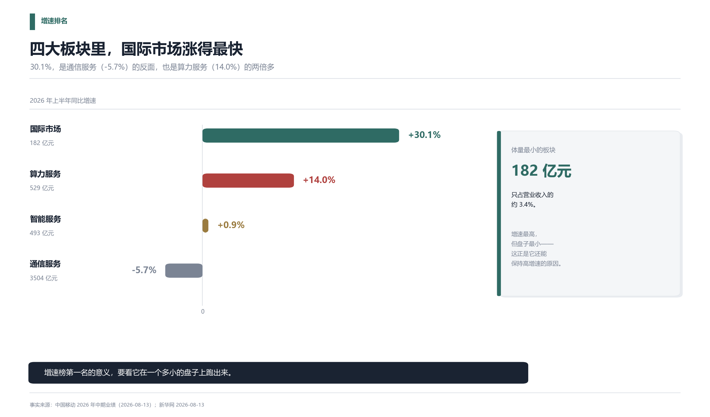
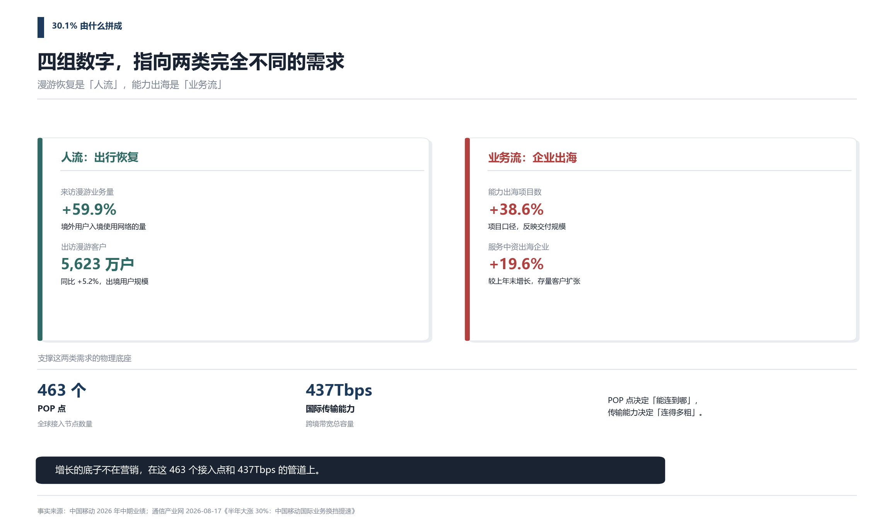
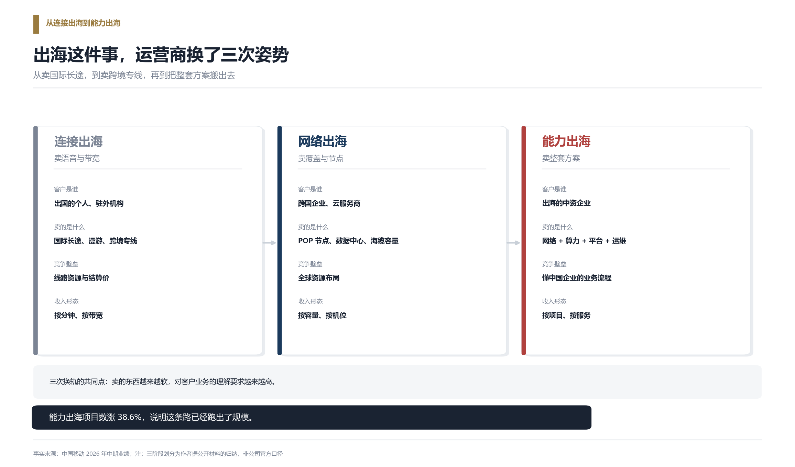

# 国际市场涨 30.1%，是四大板块里增速最快的一块

2026 年上半年，中国移动四大业务板块的增速排出来是这样：

国际市场 +30.1%。算力服务 +14.0%。智能服务 +0.9%。通信服务 −5.7%。

国际市场排第一，而且是唯一一个两位数的正增长。

这个排名值得注意，因为它不太符合常识。一家以国内十亿用户为主要市场的运营商，增长最快的竟然是国际业务——而这块业务只有 182 亿元，约占营业收入的 3.4%。

增速第一和体量最小同时出现，这本身就说明了一些事。

## 182 亿，是个什么量级

先说清楚盘子有多大。

上半年营业收入 5380 亿元，国际市场收入 182 亿元，占比约 3.4%。

换算成每天，大约 1 亿元。这个数字放在一家年收入上万亿的公司里，属于"方向明确但仍在早期"的规模。

对比一下：通信服务收入 3504 亿元，是国际市场的将近 20 倍；算力服务 529 亿元，是它的近 3 倍。

所以 30.1% 这个增速，不能读成"国际业务已经成了新支柱"。它现在还不是。

它说明的是另一件事：**这块业务处在投入产出比最好的那个阶段**——基数小、方向对、资源刚刚铺到位。

## 30.1% 由四组数字拼成

财报里关于国际业务，给了四组具体数据。这四组数字指向两类完全不同的需求。

**第一类是人流——出行恢复了。**

来访漫游业务量同比增长 59.9%。这是境外用户入境中国时使用网络的量，直接对应入境旅游和商务往来的恢复。

出访漫游客户 5,623 万户，同比增长 5.2%。这是出境用户的规模，增速慢得多，但基数大。

一快一慢的对比很有意思：入境业务的增速远超出境。这轮国际业务的增长，更多是"别人来中国"带来的，而不是"中国人出去"。

**第二类是业务流——企业出海了。**

能力出海项目数量同比增长 38.6%。这是项目口径，反映的是交付规模。

累计服务中资出海企业数量较上年末增长 19.6%。这是存量客户口径。

两个数字加起来，说明中国企业的海外扩张正在给运营商带来实际订单——不只是建个办事处，而是真金白银的网络、算力、平台采购。

## 底子在 463 个点和 437Tbps 上

这两类需求能不能接住，取决于物理底座。

财报披露：POP 点达到 463 个，国际传输能力达到 437Tbps。

POP 点（Point of Presence，网络接入点）是全球网络的"落脚点"。客户要连到哪个国家，得先看那里有没有点。463 个点意味着覆盖了全球主要的商业城市。

国际传输能力 437Tbps 是管道的粗细。这个数字决定了一次能搬多少数据。

两个指标的关系很清楚：POP 点决定"能连到哪"，传输能力决定"连得多粗"。缺少任何一个，业务都跑不起来。

而且这两个指标的增长是滞后于需求的——建一个海外 POP 点涉及牌照、机房、海缆资源、当地合作方，周期以年计。所以 30.1% 的收入增长，背后是好几年前就开始的资源投入。

## 出海的姿势换了三次

把这块业务放到更长的时间轴上看，会发现运营商出海的方式换过三次。

**第一次是连接出海。** 卖国际长途、漫游、跨境专线。客户是出国的个人和驻外机构，竞争壁垒是线路资源和结算价，收入按分钟、按带宽计。

**第二次是网络出海。** 卖 POP 节点、数据中心、海缆容量。客户变成跨国企业和云服务商，壁垒是全球资源布局，收入按容量、按机位计。

**第三次是能力出海。** 卖网络、算力、平台、运维一整套方案。客户是出海的中资企业，壁垒变成了"懂中国企业的业务流程"。

三次换轨的共同点很清楚：卖的东西越来越"软"，对客户业务的理解要求越来越高。

第一次卖资源，第二次卖位置，第三次卖理解。前两次靠钱能买到，第三次买不到。

这也解释了为什么能力出海项目数能涨 38.6%——它不是靠降价抢来的，是靠"别人做不了"这件事。

## 一个容易被忽略的门槛：合规与牌照

做国际业务，最难的不是技术，是"能不能在当地合法做生意"。

通信是有强监管属性的行业。一个国家的频谱、牌照、数据落地要求、外资持股比例，每一项都可能成为进入门槛。中国移动要在 463 个点位上提供服务，意味着要和几十上百个国家的监管机构打交道。

这件事的难度不在谈判，在时间。一张牌照谈三年是常态，建成网络再花两年。所以当财报上说"POP 点达到 463 个"时，它背后是过去许多年的积累，而不是这个半年的动作。

对想复制这条路径的后来者来说，这是一个很难绕过的门槛。钱能买设备，买不到时间。

这也解释了另外一个现象：国际业务的增速为什么是"台阶式"的，而不是"斜坡式"的。每打通一个国家或区域，收入就上一个台阶；打不通的地方，一直是零。30.1% 这个数字，可能就是几个台阶叠加的结果。

## 为什么这块业务能跑这么快
有几个结构性原因。

**第一，中资出海是刚需。** 中国企业去东南亚、中东、欧洲建厂、开店、做电商，第一件事就是要把网络和系统搭起来。而这批企业对国内运营商的信任度天然更高——用惯了。

**第二，运营商的短板正在被补齐。** 过去中资企业出海，往往找当地运营商或国际云厂商。现在国内运营商在海外的节点、牌照、服务能力都上来了，替代开始发生。

**第三，这块业务的单价更高。** 跨境专线、国际数据中心的单位价格，远高于国内同类业务。同样一公里的光纤，跨境的溢价可能是几倍。

**第四，竞争格局不同。** 国内通信市场是三家分食，价格战打了二十年。国际市场上，中国移动面对的是各国运营商和国际厂商，在某些区域反而有议价空间。

四个原因叠加，才有了 30.1%。

## 国内能力怎么变成海外订单

还有一层逻辑，图上没有画出来。

能力出海能成立，前提是"国内已经有能力"。如果国内没有建过万卡集群、没有做过行业大模型、没有运营过大型数据中心，那出海卖什么？

所以国际业务和国内两大新主业（算力、智能）之间，其实是一种"能力溢出"的关系：先在主场把能力练出来，再把同一套能力搬到海外去卖。

这个链条的传导顺序是：国内算力网建设 → 形成交付能力 → 中资企业出海时带上 → 变成国际业务收入。

半年报里"能力出海项目数量同比增长 38.6%"这个数，本质上是国内能力成熟度的一个海外映射。

这也意味着，国际业务的天花板不完全由国际市场决定，而由国内能力能走多远决定。国内算力越强、行业方案越成熟，出海能卖的东西就越多。

## 落到：这块短板补到什么程度了
回到"增速第一、体量最小"这个组合。

它说明国际业务目前的角色是"补短板"，不是"挑大梁"。

补短板的意思是：过去这块太弱了，现在在快速补上。182 亿元放在全球运营商里看，仍然不算高——很多国际运营商的海外收入占比超过三成。

但趋势是清楚的。董事长在报告书里的表述是：持续推动国内国际"两个市场"深度融通，加快能力规模出海。

"两个市场深度融通"这句话值得琢磨。它说的不是"把国内业务搬到海外"，而是让国内的网络、算力、平台能力和海外的节点、客户、场景对接起来。

对一家以国内为主场的运营商来说，这可能是比 30.1% 更重要的一个变化——从"服务中国人"变成"服务中国企业的全球化"。

后者的天花板，比前者高得多。

---

*事实来源：中国移动 2026 年中期业绩（2026-08-13 发布）：国际市场收入 182 亿元（半年报口径 181.73 亿元），同比增长 30.1%；POP 点达到 463 个；国际传输能力达到 437Tbps；来访漫游业务量同比增长 59.9%；出访漫游客户 5,623 万户，同比增长 5.2%；能力出海项目数量同比增长 38.6%；累计服务中资出海企业数量较上年末增长 19.6%。同期对比：营业收入 5380 亿元、通信服务收入 3504 亿元（同比 -5.7%）、算力服务收入 529 亿元（同比 +14.0%）、智能服务收入 493 亿元（同比 +0.9%）。董事长在报告书中表述"持续推动国内国际'两个市场'深度融通，加快能力规模出海"。据新华网 2026-08-13《中国移动 2026 上半年营运收入 5380 亿元 算力服务成重要增长引擎》、通信产业网 2026-08-17《半年大涨 30%：中国移动国际业务换挡提速》、移动通信网 2026-08-17。*

*需说明四点。其一，"约占营业收入 3.4%"为据 182 亿元与 5380 亿元计算所得，非财报披露口径；因国际市场收入与营业收入的口径归集方式未在财报中详细说明，该比例仅为量级参考。其二，图 3 的"三次换轨"（连接出海、网络出海、能力出海）为作者据公开材料所作的归纳，公司未以这种方式划分业务阶段。其三，"入境业务增速远超出境""中资出海是刚需""跨境业务单价更高"等为作者分析；财报未披露国际业务的分项收入结构与毛利率，本文未作任何推算。其四，"很多国际运营商海外收入占比超过三成"为行业一般性描述，未指向具体公司或具体年份，不构成与同业的精确对比。*
