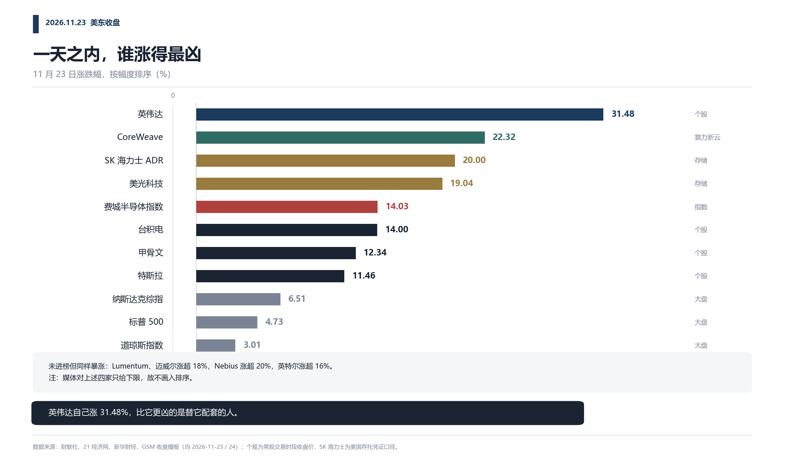
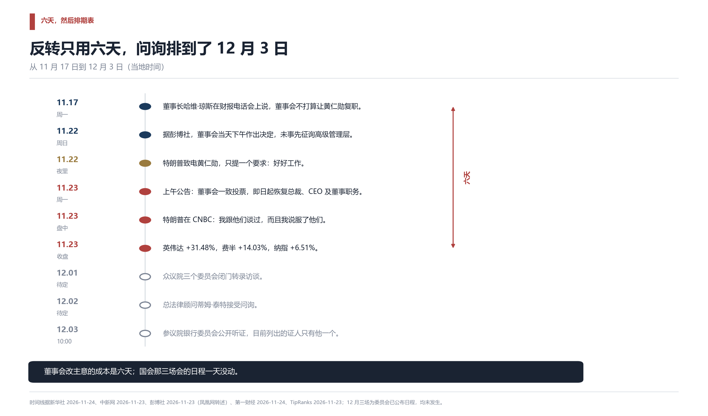
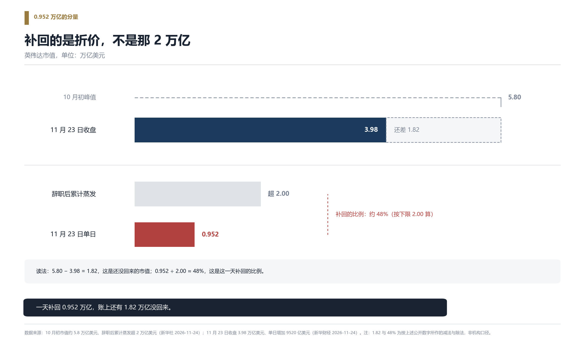

# 黄仁勋闪电复职，英伟达一夜涨出 9520 亿美元：董事会反转了，但 12 月 3 日的听证会没取消

11 月 23 日，英伟达董事会一致投票，即日起恢复黄仁勋的总裁、首席执行官及董事会成员职务。距董事会公开说"不考虑让他回来"，只隔了六天。

市场没打算慢慢消化。收盘 165.05 美元，涨 31.48%，创 2003 年 5 月以来最大单日涨幅；市值单日增加 9520 亿美元，创美国上市公司单日市值增幅纪录——流传更广的"9500 亿"是四舍五入后的说法。费城半导体指数涨 14.03%，为 2025 年以来最大单日涨幅。纳指涨 6.51%，标普 500 涨 4.73%，双双创下 2025 年 4 月 8 日以来最大单日涨幅。

## 六天

反转的速度比涨幅更值得看。

11 月 17 日，董事长哈维·琼斯在财报电话会上明确说，董事会不打算让黄仁勋复职。据彭博社报道，真正的决定是 11 月 22 日周日下午作出的，过程相当突然，没有事先征询高级管理层，临时 CEO 科莱特·克雷斯也没有参与。

推手在白宫。11 月 23 日上午，特朗普在 CNBC 近一小时的采访中说："我跟他们谈过，而且我说服了他们，这件事是我促成的。"他说董事会要求政府就国家安全风险作出保证，政府为此调查了数周，司法部长确认没有证据表明黄仁勋有不合法行为。据新华社引消息人士，特朗普要求副总统万斯调查辞职一事，万斯上周末开始劝说董事会。

谈妥之后，他在前一晚给黄仁勋打了电话，没谈治理，只提一个要求：好好工作。

## 谁涨得最凶

涨得最凶的不是英伟达自己。

存储：SK 海力士美国存托凭证涨 20.00%，美光涨 19.04%。光通信与互连：Lumentum、迈威尔涨超 18%。算力新云：CoreWeave 涨 22.32%，Nebius 涨超 20%。此外甲骨文涨 12.34%，英特尔涨超 16%，台积电涨 14%，特斯拉涨 11.46%。

结构很清楚：越依赖"英伟达继续供货"的公司，涨得越多。英伟达自己只是回到了 10 月高点的七成。

卖方却没跟着一起兴奋。伯恩斯坦把评级从"与市场表现一致"上调至"跑赢大盘"，目标价却维持 200 美元——这个目标价上周刚从 400 美元砍半。分析师 Stacy Rasgon 说乐见其回归，但对他的判断力仍有疑问，并直接批评董事会六天内两次反转"像小丑"。

## 12 月 3 日

复职修复的是治理叙事，不是管制变量。

同一天，参议院银行、住房和城市事务委员会把听证排上了日程：12 月 3 日上午 10 时，公开听证，主题是"保护美国的人工智能优势：对美国出口管制的监督"，目前日程上列出的证人只有黄仁勋一个。这场会由委员会主席蒂姆·斯科特安排，而坐在对面的包括沃伦——她已经把董事会的决定称为"鲁莽"，要求公司到国会解释合规情况。

前一天还有一场：12 月 1 日，黄仁勋要接受众议院情报委员会、外交事务委员会和美中战略竞争特别委员会的闭门转录访谈；12 月 2 日轮到总法律顾问蒂姆·泰特。众议院方面说，他是否复职不改变调查安排。

制度环境也没松。11 月 16 日，美国商务部工业与安全局（BIS）发布临时最终规则，把"远程访问"纳入管制：只要机房给总部位于中国等 D:5 国家的企业提供超过 1200 万 TPP 的算力，卖芯片、卖服务器都要先拿许可。11 月中旬，英伟达还停了对华 H200 供货。这两件事，没有一件因为 CEO 回来而变化。

11 月 24 日美股盘前，英伟达跌超 4%。一天 31% 的涨幅里，多少是估值修复，多少是空头回补和情绪反弹，要等 12 月 3 日之后才算有了第一份答卷。

董事会用六天证明它随时可以反转。国会不用。

---

*事实来源：2026 年 11 月 23 日英伟达官网声明，董事会一致投票恢复黄仁勋总裁、CEO 及董事会成员职务，即日生效；董事会称听取美国政府高层意见后确信复职不构成国家安全风险，哈维·琼斯继续任董事长、科莱特·克雷斯继续任 CFO，公司将继续配合正在进行的政府调查与问询——据中新网 11-23、英伟达公告。11 月 17 日琼斯在财报电话会表示董事会无意恢复其职务，据新华社 11-24 综述。董事会于 11 月 22 日周日下午作出决定、未事先征询高级管理层、临时 CEO 未参与，据彭博社 11-23（凤凰网 11-24 转述）。特朗普 11 月 23 日上午接受 CNBC《Squawk on the Street》近一小时采访，称"我跟他们谈过，而且我说服了他们，这件事是我促成的"、董事会要求政府就国家安全风险作保证、司法部长确认无证据表明其有不合法行为、前一晚致电黄仁勋只要求"好好工作"——据 CNBC 采访（凤凰网、财联社 11-24 转述）；特朗普同日在社交媒体称该决定"正确且恰当"、美国无理由认为复职构成国家安全风险，据中新网、新华社 11-23／24。万斯受特朗普要求调查辞职一事、与司法部长协商后上周末开始劝说董事会，据新华社 11-24 引消息人士。市场数据（美东 11-23 收盘）：英伟达 165.05 美元、+31.48%、市值 3.98 万亿美元、单日增 9520 亿美元，创 2003 年 5 月 9 日以来最大单日涨幅及美国上市公司单日市值增幅纪录；费城半导体指数 +14.03%；道指 +3.01% 报 49595.31、标普 500 +4.73% 报 7237.17、纳指 +6.51% 报 24089.56；SK 海力士 ADR +20.00% 报 124.28 美元、美光 +19.04% 报 707.70 美元、CoreWeave +22.32%、甲骨文 +12.34%、特斯拉 +11.46%、英特尔涨超 16%、台积电 +14%、Lumentum 与迈威尔涨超 18%、Nebius 涨超 20%——据财联社 11-24、21 经济网 11-24、新华财经 11-24、GSM 收盘播报 11-23。伯恩斯坦评级由 Market-Perform 上调至 Outperform、目标价维持 200 美元（上周自 400 美元下调）、分析师 Stacy Rasgon 对黄仁勋判断力仍存疑并批评董事会反复，据新浪财经 11-24、格隆汇 11-24、TipRanks 11-23。听证会：参议院银行、住房和城市事务委员会 12 月 3 日 10 时公开听证，主题"保护美国的人工智能优势：对美国出口管制的监督"，当日日程列出的证人为黄仁勋——据第一财经 11-24、央视新闻／澎湃 11-24、TipRanks 11-23；12 月 1 日众议院三个委员会闭门转录访谈、12 月 2 日总法律顾问蒂姆·泰特接受问询、众议院称复职不改变调查安排，据凤凰网 11-24；沃伦称该决定"鲁莽"并要求公司向国会解释合规情况，据新华社 11-24。BIS 临时最终规则（RIN 0694-AK50，1200 万 TPP 门槛，11 月 16 日发布、11 月 19 日刊登生效）据 BIS 新闻稿及本报 11-19 报道；英伟达停供对华 H200 及外交部 11-18 回应，据中新网 11-18、财联社 11-18。11 月 24 日盘前英伟达跌超 4%，据 21 经济网 11-24 09:56。*

*需说明四点。其一，题面流传的"市值单日增超 9500 亿美元"实为 9520 亿美元，"费半涨 14%"实为 14.03%，本文按精确口径书写。其二，"证人只有黄仁勋一个"指委员会当日公布的日程只列他一人，不代表委员会不会增补其他证人。其三，"英伟达自己只是回到了 10 月高点的七成"为据新华社"10 月初市值约 5.8 万亿美元"与 11-23 收盘 3.98 万亿美元所作的折算（约 69%），非公司或媒体口径。其四，文中"越依赖英伟达继续供货的公司涨得越多""董事会用六天证明它随时可以反转，国会不用"等为作者判断，非当事方表述。*