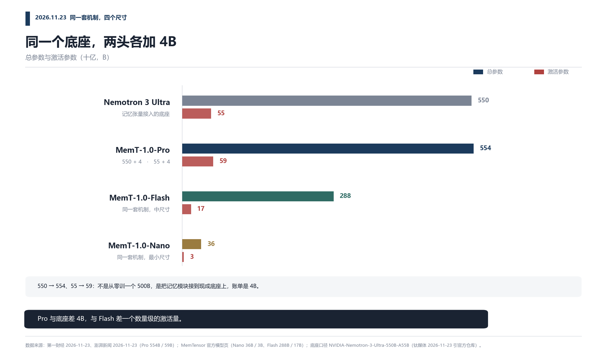
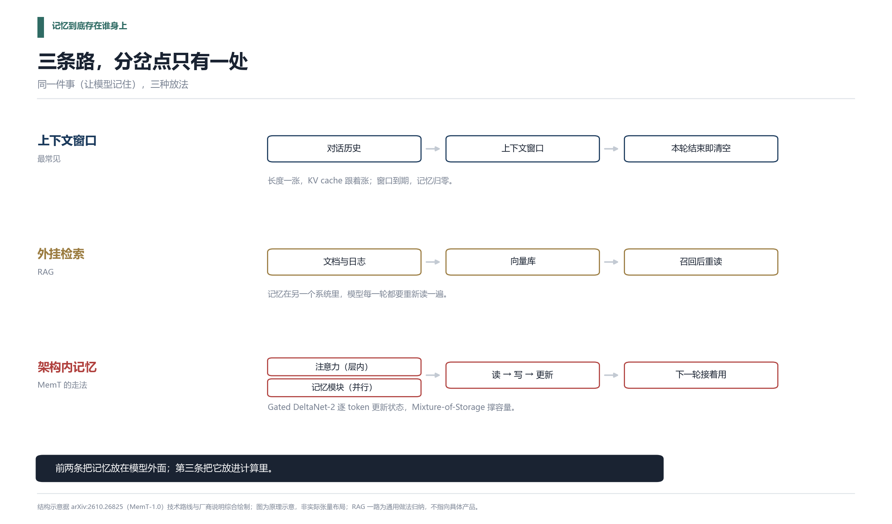
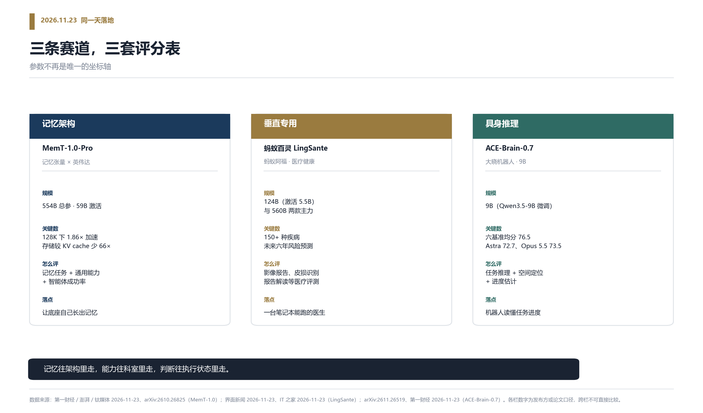

# 554B 参数、59B 激活，记忆张量联合英伟达开源"记忆原生"模型：不靠外部检索，把记忆写进架构

11 月 23 日，记忆张量（MemTensor）发布并开源与英伟达联合研发的 MemT-1.0-Pro：基于 NVIDIA Nemotron 3 Ultra 底座，总参数 554B、激活参数 59B，分布式训练用 Megatron-Core 与 Megatron Bridge，代码与权重分别放在 GitHub 和 Hugging Face。

它改的不是参数量，是"记忆"放哪。

## 记忆放在哪

这篇论文不是临时起意：10 月 19 日挂出第一版，11 月 23 日已经更新到第五版。路线是公开迭代出来的，不是发布会当天现写的。

主流两条路，都把记忆放在模型外面。一条靠上下文窗口，把历史一段段塞进去——窗口是临时的，用完就空，长度一涨，KV cache 跟着涨。一条靠外挂检索，文档切块、向量化、按需召回——记忆存在另一个系统里，模型每次都得重新读一遍。

MemT 走第三条：在选定层里插一个记忆模块，与注意力并行。动态局部记忆承接这一轮写进来的信息，可训练的记忆负责学会怎么存、怎么取；生成时先读，这一轮结束再更新状态。逐 token 的更新用 Gated DeltaNet-2，容量靠 Mixture-of-Storage 往上扩。训练分持续预训练和后训练两段，34B token。

论文给的三组数值得记住：128K 历史长度下，最小的 Nano 端到端推理快 1.86 倍，持久化存储比全上下文 KV cache 少 66 倍；平均超过参数记忆基线，与检索增强方法持平；通用能力基本没掉。

"持平"这两个字比"超过"重要。它没说打赢 RAG，说的是不挂外挂也能追到同一条线上——省掉的是检索链路，不是效果。

还有一处限定得说清楚：1.86 倍和 66 倍是 Nano 的数据，论文没给 Pro 的同口径数字。同样的机制搬到 550B 底座上，这两个比值守不守得住，眼下没有公开答案。

## 多出来的 4B

Pro 的底座是 Nemotron 3 Ultra，命名里的 550B-A55B 就是 550B 总参、55B 激活。接上记忆模块之后是 554B 总参、59B 激活——两头各多 4B。

所以这不是从零训一个 500B 模型，而是把"记忆"接到一个已经很强的底座上，账单只有 4B。同门的 Nano（36B／3B）和 Flash（288B／17B）是同一套机制的小尺寸版本，三个尺寸一起开源，本身就是一次可复现的验证。

对英伟达来说，这是 Nemotron 生态往能力层延伸的一次公开样本：底座归底座，记忆、检索、工具这些过去长在应用层的东西，开始被做成能插在底座上的模块。

## 同一天，另外两条路

蚂蚁在阿福医疗健康生态大会上把百灵家族全面开源，四款各有分工：air-VL 124B、激活 5.5B，能看皮损照片、饮食图片、体检报告，笔记本就能本地跑；flash 560B，主打复杂医学推理，支持 1M 上下文，可多轮检索、核验证据、调用工具；Pulse 做 150 余种疾病未来六年的风险预测；MedGuard 专门管医疗安全与合规。

大晓机器人的 ACE-Brain-0.7 只有 9B，路子是把任务理解拆成两层：任务结构（步骤、依赖、完成条件）能靠指令推断，执行状态（未开始、进行中、完成、失败）必须靠真实观察确认。3.7M 组问答对微调 Qwen3.5-9B 之后，六个公开任务推理基准均分 76.5，高于 GPT-6 Astra 的 72.7、Claude Opus 5.5 的 73.5。

## 分化

三件事不在一个赛道上，却指向同一个变化：参数不再是唯一的坐标轴。记忆往架构里走，能力往科室里走，判断往执行状态里走——每条路都长出了自己的评测方式，也都交出了第一批开源权重。

通用模型还在比谁更大。专用模型已经开始比谁更对。

---

*事实来源：MemT-1.0-Pro 于 2026 年 11 月 23 日发布并开源，由记忆张量与英伟达联合研发，基于 NVIDIA Nemotron 3 Ultra 底座，采用 Megatron-Core 与 Megatron Bridge 支撑分布式训练，总参数 554B、激活参数 59B——据第一财经 11-23、澎湃新闻 11-23、每日经济新闻 11-23。技术路线（在选定层插入与注意力并行的记忆模块、动态局部记忆与可训练记忆、Gated DeltaNet-2 逐 token 更新、Mixture-of-Storage 扩展容量、持续预训练＋后训练两阶段、34B token 训练数据）据 arXiv 论文《MemT-1.0: Towards Memory-Native Evolution》（arXiv:2610.26825，v1 于 10 月 19 日提交，11 月 23 日更新至 v5）；评测结论（平均超过参数记忆基线、与检索增强方法持平、通用能力基本保持、128K 历史下 Nano 端到端推理约 1.86 倍加速、持久化存储较全上下文 KV cache 减少 66 倍、内化检索到的程序性经验提升智能体任务成功率）同为该论文摘要口径。家族尺寸（Nano 36B／3B、Flash 288B／17B）据 MemTensor 官方模型页 memt.memtensor.cn。底座型号 NVIDIA-Nemotron-3-Ultra-550B-A55B 据钛媒体 11-23 引官方仓库。蚂蚁百灵医疗健康大模型家族于 11 月 23 日蚂蚁阿福医疗健康生态大会宣布全面开源，包括 LingSante-3.1-air-VL（124B、激活 5.5B，多模态，可在笔记本等本地设备部署）、LingSante-3.1-flash（560B，复杂医学推理，支持 1M Token 上下文）、LingSante Pulse（150 余项疾病未来六年风险预测）、LingSante MedGuard（医疗安全防护）——据界面新闻 11-23、IT 之家 11-23、新华网 11-23。大晓机器人 ACE-Brain-0.7 为 9B 视觉语言模型，经 3.7M 问答对与空间定位、进度估计数据微调 Qwen3.5-9B；六个公开任务推理基准均分 76.5，高于 GPT-6 Astra 的 72.7 与 Claude Opus 5.5 的 73.5；空间定位七项基准均分 75.90、RefCOCOg 上 Acc@0.5 达 91.25——据 arXiv:2611.26519（11 月 19 日）、第一财经 11-23、科技日报 11-24。*

*需说明四点。其一，"两头各多 4B"是据 550B／55B 与 554B／59B 两组公开参数相减所得，非公司口径。其二，论文所称"与检索增强方法持平"指多项记忆评测的平均表现，不是逐项全胜，也不构成对 RAG 的替代结论。其三，蚂蚁"多项医疗评测全球第一"、ACE-Brain"六项成绩超 Astra"均为发布方口径，本文只转述未独立复算；ACE 的 76.5 与 72.7 为各自论文或发布方报告的数字，评测集不完全重合时不可直接比较。其四，文中"省掉的是检索链路，不是效果""参数不再是唯一的坐标轴""专用模型开始比谁更对"等为作者判断。*