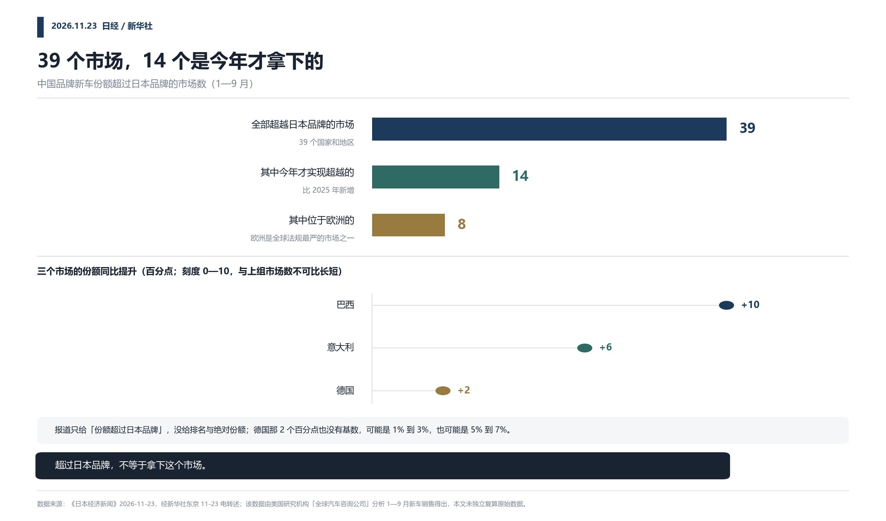
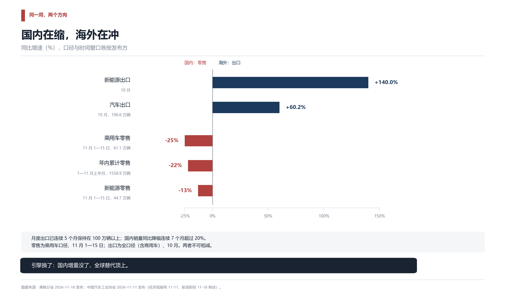
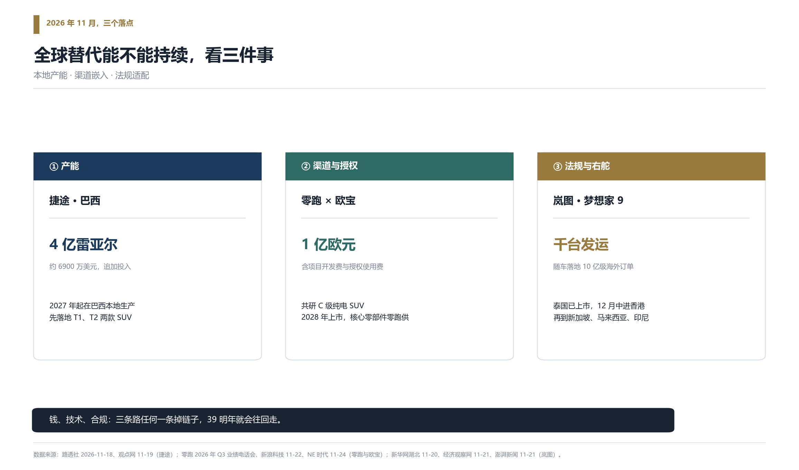

# 39 个市场的新车份额超过日本品牌：趋势是真的，但"替代完成"是另一回事

11 月 23 日，《日本经济新闻》报道，美国研究机构"全球汽车咨询公司"分析了 1—9 月的新车销售数据：中国品牌在 39 个国家和地区的市场份额超过日本品牌。其中 14 个是今年才实现超越的，8 个在欧洲。德国份额同比提高 2 个百分点，意大利 6 个，巴西 10 个。

这组数字的分量在分布。不是靠一两个市场撑起来的，而是跨大洲、跨品类同时发生。欧洲那 8 个尤其扎眼——那是全球法规最严、本土品牌忠诚度最高的市场之一。

但同一周还有另一组数。

乘联分会 11 月 18 日发布：11 月 1—15 日，全国乘用车零售 61.1 万辆，同比下降 25%；新能源零售 44.7 万辆，同比也降 13%；零售渗透率 73.2%，历史新高。年内累计零售 1558.9 万辆，同比降 22%。

中汽协那边的 10 月数据是另一面：汽车出口 106.6 万辆，同比增长 60.2%，月度出口连续 5 个月保持在 100 万辆以上；新能源出口 60.6 万辆，同比增 1.4 倍。而国内销量同比降幅，已经连续 7 个月超过 20%。

两组数并排放，结论只有一个：引擎换了。国内增量没了，全球替代顶上。

## 三处容易读过头

第一处，39 是个容易膨胀的数字。报道给的是"份额超过日本品牌"，没给排名，也没给绝对值。德国那 2 个百分点同样没有基数——可能是从 1% 挪到 3%，也可能是从 5% 挪到 7%，两种情形对"是否站住"的判断完全不同。

第二处，东南亚还没拿下。新华社的原话是"在日本车企长期占据优势的东南亚市场，双方差距进一步缩小"。缩小，不是反转。

第三处，73.2% 是分母缩出来的。新能源零售同比也在下降，渗透率创新高，是因为燃油车掉得更快。渗透率是结构指标，不能当增长指标读。

这一条也得自己给自己补个口径：上半月是周度数据，波动大。1—10 月新能源累计销量同比仍增 11.3%（中汽协），单半月转负不等于全年转负。乘联分会自己的定调是"政策托底、弱修复、结构极致分化"。

## 三个落点，正好三个维度

全球替代能不能持续，看三件事：本地产能、渠道嵌入、法规适配。11 月这半个月，三件事各有一个具体动作。

**产能。** 捷途 11 月 18 日宣布，明年在巴西启动本地生产，先产 T1、T2 两款 SUV，追加投资 4 亿雷亚尔，约合 6900 万美元，在此前同规模投资之外。

**渠道与授权。** 零跑与 Stellantis 旗下的欧宝签署联合开发协议，共研一款 C 级纯电 SUV，2028 年上市，整体对价 1 亿欧元，含项目开发费与授权使用费，量产后核心零部件由零跑供应。这条路卖的不是车，是平台和工程能力。

**法规与右舵。** 11 月 20 日，千台岚图梦想家 9 右舵版从武汉发运，随车落地一笔 10 亿级海外订单；当日在泰国上市，12 月中旬进中国香港，之后是新加坡、马来西亚、印尼。右舵是一道硬门槛，进得去，才谈得上份额。

三条路对应三种能力：钱、技术、合规。任何一条掉链子，39 这个数字第二年就会往回走。

## 结

中国品牌在 39 个市场超过日本品牌，是这轮产业转移里少有的、能用第三方数据说清楚的结论。但它证明的是"替代正在发生"，不是"替代已经完成"。

国内在收缩，海外在扩张，中间靠的是产能、渠道和法规一寸一寸往前挪。这三件事，都比份额慢。

---

*事实来源：《日本经济新闻》11 月 23 日报道，美国研究机构"全球汽车咨询公司"分析 1—9 月新车销售数据，中国品牌在 39 个国家和地区份额超过日本品牌，14 个市场为今年实现超越、8 个位于欧洲，德国份额同比提高 2 个百分点、意大利提高 6 个百分点、巴西提高 10 个百分点，"在日本车企长期占据优势的东南亚市场，双方差距进一步缩小"——据新华社东京 11-23 电（李诗萌、蓝建中）。乘联分会 11 月 18 日数据：11 月 1—15 日全国乘用车零售 61.1 万辆、同比下降 25%、环比下降 6%；新能源零售 44.7 万辆、同比下降 13%、环比增长 7%；新能源零售渗透率 73.2%；年内累计零售 1558.9 万辆、同比下降 22%——据乘联分会发布、每日经济新闻 11-19、观点网 11-18。中汽协 10 月数据：汽车出口 106.6 万辆、同比增长 60.2%、环比增长 1.3%，月度出口连续 5 个月保持 100 万辆以上；新能源汽车出口 60.6 万辆、同比增长 1.4 倍；国内销量同比降幅连续 7 个月超过 20%——据中汽协 11-11 发布、经济观察网 11-11、新浪财经 11-18。捷途 11 月 18 日宣布明年在巴西启动本地生产、先产 T1 与 T2、追加投资 4 亿雷亚尔（约 6900 万美元），据路透社 11-18、观点网 11-19。零跑与欧宝签署联合开发协议、共研 C 级纯电 SUV、2028 年上市、对价 1 亿欧元含项目开发费与授权使用费、量产后核心零部件由零跑供应，据零跑 2026 年 Q3 业绩电话会（新浪科技转格隆汇 11-22）、NE 时代 11-24。千台岚图梦想家 9 右舵版 11 月 20 日发运、10 亿级海外订单、当日在泰国上市、12 月中旬登陆中国香港、后续进入新加坡马来西亚印尼，据新华网湖北 11-20、经济观察网 11-21、澎湃新闻 11-21。*

*需说明三点。其一，图 2 与文中"两个方向"的两组数据窗口不同：零售为 11 月 1—15 日、出口为 10 月，且零售商用车与出口全口径（含商用车）统计对象不完全一致，仅用于指示方向，不可直接相减或折算。其二，"德国那 2 个百分点没有基数"为对报道信息边界的说明，本文未推算德国市场的绝对份额。其三，文中"引擎换了""三件事都比份额慢""替代正在发生而非已经完成"等为作者判断；"份额超过日本品牌"是日经所引第三方机构口径，本文未独立复算原始数据。*