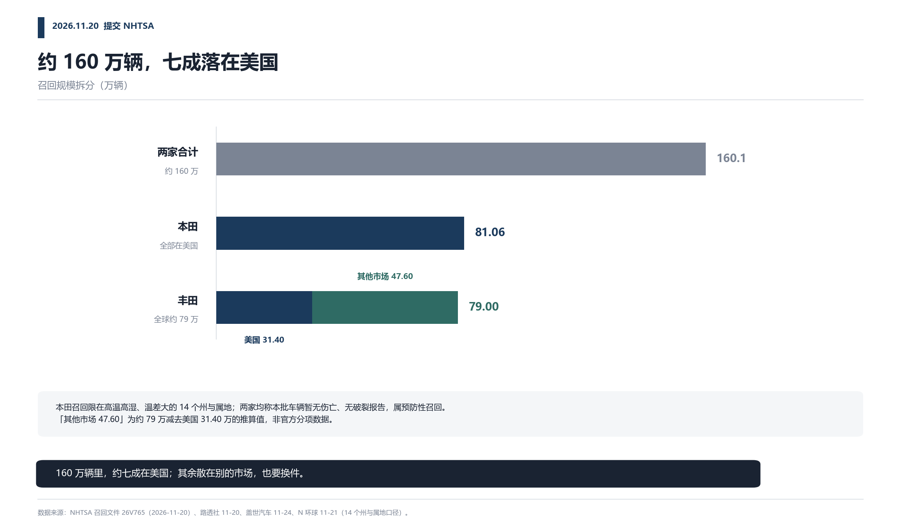
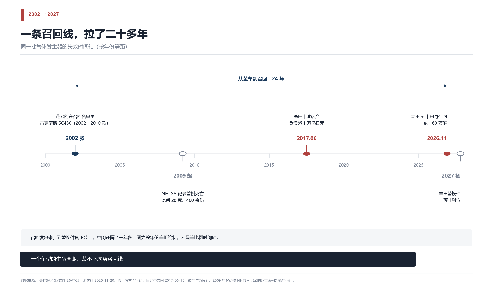
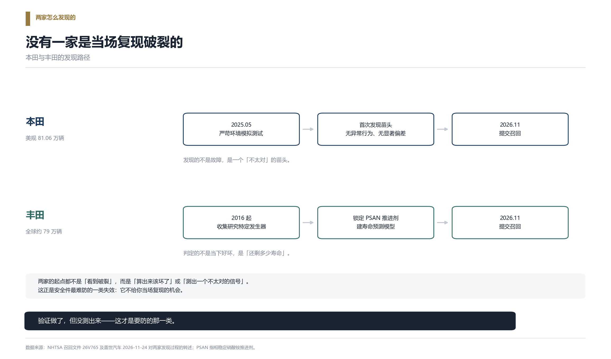

# 160 万辆、2002 款：高田气囊的余波，比车型生命周期长一倍

11 月 20 日，本田与丰田向美国国家公路交通安全管理局（NHTSA）提交新的召回文件：因高田气囊气体发生器存在破裂风险，两家合计召回约 160 万辆。本田在美国召回 810,592 辆，丰田全球约 79 万辆，其中美国 314,029 辆。

两家都表示，本批车辆暂无伤亡、无破裂报告，属于预防性召回，将免费更换驾驶席与副驾气体发生器。丰田的替换件预计 2027 年初到位。

NHTSA 文件把机理写得很清楚：推进剂反复暴露在高湿度和较大温差下会降解，内部压力随之升高；气囊一旦展开，升高的压力可能让气体发生器破裂，金属碎片穿过气囊缓冲材料伤人。2009 年以来，NHTSA 记录了 28 起死亡、400 多起受伤与这一缺陷有关。截至 2017 年 5 月，全球因此召回的车辆已达约 1.2 亿辆，被称为美国史上最大规模的汽车召回。

## 最值得看的不是数量，是"怎么才发现的"

本田说，是在 2025 年 5 月一次严苛环境条件的模拟测试中首次发现该问题——但同一次测试并没有显示气体发生器存在异常行为，也没有统计学意义上的偏差。

丰田从 2016 年起就在收集和研究特定的高田气体发生器，盯的是干燥的"相稳定硝酸铵"（PSAN）推进剂；最后是寿命预测模型判定部分发生器可能已到使用寿命终点，才发起自愿召回。

两句话合起来是一个更难接受的结论：验证不是没做，是做了也没测出来。缺陷的兑现速度，慢于当时所有测试的观测窗口。

## 长尾有多长

最老的召回车型是 2002 款雷克萨斯 SC430，最新的是 2017 款 GX460 与 4Runner——年款跨了 16 个。高田 2017 年 6 月申请破产，主要资产以 15.88 亿美元卖给均胜安全（KSS），2018 年 4 月交割，且明确把 PSAN 业务排除在收购范围之外。

再往后九年，本田和丰田仍在为同一批气体发生器发召回，替换件要等到 2027 年。召回发出来，到件真正装上，中间隔了一年多。

还有一处细节值得记：本田这次的范围限在高温高湿、温差大的 14 个州与属地。同一个件，在不同气候里失效概率不一样——这决定了验证不能只做一份"标准工况"。

从 2002 款装车，到 2026 年发召回，账期是二十多年。这已经不是一个车型的生命周期，而是两代车主的持有周期。

## 对中国供应链的三条含义

第一，批次追溯要能追到配方。本田这次之所以能换，是因为新气体发生器换了供应商、换了推进剂，在高温高湿和温差下不再降解。说不清配方，就说不清风险边界。

第二，失效验证的时间尺度是十年，不是改款周期。台架和实车跑不出来的问题，会在高温高湿的停车场里慢慢长出来——本田那次模拟测试已经算严苛，仍然没测出统计显著偏差。

第三，风险的兑现晚于关系的终结。高田破产时，大批问题车还在路上；等召回发出来，责任主体已经换了两轮，接手的还是中国公司。

成本压力和产能爬坡，最容易压缩的恰好是第三条里的冗余——因为它不产生当期收益，只对冲十年后的账单。

## 结

一个安全件的账，要用二十年记。车企要这么记，供应商也要这么记。

---

*事实来源：本田与丰田于 2026 年 11 月 20 日向美国国家公路交通安全管理局提交召回文件，合计召回约 160 万辆，其中本田在美国召回 810,592 辆、丰田全球约 79 万辆（美国 314,029 辆），两家均称本批车辆无相关伤亡、事故与发生器破裂，属预防性召回，将免费更换驾驶席与副驾气体发生器，据路透社 11-20、盖世汽车 11-24、凤凰网 11-23、新能源汽车产业网 11-22；本田召回限高温高湿的 14 个州与属地，据 N 环球 11-21。涉及车型：2013 款本田雅阁，2012—2013 款思域、CR-V，2013 款讴歌 ILX、RDX；2002—2010 款雷克萨斯 SC430、2011 款 IS250、2017 款 GX460，2003—2008 款卡罗拉、2005—2006 款坦途、2005—2007 款红杉、2016—2017 款 4Runner，据 NHTSA 召回文件（26V765）与盖世汽车 11-24。失效机理（推进剂在高湿与温差下降解、内部压力升高、发生器破裂致金属碎片伤人）、2009 年以来 28 起死亡与 400 多起受伤、本田 2025 年 5 月严苛环境模拟测试首次发现问题但未显示异常行为与统计学显著偏差、丰田自 2016 年起研究 PSAN 推进剂并据寿命预测模型发起召回、本田新件改用不同供应商与不同推进剂，据 NHTSA 文件及盖世汽车 11-24 转述。高田 2017 年 6 月申请破产、负债超 1 万亿日元，据日经中文网 2017-06-16；均胜安全以 15.88 亿美元收购高田除 PSAN 业务以外的主要资产、2018 年 4 月交割，据均胜电子公告与浙江在线 2018-04-12、中证网 2018-04-12。截至 2017 年 5 月全球因该缺陷召回约 1.2 亿辆、被称为美国史上最大规模汽车召回，据电动汽车网 2017-06-19 与路透社 11-20。*

*需说明三点。其一，"年款跨 16 个"按召回文件列出的 2002—2017 年款计，为作者按公开列表数出，非官方口径。其二，"二十多年账期"按 2002 款车型与 2026 年 11 月召回时点计，车辆实际上牌时间可能早于或晚于年款年份。其三，文中"验证不是没做，是做了也没测出来""风险的兑现晚于关系的终结""最容易压缩的是第三条的冗余"等为作者判断；"1.2 亿辆"为 2017 年 5 月的累计口径，非当前值，本文未作更新推算。*