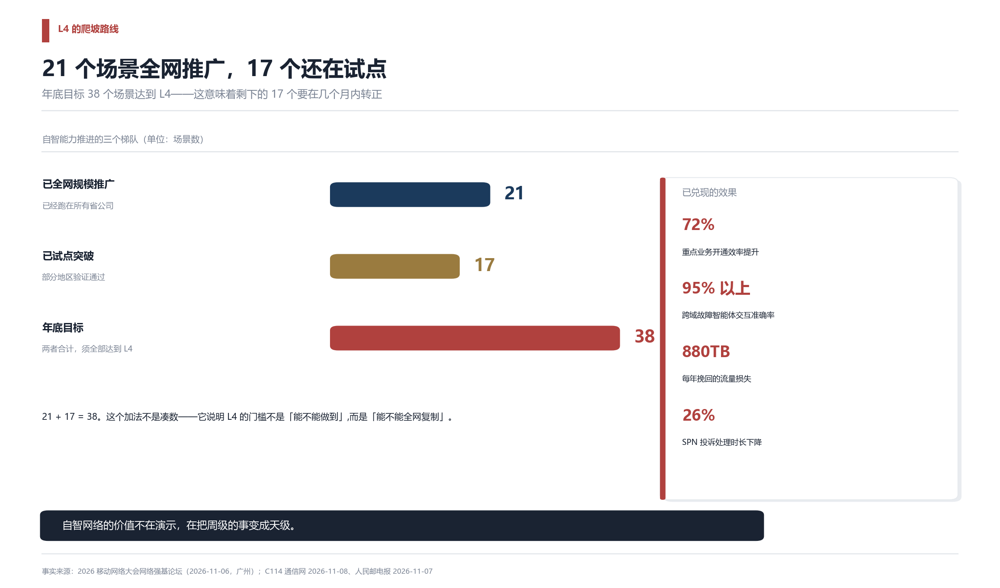
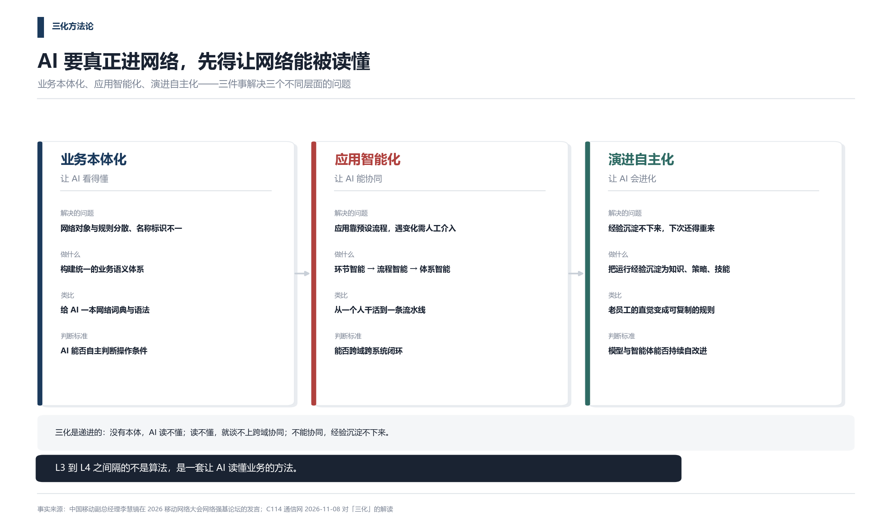
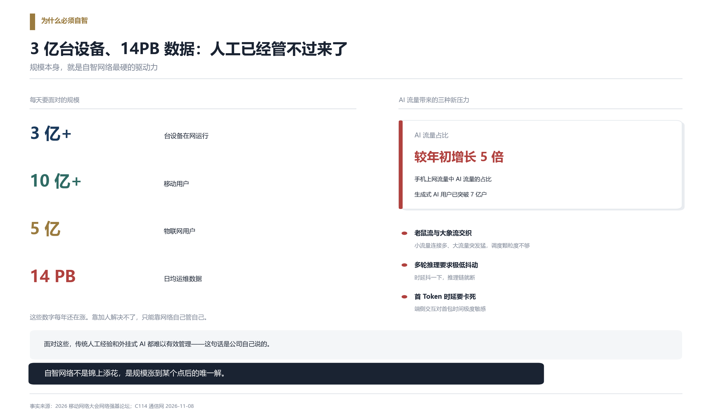

# 21 个场景全网推广、17 个试点突破：自智网络的 L4 是怎么爬上去的

2026 年 11 月 6 日，广州，移动网络大会的网络强基论坛。

中国移动副总经理李慧镝在台上说了一句话：随着 AI 与网络结合越来越深，网络运营的挑战已经不只是优化某台设备、某个环节，而是如何统筹网络资源、业务需求和多域协同。

这句话听起来有点抽象，但翻译成具体场景就很清楚：一张每天有 3 亿台设备在跑、服务十几亿用户、产生 14PB 运维数据的网络，靠人盯是盯不过来的。

自智网络要解决的，就是这个"盯不过来"。

## 先看进度：21 和 17

论坛上披露的进度数据很具体：

**21 个** L4 高价值自智场景完成**全网规模推广**。

**17 个**场景实现 **L4 试点突破**。

年底目标：推动 **38 个**场景达到 L4。

这三个数字的关系值得算一下：21 加 17 正好 38。也就是说，年底目标的组成是"已经推广的"加"还在试点的"——后者要在剩下几个月里全部转正。

这个结构本身说明了一件事：**L4 的门槛不只是"能不能做到"，还有"能不能全网复制"。**

一个场景在某个省跑通了，算试点突破；要在所有省公司都跑起来，才算全网推广。中间这道坎，往往比技术攻关还难过——不同省份的网络结构、业务量、历史包袱都不一样，一套方案在一地能用，换一地可能要重做适配。

所以 21 和 17 这两个数，看着只是场景数量，实际上标的是两种完成度。

## 效果：几个可以直接量出来的数

自智网络容易讲成虚的，但这个论坛给了几个具体的数。

**重点业务开通效率提升 72%。** 开通是企业客户最敏感的事——签了合同、多久能真正用上。这个指标提上去，直接改善的是客户体验。

**跨域故障管理场景，智能体交互准确率提升到 95% 以上，故障处理从周级缩短到天级，每年挽回流量损失 880TB。**

这条最值得一提。"从周级到天级"是一个数量级的变化，而且是跨域——跨域的意思是故障不在一个专业、一个系统里，要多个部门联动才能定位。这正是过去最耗人的地方。

**SPN 专线投诉处理，自动化诊断成功率 90%，平均处理时长下降 26%。**

**家庭宽带质量主动修复年均超 400 万次，网络质量满意度同比提升约 11%。**

这四组数字凑在一起，指向同一件事：自智网络的价值不在于"AI 多聪明"，而在于把原来按周算的事，变成按天甚至按分钟算。

## 为什么"三化"是这么排的

论坛上李慧镝给出的方法论是"三化"：业务本体化、应用智能化、演进自主化。

三个词听起来并列，其实是递进的。

**第一层是业务本体化——让 AI 看得懂。**

现网的问题很具体：业务由跨专业、多厂家的系统共同承载，网络对象和规则分散，名称标识、统计口径都不统一。AI 面对这种网络，就像一个人拿到了图纸但看不懂图例。

所以第一步是构建一套 AI 可理解、可推理、可执行的统一业务语义体系——把网络对象、能力、知识、规则统一关联起来。用论坛上的比喻：这是给 AI 编一本网络的词典和语法。

**第二层是应用智能化——让 AI 能协同。**

业务目标的实现，往往要多个流程动作、多个系统联动。而现有应用大多靠预设流程和固定接口，一旦业务需求或网络状态变了，就得人工介入。

所以第二步是把 AI 从"单点环节智能"往"端到端流程智能、跨域跨系统协同智能"推。分三层：环节智能、流程智能、体系智能。

**第三层是演进自主化——让 AI 会进化。**

大规模应用跑起来之后，会产生海量的执行经验和多智能体交互记录。这些经验如果沉淀不下来，下次遇到同类问题还得从头来。

所以第三步是建立可量化、可追溯的自主演进机制，把经验变成知识、策略、技能，让本体、模型、智能体持续迭代。

三层是咬合的关系：没有本体，AI 读不懂网络；读不懂，就谈不上跨域协同；不能协同，经验也沉淀不下来。

## L4 到底意味着什么

顺带说清一件事：L1 到 L5 这个分级，是按"人介入的程度"划的。

L1、L2 是辅助——系统给建议，人做决定。L3 是条件自治——在限定场景下系统能自己做，人只在异常时接管。

L4 的门槛在于：在特定场景下，系统能自主完成"感知—分析—决策—执行"的全过程，人不需要介入，只需要监督。

这个差别在运维上的体现很直接。L3 时代，一个故障告警出来，系统的角色是"帮你定位"，最终要不要重启板卡、要不要切链路，还得人拍板。L4 时代，系统自己判断、自己动手，人事后看记录。

从"人拍板"到"系统拍板"，中间要跨过的不只是算法精度，还有三样东西：

**一是可解释。** 系统做了决定，人要能看懂为什么。否则出了事故无法复盘。

**二是可回滚。** 系统自己动手，万一手错了，要能退回去。这要求网络本身有足够的冗余。

**三是可授权。** 哪些场景允许系统全自动，哪些必须留人，这条边界得先划清楚。

三样凑齐，才敢把"拍板权"交出去。这也是为什么自智网络喊了几年，真正的 L4 场景数量还是有限的——不是技术做不到，是敢不敢的问题。

## 横在 L3 与 L4 之间的到底是什么
这里有个行业背景需要交代。

按 TM Forum 的调研（对 80 家运营商），20% 预计 2027 年前达到 L4 或以上，81% 把 2030 年设为目标节点。自智网络的产业参与者，从 2019 年的 7 家增加到 2026 年的近百家。

但共识容易，路径难。多数运营商的自智实践还停在"单点智能"：AI 能辅助定位一类故障、优化一类参数，却难以理解整张网络的业务逻辑，更难支撑跨域、跨专业的端到端闭环。

换句话说，横在 L3 和 L4 之间的不是算法问题，是系统方法问题——怎么让 AI 读懂网络、管好网络、并持续进化。

"三化"就是针对这个缺口提出的。它是不是唯一答案不好说，但至少给出了一条从"做什么"到"怎么做"的路径。

## 规模：为什么必须自智

再回到最开始那个数字组合。

3 亿台设备、10 亿多移动用户、5 亿物联网用户、日均 14PB 运维数据——这套规模下，靠加人已经没有意义了。

而且规模还在变复杂。论坛披露了一个新变量：手机上网流量中，AI 流量的占比已较年初增长五倍。同时，生成式 AI 用户已突破 7 亿户。

AI 流量和传统流量的性质不一样。传统流量是"老鼠流"与"大象流"交织——大量小连接加大流量突发；而 AI 流量除了这个，还要承受多轮推理带来的极低抖动要求，以及端侧实时交互对首 Token 时延的严苛考验。

三种压力叠在一起，人工配置参数的方式彻底失效。

所以自智网络不是一个"更先进"的选择，而是规模涨到某个点之后的唯一解。

## 落到：能力开始外溢

论坛还有一件事：《中国移动自智网络白皮书（2026版）》发布，里面有三项产业倡议，其中一项是向海外自智网络市场延伸。

公开报道提到，每年有近 20 家运营商与中国移动交流自智网络，这次论坛请来的四家海外运营商，都在会上提到"学习"和"借鉴"。印尼一家服务超 7300 万用户的运营商，通过网络数字化运营使事故总量同比下降 32%。

这条线索和前面的技术内容不一样——它说明自智能力已经不只是内部降本工具，正在变成可以对外输出的产品。

对一家运营商来说，这种转变意义不小：过去卖的是连接，现在开始卖方法论。

至于 38 个场景能不能在年底全部达标，四季度末会有答案。但比数字更重要的是那个方向：网络正在从"人管"变成"网管网"。

---

*事实来源：2026 移动网络大会（MobileLink 2026，2026-11-05 至 07，广州）期间举办"网络强基论坛"，中国移动副总经理李慧镝出席并致辞，提出以业务本体化、应用智能化、演进自主化为方向牵引，加速自智网络向更高阶演进；《中国移动自智网络白皮书（2026版）》正式发布，阐释"四要素一闭环"总体规划、"五个以"落地方法与"三化"技术发展策略，并倡议产业向"人工智能+信息通信"深度延伸、向新一代通信网演进延伸、向海外自智网络市场延伸。规模数据：每天超过 3 亿台设备在网运行，服务超 10 亿移动用户、宽带联网用户和 5 亿物联网用户，日均产生 14PB 运维数据；手机上网流量中 AI 流量占比已较年初增长五倍；生成式 AI 用户突破 7 亿户。进度：21 个 L4 高价值自智场景完成全网规模推广，17 个场景实现 L4 试点突破，重点业务开通效率提升 72%，今年底目标推动 38 个场景达到 L4。标准与评测：累计主导行业及国际标准 230 项，标准贡献量居全球运营商第一；TM Forum 全部 13 个自智网络场景评估中 12 个场景位列全球第一；获国际及行业奖项超 20 项。案例：A2A-T 通信智能体交互协议全球首发并在多地试点；跨域故障管理场景智能体交互准确率提升至 95% 以上，故障处理从周级缩短至天级，每年挽回流量损失 880TB；SPN 专线投诉处理自动化诊断成功率 90%，投诉平均处理时长下降 26%；远程调优支撑家庭宽带质量主动修复年均超 400 万次，网络质量满意度同比提升约 11%；面向生成式 AI 用户，借数字孪生与 GSRv6 使业务访问时延降低 15%、丢包率减少 41%。行业参照（TM Forum）：自智网络产业参与者从 2019 年 7 家增至 2026 年近百家；对 80 家运营商调研，20% 预计 2027 年前达到 AN L4 或以上，81% 将 2030 年设为目标节点。海外：每年有近 20 家运营商交流，本次论坛邀请四家海外运营商；印尼 XLSMART 服务超 7300 万用户，网络事故总量同比下降 32%。据 C114 通信网 2026-11-08《2026移动网络大会观察："三化"牵引，中国移动给出自智网络高阶演进方法论》（蒋均牧）、人民邮电报 2026-11-07、光互连 2026-11 对白皮书的报道。*

*需说明四点。其一，本文"21 + 17 = 38，后者须在几个月内转正"为据三组数字所作的推断，公司未明确说明 38 个场景是否等于 21 与 17 之和，也可能存在新增场景，引用时请注意这一不确定性。其二，"从周级到天级是数量级变化""L4 门槛在于全网复制"等为作者分析，不代表公司观点。其三，文中效果数据（72%、95%、880TB、26%、400 万次、11%）均为公司在论坛上披露的口径，未见第三方审计或独立评测，本文照引未作验证。其四，"三化"三层递进关系的表述（没有本体就没有协同、没有协同就沉淀不下来）为作者对三者逻辑关系的解读，公司原话为并列提出三个方向。*
