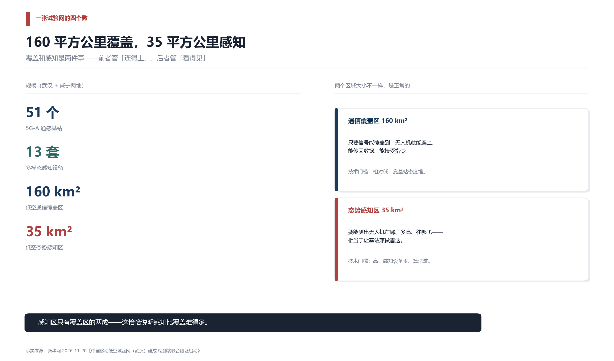
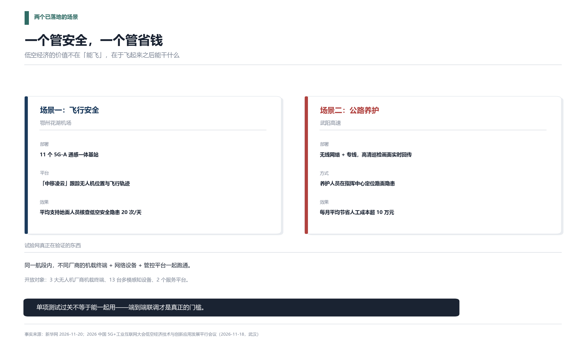
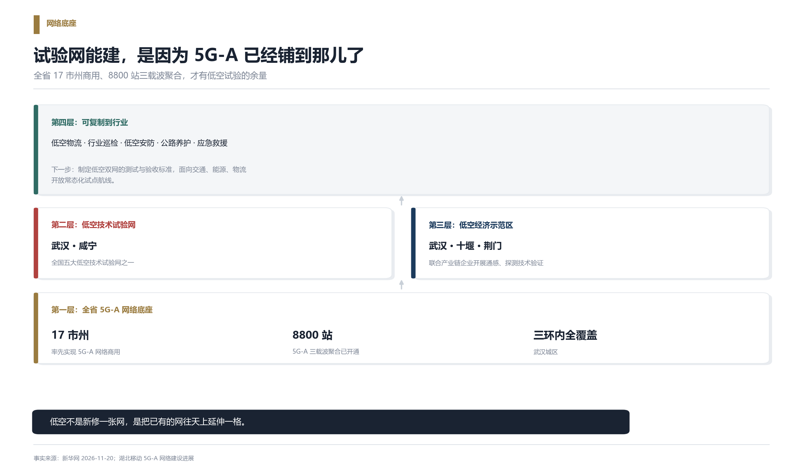

# 160 平方公里低空覆盖、35 平方公里感知区：一张试验网在试什么

2026 年 11 月 18 日，武汉，中国 5G+工业互联网大会低空经济平行会议。

中国移动湖北公司与中信科移动联合发布"中国移动低空试验网（武汉）"的建设成果。发布会的措辞很克制：推动低空终端、网络与平台从单项测试迈入端到端联合验证阶段。

"从单项测试到端到端联合验证"——这十几个字，是这篇要讲的全部。

## 四个数：覆盖和感知是两件事

发布的数据有四个：

**51 个** 5G-A 通感基站。
**13 套**多模态感知设备。
**160 平方公里**低空通信覆盖区。
**35 平方公里**低空态势感知区。

前两个是设备数，后两个是面积。

很多人会把后两个混为一谈，其实它们完全是两回事。

**通信覆盖**的意思是：信号能到那儿。无人机飞到 160 平方公里里的任何位置，都能连上网、能传回数据、能接受指令。

**态势感知**的意思是：网络知道你在那儿。不仅要能连上，还要能测出你的位置、高度、航向、速度。

前者只需要基站密度够，后者要求基站具备雷达功能——这就是 5G-A 通感一体的价值。

35 比 160 小了将近八成。这个比例不是建设进度落后，而是技术难度的真实写照：覆盖靠堆站就能做，感知要额外的射频通道和算法，每扩大一平方公里都要花钱。

## 试验网真正在验证什么

如果只是建 51 个基站，这不叫"试验网"。

试验网的价值在于：**它提供了一个让不同厂商的设备一起跑的环境。**

发布会说得很清楚：产业伙伴可在同一航段内完成不同厂商机载终端、网络设备、管控平台的协同测试。

这句话背后是一个很现实的行业痛点。

低空经济这条产业链上，至少有三类玩家：造无人机的、造网络设备的、做管控平台的。每个厂商的单品测试都能过，但把甲方的飞机、乙方的基站、丙方的平台放到同一条航线上，问题就出来了——协议能不能对得上、数据格式是不是一致、出问题时责任归谁。

这类问题在实验室里测不出来，只能在实际航线上跑。

所以这张试验网开放了三类对象：3 大主流无人机厂商的机载终端、13 台多模感知设备、2 个服务平台。

输出物也很明确：低空物流、行业巡检、低空安防等场景的**设备选型标准与网络优化方案**。

选型标准这四个字，分量比听起来重。它意味着试验的结果不只是"我们验证成功了"，而是要变成别人采购时能直接照着用的规范。

## 通感一体到底怎么做到的

多说一句技术原理，因为这决定了低空网络的成本结构。

雷达和通信本来是两套系统。雷达发一个脉冲，等回波，靠时间差算距离、靠多普勒频移算速度。通信是发数据、收数据。

5G-A 的通感一体，是让同一套射频设备同时干这两件事——发出去的是通信信号，但信号的反射回波也能被接收端解析出来，从而反推出目标的位置和运动。

好处很明显：不用另建一套雷达网，用现有的基站就能"看见"天空。

坏处也很明显：通信信号是为传输数据优化的，不是为探测优化的。用它做雷达，探测精度、刷新率、抗干扰能力都受限。

这解释了为什么感知区只有 35 平方公里——不是不想做大，是用通信信号做感知的物理上限就在那里。

也解释了为什么还要额外配 13 套多模态感知设备：单一手段不够，得靠多传感器融合。

## 两个已经落地的场景

试验网不是空转的，已经跑出了两个具体场景。

**场景一：飞行安全。**

在鄂州花湖机场部署了 11 个 5G-A 通感一体基站，通过"中移凌云"平台跟踪无人机的位置和飞行轨迹。效果是：平均支持地面人员及时核查低空安全隐患 20 次/天。

这个数字看着不大，但要想清楚它替代的是什么——没有这套系统之前，机场周边的低空安全主要靠人盯和举报，一天能有几次有效核查已经不错。

**场景二：公路养护。**

在武阳高速，通过无线网络和专线把高清巡检画面实时传回管理指挥中心，养护人员在指挥中心定位路面隐患。效果是：每月平均节省人工成本超 10 万元。

这个场景和无人机关系不大，本质上是"移动视频回传"。但它验证了同一件事：低空网络的价值不止于飞行，还在于把视角抬高之后带来的作业方式改变。

## 底座：为什么是湖北

一个省能建成低空试验网，前提是它的 5G-A 底子够厚。

发布会给了三个数：湖北移动率先实现全省 17 市州 5G-A 网络商用；5G-A 三载波聚合已在全省开通 8800 站；武汉三环内实现全面覆盖。

三个数说明的是同一件事：低空的试验不是另起炉灶，而是在已有的 5G-A 网络上"往上加一层"。

基站的位置、供电、回传，全都是现成的。要加的只是通感能力和低空的算法。

这也解释了为什么低空经济能这么快铺开——它不是一项从零开始的新基建，而是现有网络的延伸。对运营商来说，边际成本比想象中低。

## 两个需要注意的判断

发布会有两句话，比数据更值得记下来。

第一句是湖北移动副总经理刘建说的：低空智联网建设要以飞行安全和行业作业需求为依据。

这句话是在给"低空经济"降温。市面上很多讨论是从技术出发的——能飞多远、能载多重。但真正的约束是安全：空域怎么管、出了事谁负责、怎么保证不撞。

第二句：网络覆盖是否连续、感知是否准确，需要在实际航线上验证。

"连续"和"准确"这两个词，是低空网络最难的部分。地面网络允许有盲区，人走到没信号的地方可以换个位置；无人机在天上，一旦链路断了，后果不是"打不了电话"。

所以低空网络对连续性的要求，比地面网络高一个量级。

## 为什么要把网开放给竞争对手

有一点容易被忽略：这张试验网是**对产业伙伴开放**的，包括 3 家主流无人机厂商。

按常理，自己花钱建的网，为什么要开放给别人测？

因为低空经济现在的瓶颈不在网络这一侧。

如果只有网络，没有终端、没有平台、没有应用，这张网就是个空壳——建得再好也没人用。运营商真正需要的不是"我的网最好"，而是"这条产业链尽快跑起来"。

这也是运营商在产业链里的特殊位置决定的。它既不造无人机，也不做飞控软件，它提供的是"连接和感知"这个公共层。公共层的价值，取决于上面跑的东西多不多。

所以开放测试是理性的选择：短期看是让别人白用，长期看是在给整条链加速。

类似的逻辑在 5G 时代已经上演过一次——当年运营商联合厂商建各种行业试验网，本质上是同一个思路。

## 落到：标准才是真正的产出

往后看，这张试验网最值得关注的不是那 51 个基站。

发布会末尾提到下一步：作为湖北省通信学会低空经济专委会首届主任委员单位，将联合产业伙伴制定低空双网的测试与验收标准，面向交通、能源、物流等行业开放常态化试点航线。

"测试与验收标准"——这才是核心产出。

低空经济现在最大的问题是碎片化：每个地方建一套、每个厂商用自己的协议、每个项目单独验收。这种状态下，规模起不来，成本降不下去。

谁能把标准定下来，谁就在这条产业链上占据了上游位置。

从这个角度看，160 平方公里和 35 平方公里，只是这场标准之争的入场券。

---

*事实来源：2026 年 11 月 18 日，2026 中国 5G+工业互联网大会低空经济技术与创新应用发展平行会议在武汉举行，中国移动湖北公司与中信科移动联合发布"中国移动低空试验网（武汉）"建设成果，推动低空终端、网络与平台从单项测试迈入端到端联合验证阶段。该试验网是中国移动全国五大低空技术试验网之一，覆盖武汉、咸宁两地；累计部署 51 个 5G-A 通感基站、13 套多模态感知设备，形成 160 平方公里低空通信覆盖区、35 平方公里低空态势感知区；为 3 大主流无人机厂商的机载终端、13 台多模感知设备、2 个服务平台提供联合测试条件；输出低空物流、行业巡检、低空安防等场景的设备选型标准与网络优化方案。在鄂州花湖机场部署 11 个 5G-A 通感一体基站，通过"中移凌云"平台跟踪无人机位置和飞行轨迹，平均支持地面人员及时核查低空安全隐患 20 次/天；在武阳高速通过无线网络和专线将高清巡检画面实时传回管理指挥中心，每月平均节省人工成本超 10 万元。湖北移动率先实现全省 17 市州 5G-A 网络商用，5G-A 三载波聚合已在全省开通 8800 站，武汉三环内实现全面覆盖，并在武汉、十堰、荆门等地打造 5G-A 低空经济示范区。湖北移动副总经理刘建表示，低空智联网建设要以飞行安全和行业作业需求为依据，网络覆盖是否连续、感知是否准确需要在实际航线上验证；后续将联合产业伙伴制定低空双网的测试与验收标准，面向交通、能源、物流等行业开放常态化试点航线。据新华网 2026-11-20《中国移动低空试验网（武汉）建成 端到端联合验证启动》。*

*需说明四点。其一，"35 比 160 小了将近八成"为本文据两个面积数所作的比较，二者定义不同（通信覆盖区与态势感知区），不宜理解为建设进度比率；"感知每扩大一平方公里都要花钱"为作者对技术难度的判断，公司未披露单位建设成本。其二，"机场周边低空安全此前主要靠人盯和举报"为一般性描述，未指向具体单位或具体时段，公司未就核查 20 次/天这一指标披露改造前的对照数据。其三，"低空网络对连续性要求比地面网络高一个量级"为作者分析，公司表述为"覆盖是否连续、感知是否准确需在实际航线上验证"。其四，"标准是真正的产出""谁定标准谁占上游"为作者判断；公司披露的下一步为"制定低空双网的测试与验收标准"，尚未公布标准的具体内容与发布时间表。*
