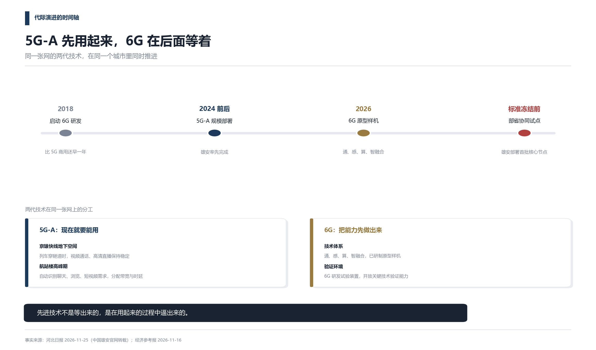
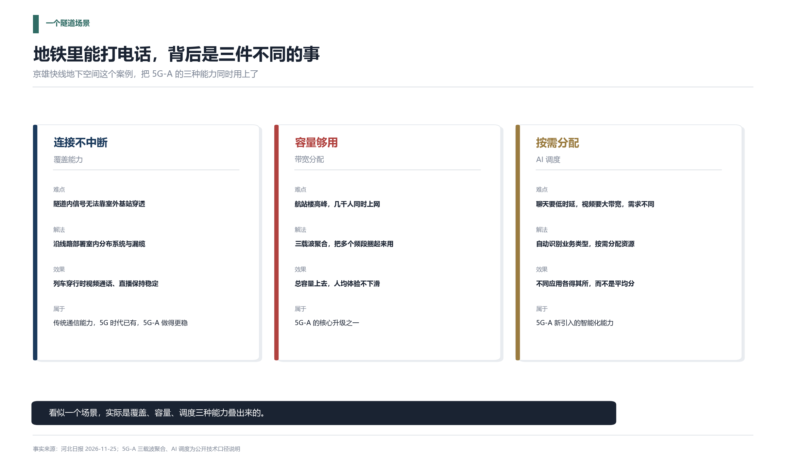
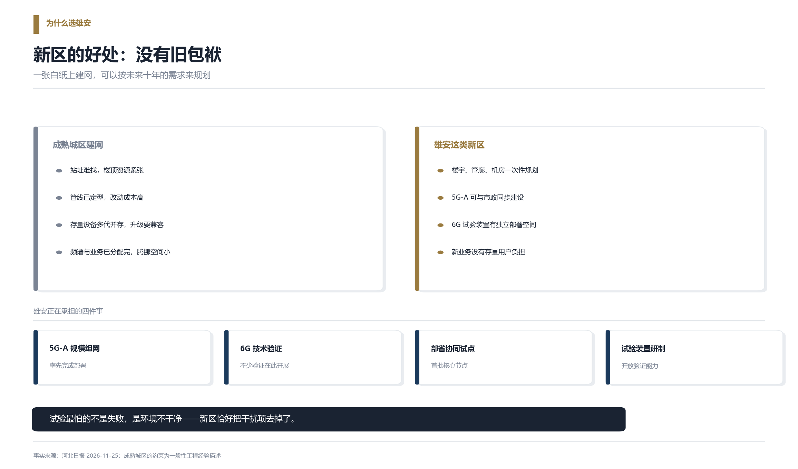

# 雄安这条路径：5G-A 先用起来，6G 在后面等着

2026 年 11 月 18 日上午，雄安，中国移动智慧城市科创中心的机房里，技术人员在调试环境——为 6G 创新发展部省协同试点做首批核心节点部署准备。

同一天，京雄快线航站楼的地下空间里，5G-A 网络已经在跑：列车穿行隧道时，手机视频通话、高清直播还能保持稳定；到了客流高峰，网络能自动识别乘客是在聊微信、刷网页还是看短视频，按不同需求分配带宽和时延。

一个是六年后的技术，一个是眼下就在用的技术，在同一个城市里同时推进。

这条路径值得单独讲一讲。

## 一颗"提前种下的种子"

中国移动启动 6G 研发的时间是 2018 年。

这一年，5G 还没正式商用（首个 5G 标准在 2018 年 6 月冻结，规模商用要到 2019 年）。也就是说，5G 还没开始赚钱，就已经在为 6G 做准备了。

这个时间差不是激进，是通信行业的规律。一代移动通信技术的生命周期大约十年，从研发到商用通常要七八年。如果等到 5G 见顶了再启动 6G，那时已经晚了。

到 2026 年，中国移动构建起通、感、算、智融合的 6G 技术体系，研制出原型样机，不少技术验证都放在雄安开展。

中国工程院院士、中国移动总工程师王晓云对 6G 的定位说得比较克制：6G 将成为智能时代的新型网络底座，将提供更强的连接服务以及超越连接服务。

"超越连接服务"这六个字是关键。5G 的价值基本还在"连接"范畴内——更快的速率、更低的时延、更多的连接数。6G 要提供的是连接之外的东西：感知、算力、智能。

## 5G-A 为什么是必经之路

那么，为什么不能跳过 5G-A 直接上 6G？

因为技术不能空转。

5G-A（也叫 5.5G）在 5G 基础上引入了通感一体、AI 智能调度等能力。这些能力，恰好是 6G 要用的核心组件。

说白了：6G 想做的"通感一体""通智一体"，在 5G-A 上先做一遍，验证可行、暴露问题、把成本降下来。等 6G 商用时，这些不是从零开始。

雄安这个案例恰好展示了这种"预演"。

**连接不中断**，靠的是隧道内沿线路部署的室内分布系统和漏缆。这是传统覆盖能力，5G 时代就有，5G-A 做得更稳。

**容量够用**，靠的是三载波聚合——把多个频段捆起来同时用，总容量上去。这是 5G-A 的核心升级之一。

**按需分配**，靠的是网络自动识别业务类型，给聊天分配低时延、给视频分配大带宽。这是 5G-A 新引入的智能化能力，也是 6G"通智一体"的雏形。

三件事叠在一起，用户在隧道里感受到的只是"能打电话、能看视频"。但背后是三种不同的技术在协同。

这也是通信行业的一个特点：用户感知到的是最简单的部分，复杂度全藏在网络里。

## 6G 在雄安验证什么

按公开信息，6G 新引入的技术方向包括通信与 AI 融合、通信与感知融合、星地融合。

这三个方向，恰好对应前面说的"超越连接"。

**通信与 AI 融合**：网络自己会优化。这需要把 AI 放到无线接入网和终端里，而不是外挂一层。

**通信与感知融合**：基站兼做雷达。这在 5G-A 的通感一体上已经开始验证。

**星地融合**：地面网和卫星网统一组网。前面讲过的天启星座、手机直连卫星，都是这条线。

三个方向都还在早期，但都需要一个真实的城市环境来做验证——实验室里跑出来的结果，和真实网络里跑出来的，往往不是一回事。

雄安提供的就是这个环境。

## 一张表看清 5G 与 6G 的边界

把几代技术的关键能力摆在一起，能看出 6G 到底在哪些维度上"越界"。

**速率这一维，提升有限。** 5G 的理论峰值已经到 20Gbps，6G 的公开验证数据是 U6GHz 单载波 18Gbps——同一个数量级。也就是说，单纯比"快"，6G 相对 5G 的跃升不像 4G 到 5G 那么夸张。

**覆盖这一维，变化很大。** 5G 的覆盖基本止于地面；6G 要把卫星、高空平台一起纳进来，覆盖从"面"变成"体"。

**感知这一维，是全新的。** 5G 的基站只管通信；6G 的基站还要管"看见东西"。这一维在 5G 时代是零。

**智能这一维，也是新的。** 5G 的 AI 是外挂的辅助工具；6G 要把 AI 放进网络本体里。

**服务对象这一维，扩了一级。** 5G 服务人和物；6G 要服务智能体——这是信通院杜滢的概括，服务对象从人机物扩展到智能体。

五个维度摆开，6G 的真正野心就清楚了：它的重点在**把网络从"传输工具"变成"感知与智能的载体"**，而不是把速率再提几倍。

这也就解释了为什么 5G-A 是必经之路——通感一体、通智一体这两件事，在 5G-A 上先做半步，6G 才不会从零起步。

## 为什么是雄安

新建城区有一个成熟城市没有的优势：**没有旧包袱**。

在成熟城区建网，要面对这些：站址难找、楼顶资源紧张；管线已经定型，改动成本高；存量设备多代并存，升级要考虑兼容；频谱和业务已经分配完，腾挪空间小。

在一个新区，这些约束少很多。楼宇、管廊、机房是一次性规划的，5G-A 可以和市政同步建设，6G 试验装置有独立的部署空间，新业务也没有存量用户负担。

对技术验证来说，"环境干净"这件事的价值经常被低估。

一个实验如果在复杂环境里做，即使成功了，也说不清是哪一项改进起了作用；如果失败了，也难定位原因。而新区提供的近似受控环境，能让变量更少、结论更硬。

所以雄安承担的不是"示范"角色，而是"试验场"角色。示范区是为了给人看，试验场是为了把问题找出来。

目前雄安在做的至少四件事：5G-A 规模组网、6G 技术验证、部省协同试点、试验装置研制。

## 试验装置为什么要开放

材料里有一句容易被跳过的话：中国移动研制 6G 研发试验装置，开放 6G 关键技术验证能力，吸纳合作伙伴参与共创、共试。

"开放验证能力"这五个字，是 6G 这场竞赛里比较特殊的一个安排。

通常的技术竞赛里，试验装置是核心资产，不轻易示人。为什么 6G 要反过来开放？

因为 6G 涉及的产业链太长了。

从芯片、终端、基站、核心网，到卫星、感知器件、行业应用，任何一家公司都不可能全包。如果验证装置只自己用，那产业链上的其他环节就无从验证——终端厂商没有网可以测，应用厂商没有网可以试。

结果就是：标准冻结时，只有少数几家的产品能对接上，整个产业的上量会被拖慢。

所以开放验证装置，本质是在给整条产业链提前"校准"。让更多人提前把产品对准同一个技术方向，等标准一冻结，大家能立刻上量。

这也是为什么雄安要同时做两件事：一边部署 5G-A 商用网络，一边建设 6G 试验装置。前者是当下的收入，后者是未来的位置。

## 落到：这条路径的启示

回到开头那两件事。

一边是地铁隧道里能视频通话，一边是在机房里为 6G 核心节点调试环境。它们不是两件不相干的事，而是同一件事的现在和未来。

这条路径的逻辑可以概括成三句话：

**第一，技术要靠场景养。** 5G-A 的能力不写在纸上，写在地铁、机场、高速这些真实场景里。场景跑得越多，技术越成熟。

**第二，代际不能跳。** 6G 的"通感一体""通智一体"，都得先在 5G-A 上验证过。跳过 5G-A 直接做 6G，等于把风险留到最后。

**第三，试验需要干净的环境。** 新区、试验网、专线航线，本质都是同一个思路——把干扰项去掉，让结论可归因。

对一家运营商来说，这种"边用边研"的能力，可能比某一代技术本身更重要。因为一代技术总有被替代的时候，而把技术养成熟的方法论，可以一直用下去。

---

*事实来源：2026 年 11 月 25 日河北日报（中国雄安官网转载）：中国移动在雄安率先完成 5G-A 技术的规模组网部署，为 6G 演进探路；京雄快线航站楼地下空间已部署 5G-A 网络，列车穿行隧道时手机视频通话、高清直播等仍能保持信号稳定，航站楼客流高峰期 5G-A 网络能自动识别乘客正在使用的微信聊天、网页浏览、短视频观看等网络需求并按不同业务需要分配带宽和时延资源；自 2018 年起中国移动率先启动 6G 研发，组织带动产学研用各方开展协同创新，构建起通、感、算、智融合的 6G 技术体系，成功研制业界领先的 6G 原型样机，其中不少技术验证在雄安开展；中国工程院院士、中国移动总工程师王晓云表示，6G 将成为智能时代的新型网络底座，将提供更强的连接服务以及超越连接服务；中国移动已牵头建立信息产业协同创新基地和高校联合研发载体，研制 6G 研发试验装置，开放 6G 关键技术验证能力；雄安新区正在为 6G 创新发展部省协同试点做首批核心节点部署准备。同期对照：经济参考报 2026-11-16 报道 6G 新引入通信与 AI 融合、通信与感知融合、星地融合等新技术新场景，服务对象从人机物扩展到智能体；2026 年 11 月中国移动披露 6G 实验在 U6GHz 特定波段实现单载波 18Gbps 下载速率。*

*需说明四点。其一，"5G-A 的能力在 6G 上复用""代际不能跳"等为本文据技术演进逻辑所作的分析，公司未以这种方式表述 5G-A 与 6G 的关系；公司口径为"5G-A 技术是 5G 向 6G 演进的关键技术路径，也是 6G 关键技术先行验证的承载网络"。其二，图中"2024 前后 5G-A 规模部署"的时间点为本文据公开信息所作的大致标注，公司未披露雄安 5G-A 规模组网的具体完成日期。其三，"成熟城区建网的四种约束"为一般性工程经验描述，未指向具体城市或具体项目的数据。其四，"试验场角色"与"示范区角色"的区分、"新区提供近似受控环境"为作者分析；公司对雄安定位的表述为"为 6G 演进探路""不少技术验证在雄安开展"。*
