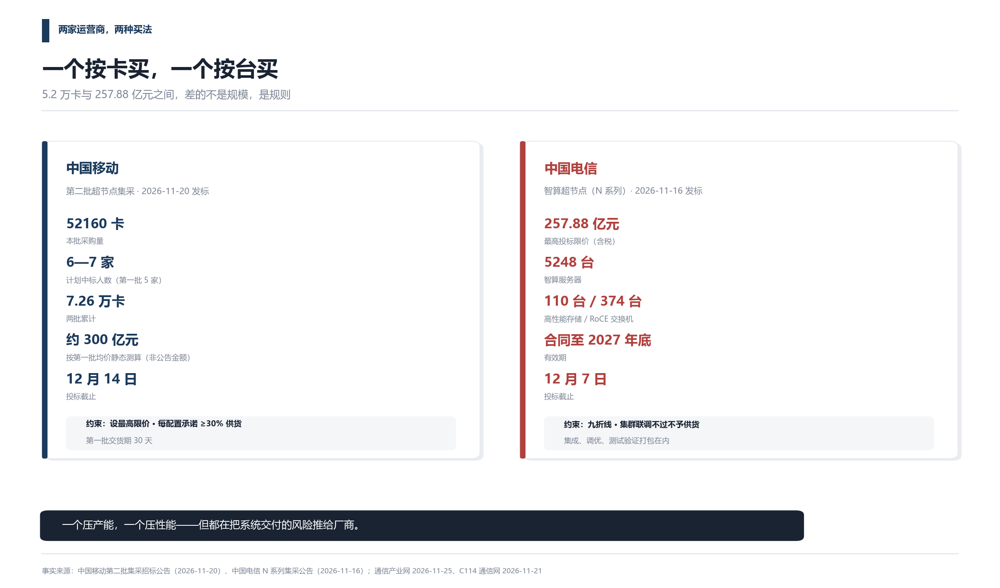
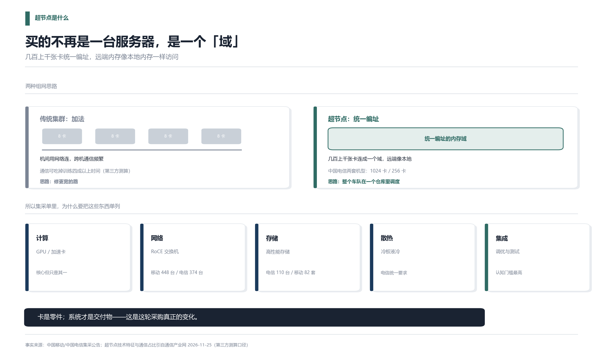
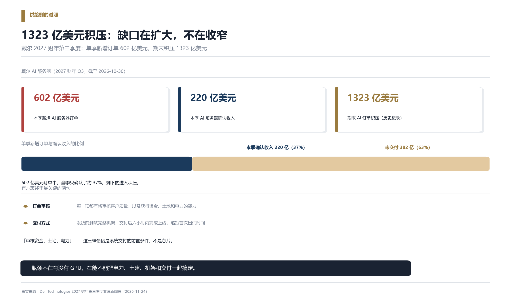

# 5.2 万卡、257.88 亿、1323 亿美元：算力的瓶颈，换了地方

11 月 20 日，中国移动发布第二批新一代 AI 超节点集采公告：合计 52160 卡，不划分标包，计划选 6—7 家中标人，投标截止 12 月 14 日。

4 天前，11 月 16 日，中国电信也发了公告：2026 年智算超节点（N 系列）集采，最高投标限价 257.88 亿元（含税），采购智算服务器 5248 台，另配 110 台高性能存储、374 台 RoCE 交换机，合同延续到 2027 年底。

两笔单子前后相距 4 天，规模都创了纪录。

再往西看半个地球，11 月 24 日，戴尔公布 2027 财年第三季度业绩：单季新增 AI 服务器订单 602 亿美元，确认收入 220 亿美元，期末 AI 订单积压冲到 1323 亿美元——历史纪录。

三件事放在一起看，指向同一个结论：**算力扩张的瓶颈，已经不在"有没有 GPU"上了。**

## 先看清这两笔单子的规则

数字之外，更值得看的是条款。两家运营商把系统交付的风险，用不同的方式压到了厂商身上。

**中国移动压的是产能。**

第一批 9 月底发标、10 月底公示，20480 卡，5 家中标，报价集中在 115.99 亿—117.02 亿元（不含税），平均单卡约 57 万元，交货期 30 天。

第二批直接把量拉到 52160 卡，中标人从 5 家扩到 6—7 家，公告设最高投标限价，超限直接废标；还要求每家对每个配置承诺至少 30% 的供货量。

三条合起来指向同一件事：先保证交得出。扩中标人是为了让更多整机厂分担产能，设限价是不让价格跑偏，30% 承诺是让厂商先证明自己能供上三成。

**中国电信压的是性能。**

它用份额规则逼价格：第二名评标价低于第一名九折时，份额改成 60% 和 40%——第一名报价比第二名高出太多，自己就要让出 10 个点。

更硬的一道门槛在标后：中标产品要过中国电信组织的集群联调性能测试，跑不出指标就不予供货，测试成本厂商自担。

标书写得再漂亮，联调跑不起来照样出局。

一个压"能不能按时交"，一个压"交的东西能不能跑"。两种条款，但都是同一件事：系统级交付的不确定性，留在厂商那侧。

顺带提醒一个容易踩的坑。中国移动第一批披露的是**不含税**报价，中国电信这次是**含税**限价。两个数字不能直接加，也不能直接比。很多讨论在这里出了错。

## 30% 供货承诺是什么意思

第二批公告里有一条容易被忽略的条款：每家须对每个配置承诺至少 30% 的供货量。

这句话不是"必须中标 30%"，而是"你要证明自己能供上 30%"。

差别在哪？投标的时候，厂商报的是一个名义产能。但真实交付时，产能往往缩水——上游卡供应不上、产线排期冲突、关键部件缺货，任何一环出问题都会拖累交付。

所以让厂商承诺 30%，本质是在做一个压力测试：你说你能供 5 万卡，那你先证明你能稳定供上其中的三成。

这个条款和第一批的"30 天交货期"是同一套逻辑的延续。

第一批 20480 卡，公示到交付只有 30 天。这个窗口几乎没有留出备产时间，意味着中标厂商手里必须已有现货或准现货。

从 30 天交货，到 30% 供货承诺，采购方在用两个不同的方式问同一个问题：**你到底能不能交出来？**

这在过去的 GPU 采购里很少见。买卡的时候，交期是供应链的事，采购方等就是了；买系统的时候，交付能力本身就是被采购的东西。

## 一个"卡"不等于一台机器
要理解为什么条款要这么设，得先看超节点到底是什么。

传统智算集群的思路是加法：一台服务器装 8 张卡，不够就加机器，机器之间用网络连。卡越多，跨机通信越频繁，等数据的时间越长。按第三方的测算，大模型训练里通信能吃掉四成以上的时间——训练 10 小时，大约 4 小时在等数据。

超节点换了个思路：用高速互联把几百上千张卡连成一个**统一编址的"域"**，访问远端内存像访问自己的内存。过去是修更宽的路，现在是让整个车队在一个仓库里统一调度。

这个转变，直接改变了采购清单的形状。

中国电信这次准备了两套机型：一套撑 1024 卡集群，一套撑 256 卡，统一冷板液冷，网络侧要求 800G RoCE。中国移动第一批配了 448 台无损以太网 RoCE 交换机和 82 套存储（72 套智算、10 套分布式）。

交换机、存储、液冷全都单列——因为超节点不是一台机器，是一套"计算＋网络＋存储＋散热＋集成"的系统。

**买的是系统，验收的也是系统。**

这才是这轮采购真正的变化。过去买 GPU，买的是零件；现在买超节点，买的是把一个集群跑起来的能力。

## 供给侧的答案：缺口在扩大

再看戴尔那份财报，会发现一个更根本的问题。

单季新增订单 602 亿美元，确认收入只有 220 亿美元。也就是说，这 602 亿里，当季只交付了约 37%，剩下的 382 亿进了积压。

期末积压 1323 亿美元，创历史纪录。

这个数字的含义很直接：需求远大于供给，而且缺口还在扩。

更值得注意的是戴尔副董事长兼 COO Jeff Clarke 的两句表述。

第一句：订单"每一项都严格审核客户质量以及获得**资金、土地和电力**的能力"。

请注意这三样。审核的不是客户要不要 GPU，是客户有没有钱、有没有地、有没有电。

这三样，恰恰是系统交付的前置条件。一个吉瓦级的数据中心，地批不下来、电接不进来，买了卡也没地方装。

第二句："我们在发货前测试完整机架，交付后六小时内完成上线，从而缩短首次出词时间。"

这句话把 OEM 的角色说透了——它卖的不只是服务器，而是"从出厂到能跑"的这一段。

## 为什么买方从云厂商扩散到运营商

这轮采购还有一个结构性变化：算力基础设施的买方，正从互联网云厂商向电信运营商扩散。

原因不复杂。云厂商建算力，是按自己的业务节奏走；运营商建算力，是按基础设施的节奏走。

两种节奏对采购的要求完全不同。

云厂商可以自己定标准、自己调优、自己承担集成风险——它有能力做这件事。运营商不太一样：它要买的是"能直接接进自己算力网"的东西，标准要统一、接口要规范、交付要可验收。

所以运营商的采购逻辑天然偏向：**系统集成、集群性能、长期交付**，而不是单卡性能。

这也解释了为什么两家的公告里，交换机、存储、液冷、集成、调优、测试验证全都被写进了标书——它们买的不是一个部件，是一整套可验收的能力。

## 落到：权重在往哪边移

三件事连起来看，能得出几个判断。

**第一，卡不再是稀缺的那一环。** 至少在国内，超节点已经进了集采目录，变成常备品类。从示范项目到常备品类，只用了不到一年。

**第二，稀缺的是"把卡连成一台机器"的能力。** 谁能做整机、做网络、做液冷、做集成，谁就更可能拿到份额。单纯组装服务器的厂商，空间会越来越窄。

**第三，OEM 的权重在上升。** 戴尔的积压订单、它"审核土地和电力"的做法、它"发货前测试完整机架"的流程，都在说明一件事：这个行业里，能把系统交付出去的公司，比能造出好芯片的公司更缺。

对中国移动来说，5.2 万卡这一单的意义，不在卡的数量。

它意味着，算力建设的评价标准正在从"买了多少卡"变成"能不能稳定、便宜、按时地把几千张卡连成一台机器"。

第一批的 30 天交货期，第二批的 30% 供货承诺，都是这个新标准的具体条款。

12 月 14 日开标，届时会有更清楚的答案。

---

*事实来源：中国移动 2026 年至 2027 年新一代人工智能超节点设备（第二批）集中采购项目招标公告（2026-11-20 发布）：采购人工智能超节点合计 52160 卡，不划分标包，计划选取 6—7 家中标人，投标截止 2026-12-14，设最高投标限价，每家须对每个配置承诺至少 30% 的供货量。第一批（2026-09-29 发标、10-28 公示）20480 卡，5 家中标（华鲲振宇、宝德、华启智慧、百信、神州鲲泰），不含税报价集中在 115.99 亿—117.02 亿元，平均单卡约 57 万元，份额 30%/25%/20%/15%/10%，交货期 30 天，配 448 台 RoCE 交换机、82 套存储（72 套智算、10 套分布式）。两批累计 72640 卡；按第一批均价静态测算第二批约 297 亿元，接近 300 亿元（非公告金额）。中国电信 2026 年智算超节点（N 系列）集中采购公告（2026-11-16）：最高投标限价 257.88 亿元（含税），合同有效期至 2027 年底；采购智算服务器 5248 台、高性能存储 110 台、RoCE 交换机 374 台，集成、调优、测试验证打包在内；最多 5 家中标，投标截止 2026-12-07；份额规则为有效投标人 6 家以上时按 30%/25%/20%/15%/10%，2—3 家时按 70%/30%；第二名评标价低于第一名九折时份额改为 60%/40%；中标产品须通过集群联调性能测试，不达标不予供货；两套机型分别支撑 1024 卡与 256 卡集群，统一冷板液冷，网络侧要求 800G RoCE。据通信产业网 2026-11-25《7.26 万卡与 257.88 亿：运营商采超节点，买法变了》（宋鹏超）、C114 通信网 2026-11-21、腾讯新闻/新浪科技 2026-11-21。戴尔科技 2027 财年第三季度业绩新闻稿（2026-11-24，季度截至 2026-10-30）：净营收 549.37 亿美元（同比 +103%）；ISG 营收 419.74 亿美元（同比 +198%），其中 AI 优化服务器营收 220.31 亿美元（同比 +291%）；本季新增 AI 服务器订单 602 亿美元，期末 AI 订单积压 1323 亿美元；全年 FY27 营收指引 2020 亿美元，AI 优化服务器全年指引 780 亿美元；副董事长兼 COO Jeff Clarke 表述为订单"每一项都严格审核客户质量以及获得资金、土地和电力的能力"，以及"我们在发货前测试完整机架，交付后六小时内完成上线，从而缩短首次出词时间"。*

*需说明六点。其一，中国移动第二批的"约 300 亿元"为媒体据第一批不含税均价所作的静态测算，公司未披露本批招标金额，正文与图中均已标注。其二，中国移动第一批为不含税报价、中国电信本次为含税限价，两者口径不同，不可直接相加或比较；文中"257.88 亿元"与"约 300 亿元"分属两个口径，未作合并计算。其三，"通信可吃掉训练四成以上时间"引用自第三方测算口径，非公司披露数据。其四，素材提到的"2027 日历年供需失衡预计超过 2026 年"一句，本文未采用——戴尔官方新闻稿中未见此表述，无法核实出处，故未写入。其五，"卡不再稀缺""OEM 权重上升""运营商买系统不买零件"等为作者分析，非公司或机构表述。其六，本文未对两家运营商的单卡价格作横向比较，也推算中国电信"单台约 491 万元"一类数字，因其含存储、交换机与集成服务，折算会失真。*
